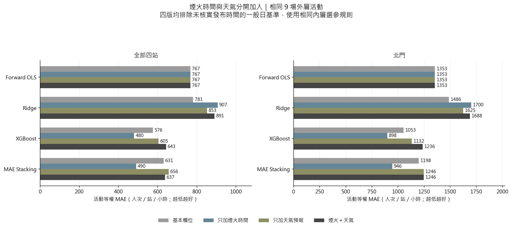
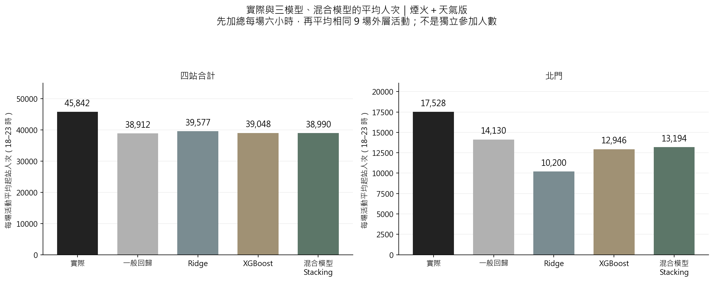
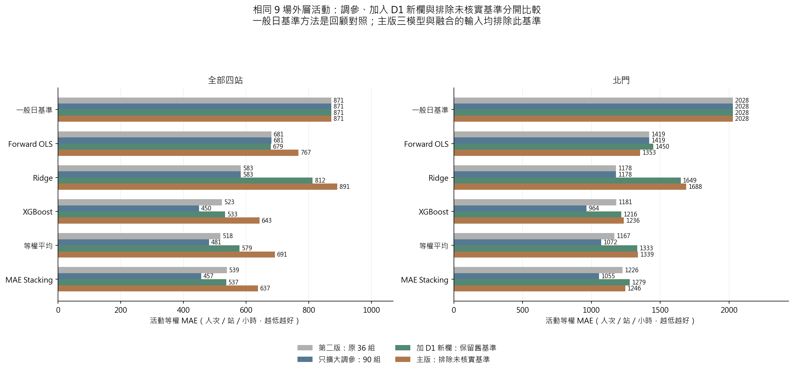
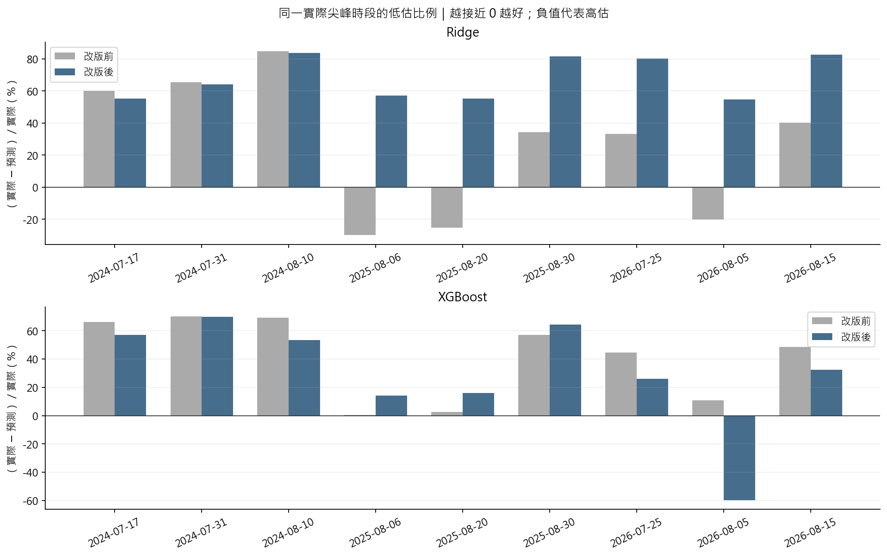
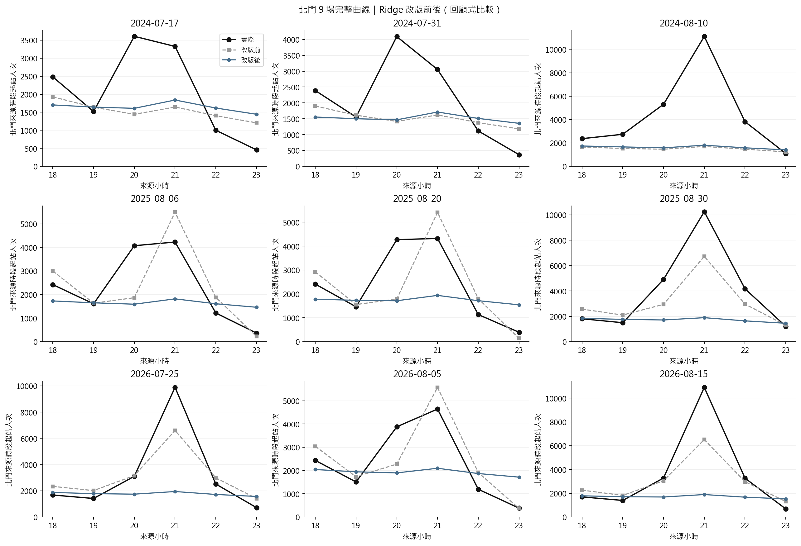
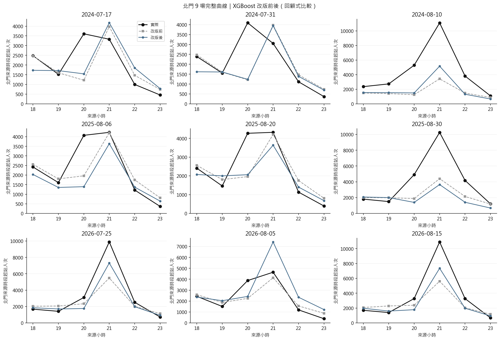
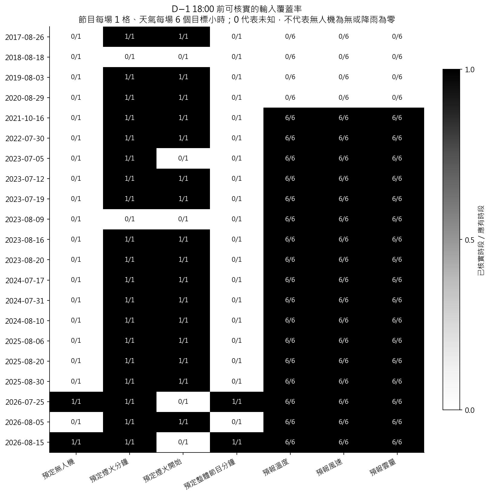
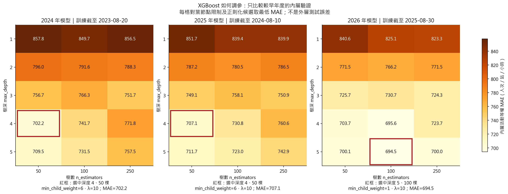
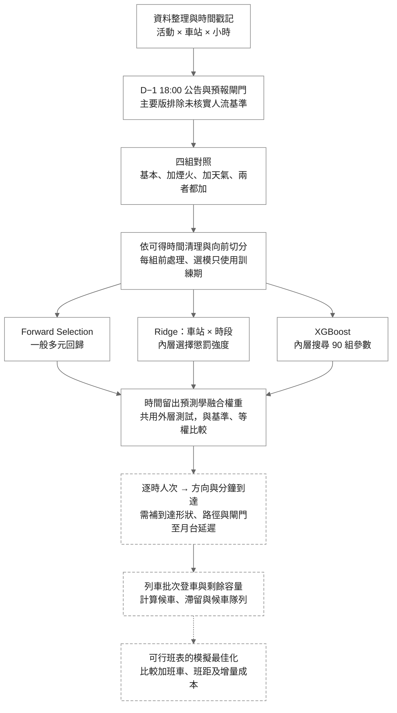

# 大稻埕煙火人流分析與捷運班次模擬

## 專案目的與目前進度

整理北捷逐時 OD、活動、天氣及社群資料，分析煙火活動人流，銜接候車與列車容量情境。**已將煙火時間與天氣分開重跑：XGBoost 單加煙火改善、單加天氣退步；Ridge 加任一組都退步。**

先看 [煙火／天氣分組比較](result/analysis_v4/report.md)／[平均人次圖](result/analysis_v4/figures/mean_event_counts.png)，實作看 [process.md 第 15 節](process.md#15-第四版煙火與天氣分開比較)。新圖在根目錄 `result/analysis_v4/`，舊版本保留供對照。

| 項目 | 本版規格 |
|---|---|
| 預測目標 | 活動日北門、大橋頭站、雙連、民權西路 18–23 時的來源時段起站人次，暫作進站需求代理 |
| 資料與評估 | 2017–2026 年 21 場、504 列；外層比較 2024–2026 年共 9 場、216 列，整年向前切分 |
| 事前截止 | 活動前一天 18:00（臺北時間），每筆新輸入須有截止前的公告或預報版本證據 |
| 四組輸入 | 基本欄位／另加煙火時間／另加天氣／兩組都加；Ridge 均保留站別 × 時段 |
| 人流基準 | 近 56 天一般日人流的發布時間未核實，本次四組一律排除；舊版另有含基準的回顧敏感度比較 |
| 限制 | 504 列不等於 504 個獨立活動；較早訓練標籤發布時間及事後已辦活動篩選仍有限制，尚非完整 D−1 上線驗證 |

## 這次加入哪些資料

| 變數 | 截止前能核對的場次 | 本次處理 |
|---|---:|---|
| 預定煙火分鐘 | 19/21 | 加入；純煙火與無人機／水幕分開 |
| 預定煙火開始時間 | 16/21 | 加入；整套節目開始不冒充真正煙火開始 |
| 預定無人機、整套展演分鐘 | 各 2/21 | 第三版外層訓練全未知而自動剔除，本次不列候選；**尚不能估計無人機效果** |
| 預報氣溫、風速、雲量 | 各 17/21，每場 6 時點 | 另取當年已公開的 GFS 預報；不是當天實測 |
| 降雨機率 | 無合格系列 | 未加入，不以實測雨量代替 |

未知保留缺值，補值只在各訓練折計算；未提無人機不當成「沒有」。預報四站共用附近 0.25° 網格，三小時預報點在同一事前版本內插，不能當成站口微氣候。

來源：[節目公告逐欄證據](docs/d1_program_sources.json)／[天氣取得方式](docs/d1_weather_audit.md)／[預報來源與數值](docs/d1_weather_sources.json)／[逐筆截止時間檢查](result/analysis_v3/tables/d1_feature_audit.csv)。

## 煙火與天氣分開後，哪組讓預測變差？

相同九場外層活動、相同訓練年度、相同 90 組 XGBoost 搜尋；四組均不用發布時間未核實的人流基準。每組依同一規則重新選變數、調參與學融合權重。

**北門逐時 MAE（人次／小時，越小越好）：**

| 方法 | 不加新變數 | 只加煙火時間 | 只加天氣預報 | 煙火＋天氣 |
|---|---:|---:|---:|---:|
| 一般回歸 | 1,353 | 1,353 | 1,353 | 1,353 |
| Ridge | 1,486 | 1,700 | 1,625 | 1,688 |
| XGBoost | 1,053 | **898** | 1,132 | 1,236 |
| Stacking | 1,198 | **946** | 1,246 | 1,246 |

- **XGBoost：煙火這組有用，加入目前這組天氣預報後退步。** 單加煙火，北門 MAE 降 **14.7%**、四站 MAE 576 → 480；單加天氣，北門 MAE 增 **7.5%**。煙火再加天氣則由 898 → 1,236。這是本資料及建模流程的結果，不表示天氣不影響人流。
- **Ridge：兩組各自加入都退步。** 基本版三年度皆選 λ=0.1；煙火版與合併版皆改選 λ=1，整個模型收縮更強。資料和 λ 同時改變，不能斷定退步全由其中一項造成。
- **一般回歸：四組結果相同。** Forward Selection 沒選進新增欄位；「提供候選」不等於模型一定會採用。
- **尖峰仍未解決。** XGBoost 九場北門實際尖峰絕對誤差由 2,376 → 2,139（煙火），但 2026 年北門逐時 MAE 由 677 → 820，該年北門反而退步；煙火版 8/5 尖峰高估約 3,051 人次。不能只看跨年平均改善。



**為什麼變數多了反而差？** 只有 21 場活動，早年天氣共同缺值、預報網格較粗，煙火開始與長度又隨年度／活動型態改變。新欄位可能帶入不穩定規律，也會改變選中的懲罰與樹結構；504 列不代表 504 場獨立訓練資料。這些是診斷與可能解釋，分組比較不能證明單一機制。無人機過去訓練全未知，這次未放入。

下一步可把「只加煙火的 XGBoost」保留為較精簡候選，用尚未看過的新場次驗證。**本次沒有依外層成績自動更換正式模型，也不能把這九場當成全新的確認性測試。** [完整指標](result/analysis_v4/tables/group_ablation.csv)／[逐年度結果](result/analysis_v4/tables/yearly_ablation.csv)。

## 實際與三模型、混合模型的平均人次

以下固定展示「煙火＋天氣」版：**每場先加總 18–23 時，再平均同九場外層活動**。這是車站起站**人次**，不是煙火現場的獨立參加人數；三模型與 Stacking 都使用留出預測。類別平均值適合畫長條圖。

| 方法 | 四站合計平均人次／場 | 北門平均人次／場 |
|---|---:|---:|
| 實際 | 45,842 | 17,528 |
| 一般回歸 | 38,912 | 14,130 |
| Ridge | 39,577 | 10,200 |
| XGBoost | 39,048 | 12,946 |
| Stacking | 38,990 | 13,194 |



總量接近仍可能有逐時高低估互相抵銷，故必須一起看尖峰誤差。[四組完整平均值](result/analysis_v4/tables/mean_event_counts.csv)。

<details>
<summary>上一版：加新變數與移除人流基準的比較</summary>

### 第三版實際結果

下表為同九場活動的 **北門逐時 MAE，越小越好**；「加新變數」與「拿掉基準」分開比較，避免把不同改動混成一個效果。

| 方法 | 第二版 | 只擴大調參 | 加新變數、保留基準 | 主要版：加新變數、排除基準 |
|---|---:|---:|---:|---:|
| 一般回歸 | 1,419 | 1,419 | 1,450 | 1,353 |
| Ridge | 1,178 | 1,178 | 1,649 | 1,688 |
| XGBoost | 1,181 | 964 | 1,216 | 1,236 |
| 等權平均 | 1,167 | 1,072 | 1,333 | 1,339 |
| Stacking | 1,226 | 1,055 | 1,279 | 1,246 |

- **只擴大調參有效：** XGBoost 北門 MAE 1,181 → 964；九場尖峰絕對誤差平均 3,236 → 2,367 人次，但原人流基準仍是未核實發布時間的回顧輸入。
- **加入新變數未帶來整體改善：** 在同樣保留基準、同樣 90 組搜尋下，XGBoost 北門 MAE 964 → 1,216，尖峰絕對誤差 2,367 → 3,466；Ridge 也退步。不能因單場變好就宣稱新變數有效。
- **排除未核實基準的主要版：** XGBoost 北門 MAE 1,236，比第二版 1,181 略差；九場尖峰絕對誤差 3,069，較第二版 3,236 略小。主要版全站 MAE 最低為 Stacking 637，XGBoost 643，沒有全面勝過舊版。
- **固定示例 2026/8/15、21 點，實際 10,904：** XGBoost 第二版 5,616 → 只調參 8,465 → 加新變數保留基準 7,110 → 主要版 7,355。主要版仍低估約 32.5%，尚未解決大型尖峰。
- 也有反例：主要版 2026/8/5 21 點預測約 7,410，實際 4,642，明顯高估；完整九場曲線均保留。
- 新 Ridge 三年度都選 λ=1，較第二版後兩年的 0.001 收縮強；增加候選後連交互項也受較強收縮，是需檢查的現象，不能把退步單獨歸因於天氣。只有 21 場、早年缺值及活動型態混雜，都限制穩定估計。




<details>
<summary>展開九場完整逐時曲線與資料可用率</summary>





</details>

本次不因結果退步而偷偷改候選或丟掉場次；四個版本全部保留。後續先補可辨識的節目計畫、核實人流基準發布時間，再評估相對預定結束時段等特徵；不能直接拿目前點預測當作月台安全容量或營運班表。

</details>

## 90 組是怎麼選出一個設定的？

1. **樹深**是每棵樹最多分幾層；**樹數**是逐步修正預測的次數，增加不保證更準。
2. 現在固定樹深 **1/2/3/4/5**、樹數 **50/100/250**、`min_child_weight=1/6/24`、`reg_lambda=1/10`，即 **5 × 3 × 3 × 2 = 90 組**；學習率固定 **0.05**。
3. **是從 90 組選出內層 MAE 最低的一組，稱為網格搜尋。** 各組用較早年度的時間驗證折評分，再以該外層年度之前的資料重新訓練；不看當年外層真值選參。
4. **每個年度、每個變數組合各選一次，並非整個研究只選一組。** 這是候選網格內的最佳，不保證所有可能參數的全域最佳；沒有把 90 個模型平均。Stacking 是另外融合 OLS、Ridge、XGBoost 三模型。
5. `min_child_weight` 是子節點 Hessian 總和門檻；本案等權平方誤差可對應最少列數，**不是最少活動場數**。`reg_lambda` 控制葉節點權重的 L2 懲罰。[官方參數說明](https://xgboost.readthedocs.io/en/stable/parameter.html)

「煙火＋天氣」版實際選出的設定（與第三版相同）：

| 外層測試年 | 樹深 | 樹數 | min_child_weight | reg_lambda |
|---|---:|---:|---:|---:|
| 2024 | 4 | 50 | 6 | 10 |
| 2025 | 4 | 50 | 6 | 10 |
| 2026 | 5 | 100 | 1 | 10 |



要改搜尋範圍，修改 [`configs/analysis_v4_both.json`](configs/analysis_v4_both.json) 的 `xgb_grid` 後完整重跑；分組比較時四組網格須一致。每格熱圖是該深度／樹數下其他參數的內層最佳值。[完整選參表](result/analysis_v4/both/tables/xgb_selected_params.csv)／[所有候選分數](result/analysis_v4/both/tables/inner_selection.csv)。

<details>
<summary>保留第二版交互作用診斷與改版前後結果</summary>

原線性模型在控制一般日基準後，各站共用時段效果；加入站別 0/1 × 時段 0/1 後，允許各站不同的時段曲線。只看2017–2023訓練資料，舊 OLS 在21時低估北門約2,600、高估民權西路約1,447人次，支持檢查交互作用，並非已做顯著性F檢定或因果識別。

## 第二版實際結果

兩版使用相同來源檔案及 9 場外層活動。MAE 單位為人次／站／小時，越小越好；OLS 與一般日基準的逐筆預測核對不變。

| 方法 | 全站 MAE 原版 → 第二版 | 北門 MAE 原版 → 第二版 |
|---|---:|---:|
| Forward OLS | 680.60 → 680.60 | 1,419.48 → 1,419.48 |
| Ridge | 691.34 → 582.87 | 1,532.55 → 1,177.78 |
| XGBoost | 646.30 → 523.05 | 1,334.62 → 1,181.36 |
| 等權平均 | 611.72 → **517.85** | 1,395.90 → **1,166.83** |
| MAE Stacking | 633.75 → 538.60 | 1,404.09 → 1,226.07 |
| 一般日基準 | 871.48 → 871.48 | 2,027.50 → 2,027.50 |

- **Ridge 北門逐時 MAE 降低 23.1%。** 九場實際尖峰的平均正向低估 4,696.84 → 2,826.99（減少 39.8%）；尖峰絕對誤差 4,696.84 → 3,192.95（減少 32.0%）。2024 幾乎不變，三個較小場次轉為高估；大橋頭與雙連的 MAE 略退步。
- **XGBoost 北門逐時 MAE 降低 11.5%。** 尖峰誤差 4,080.99 → 3,236.04（減少 20.7%），7／9 場改善，2024 兩場 20 時尖峰退步。
- **2026/8/15 尖峰實際 10,904：** Ridge 2,951 → **6,517**；XGBoost 3,899 → **5,616**。有所改善，仍不能視為已解決大型尖峰低估。
- 等權平均的全站 MAE 仍優於學權重 Stacking；民權西路仍以一般日基準最好，不能宣稱一個模型適合所有站。


<details>
<summary>展開九場完整逐時曲線：Ridge 與 XGBoost</summary>


</details>

XGBoost 三個外層年度均選到 `max_depth=3`、`n_estimators=100`、`min_child_weight=1`、`reg_lambda=10`，學習率固定 0.05。Ridge 的 λ 依 2024／2025／2026 為 **1／0.001／0.001**；並非無懲罰。選參過程見 [內層選模紀錄](result/analysis_v2/tables/inner_selection.csv)。

**改善仍是回顧比較，尚不能直接用來決定營運班表。** 需核實來源時段意義，再補方向、分鐘到達、剩餘容量及車隊／折返限制；排隊結果仍是明示假設的情境試算。


</details>

## 分析流程



**目前進度：**三個模型與融合比較已實作；分鐘／方向分流及候車僅為假設情境；可行班表最佳化尚待營運資料。D−1 資料發布時間仍需核實，圖中的完整路徑不代表每一步都已完成。

### 詳細 workflow

| 步驟 | 實際要做的事 | 本版狀態／下一步 |
|---|---|---|
| 1. 定義目標 | 活動前一天固定截止時間，預測隔天各站各時段進站人次；另列尖峰與低估指標 | 已有四站 18–23 時歷史比較；504 列來自 21 場活動 |
| 2. 整理資料 | 檢查主鍵、缺值、時間口徑與 `available_at`；重建同站同時段一般日基準 | 日期及數量已核對；來源時段是否按進站分箱、歷史發布時間仍待核實 |
| 3. 設計與檢查變數 | 訓練內檢查共線性、標準化及選變數；區分預定節目、天氣預報與事後實測 | Ridge 已加「車站 × 時段」；已補事前節目及17場歷史預報；真正散場時間與可學無人機對照仍不足 |
| 4. 三模型並行 | OLS 在內層做 Forward Selection；Ridge 選 λ；XGBoost 選複雜度 | 已完成。Ridge／XGBoost 不沿用 OLS 選完的子集 |
| 5. 學融合權重 | 用更早年度的留出預測學非負、總和為 1 的權重 | 已完成；不能用當年測試真值調權重 |
| 6. 評估預測 | 同一外層活動比較基準、三模型、等權與 Stacking；看逐站、逐場及尖峰 | 全站平均 MAE 最佳不代表北門尖峰最佳；目前尖峰仍明顯低估 |
| 7. 改善尖峰 | 固定切分、來源與調參範圍，分開加入煙火時間及預報 | 已完成四組比較：XGB 單加煙火平均改善，但 2026 年北門退步；相對預定結束階段與增量模型尚未實作 |
| 8. 建立到達情境 | 以量測／調查估方向比例、5 分鐘到達曲線與閘門至月台延遲；測試分位數與集中到達情境 | 目前只有均勻到達假設；逐時資料不能直接辨識分鐘尖峰 |
| 9. 批次服務排隊 | 每班依本站剩餘容量上車，滯留延續到下一班；計等待人分鐘、最大隊列、清空時間 | 已有情境程式；列車不直接套 M/M/c，尚未驗證實際候車與全月台人數 |
| 10. 可行調度 | 加入車隊、折返、最小班距、既有班表、月台安全及成本限制，模擬比較可行方案 | 待取得營運限制；不能只選「班距越短越好」 |

北門的原版診斷見 [第 12 節](process.md#12-北門尖峰診斷與改善順序)，交互作用見 [第 13 節](process.md#13-第二版實作與實際改善結果)，事前來源見 [第 14 節](process.md#14-第三版活動前一天的節目天氣與調參)，本次分組比較見 [第 15 節](process.md#15-第四版煙火與天氣分開比較)。

## 快速開始

在專案根目錄執行：

```powershell
# 分析環境
uv sync --group analysis

# 先確認資料；不需要連 MySQL，不會寫回 SQL
uv run --group analysis python -X utf8 src/run_analysis.py --validate-only

# 四組各自重跑；不需先執行舊版本
foreach ($variant in @('core', 'fireworks', 'weather', 'both')) {
    uv run --group analysis python -X utf8 src/run_analysis.py --config "configs/analysis_v4_$variant.json"
    if ($LASTEXITCODE -ne 0) { throw "分析失敗：$variant" }
}
uv run --group analysis python -X utf8 src/compare_analysis_v4.py

# 有意義的資料、時間切分、融合與排隊測試
uv run --group analysis python -X utf8 -m unittest discover -s tests -p 'test_analysis_v*.py'
```

重跑需要隊員私下提供三個整理檔，依相同相對路徑放置：

- `data/processed/event_station_hourly_context.csv`
- `data/processed/calendar_baseline/candidate_audit.csv`
- `data/processed/station_hourly.parquet`

可選的 `.local/research_review/2026-10-07-refresh/statistics_snapshot.json` 只補實際節目 EDA；缺少它仍可跑同一套預測，但節目完整度圖不同。四組必須使用同一份原資料；比較程式會核對來源、模型程式雜湊、主鍵、真值、完整四站六小時與訓練截止。[核對紀錄](result/analysis_v4/comparison_checks.json)。SQL、原始資料與逐筆預測不提交；只看報告與 PNG 不需要資料庫。舊版重現命令保留在 `process.md`。

`--require-d1` 會在整套事前資訊可用性尚未核實時停止。四組設定為 `configs/analysis_v4_*.json`，兩份公告／預報來源 JSON 已附在 `docs/`；各版本獨立保存輸出，不覆蓋舊結果。

<details>
<summary>既有網站、前處理與文字雲操作</summary>

```powershell
uv sync --group analysis --group notebook --extra social --extra web --extra app
.\app\start.ps1
.\.venv\Scripts\python.exe -X utf8 src/main.py --reuse-clean --mysql
.\.venv\Scripts\python.exe -X utf8 src/import_weather.py
.\.venv\Scripts\python.exe -X utf8 src/threads_web_collect.py
.\.venv\Scripts\python.exe -X utf8 src/ptt_web_collect.py
```

捷運月 CSV 放在 `data/original_data/`；前處理仍需本機 MySQL 的活動與聲量資料。網站透過 Tailscale 私人連線。Threads 預設在新開 Edge 登入後操作，PTT 不需登入；文字雲是公開搜尋樣本，不是全站聲量。年度活動預算與宣導所需費用應各存年度一筆，不能展開後當成每場獨立經費；本版未將它們放進預測。

</details>

## 專案結構

```text
統計實務/
│
├── README.md                         # 專案介紹、實際結果與文獻
├── process.md                        # 資料資格、實作公式、驗證與限制
├── pyproject.toml                    # uv 環境；analysis 套件群組
├── uv.lock                           # 鎖定套件版本
├── configs/analysis_v1.json           # 原版設定，保留供對照
├── configs/analysis_v2.json           # 第二版對照
├── configs/analysis_v3*.json          # 主要版、只調參、保留基準敏感度
├── configs/analysis_v4_*.json         # 基本、煙火、天氣、兩者四組對照
├── scripts/collect_d1_gfs.py          # 歷史操作型預報蒐集與發布稽核
│
├── src/
│   ├── run_analysis.py               # 本版分析入口
│   ├── analysis_v1/
│   │   ├── data.py                   # 資料核對與逐時基準
│   │   ├── d1_features.py            # D−1 來源、時間、單位與缺值閘門
│   │   ├── d1_reporting.py           # 調參熱圖與來源覆蓋率
│   │   ├── eda.py                    # 缺值、描述統計與活動層次相關
│   │   ├── models.py                 # 三模型、向前驗證、融合與 VIF
│   │   ├── queueing.py               # 平行服務 M/M/c 與列車批次隊列
│   │   ├── queue_report.py           # 方向與班距假設的情境圖表
│   │   ├── reporting.py              # 模型圖表及中文結果報告
│   │   └── comparison.py             # 相同活動的原版／新版比較
│   ├── compare_analysis_v3.py        # 四版同樣本結果彙整
│   ├── compare_analysis_v4.py        # 分組比較、平均人次與完整樣本核對
│   ├── main.py                       # 既有捷運前處理
│   └── ...                           # 氣象、社群與資料匯入程式
│
├── result/analysis_v4/                # 本次報告、兩張總覽圖及彙整表
│   ├── core/                        # 基本欄位完整結果
│   ├── fireworks/                   # 只加煙火開始與時長
│   ├── weather/                     # 只加天氣預報
│   └── both/                        # 兩組都加；各自附選參與稽核
├── result/analysis_v3/                # 前版、四版本比較、調參與覆蓋率圖
├── result/analysis_v3_tuning/         # 只擴大XGB搜尋的對照
├── result/analysis_v3_with_baseline/  # 加新變數但保留回顧基準
├── result/analysis_v1/                # 第一版結果，保留不覆蓋
├── result/analysis_v2/
│   ├── report.md                     # 已執行的結果與解讀
│   ├── figures/                      # 10 張分析 PNG
│   ├── tables/                       # 指標、VIF、相關與情境 CSV
│   ├── folds.json                    # 各外層模型與權重
│   ├── run_manifest.json             # 資料雜湊、環境與設定
│   └── comparison/                   # 4 張前後比較圖、指標表與中文報告
│
├── app/                              # 前端、FastAPI、Tailscale 啟動
├── data/                             # 原始與整理資料，另外私下共享
├── .local/                          # 各版私有預測與模型，不提交
├── tests/                            # 資料、時間隔離、融合及排隊測試
├── docs/                             # 既有說明、資料規格與文獻
├── mysql/                            # 匯入程式；SQL 留在本機
└── results/                          # 舊有前處理、社群與研究結果
```

## 詳細說明與參考資料

- [煙火與天氣分組比較](result/analysis_v4/report.md)／[平均人次長條圖](result/analysis_v4/figures/mean_event_counts.png)
- [第三版完整分析](result/analysis_v3/report.md)／[四版本比較](result/analysis_v3/version_report.md)／[事前天氣查核](docs/d1_weather_audit.md)
- [第二版完整分析結果](result/analysis_v2/report.md)／[改版比較](result/analysis_v2/comparison/report.md)／[實作細節與公式](process.md)
- [網站啟動與隊員連線](app/README.md)
- [資料前處理與欄位定義](docs/data_preprocessing.md)／[資料庫結構](docs/database_schema.dbml)
- [Threads](docs/threads_collection.md)／[PTT](docs/ptt_collection.md)／[Google Trends](mysql/GOOGLE_TRENDS_README.md)
- [既有參考論文](docs/references.md)／[研究規劃](docs/research_plan.md)

本版方法依據：

| 文獻 | 本版用途與界線 |
|---|---|
| [Heinze、Wallisch & Dunkler（2018）](https://onlinelibrary.wiley.com/doi/full/10.1002/bimj.201700067)，§2.2、2.4 | 變數選擇及選後推論風險；Forward Selection 不保證最佳。本版用內層時間 MAE，不做選後普通 p 值。 |
| [Hoerl & Kennard（1970）](https://doi.org/10.1080/00401706.1970.10488634)，§0–2 | Ridge 在相關設計下的偏差與變異取捨；不能推論本資料一定勝 OLS。 |
| [Chen & Guestrin（2016）](https://arxiv.org/abs/1603.02754)，§2 | XGBoost 正則化加法樹；本版的樹深與 90 組網格是研究設定，不是原文保證的最優參數。 |
| [Breiman（1996）Stacked Regressions](https://statistics.berkeley.edu/sites/default/files/tech-reports/367.pdf)，§1、2、5、7 | 用留出預測學融合權重；本版活動平衡 MAE 線性規劃與年度向前切分為延伸，原文主要用非負最小平方。 |
| [Varma & Simon（2006）](https://pmc.ncbi.nlm.nih.gov/articles/PMC1397873/) | 分開內層選模與外層評分，避免共用驗證資料造成樂觀偏差；不能解決活動場次少或發布時間未知。 |
| [Hyndman & Athanasopoulos，§5.10](https://otexts.com/fpp3/tscv.html) | 訓練只用預測時點以前的資料；本版再按整年度及活動分組。 |
| [Santanam 等（2021），Public Transit for Special Events: Ridership Prediction and Train Optimization](https://arxiv.org/abs/2106.05359) | 活動需求預測銜接列車排程的研究方向；本版只完成批次容量情境，未重現其調度最佳化。 |
| [Gneiting（2011），Quantiles as optimal point forecasts](https://doi.org/10.1016/j.ijforecast.2009.12.015) | 下一版容量規劃可用非對稱成本選擇分位數；目前尚未擬合或驗證 P80／P90，不能當作安全保證。 |
| [XGBoost 官方參數文件](https://xgboost.readthedocs.io/en/stable/parameter.html) | 調整樹深、葉節點 Hessian 門檻與 L2 懲罰；本案平方誤差的列數門檻不等於獨立活動場數。 |
| [Cawley & Talbot（2010）](https://jmlr.org/papers/v11/cawley10a.html) | 選模準則也可能過擬合；看過外層結果再改模型的比較需保留探索性定位。 |

資料來源：

- [北捷分時進出站運量](https://data.taipei/dataset/detail?id=63f31c7e-7fc3-418b-bd82-b95158755b4d)
- [固定／變動成本](https://www.metro.taipei/cp.aspx?n=20CB8DE3F41B411)：參考 114 年審定決算書。
- [變動／固定公里數](https://whhr.gov.taipei/News_Content.aspx?n=0121E4C78246FC0D&s=3E147DD6A74BE990)
- [天氣實測](https://codis.cwa.gov.tw/StationData)：氣象署 CODiS，只作事後探索。
- [GFS 歷史操作型預報](https://gdex.ucar.edu/datasets/d084001/)／[NOAA AWS 公開時間證據](https://registry.opendata.aws/noaa-gfs-bdp-pds/)：本版事前天氣輸入。
- [特殊節假日](https://data.gov.tw/dataset/14718)：政府行政機關辦公日曆表。
- [大稻埕煙火排程參考](https://data.gov.tw/dataset/7778)：觀光資訊活動資料庫。
