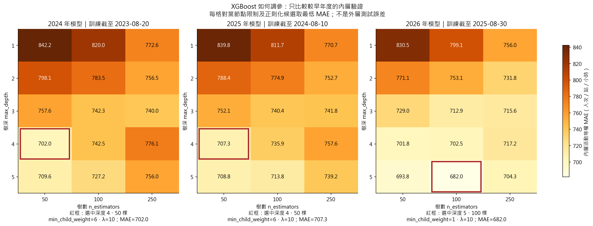
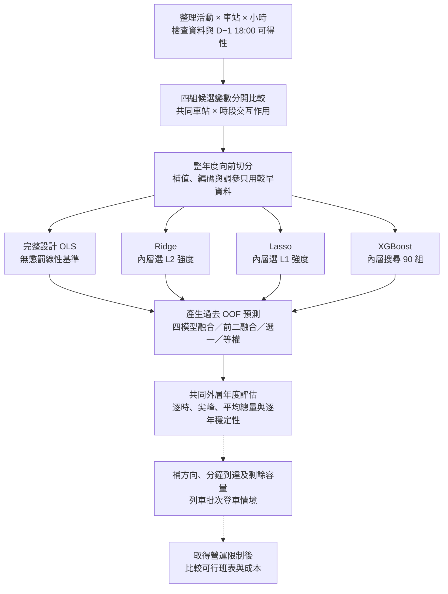

# 大稻埕煙火人流分析與捷運班次模擬

## 專案目的與目前進度

整理北捷逐時 OD、活動、天氣及社群資料，分析煙火活動人流，銜接候車與列車容量情境。**第五版已加入 Lasso，統一四模型的候選變數與車站 × 時段交互作用，並實作「先選模型，再融合」。**

先看 [本次完整結果](result/analysis_v5/report.md)／[平均人次圖](result/analysis_v5/figures/mean_event_counts.png)，實作看 [process.md 第 16 節](process.md#16-第五版共同設計lasso-與先選模型再融合)。新圖在根目錄 `result/analysis_v5/`；舊版保留，沒有覆蓋。

| 項目 | 本版規格 |
|---|---|
| 預測目標 | 北門、大橋頭站、雙連、民權西路，活動日 18–23 時的來源時段起站人次，暫作進站需求代理 |
| 資料與評估 | 2017–2026 年 21 場、504 列；外層比較 2024–2026 年共 9 場、216 列，整年向前切分 |
| 事前截止 | 活動前一天 18:00（臺北時間），新輸入須有截止前的公告／預報版本證據 |
| 共同設計 | OLS、Ridge、Lasso、XGBoost 共用同一訓練矩陣，包含 15 個車站 × 時段交互項 |
| 四組輸入 | 基本變數／另加煙火時間／另加天氣預報／兩組都加 |
| 人流基準 | 近 56 天一般日人流的發布時間未核實，四組一律排除 |
| 限制 | 504 列不是 504 場獨立活動；早年訓練標籤發布時間、日曆歷史版本及已辦活動篩選仍有限制，尚非完整 D−1 上線驗證 |

## 為什麼比較這四個模型？

| 模型 | 直覺：它在解決什麼問題？ | 能解釋什麼、不能解釋什麼？ |
|---|---|---|
| 完整設計 OLS | 先問「線性變數加上指定交互作用，是否已足夠？」提供無收縮的參考線 | 係數是控制其餘欄位後的線性關聯；有交互作用時要連主效果一起解讀。共線性可能讓係數不穩定 |
| Ridge | 變數彼此相關時，保留訊息並把過大的係數縮小，降低估計變動 | 可看方向與相對大小，但係數有偏且依標準化方式；不是變數篩選，也不保證更準 |
| Lasso | 除了縮小係數，也把部分係數壓成零，問「較精簡的線性規則夠不夠？」 | 可指出本次懲罰下留下哪些欄位；零係數不代表真實影響為零，相關變數的入選也可能不穩定 |
| XGBoost | 用多棵樹逐步修正誤差，捕捉非線性、門檻及多變數的條件組合 | 例如「北門、晚間、較長煙火」可以有不同規則，不必手寫所有非線性項；但沒有單一固定斜率，樹切分或特徵重要性不等於因果效果 |
| 融合 | 問「不同模型的預測誤差能不能互相補足？」 | 權重表示本次過去驗證的預測組合，不是各種機制的真實占比；融合不保證勝過最佳單模型 |

**向老師說明可以用這段：**「本研究不是假定某個演算法最好，而是比較無收縮線性、L2 收縮、L1 稀疏選擇與非線性樹模型。四者使用相同事前資訊，再用相同的時間留出資料比較預測。融合則另外檢查誤差互補是否帶來增益。」相關原始文獻列於文末。

本版的 OLS **不做 Forward Selection**，以免和 Ridge／Lasso 的差異同時來自不同候選矩陣。舊版 Forward OLS 仍保留。Lasso 的選變數是模型本身的一部分；「提供相同候選」不代表最後每個係數都非零。Adaptive Lasso、Elastic Net 可作未來擴充，但本次沒有執行，也不宣稱它們不適用。

連續欄位在訓練折內標準化，0/1 欄位保留原編碼；缺值補值也只用訓練資料。精確線性相依的欄位採共同規則移除，僅高度相關者不刪。這些選擇會影響懲罰結果，詳見 process。普通 Lasso 沒有強制「保留交互作用就必須保留主效果」的階層限制。**本版沒有計算 SHAP，也不使用選模後的普通 p 值宣稱顯著影響。**

## 活動前一天可用哪些輸入？

| 變數 | 可核對的場次 | 處理 |
|---|---:|---|
| 車站、時段、週末、年內日期、年度趨勢 | 21/21 的分析欄位 | 各組共同候選；日曆欄由分析活動日期推導，歷史預定日期版本仍待補核 |
| 預定純煙火分鐘／開始時間 | 19/21、16/21 | 用事前公告；整套節目開始不能冒充煙火開始 |
| 預報氣溫、風速、雲量 | 各 17/21，每場 6 時點 | 當年已公開的 GFS 操作型預報；不用當天實測 |
| 預定無人機／整套展演分鐘 | 各 2/21 | 外層訓練期全未知，未列候選；尚不能估計無人機效果 |
| 實測天氣、事後整月聲量、年度實支 | 不符合本次事前輸入口徑 | 不放入預測；年度費用也不能當成每場獨立經費 |

未知保留缺值，未提無人機不當成「沒有」。四站天氣共用附近 0.25° 網格，不是站口微氣候。[節目證據](docs/d1_program_sources.json)／[天氣取得與發布稽核](docs/d1_weather_audit.md)／[逐筆輸入檢查](result/analysis_v5/both/tables/d1_feature_audit.csv)。

## 重跑後的實際結果

同九場外層活動，**北門逐時 MAE（人次／小時，越小越好）**：

| 模型 | 基本變數 | 只加煙火 | 只加天氣 | 煙火＋天氣 |
|---|---|---|---|---|
| 完整設計 OLS | 1,265 | 1,267 | 1,221 | 1,301 |
| Ridge | 1,486 | 1,700 | 1,622 | 1,686 |
| Lasso | 1,350 | 1,330 | 1,573 | 1,571 |
| XGBoost | 962 | 901 | 1,131 | 1,216 |
| 四模型等權 | 1,193 | 1,191 | 1,274 | 1,295 |
| 四模型 Stacking | 1,138 | 1,062 | 1,312 | 1,263 |
| 過去驗證選一 | 1,075 | 901 | 1,131 | 1,216 |
| 先選前二再融合 | 1,032 | 989 | 1,312 | 1,263 |

- **Lasso 沒有勝出。** 合併組三年均選 α=100，15 個站別 × 時段係數全部變成零，失去各站不同時段曲線的彈性；北門 MAE 1,571，比同設計 OLS 1,301、XGBoost 1,216 高。這是目前資料、編碼及選參目標的結果，不是 Lasso 普遍不好。
- **只加煙火的 XGBoost 跨年平均最低：** 全站 MAE 475、北門 901。但此表已被用來反覆修訂，不能當成全新確認性測試，也沒有依此自動更換正式模型。
- **先選前二可以改善四模型融合，但未勝過 XGBoost。** 基本組北門 1,138 → 1,032；煙火組 1,062 → 989；天氣與合併組則相同。不能為了使用融合而強迫融合。
- **尖峰仍未解決。** 下表同時檢查實際尖峰所在時刻，避免只看平均總量。合併組 Lasso 的尖峰比 OLS、XGBoost 差。

| 模型 | 北門逐時 MAE | 實際尖峰時刻絕對誤差 |
|---|---|---|
| 完整設計 OLS | 1,301 | 3,127 |
| Ridge | 1,686 | 5,171 |
| Lasso | 1,571 | 4,825 |
| XGBoost | 1,216 | 3,104 |
| 四模型 Stacking | 1,263 | 3,431 |
| 先選前二再融合 | 1,263 | 3,431 |


本版也統一了 XGBoost 的交互項及共同精確相依篩除，因此與 v4 的差異不能全部歸因於「多一個 Lasso」。[逐年度／全站指標](result/analysis_v5/tables/yearly.csv)／[全部尖峰及誤差指標](result/analysis_v5/tables/metrics_by_variant.csv)／[舊版結果](result/analysis_v4/report.md)。

## 可以先選模型，再做融合嗎？

**已實作，流程固定為以下四步：**

1. 在外層測試年之前，產生「用更早年份訓練、預測較晚年份」的留出預測（OOF）；每次調參也只用當時更早的資料。
2. 依過去 OOF 四站全部時段的活動等權 MAE 排名，**預先固定保留前二名**；不是看測試年的成績挑模型，也未特別優化北門尖峰。
3. 用這兩個模型的過去 OOF，學非負且總和為 1 的 MAE 最小權重，再預測外層年。
4. 和四模型等權、四模型學權重、只選第一名一起比較。**入選兩個仍可能有一個權重為零。**

「煙火＋天氣」組實際選擇如下；OLS、Lasso 在這組前二融合的權重都是零：

| 外層年 | 過去驗證入選模型 | Ridge 權重 | XGBoost 權重 | Lasso α／非零係數數 |
|---|---|---|---|---|
| 2024 | XGBoost、Ridge | 25.1% | 74.9% | 100／4（共 34 欄） |
| 2025 | XGBoost、Ridge | 25.1% | 74.9% | 100／5（共 34 欄） |
| 2026 | XGBoost、Ridge | 16.5% | 83.5% | 100／7（共 34 欄） |

這組四模型 Stacking 最後也只給 Ridge、XGBoost 非零權重，因此與前二融合預測相同；只選第一名則每年都選到 XGBoost。全四模型 Stacking 在四組共 12 個外層設定中都給 Lasso 零權重，但煙火組前二規則在 2025、2026 年曾選入 Lasso，兩種機制不可混為一談。

**前二是可重現的簡單規則，不是已證明最佳的模型子集合。** 排名可能排除單獨誤差較大、但能補足另一模型的成員；是否有幫助要看外層表現。排名與權重共用過去 OOF 是訓練流程，該 OOF 分數不能再當無偏的最終成績。權重公式與線性規劃見 [process 第 16 節](process.md#16-第五版共同設計lasso-與先選模型再融合)。


## 實際與模型估計的平均人次

固定展示「煙火＋天氣」版：**每場先加總 18–23 時，再平均同九場外層活動**。這是起站人次，不是活動現場獨立參加人數；用外測預測，不是訓練擬合值。類別平均適合長條圖，並非分布直方圖。


總量接近也可能是逐時高低估互相抵銷。[完整平均值](result/analysis_v5/tables/mean_event_counts.csv)／[北門全部九場曲線](result/analysis_v5/figures/beimen_profiles.png)／[融合曲線](result/analysis_v5/figures/beimen_fusion_profiles.png)。

<details>
<summary>調參方式與本次 XGBoost 設定</summary>

- Ridge：λ = 0.001／0.01／0.1／1／10；程式用 `sklearn alpha = 訓練列數 × λ`。
- Lasso：α = 0.1／1／5／10／25／50／100／250；目標為 `SSE/(2n) + α × L1`，不能直接與 Ridge 的 λ 比大小。
- XGBoost：樹深 1–5 × 樹數 50／100／250 × 葉節點門檻 1／6／24 × L2 懲罰 1／10，共 **90 組**；學習率 0.05。
- 每個訓練截止各以較早年度的內層活動等權 MAE 選一組；不是融合 90 棵模型，也不是保證所有參數空間的全域最佳。

合併組選出的 XGBoost 設定：

| 外層年 | 樹深 | 樹數 | 葉節點門檻 | L2 懲罰 |
|---|---|---|---|---|
| 2024 | 4 | 50 | 6 | 10.0 |
| 2025 | 4 | 50 | 6 | 10.0 |
| 2026 | 5 | 100 | 1 | 10.0 |



Lasso 統一使用較高迭代上限與精度，所有候選另以 KKT 與 primal–dual gap 檢查收斂；不是接受未收斂模型，也沒有改候選格來追求結果。詳細分數、數值診斷、零係數及 VIF 分別在各組 `tables/inner_selection.csv`、`folds.json`、`tables/training_coefficients.csv`、`tables/training_vif.csv`。

</details>

## 分析流程



### 詳細 workflow

| 步驟 | 目前做法 |
|---|---|
| 1. 確定預測問題 | 活動前一天固定截止，預測四站 18–23 時；新公告／預報逐筆查發布時點 |
| 2. 準備相同輸入 | 四組各自執行；一組內四模型共用同一編碼、缺值處理及交互項，不先用全資料篩變數 |
| 3. 調整基模型 | OLS 完整擬合；其餘三者用訓練內時間驗證選參，不能隨機把同場不同列拆兩邊 |
| 4. 選模型與融合 | 更早資料產生 OOF；前二規則與融合權重在這裡訓練，和固定四模型、選一作對照 |
| 5. 評估 | 外層整年才計分；看全站、北門、逐年、實際尖峰和總量，不只挑漂亮個案 |
| 6. 新場次確認 | 本次九場已反覆檢查，先固定下一次實驗規格；補未知發布時間再談完整事前驗證 |
| 7. 接排隊與調度 | 還需來源時間定義、方向比例、分鐘到達、閘門到月台延遲、列車剩餘容量與班表限制；目前僅有舊版容量假設情境，不能直接當營運調度 |

## 快速開始

在專案根目錄執行：

```powershell
uv sync --group analysis
uv run --group analysis python -X utf8 src/run_analysis_v5.py --validate-only
foreach ($variant in @('core', 'fireworks', 'weather', 'both')) {
    uv run --group analysis python -X utf8 src/run_analysis_v5.py --config "configs/analysis_v5_$variant.json"
    if ($LASTEXITCODE -ne 0) { throw "分析失敗：$variant" }
}
uv run --group analysis python -X utf8 src/compare_analysis_v5.py
uv run --group analysis python -X utf8 -m unittest discover -s tests -p 'test_analysis_v*.py'
```

隊員重跑需私下取得三檔並保持相同相對路徑：

- `data/processed/event_station_hourly_context.csv`
- `data/processed/calendar_baseline/candidate_audit.csv`
- `data/processed/station_hourly.parquet`

分析不用連 MySQL，也不會寫回 SQL；已附公開公告／預報來源。SQL、原始資料、逐筆預測及模型不提交，**只看 README、報告與 PNG 不需要資料庫**。比較程式核對共同來源、程式雜湊、完整四站六小時、真值、訓練截止、共同欄位與融合權重。[核對紀錄](result/analysis_v5/comparison_audit.json)。

`--require-d1` 在整套資訊可得性尚未核實時會停止。可選舊 EDA 快照不參與預測。舊版重現命令保留在 `process.md`；第五版不需先跑舊版。125 項分析測試通過，包含時間隔離、共用矩陣、Lasso 數值收斂、融合及報表核對。

<details>
<summary>既有網站、前處理與文字雲操作</summary>

```powershell
uv sync --group analysis --group notebook --extra social --extra web --extra app
.\app\start.ps1
.\.venv\Scripts\python.exe -X utf8 src/main.py --reuse-clean --mysql
.\.venv\Scripts\python.exe -X utf8 src/import_weather.py
.\.venv\Scripts\python.exe -X utf8 src/threads_web_collect.py
.\.venv\Scripts\python.exe -X utf8 src/ptt_web_collect.py
```

網站透過 Tailscale 私人連線。前處理仍需本機資料庫；Threads 在新開 Edge 登入，PTT 不需登入。文字雲是公開搜尋樣本，不代表全站聲量。

</details>

## 專案結構

```text
統計實務/
│
├── README.md                       # 本次結果、流程與方法理由
├── process.md                      # 各版細節、公式與限制
├── pyproject.toml / uv.lock         # 套件與鎖定版本
├── configs/analysis_v5_*.json       # 四組共用設計與調參設定
├── scripts/collect_d1_gfs.py        # 歷史操作型預報與公開時間稽核
│
├── src/
│   ├── run_analysis_v5.py          # 第五版分析入口
│   ├── compare_analysis_v5.py      # 共同樣本比較與報告
│   ├── analysis_v5/
│   │   ├── models.py              # 共同矩陣、四模型、選擇及融合
│   │   └── reporting.py           # 核對、平均圖、尖峰曲線與報告
│   ├── run_analysis.py            # 第一至四版入口，保留重現
│   ├── analysis_v1/               # 共用資料、事前閘門及舊版分析
│   └── main.py                    # 既有捷運前處理
│
├── result/analysis_v5/
│   ├── report.md                  # 四組八種預測方式的實際比較
│   ├── figures/                   # 模型、平均人次、融合權重及尖峰圖
│   ├── tables/                    # 四組共同指標與年度選擇
│   └── core/ fireworks/ weather/ both/
│                                  # 各組選參、係數、稽核與執行紀錄
├── result/analysis_v1/              # 第一版結果
├── result/analysis_v2/              # 第二版交互作用比較
├── result/analysis_v3/              # 第三版事前變數比較
├── result/analysis_v4/              # 第四版煙火／天氣比較
├── app/                            # 前端、FastAPI 與 Tailscale
├── data/                           # 原始與整理資料，私下共享
├── .local/analysis_v5/              # 私有逐筆預測及模型，不提交
├── tests/                          # 資料、時間切分、模型與報表測試
├── docs/                           # 來源證據、資料規格及文獻
├── mysql/                          # 匯入程式；SQL 留本機
└── results/                        # 舊前處理、社群與研究結果
```

## 詳細說明與參考資料

- [第五版完整報告](result/analysis_v5/report.md)／[實作細節與公式](process.md#16-第五版共同設計lasso-與先選模型再融合)
- [第四版：煙火／天氣分組](result/analysis_v4/report.md)／[第三版](result/analysis_v3/version_report.md)／[第二版交互作用比較](result/analysis_v2/comparison/report.md)／[第一版](result/analysis_v1/report.md)
- [網站啟動](app/README.md)／[資料前處理](docs/data_preprocessing.md)／[資料庫結構](docs/database_schema.dbml)
- [Threads](docs/threads_collection.md)／[PTT](docs/ptt_collection.md)／[Google Trends](mysql/GOOGLE_TRENDS_README.md)
- [事前天氣證據](docs/d1_weather_audit.md)／[既有參考論文](docs/references.md)／[研究規劃](docs/research_plan.md)

| 原始文獻 | 本版用途與界線 |
|---|---|
| [Hoerl & Kennard（1970）](https://doi.org/10.1080/00401706.1970.10488634) | Ridge 的係數收縮與偏差／變異取捨；不保證本資料勝 OLS |
| [Tibshirani（1996）](https://doi.org/10.1111/j.2517-6161.1996.tb02080.x) | Lasso 的 L1 收縮與稀疏係數；零係數不等於無因果影響 |
| [Chen & Guestrin（2016），§2](https://arxiv.org/abs/1603.02754) | 正則化加法樹；非線性與條件分支的建模依據，本案 90 組網格為自行設定 |
| [Breiman（1996），§1、2、5、7](https://statistics.berkeley.edu/sites/default/files/tech-reports/367.pdf) | 用留出預測學融合權重；原文主要是非負最小平方，本版活動平衡 MAE、總和為 1、先選前二是明示延伸，非原文保證最優 |
| [Cawley & Talbot（2010）](https://jmlr.org/papers/v11/cawley10a.html) | 選模也可能過擬合；選模型與權重需放在外層測試之外 |
| [Varma & Simon（2006）](https://pmc.ncbi.nlm.nih.gov/articles/PMC1397873/) | 分開內層調參與外層評分；不能解決反覆檢查相同測試集的偏差 |
| [Hyndman & Athanasopoulos，§5.10](https://otexts.com/fpp3/tscv.html) | 用較早資料預測較晚資料的時間驗證；本版另保留整場及整年度 |
| [Heinze、Wallisch & Dunkler（2018）](https://onlinelibrary.wiley.com/doi/full/10.1002/bimj.201700067) | 變數選擇與選後推論限制；舊版 Forward Selection 的背景，本版不做一般選後 p 值 |
| [Santanam 等（2021）](https://arxiv.org/abs/2106.05359) | 活動需求預測銜接列車調度的方向；尚未重現其排程最佳化 |

資料來源：

- [北捷分時進出站運量](https://data.taipei/dataset/detail?id=63f31c7e-7fc3-418b-bd82-b95158755b4d)
- [固定／變動成本](https://www.metro.taipei/cp.aspx?n=20CB8DE3F41B411)：參考 114 年審定決算書。
- [變動／固定公里數](https://whhr.gov.taipei/News_Content.aspx?n=0121E4C78246FC0D&s=3E147DD6A74BE990)
- [天氣實測](https://codis.cwa.gov.tw/StationData)：氣象署 CODiS，只作事後探索。
- [GFS 歷史操作型預報](https://gdex.ucar.edu/datasets/d084001/)／[NOAA AWS 公開時間證據](https://registry.opendata.aws/noaa-gfs-bdp-pds/)：本版事前天氣輸入。
- [特殊節假日](https://data.gov.tw/dataset/14718)：政府行政機關辦公日曆表。
- [大稻埕煙火排程參考](https://data.gov.tw/dataset/7778)：觀光資訊活動資料庫。
