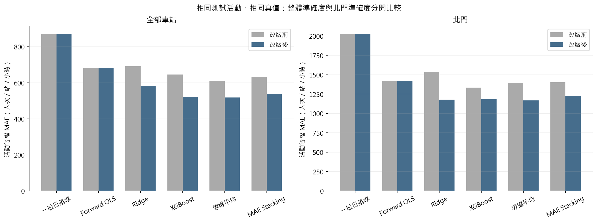
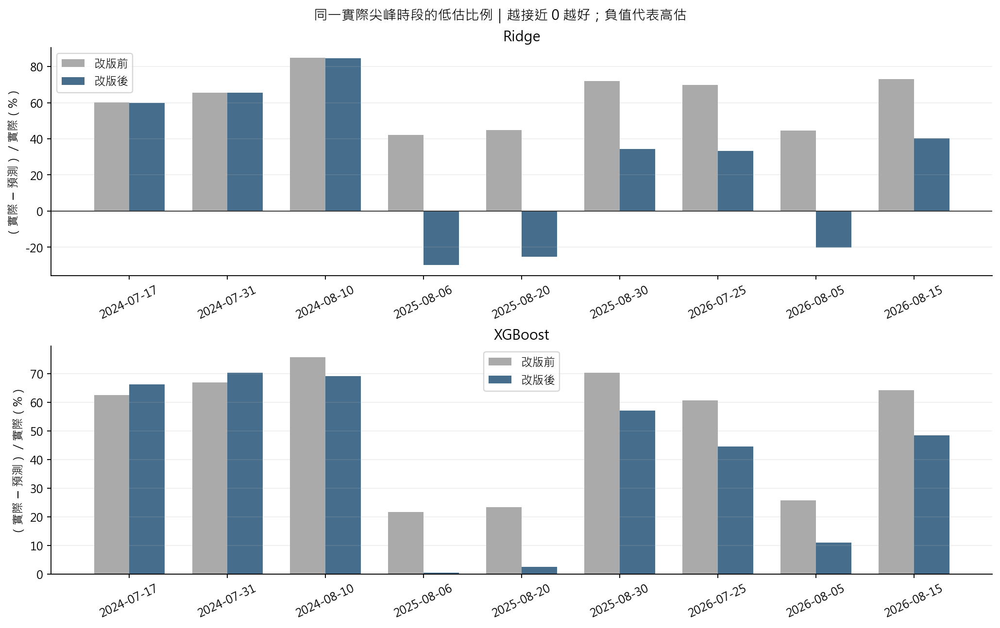
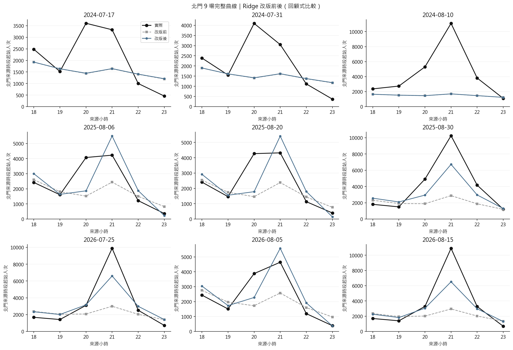
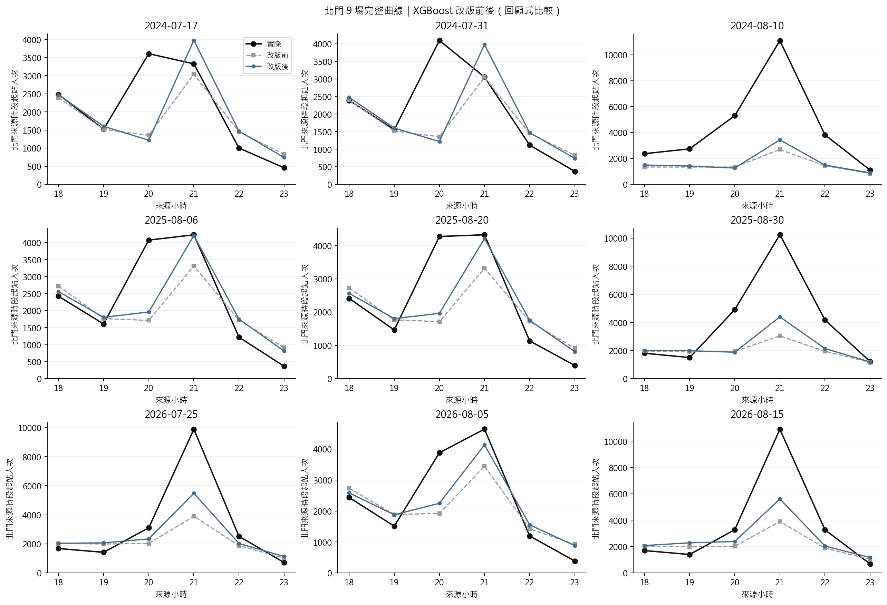
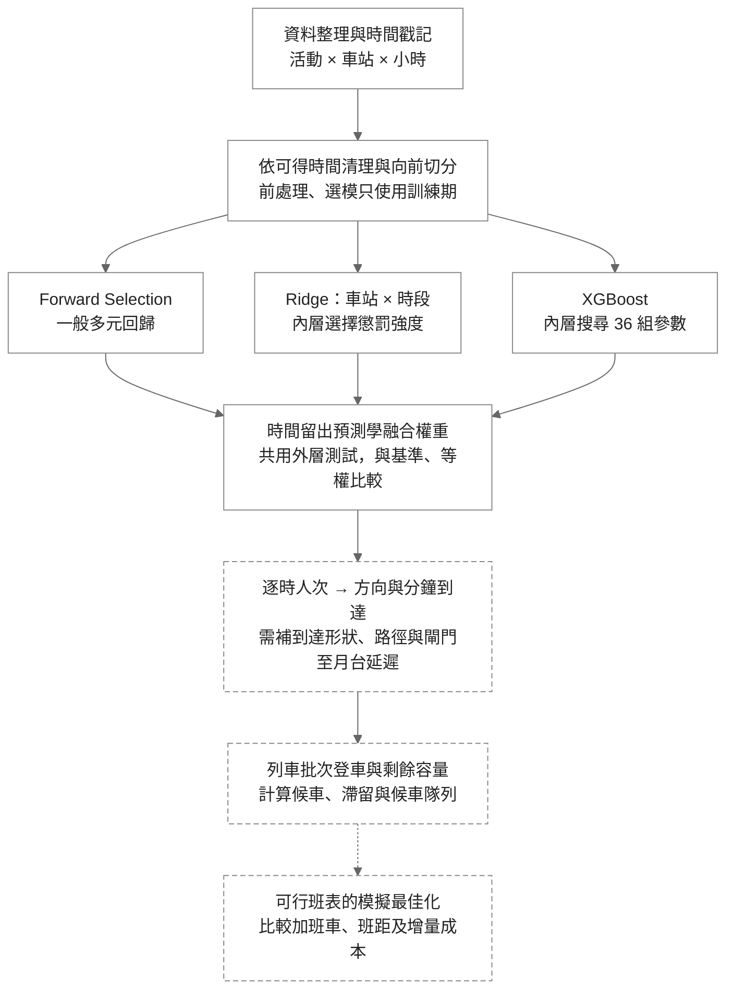

# 大稻埕煙火人流分析與捷運班次模擬

## 專案目的與目前進度

整理北捷逐時 OD、活動、天氣及社群資料，分析煙火活動人流，並銜接候車與列車容量情境。已完成資料前處理、Threads／PTT 文字雲、網站及分析；**第二版已加入 Ridge 車站 × 時段交互作用、XGBoost 調參，並重跑時間驗證與融合。**

**先看 [改版前後比較](result/analysis_v2/comparison/report.md)／[第二版完整結果](result/analysis_v2/report.md)，實作細節看 [process.md](process.md#13-第二版實作與實際改善結果)。** 新圖在根目錄的 [`result/analysis_v2/`](result/analysis_v2/)；[第一版結果](result/analysis_v1/report.md) 保留供比較，舊文字雲仍在 `results/`。

| 項目 | 本版規格 |
|---|---|
| 目標 | 預測活動日四站 18–23 時的來源時段起站人次，暫作進站需求代理 |
| 範圍 | 北門、大橋頭站、雙連、民權西路；2017–2026 年 21 場活動、504 列 |
| 模型 | 原 Forward OLS、交互作用 Ridge、調參 XGBoost、重新計算的等權與 Stacking；一般日基準作比較 |
| 評估 | 2024、2025、2026 年共 9 場；訓練、選變數與學權重只用更早年度 |
| 可用輸入 | 同站同時段一般日基準、站別、小時；候選為週末、年內日序、年度序號；Ridge 再加 15 個站別 × 時段交互項 |
| 暫不進模型 | 事後實測天氣、無人機實況、實際節目長度、年度經費、活動後聲量 |
| 適用界線 | 原外層結果已用於提出改版，屬探索式回顧比較；尚未核實歷史發布時間，不能稱已驗證真實 D−1 部署 |

504 列不等於 504 場獨立活動。VIF、缺值與活動層次相關均已檢查；VIF 不作自動刪欄門檻，沒有對逐列資料套獨立樣本的 p 值。

## 交互作用怎麼看，三個模型在做什麼

原線性模型在控制一般日基準後，各站共用相同的時段增幅；加入「車站 × 時段」後，北門與其他站可以有不同的散場尖峰。它是**站別 0／1 欄 × 時段 0／1 欄**，不是把車站編號乘上小時。

診斷依據：只看 2017–2023 的 12 場訓練資料，舊 OLS 在 21 時平均仍低估北門約 **2,600**，卻高估民權西路約 **1,447** 人次。這支持檢驗不同站的時段效果；不是已做 F 檢定證明顯著，也不是因果結論。

| 模型 | 現在怎麼做 | 本次改動 |
|---|---|---|
| Forward OLS | 基準＋站別＋時段；以訓練內時間 MAE 逐步加入候選變數，再用最小平方估係數 | 維持原版，作為對照 |
| Ridge | 使用全部合格候選＋站別 × 時段；懲罰係數大小，λ 由訓練內選擇 | 新增 15 個交互項，沿用原 λ 搜尋範圍 |
| XGBoost | 用多棵樹逐步修正誤差，可透過分裂學非線性與交互作用 | 搜尋樹深、樹數、葉片門檻與 L2 懲罰共 36 組；不另加交互乘積欄 |

## 第二版實際結果

兩版使用相同來源檔案及 9 場外層活動。MAE 單位為人次／站／小時，越小越好；OLS 與一般日基準的逐筆預測核對不變。

| 方法 | 全站 MAE 原版 → 第二版 | 北門 MAE 原版 → 第二版 |
|---|---:|---:|
| Forward OLS | 680.60 → 680.60 | 1,419.48 → 1,419.48 |
| Ridge | 691.34 → 582.87 | 1,532.55 → 1,177.78 |
| XGBoost | 646.30 → 523.05 | 1,334.62 → 1,181.36 |
| 等權平均 | 611.72 → **517.85** | 1,395.90 → **1,166.83** |
| MAE Stacking | 633.75 → 538.60 | 1,404.09 → 1,226.07 |
| 一般日基準 | 871.48 → 871.48 | 2,027.50 → 2,027.50 |

- **Ridge 北門逐時 MAE 降低 23.1%。** 九場實際尖峰的平均正向低估 4,696.84 → 2,826.99（減少 39.8%）；尖峰絕對誤差 4,696.84 → 3,192.95（減少 32.0%）。2024 幾乎不變，三個較小場次轉為高估；大橋頭與雙連的 MAE 略退步。
- **XGBoost 北門逐時 MAE 降低 11.5%。** 尖峰誤差 4,080.99 → 3,236.04（減少 20.7%），7／9 場改善，2024 兩場 20 時尖峰退步。
- **2026/8/15 尖峰實際 10,904：** Ridge 2,951 → **6,517**；XGBoost 3,899 → **5,616**。有所改善，仍不能視為已解決大型尖峰低估。
- 等權平均的全站 MAE 仍優於學權重 Stacking；民權西路仍以一般日基準最好，不能宣稱一個模型適合所有站。




<details>
<summary>展開九場完整逐時曲線：Ridge 與 XGBoost</summary>




</details>

XGBoost 三個外層年度均選到 `max_depth=3`、`n_estimators=100`、`min_child_weight=1`、`reg_lambda=10`，學習率固定 0.05。Ridge 的 λ 依 2024／2025／2026 為 **1／0.001／0.001**；並非無懲罰。選參過程見 [內層選模紀錄](result/analysis_v2/tables/inner_selection.csv)。

**改善仍是回顧比較，尚不能直接用來決定營運班表。** 需核實來源時段意義，再補方向、分鐘到達、剩餘容量及車隊／折返限制；排隊結果仍是明示假設的情境試算。

## 分析流程



**目前進度：**三個模型與融合比較已實作；分鐘／方向分流及候車僅為假設情境；可行班表最佳化尚待營運資料。D−1 資料發布時間仍需核實，圖中的完整路徑不代表每一步都已完成。

### 詳細 workflow

| 步驟 | 實際要做的事 | 本版狀態／下一步 |
|---|---|---|
| 1. 定義目標 | 活動前一天固定截止時間，預測隔天各站各時段進站人次；另列尖峰與低估指標 | 已有四站 18–23 時歷史比較；504 列來自 21 場活動 |
| 2. 整理資料 | 檢查主鍵、缺值、時間口徑與 `available_at`；重建同站同時段一般日基準 | 日期及數量已核對；來源時段是否按進站分箱、歷史發布時間仍待核實 |
| 3. 設計與檢查變數 | 訓練內檢查共線性、標準化及選變數；區分預定節目、天氣預報與事後實測 | Ridge 已加「車站 × 時段」；D−1 公告散場時間、預定節目與歷史預報仍待補 |
| 4. 三模型並行 | OLS 在內層做 Forward Selection；Ridge 選 λ；XGBoost 選複雜度 | 已完成。Ridge／XGBoost 不沿用 OLS 選完的子集 |
| 5. 學融合權重 | 用更早年度的留出預測學非負、總和為 1 的權重 | 已完成；不能用當年測試真值調權重 |
| 6. 評估預測 | 同一外層活動比較基準、三模型、等權與 Stacking；看逐站、逐場及尖峰 | 全站平均 MAE 最佳不代表北門尖峰最佳；目前尖峰仍明顯低估 |
| 7. 改善尖峰 | 同活動比較有無交互作用與 XGBoost 調參；再考慮一般日基準＋活動增量及預定散場對齊 | 本次重跑顯示平均改善但仍有退步場次；增量與相對散場模型未實作，需另留未來活動確認 |
| 8. 建立到達情境 | 以量測／調查估方向比例、5 分鐘到達曲線與閘門至月台延遲；測試分位數與集中到達情境 | 目前只有均勻到達假設；逐時資料不能直接辨識分鐘尖峰 |
| 9. 批次服務排隊 | 每班依本站剩餘容量上車，滯留延續到下一班；計等待人分鐘、最大隊列、清空時間 | 已有情境程式；列車不直接套 M/M/c，尚未驗證實際候車與全月台人數 |
| 10. 可行調度 | 加入車隊、折返、最小班距、既有班表、月台安全及成本限制，模擬比較可行方案 | 待取得營運限制；不能只選「班距越短越好」 |

北門的原版診斷見 [第 12 節](process.md#12-北門尖峰診斷與改善順序)，本次實作與結果見 [第 13 節](process.md#13-第二版實作與實際改善結果)。

## 快速開始

在專案根目錄執行：

```powershell
# 分析環境
uv sync --group analysis

# 先確認資料；不需要連 MySQL，不會寫回 SQL
uv run --group analysis python -X utf8 src/run_analysis.py --validate-only

# 新環境先重建第一版作對照（已保有第一版私有輸出時可略過）
uv run --group analysis python -X utf8 src/run_analysis.py

# 第二版：自動輸出 result/analysis_v2，並產生原版比較
uv run --group analysis python -X utf8 src/run_analysis.py --config configs/analysis_v2.json

# 有意義的資料、時間切分、融合與排隊測試
uv run --group analysis python -X utf8 -m unittest discover -s tests -p 'test_analysis_v*.py'
```

重跑需要隊員私下提供三個整理檔，依相同相對路徑放置：

- `data/processed/event_station_hourly_context.csv`
- `data/processed/calendar_baseline/candidate_audit.csv`
- `data/processed/station_hourly.parquet`

可選的 `.local/research_review/2026-10-07-refresh/statistics_snapshot.json` 只補實際節目 EDA；缺少它仍可跑同一套預測，但節目完整度圖不同。兩版比較要求相同輸入雜湊，避免把資料改變誤認為模型改善；需保有第一版私有預測及其執行紀錄，否則先跑第一版。各檔 SHA-256 與套件版本記錄在 [run_manifest.json](result/analysis_v2/run_manifest.json)。SQL、原始資料與逐筆預測不提交；只看報告與 PNG 不需要資料庫。

`--require-d1` 會在事前資訊可用性尚未核實時停止。新參數在 [`configs/analysis_v2.json`](configs/analysis_v2.json)，原設定保留於 [`analysis_v1.json`](configs/analysis_v1.json)。

<details>
<summary>既有網站、前處理與文字雲操作</summary>

```powershell
uv sync --group analysis --group notebook --extra social --extra web --extra app
.\app\start.ps1
.\.venv\Scripts\python.exe -X utf8 src/main.py --reuse-clean --mysql
.\.venv\Scripts\python.exe -X utf8 src/import_weather.py
.\.venv\Scripts\python.exe -X utf8 src/threads_web_collect.py
.\.venv\Scripts\python.exe -X utf8 src/ptt_web_collect.py
```

捷運月 CSV 放在 `data/original_data/`；前處理仍需本機 MySQL 的活動與聲量資料。網站透過 Tailscale 私人連線。Threads 預設在新開 Edge 登入後操作，PTT 不需登入；文字雲是公開搜尋樣本，不是全站聲量。年度活動預算與宣導所需費用應各存年度一筆，不能展開後當成每場獨立經費；本版未將它們放進預測。

</details>

## 專案結構

```text
統計實務/
│
├── README.md                         # 專案介紹、實際結果與文獻
├── process.md                        # 資料資格、實作公式、驗證與限制
├── pyproject.toml                    # uv 環境；analysis 套件群組
├── uv.lock                           # 鎖定套件版本
├── configs/analysis_v1.json           # 原版設定，保留供對照
├── configs/analysis_v2.json           # Ridge 交互、XGB 搜尋與新版輸出位置
│
├── src/
│   ├── run_analysis.py               # 本版分析入口
│   ├── analysis_v1/
│   │   ├── data.py                   # 資料核對與逐時基準
│   │   ├── eda.py                    # 缺值、描述統計與活動層次相關
│   │   ├── models.py                 # 三模型、向前驗證、融合與 VIF
│   │   ├── queueing.py               # 平行服務 M/M/c 與列車批次隊列
│   │   ├── queue_report.py           # 方向與班距假設的情境圖表
│   │   ├── reporting.py              # 模型圖表及中文結果報告
│   │   └── comparison.py             # 相同活動的原版／新版比較
│   ├── main.py                       # 既有捷運前處理
│   └── ...                           # 氣象、社群與資料匯入程式
│
├── result/analysis_v1/                # 第一版結果，保留不覆蓋
├── result/analysis_v2/
│   ├── report.md                     # 已執行的結果與解讀
│   ├── figures/                      # 10 張分析 PNG
│   ├── tables/                       # 指標、VIF、相關與情境 CSV
│   ├── folds.json                    # 各外層模型與權重
│   ├── run_manifest.json             # 資料雜湊、環境與設定
│   └── comparison/                   # 4 張前後比較圖、指標表與中文報告
│
├── app/                              # 前端、FastAPI、Tailscale 啟動
├── data/                             # 原始與整理資料，另外私下共享
├── .local/                          # 各版私有預測與模型，不提交
├── tests/                            # 資料、時間隔離、融合及排隊測試
├── docs/                             # 既有說明、資料規格與文獻
├── mysql/                            # 匯入程式；SQL 留在本機
└── results/                          # 舊有前處理、社群與研究結果
```

## 詳細說明與參考資料

- [第二版完整分析結果](result/analysis_v2/report.md)／[改版比較](result/analysis_v2/comparison/report.md)／[實作細節與公式](process.md)
- [網站啟動與隊員連線](app/README.md)
- [資料前處理與欄位定義](docs/data_preprocessing.md)／[資料庫結構](docs/database_schema.dbml)
- [Threads](docs/threads_collection.md)／[PTT](docs/ptt_collection.md)／[Google Trends](mysql/GOOGLE_TRENDS_README.md)
- [既有參考論文](docs/references.md)／[研究規劃](docs/research_plan.md)

本版方法依據：

| 文獻 | 本版用途與界線 |
|---|---|
| [Heinze、Wallisch & Dunkler（2018）](https://onlinelibrary.wiley.com/doi/full/10.1002/bimj.201700067)，§2.2、2.4 | 變數選擇及選後推論風險；Forward Selection 不保證最佳。本版用內層時間 MAE，不做選後普通 p 值。 |
| [Hoerl & Kennard（1970）](https://doi.org/10.1080/00401706.1970.10488634)，§0–2 | Ridge 在相關設計下的偏差與變異取捨；不能推論本資料一定勝 OLS。 |
| [Chen & Guestrin（2016）](https://arxiv.org/abs/1603.02754)，§2 | XGBoost 正則化加法樹；本版的淺樹、小 grid 是研究設定，不是原文保證的最優參數。 |
| [Breiman（1996）Stacked Regressions](https://statistics.berkeley.edu/sites/default/files/tech-reports/367.pdf)，§1、2、5、7 | 用留出預測學融合權重；本版活動平衡 MAE 線性規劃與年度向前切分為延伸，原文主要用非負最小平方。 |
| [Varma & Simon（2006）](https://pmc.ncbi.nlm.nih.gov/articles/PMC1397873/) | 分開內層選模與外層評分，避免共用驗證資料造成樂觀偏差；不能解決活動場次少或發布時間未知。 |
| [Hyndman & Athanasopoulos，§5.10](https://otexts.com/fpp3/tscv.html) | 訓練只用預測時點以前的資料；本版再按整年度及活動分組。 |
| [Santanam 等（2021），Public Transit for Special Events: Ridership Prediction and Train Optimization](https://arxiv.org/abs/2106.05359) | 活動需求預測銜接列車排程的研究方向；本版只完成批次容量情境，未重現其調度最佳化。 |
| [Gneiting（2011），Quantiles as optimal point forecasts](https://doi.org/10.1016/j.ijforecast.2009.12.015) | 下一版容量規劃可用非對稱成本選擇分位數；目前尚未擬合或驗證 P80／P90，不能當作安全保證。 |
| [XGBoost 官方參數文件](https://xgboost.readthedocs.io/en/stable/parameter.html) | 調整樹深、葉節點 Hessian 門檻與 L2 懲罰；本案平方誤差的列數門檻不等於獨立活動場數。 |
| [Cawley & Talbot（2010）](https://jmlr.org/papers/v11/cawley10a.html) | 選模準則也可能過擬合；看過外層結果再改模型的比較需保留探索性定位。 |

資料來源：

- [北捷分時進出站運量](https://data.taipei/dataset/detail?id=63f31c7e-7fc3-418b-bd82-b95158755b4d)
- [固定／變動成本](https://www.metro.taipei/cp.aspx?n=20CB8DE3F41B411)：參考 114 年審定決算書。
- [變動／固定公里數](https://whhr.gov.taipei/News_Content.aspx?n=0121E4C78246FC0D&s=3E147DD6A74BE990)
- [天氣資料](https://codis.cwa.gov.tw/StationData)：氣象署 CODiS。
- [特殊節假日](https://data.gov.tw/dataset/14718)：政府行政機關辦公日曆表。
- [大稻埕煙火排程參考](https://data.gov.tw/dataset/7778)：觀光資訊活動資料庫。
