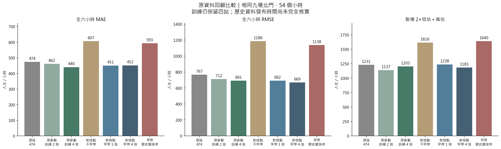
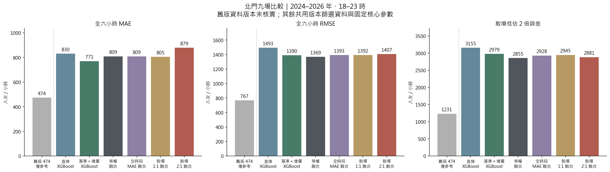
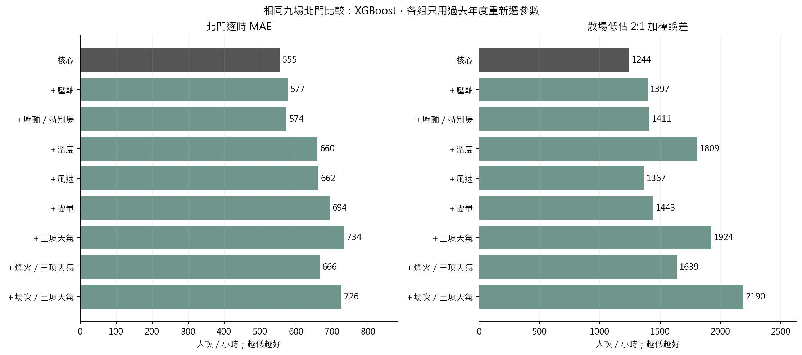
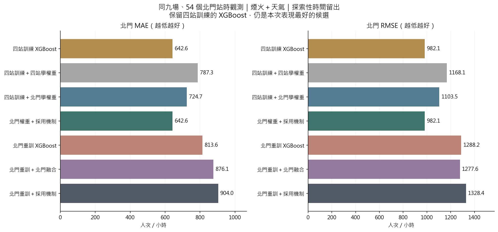
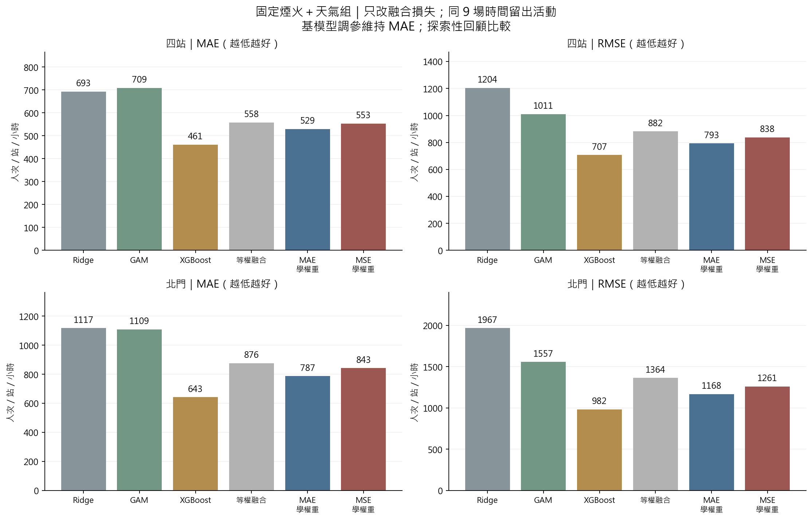
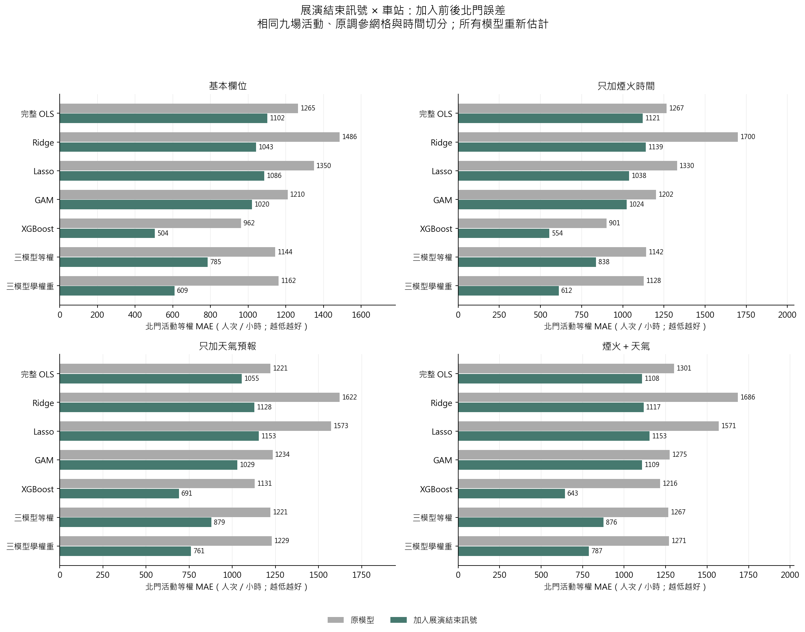
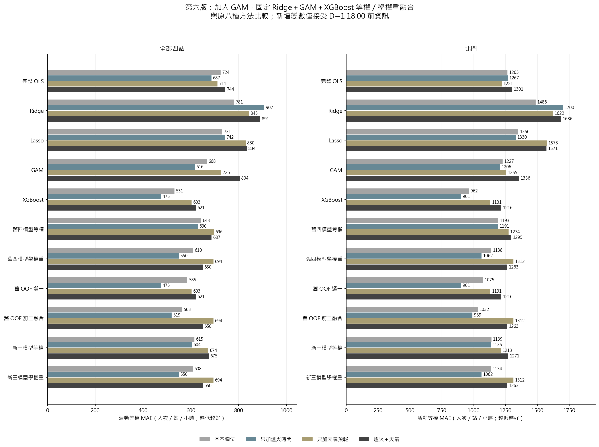
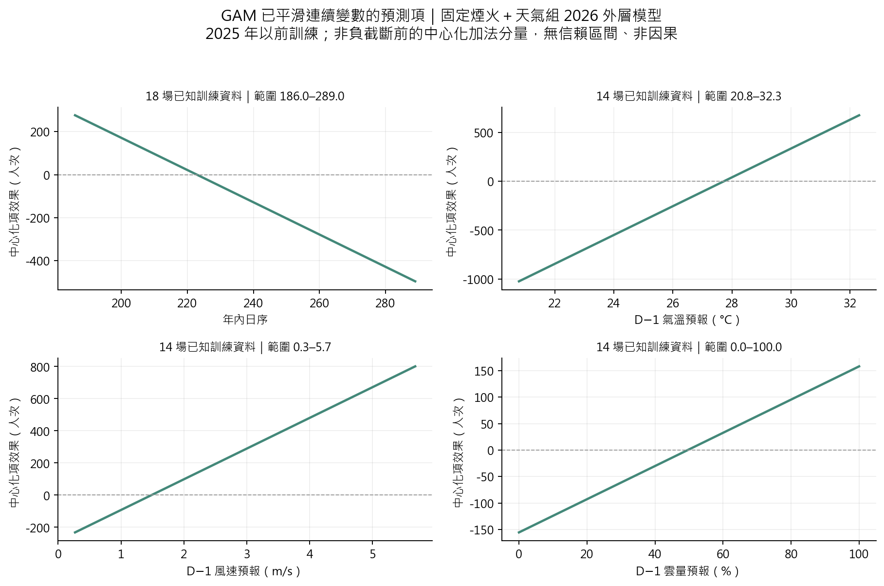
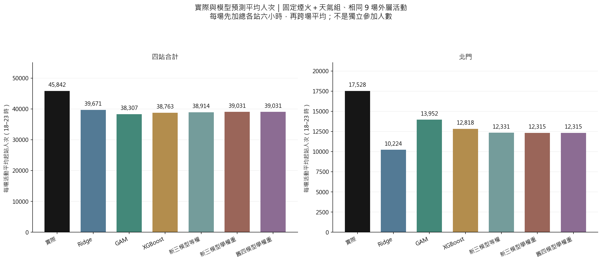
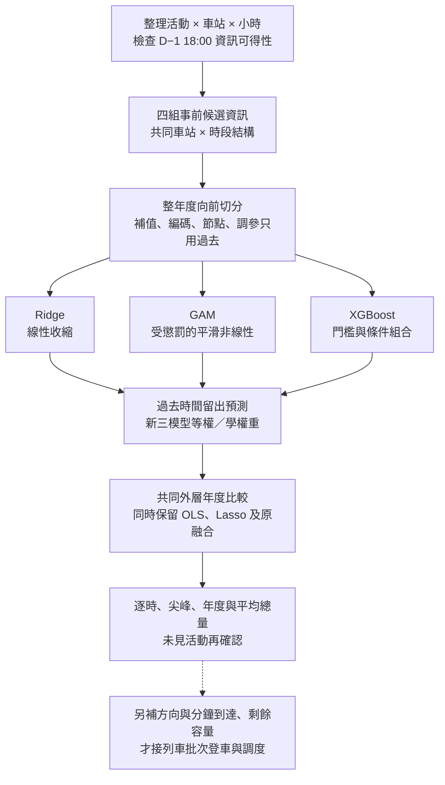

# 大稻埕煙火人流分析與捷運班次模擬

## 最新進度：原資料調參、Early stopping 與北門散場加權（2026-10-13）

**原 MAE 473.91 已重現。保留原參數、只提高北門散場訓練權重到 4 倍，降到 440.28（改善 7.1%）；新學習率格點搭配 early stopping、不加權，降到 450.55。**

保留四站訓練，比較同樣 2024–2026 九場北門、54 個小時。本次回到 V12 原資料，歷史發布時間尚未完全核實，屬回顧敏感度實驗；**不可當成已驗證 D−1 可部署模型，也不可和下方 V13 不同資料版本直接排名。**

| 方法 | MAE | RMSE | 散場 2:1 誤差 |
| --- | --- | --- | --- |
| 原固定參數＋一般日基準 | 473.91 | 766.90 | 1,231.28 |
| 原參數＋散場訓練 2 倍 | 461.71 | 711.66 | 1,137.02 |
| 原參數＋散場訓練 4 倍 | 440.28 | 690.91 | 1,202.98 |
| 新學習率／樹數格點，不早停 | 606.71 | 1,186.37 | 1,615.79 |
| 新學習率格點＋early stopping | 450.55 | 691.74 | 1,237.56 |
| Early stopping＋訓練 4 倍 | 451.71 | 669.27 | 1,182.51 |
| Early stopping＋歷史選倍率 | 592.92 | 1,137.75 | 1,639.89 |

- **與以前北門專用不同：**保留其他三站，只提高北門事前預定結束後兩小時的訓練重要性。每場總權重相同；不用實際尖峰決定權重。
- **早停怎麼做：**用更早年份訓練、最近過去年份驗證決定樹數，再以全部過去資料重訓。不加權版選 186／818／63 棵；當年真值不參與停止或選參數。
- **尖峰仍未解決：**原參數 4 倍版 MAE 較好，但尖峰平均絕對誤差僅 749.02 → 747.14，尖峰正向低估反而增加。早停 4 倍 RMSE 較低，仍非每場都改善。
- **自動選倍率也會選錯：**只依過去 OOF 選 1／2／4 倍，早停版 MAE 592.92；不能看完九場後挑 4 倍，就說已證明未來最佳。改善主要集中於 2024，九場已反覆用於開發。



[完整結果與解讀](result/analysis_v14/report.md)／[九場逐時圖](result/analysis_v14/figures/beimen_profiles.png)／[1、2、4 倍比較](result/analysis_v14/figures/weight_ablation.png)／[停止曲線](result/analysis_v14/figures/early_stopping.png)／[實作公式](process.md#25-第十四版原資料的早停與北門散場訓練加權)／[獨立檢核](result/analysis_v14/independent_validation.json)。

方法依據：[XGBoost 官方 Early stopping](https://xgboost.readthedocs.io/en/stable/python/sklearn_estimator.html)、[sample_weight](https://xgboost.readthedocs.io/en/stable/python/python_api.html#xgboost.XGBRegressor.fit)、[Cawley & Talbot（2010），模型選擇過擬合](https://jmlr.org/papers/v11/cawley10a.html)。倍率與窗口是本案假設，文獻不保證一定改善。

## 第十三版紀錄：一般日基準＋活動增量與低估 2 倍融合（2026-10-13）

**相同資料與參數下，XGBoost 改成基準＋增量，MAE 830.44 → 770.69（降低 7.2%）。散場 2:1 融合 MAE 878.74，沒有勝過單一增量 XGBoost。**

同樣比較 2024–2026 九場北門 18–23 時；新版四站訓練，依官方 OD 版本時間篩選一般日與訓練標籤。下表越低越好，單位人次／小時。

| 方法 | MAE | RMSE | 散場 2:1 誤差 |
| --- | --- | --- | --- |
| 舊版固定參數（僅參考） | 473.91 | 766.90 | 1,231.28 |
| 直接預測 XGBoost | 830.44 | 1,493.42 | 3,154.92 |
| 基準＋增量 XGBoost | 770.69 | 1,390.12 | 2,978.86 |
| 增量模型等權融合 | 809.27 | 1,369.30 | 2,854.91 |
| 全時段 MAE 融合 | 808.93 | 1,393.31 | 2,927.75 |
| 散場 1:1 融合 | 804.55 | 1,392.11 | 2,945.34 |
| 散場 2:1 融合 | 878.74 | 1,406.80 | 2,881.48 |

- **舊版 474 只作參考：**原資料缺發布核實；新版排除 2017–2020 四場、改用截止前已存在的官方 OD 版本，21 場縮為 17 場。新版直接／增量組則共用相同資料與核心參數，才能比較分解方式。
- **模型怎麼做：**先算同站同時段、同星期且截止前可用的前 56 天均值，再預測活動日與它的差。增量允許負值，最後總人流才限制非負；它不是活動因果效果。
- **權重怎麼做：**只用過去年份的北門 OOF，分別最小化全時段 MAE、散場 1:1 與散場 2:1。2 倍是研究假設；本輪沒有自動替換上線模型。
- **沒有全面改善：**散場 2:1 融合的低估量比 1:1 少，但高估增加、全時段 MAE 變差；等權融合 MAE 809.27、2:1 誤差 2854.91 也都比它低。2025、2026 的 2:1 權重都是 Ridge 100%，不能把過去最適權重當成未來必勝。
- **資料界線：**目前版本時間早於截止已檢查，但沒有完整歷史公開權限證據；同星期代理基準尚未排除所有補班／節日。沒有加入事後天氣、聲量或當場實測輸入。九場已重複檢視，仍需未見活動驗證。



[完整結果與三模型比較](result/analysis_v13/report.md)／[九場曲線](result/analysis_v13/figures/beimen_profiles.png)／[基準＋增量圖](result/analysis_v13/figures/baseline_increment.png)／[年度權重圖](result/analysis_v13/figures/fusion_weights.png)／[公式與重現步驟](process.md#24-第十三版一般日基準活動增量與非對稱融合)／[獨立檢核](result/analysis_v13/independent_validation.json)。

方法依據：[官方 OD 目錄](https://data.taipei/dataset/detail?id=63f31c7e-7fc3-418b-bd82-b95158755b4d)、[Azure 版本與分段校驗定義](https://learn.microsoft.com/en-us/rest/api/storageservices/get-blob)、[Breiman（1996）stacking](https://statistics.berkeley.edu/sites/default/files/tech-reports/367.pdf)、[Gneiting（2011）損失與決策目標](https://arxiv.org/abs/0912.0902)、[FPP3 時間向前驗證](https://otexts.com/fpp3/toolbox.html#time-series-cross-validation)。

## 第十二版紀錄：場次定位、熱度、一般日與天氣拆分（2026-10-13）

**已補壓軸／特別場並重跑 Ridge、GAM、XGBoost。新增資訊這次未改善 XGBoost 的整體表現；一般日基準有潛力，但仍需核實當時可得性。**

固定四站訓練、2024–2026 年九場北門 18–23 時評估；每年度只依過去年份的時間留出預測（OOF），以「散場低估 2 倍、高估 1 倍」選參數。下列 XGBoost 單位為人次／小時，越低越好。

| 輸入 | MAE | 散場 2:1 誤差 |
|---|---:|---:|
| 核心輸入 | 555.12 | 1244.25 |
| ＋壓軸 | 576.71 | 1396.64 |
| ＋壓軸／非壓軸特別場 | 573.53 | 1410.87 |
| ＋溫度 | 659.55 | 1808.52 |
| ＋風速 | 661.76 | 1366.87 |
| ＋雲量 | 693.86 | 1443.07 |
| ＋三項天氣 | 734.01 | 1924.21 |

- **壓軸與特別場：**分開記錄；壓軸核實 16/21 場、特別場旗標核實 15/21 場，其餘保留未知。在各外層訓練前的已核實樣本中，壓軸與週末完全相同，新增獨立資訊有限。Ridge 加壓軸的 MAE 1114.92 → 1058.83；XGBoost 未改善。
- **Google 已分析：**原檔是 117 個月、2017/1–2026/9 的相對指數。九個完整年度的平均指數與北門每場六小時人次之描述性相關 r=0.253；前月熱度的 XGBoost 敏感度 MAE 589.81。2025 八月三場前月值都為 15，不能區分場次；當月及當年完整指數含活動後資料。查詢條件與歷史版本尚待核實，未納入正式事前輸入。
- **一般日已重建：**同站、同時段、前 56 天配對值與快照一致。固定參數時 XGBoost MAE 555.12 → 473.91；重新調參後為 568.98。仍缺歷史發布證據，只作回顧性敏感度。
- **天氣已拆開：**只用截止前預報。2025/8/30 21 時真值 10,251；核心估 10,203，加溫度估 7,146，加風速估 7,209，加雲量估 10,486，三項一起估 4,784。這場主要問題出現在溫度／風速組合，但三個單項的九場合併 MAE 都沒有勝過核心。



[完整三模型結果](result/analysis_v12/report.md)／[天氣拆分圖](result/analysis_v12/figures/weather_ablation.png)／[Google 描述分析圖](result/analysis_v12/figures/google_descriptive.png)／[北門九場曲線](result/analysis_v12/figures/beimen_profiles.png)／[一般日與 Google 敏感度圖](result/analysis_v12/figures/unverified_sensitivity.png)／[實作 process 第 23 節](process.md#23-第十二版壓軸google-熱度一般日與天氣拆分)。

本節核心 555.12 是 V11 的 2:1 調參版；舊 V8 核心採 MAE 調參為 504.20。這次以相同規則比較新增資訊，不自動更換上線模型。九場已反覆使用，後續應優先補事前逐日熱度、一般日發布記錄及未見活動，避免只擴增變數與搜尋。分析系列 258 項測試通過；[獨立核對](result/analysis_v12/independent_validation.json)重算 99 次選參數、858 列指標，並完整重現 V11 的核心／煙火＋天氣控制組。

資料與方法：[官方場次來源帳本](docs/d1_event_type_sources.json)、[Google 指數說明](https://support.google.com/trends/answer/4365533?hl=zh-Hant)、[FPP3 時間向前驗證](https://otexts.com/fpp3/toolbox.html#time-series-cross-validation)、[特殊活動與列車模擬文獻](https://arxiv.org/html/2106.05359)。

## 第十一版紀錄：散場優先調參（2026-10-13）

**已用「低估 2 倍、高估 1 倍」重選 Ridge、GAM、XGBoost 參數，另比較 1:1、3:1。Ridge 有改善；XGBoost 沒有更準，暫不替換原主要候選。**

固定煙火＋天氣輸入、四站訓練；2024–2026 年同九場北門 18–23 時的結果。散場指標依事前預定結束後兩小時對「整小時誤差」加權，不是分鐘實測；越低越好。

| 模型 | 原 MAE → 擴大調參後 | 原散場 2:1 誤差 → 擴大調參後 |
|---|---:|---:|
| Ridge | 1117.39 → **1000.13** | 4112.39 → **3386.89** |
| GAM | 1108.64 → 1116.66 | 3341.43 → 3306.29 |
| XGBoost | **642.59** → 666.07 | **1595.61** → 1639.36 |

- **怎麼調：**Ridge 25 組收縮強度；GAM 4／5／7 基底與兩種懲罰，共 60 組；XGBoost 原 90 組＋固定抽取 90 組，共 180 組。每年度只用過去活動的時間留出誤差選參數，訓練損失仍維持原平方誤差。
- **改善來自哪裡：**Ridge 原網格只改評分已達 MAE 982.30；擴大網格的 1000.13 反而略差。更多搜尋不保證更好。3:1 XGBoost 亦未改善，不事後更換主分析。2 倍是研究偏好，不是已估計的成本。
- **排隊資料：**有特殊活動的五分鐘 AFC 曲線文獻，也有臺灣捷運十五分鐘實測圖；尚未取得北門活動日一／五分鐘資料。目前只能做均勻、寬峰、集中峰的情境分析，不能稱為真實分鐘分布或最佳班表。


[完整結果與年度參數](result/analysis_v11/report.md)／[實作流程與公式](process.md#22-第十一版散場優先調參與分鐘資料依據)／[分鐘資料來源與排隊銜接](docs/minute_arrivals_evidence.md)／[1、2、3 倍比較圖](result/analysis_v11/figures/penalty_sensitivity.png)／[北門九場曲線](result/analysis_v11/figures/beimen_tuned_profiles.png)。[獨立檢核](result/analysis_v11/independent_validation.json)已重算 108 次選參數與 546 列指標。

本輪延用 D−1 輸入限制；歷史 OD 發布時間及日曆版本仍未完全核實，且九場已反覆檢視，因此是探索性回顧，尚未部署。文獻：[Gneiting（2011），損失與預測目的](https://arxiv.org/abs/0912.0902)、[Bergstra & Bengio（2012），隨機調參](https://jmlr.org/papers/v13/bergstra12a.html)、[Cawley & Talbot（2010），選擇偏誤](https://jmlr.org/papers/v11/cawley10a.html)、[Santanam 等（2021），到站曲線與列車模擬](https://arxiv.org/html/2106.05359)。

## 第十版紀錄：融合採用與北門專用模型（2026-10-12）

**兩種北門聚焦實驗都已完成：只改權重有改善；連模型都只用北門重訓，本次沒有更準。目前保留四站訓練的 XGBoost 為主要候選。**

固定「煙火＋天氣」輸入，同 2024–2026 年九場、北門 18–23 時共 54 列；單位人次／小時，誤差越低越好：

| 訓練與使用方式 | MAE | RMSE |
|---|---:|---:|
| 四站訓練 XGBoost | **642.59** | **982.09** |
| 四站訓練＋四站學融合權重 | 787.27 | 1168.11 |
| 四站訓練＋只用北門學權重 | **724.65** | **1103.49** |
| 四站訓練＋北門權重＋採用機制 | **642.59** | **982.09** |
| 北門專用 XGBoost | 813.60 | 1288.15 |
| 北門專用三模型＋融合 | 876.12 | 1277.55 |
| 北門專用三模型＋採用機制 | 903.98 | 1328.37 |

- **誤差互補有限：**2026 年以前的北門時間 OOF，Ridge／XGBoost 誤差相關 0.71、GAM／XGBoost 0.69；一個高估、一個低估的比例約 23%、20%。另外檢查誤差幅度及 XGBoost 低估時能否補救，不能只看相關係數。
- **只改融合對象：**北門權重讓原融合 MAE 降低 **8.0%**，尖峰正向低估由 1338.54 降至 1094.52；仍不及單獨 XGBoost 的 889.81。完整指標含尖峰絕對誤差，避免把高估記 0 誤認為準確。
- **採用機制：**先用更早活動學權重，再用較晚的過去活動檢查融合是否勝過 XGBoost；勝出才採用，資料不足或平手就用 XGBoost。四站模型在三年度均選 XGBoost，所以成績相同，並非融合超越它。**北門重訓的機制曾選錯，整體 MAE 903.98 反而較差**，程序也不保證未來必勝。
- **完整北門重訓：**Ridge、GAM、XGBoost 都重新調參；候選資訊、網格及時間切分維持一致。資料仍是 21 場，從四站 504 列變為單站 126 列；不能把變差唯一歸因於資料量，跨站資訊、設計及最適參數也同時改變。



[完整報告](result/analysis_v10/report.md)／[誤差互補圖](result/analysis_v10/figures/error_complementarity.png)／[北門九場曲線](result/analysis_v10/figures/beimen_focus_profiles.png)／[實作與重現](process.md#21-第十版誤差互補融合採用與北門專用重訓)。新增 22 項測試通過；另獨立重算 54 個權重問題、27 個採用決策及全部摘要，見 [檢核紀錄](result/analysis_v10/independent_validation.json)。

本次沒有新增事後變數；既有 D−1 18:00 篩選沿用，歷史 OD 發布時間／日曆版本未完全核實。這九場已多次檢視，仍屬探索性比較，尚未部署或完成排隊調度驗證。文獻依據：[Breiman（1996）stacking](https://statistics.berkeley.edu/sites/default/files/tech-reports/367.pdf)、[Cawley & Talbot（2010）模型選擇偏誤](https://jmlr.org/papers/v11/cawley10a.html)、[FPP3 時間向前驗證](https://otexts.com/fpp3/toolbox.html#time-series-cross-validation)；本次採用門檻為自行明定，並非文獻保證最適。

## 第九版紀錄：MAE／MSE 融合比較（2026-10-12）

**目前 MAE 學權重較好，換成 MSE 沒有改善北門尖峰；XGBoost 單獨仍較準。** 固定第八版 Ridge、GAM、XGBoost 的時間留出預測，只改融合權重的目標。兩種融合都限制權重非負且加總為 1，使用相同過去 OOF，基模型調參維持 MAE。

主分析「煙火＋天氣」，北門 2024–2026 年九場、54 列；下列單位均為人次／小時，越小越好：

| 方法 | MAE | RMSE | 實際尖峰時刻的平均正向低估 |
|---|---:|---:|---:|
| XGBoost | **642.59** | **982.09** | **889.81** |
| Ridge＋GAM＋XGBoost 等權 | 875.62 | 1363.62 | 1926.54 |
| 三模型 MAE 學權重 | **787.27** | **1168.11** | **1338.54** |
| 三模型 MSE 學權重 | 842.53 | 1261.08 | 1484.04 |

- MSE 比 MAE 融合的北門 MAE 高 **7.0%**、RMSE 高 **8.0%**；四組輸入的九場合併結果都同方向。每場先算誤差，再將活動等權平均；RMSE 是「平均活動 MSE 的平方根」。
- 原因可從權重看：MSE 更重視過去 OOF 的大誤差，三個年度都提高 GAM、降低 XGBoost 權重；過去 OOF 的 RMSE 確實降低，但沒有轉化為整體外層改善。**2025 年北門是例外，MSE 的 RMSE 1178.56 優於 MAE 的 1241.72**，並非每年都較差。
- MSE 與 RMSE 在相同樣本／加權下有相同最適權重，因此用 MSE 求解、用人次單位的 RMSE 報告。尖峰低估以「實際尖峰同小時」計算，高估記 0；[完整報告](result/analysis_v9/report.md) 同時列尖峰絕對誤差。
- 這是已反覆檢視九場的探索性比較，暫保留 MAE 融合作對照，XGBoost 作主要候選；尚未自動更換上線模型，也未完成排隊／調度驗證。D−1 歷史 OD 發布時間與日曆版本的既有限制仍保留。



結果與圖：[第九版報告](result/analysis_v9/report.md)／[年度權重](result/analysis_v9/figures/fusion_weights.png)／[北門九場曲線](result/analysis_v9/figures/beimen_profiles.png)。公式、檢核及重現：[process 第 20 節](process.md#20-第九版固定基模型比較-mae-與-mse-融合)。

文獻：[Breiman（1996）平方損失 stacking](https://statistics.berkeley.edu/sites/default/files/tech-reports/367.pdf)、[Ersoy 等的時間序列 L1／L2 stacking](https://doi.org/10.1007/978-3-031-35763-3_7)、[Gneiting（2011）預測目標與損失函數](https://arxiv.org/abs/0912.0902)。文獻支持方法；哪個較準由本案時間留出結果評估。

## 第八版紀錄：展演結束訊號（2026-10-11）

已加入 **「事前預定展演結束後 0–60／60–120 分鐘 × 車站」**，重跑四組輸入與全部十一種方法。18/21 場有合格時間來源，其餘三場保留未知；不用實際散場時間或事後尖峰反推輸入。方法與重現見 [process 第 19 節](process.md#19-第八版事前展演結束訊號與-canva-簡報稿)，完整結果在 [result/analysis_v8](result/analysis_v8/report.md)。

固定「煙火＋天氣」組，北門九場、54 個逐時觀測的 MAE（人次／小時，越低越好）：

| 模型 | 第七版 | 加入結束訊號 |
|---|---:|---:|
| GAM | 1275.14 | 1108.64 |
| XGBoost | 1216.43 | **642.59** |
| Ridge＋GAM＋XGBoost 等權 | 1266.76 | 875.62 |
| Ridge＋GAM＋XGBoost 學權重 | 1271.13 | **787.27** |

- XGBoost、學權重融合的北門 MAE 分別降低約 **47.2%、38.1%**；融合仍未勝過 XGBoost。其他三組也完整比較，沒有自動挑新勝者上線。
- 2026/8/15 北門 21 時真值 10,904；XGBoost 由 7,122 → **10,632**，學權重融合由 5,035 → **9,398**。這是逐時起站人次，不是現場獨立人數。
- 不是所有指標都改善：XGBoost 預測尖峰所在小時的平均絕對差由 0.222 → 0.333 小時。這九場已被反覆檢視，屬探索性比較；仍須未見活動及完整發布證據驗證。



**簡報用：[16 頁 Canva prompt](docs/canva_project_prompt.txt)**。包含資料總覽、模型直覺、調參與融合、實測結果；方法頁左下角放文獻，沿用附件米白／深灰／淡綠設計。這是可貼上的提示詞，尚未生成 Canva 簡報。排隊與列車調度仍標為後續工作。

**方法導向版：[24 頁 Canva prompt](docs/canva_methods_prompt.txt)**。原始資料分析 5 頁；線性模型、GAM、XGBoost 各自一頁，說明選擇直覺、做法與可解釋性；另含融合、排隊理論、離散事件模擬與調度設計。附現成圖片路徑及上傳位置，方法頁左下角保留文獻。

## 第七版紀錄：GAM 修復（2026-10-11）

已補上 GAM 的訓練活動支持門檻與全非截距係數 L2，重跑四組資料及三模型融合。**實作、懲罰公式、前後結果與重現指令整理在 [process 第 18 節](process.md#18-第七版修正-gam-失穩後重跑融合)**；新報告與四張圖在 [result/analysis_v7](result/analysis_v7/report.md)。

- 煙火＋天氣組 2022 年失控的 OOF 最高預測：363,992 → 6,645；未刪除該年驗證。
- 北門 GAM MAE：1,355.52 → 1,275.14；等權融合 1,270.94 → 1,266.76；學權重融合 1,263.43 → 1,271.13。
- **穩定性已改善，融合仍未勝過 XGBoost（北門 MAE 1,216.43）**；GAM 非零權重不等於未來預測更準。舊八方法逐值不變，171 項分析測試通過，D−1 歷史發布證據限制仍保留。

以下保留第六版的專案介紹、流程與結果；其中 GAM 設定、零權重、圖表及重跑指令屬修復前版本，最新規格以第七版 `process.md` 為準。

## 第六版紀錄：專案目的與進度

整理北捷逐時 OD、活動、天氣及社群資料，分析煙火活動人流，銜接候車與列車容量情境。**第六版新增 GAM，比較 Ridge＋GAM＋XGBoost 的等權與學權重融合，並保留原八種方法作同樣本對照。**

先看 [完整結果](result/analysis_v6/report.md)／[平均人次圖](result/analysis_v6/figures/mean_event_counts.png)，細節看 [process 第 17 節](process.md#17-第六版gam-與三模型融合)。新圖放在根目錄 `result/analysis_v6/`，舊版保留。

| 項目 | 本版規格 |
|---|---|
| 目標 | 北門、大橋頭站、雙連、民權西路，活動日 18–23 時的來源時段起站人次，暫作進站需求代理 |
| 資料與評估 | 21 場、504 列；外層比較 2024–2026 年 9 場、216 列，整年度向前切分 |
| 事前截止 | 活動前一天 18:00（臺北時間），新增節目／天氣須有截止前的發布證據 |
| 四組輸入 | 基本變數／只加煙火時間／只加天氣預報／煙火＋天氣 |
| 公平比較 | 共用候選資訊、訓練期補值及 15 個車站 × 時段交互項；GAM 再展開部分 spline 基底，所以不是完全相同的最終矩陣 |
| 排除 | 發布時間未核實的近 56 天一般日人流、當日實測天氣、事後整月聲量、年度實支 |
| 限制 | 504 列不是 504 場獨立活動；早年訓練標籤發布時間、日曆歷史版本及已辦活動篩選仍有限制，尚非完整 D−1 上線驗證 |

## 為什麼選 Ridge、GAM、XGBoost 融合？

| 模型 | 直覺理由 | 本專案如何解讀？ |
|---|---|---|
| **Ridge** | 線性關係＋係數收縮，保留相關訊號並降低估計變動 | 車站、時段、煙火與天氣共同加總，保留指定交互作用；係數有偏，不是因果效果 |
| **GAM** | 允許連續變數呈現平滑的彎曲關係，仍可逐項畫圖 | 氣溫增加一度的預測變化不必固定；站別與時段結構保留，但不自動加入天氣 × 車站等交互作用 |
| **XGBoost** | 用條件切分學習門檻與多變數組合 | 特定車站、時段與節目條件可有不同預測規則；沒有單一固定斜率，也不代表發現因果 |
| OLS、Lasso（對照） | 分別檢查無收縮完整線性設計、L1 收縮與稀疏選變數 | 用來評估新增非線性與融合是否值得，不強迫每個模型都放進主要融合 |

**向老師可以說：**「我們依不同函數結構選模型：Ridge 提供收縮後的線性基準，GAM 刻畫可解釋的平滑非線性，XGBoost 捕捉門檻與條件組合；再用較晚年度檢查不同預測誤差是否能互補。」

本版 OLS 延續第五版完整設計，不做 Forward Selection。Lasso 的變數選擇與融合的模型權重是兩件事；相關欄位的入選可能不穩定，普通 Lasso 也未強制交互作用的階層限制。**模型名稱不同，不代表誤差必定互補；權重不是各因素真實影響的比例。**

## 活動前一天可用哪些輸入？

| 變數 | 可核對場次 | 處理 |
|---|---:|---|
| 車站、時段、週末、年內日期、年度趨勢 | 21/21 的分析欄位 | 共同候選；日曆由分析活動日期推導，歷史預定日期版本仍待補核 |
| 預定純煙火分鐘／開始時間 | 19/21、16/21 | 使用事前公告，整套節目開始不冒充煙火開始 |
| 預報氣溫、風速、雲量 | 各 17/21，每場 6 時點 | 已公開的歷史 GFS 操作型預報，不是當日實測 |
| 預定無人機／整套展演分鐘 | 各 2/21 | 外層訓練期全未知，未列候選，尚不能估計無人機效果 |

未知保留缺值，未提無人機不視為沒有；補值、標準化、欄位識別與 spline 節點都只用訓練期。精確線性相依欄位採共同規則移除，僅高度相關不刪。四站天氣共用附近 0.25° 網格，不是站口微氣候。[節目證據](docs/d1_program_sources.json)／[天氣發布稽核](docs/d1_weather_audit.md)／[逐筆輸入檢查](result/analysis_v6/both/tables/d1_feature_audit.csv)。

## 重跑後的實際結果

同九場外層活動，**北門逐時 MAE（人次／小時，越低越好）**：

| 模型 | 基本變數 | 只加煙火 | 只加天氣 | 煙火＋天氣 |
|---|---:|---:|---:|---:|
| OLS | 1,265 | 1,267 | 1,221 | 1,301 |
| Ridge | 1,486 | 1,700 | 1,622 | 1,686 |
| Lasso | 1,350 | 1,330 | 1,573 | 1,571 |
| **GAM（新增）** | **1,227** | **1,206** | **1,255** | **1,356** |
| XGBoost | 962 | 901 | 1,131 | 1,216 |
| **新三模型等權** | **1,139** | **1,135** | **1,213** | **1,271** |
| **新三模型學權重** | **1,134** | **1,062** | **1,312** | **1,263** |

<details>
<summary>展開原四種選擇／融合方法的同樣本對照</summary>

| 舊方法 | 基本變數 | 只加煙火 | 只加天氣 | 煙火＋天氣 |
|---|---:|---:|---:|---:|
| 四模型等權 | 1,193 | 1,191 | 1,274 | 1,295 |
| 四模型學權重 | 1,138 | 1,062 | 1,312 | 1,263 |
| 過去 OOF 選一 | 1,075 | 901 | 1,131 | 1,216 |
| 過去 OOF 前二融合 | 1,032 | 989 | 1,312 | 1,263 |

原模型與選參設定未改；四組舊八方法已逐值核對，最大差異為 0。對照 [第五版結果](result/analysis_v5/report.md)。

</details>

- **GAM 基本組、煙火組略優於 OLS；加天氣後反而較差。** 煙火組只有年內日期達到平滑條件，煙火本身仍是線性項，因此不能把改善說成「證實煙火效果非線性」。
- **新學權重沒有帶來穩定增益。** 基本組北門由舊融合 1,138 降至 1,134；煙火、天氣與合併組均給 GAM 零權重，和舊四模型學權重結果相同（數值精度內）。
- **合併組：** 新等權全站 MAE **675.36**、北門 **1,270.94**；新學權重 **649.95／1,263.43**，等於舊學權重；XGBoost 單模型為 **620.97／1,216.43**。
- **各組目前仍以 XGBoost 單模型的平均 MAE 最低。** 這是反覆查看同九場後的探索性比較，不代表未見活動仍會勝出，也未據此自動更換正式模型。



尖峰仍有誤差。固定「煙火＋天氣」組，在每場**實際尖峰所在時刻**評分：

| 模型 | 北門逐時 MAE | 尖峰時刻平均絕對誤差 |
|---|---:|---:|
| OLS | 1,301 | 3,127 |
| Ridge | 1,686 | 5,171 |
| Lasso | 1,571 | 4,825 |
| GAM | 1,356 | 3,220 |
| XGBoost | 1,216 | 3,104 |
| 舊四模型學權重 | 1,263 | 3,431 |
| 新三模型等權 | 1,271 | 3,403 |
| 新三模型學權重 | 1,263 | 3,431 |

[完整指標](result/analysis_v6/tables/metrics_by_variant.csv)／[逐年度結果](result/analysis_v6/tables/yearly.csv)／[北門九場基模型曲線](result/analysis_v6/figures/beimen_profiles.png)／[北門九場融合曲線](result/analysis_v6/figures/beimen_fusion_profiles.png)。

## GAM 與融合如何設定？

1. **GAM 採 Gaussian identity 的平方損失預測。** 不把人次宣稱為常態、獨立樣本，不用此模型的 p 值作推論。車站、時段、交互項、缺值指標及年度趨勢保留無懲罰線性項。
2. **只對足夠有資料的連續變數平滑：** 訓練期至少 6 場有值、至少 8 種不同值，才用 5 個 cubic P-spline 基底與二階係數差分懲罰；不足則維持線性。六個晚間時段不做週期平滑。
3. **所有平滑項共用 λ：** 從 0.1／1／10／100／1000，依過去內層向前驗證的活動等權 MAE 選擇；不用 GCV，也不看外層挑複雜度。此 λ 對應總平方誤差尺度，不能直接和 Ridge λ 比大小。
4. **融合成員事先固定 Ridge、GAM、XGBoost。** 等權各占 1/3；學權重以過去時間留出預測（OOF）最小化活動等權 MAE，限制非負、總和為 1，允許零權重；沒有每站、每小時各學一套。
5. 每個 OOF 模型的選參也只能用當時更早的資料；OOF 是訓練權重的資料，其誤差不是最終測試成績。到外層整年度才計分。

「煙火＋天氣」組的實際設定：

| 外層年 | GAM λ | GAM 有效自由度 | Ridge 權重 | GAM 權重 | XGBoost 權重 |
|---|---:|---:|---:|---:|---:|
| 2024 | 0.1 | 38.92 | 25.13% | 0% | 74.87% |
| 2025 | 1000 | 35.00 | 25.13% | 0% | 74.87% |
| 2026 | 1000 | 35.01 | 16.52% | 0% | 83.48% |

基本組 GAM 三年權重為 16.48%、5.37%、11.29%；其餘三組皆為零。**把模型放入候選，不代表應強迫給它正權重。** 原本先選前二機制仍保留作對照，並未用它決定新三模型的成員。[全部融合權重圖](result/analysis_v6/figures/fusion_weights.png)／[權重數值](result/analysis_v6/tables/fusion_weights.csv)。

下圖固定用 2026 外層模型（訓練至 2025 年），只畫訓練範圍。曲線是**非負截斷之前的加法預測分量**，以訓練平均分量為零點；不是完整人流預測、因果效果或推論信賴區間。範圍外採線性延伸並留下稽核。此模型選到 λ=1000，圖中平滑項接近直線，表示懲罰壓低彎曲程度，不能宣稱已發現明顯非線性。



<details>
<summary>原模型調參與數值檢查</summary>

- OLS 完整擬合；Ridge λ = 0.001／0.01／0.1／1／10，`sklearn alpha = 訓練列數 × λ`。
- Lasso α = 0.1／1／5／10／25／50／100／250，目標 `SSE/(2n) + α × L1`。
- XGBoost 樹深 1–5 × 樹數 50／100／250 × 葉節點門檻 1／6／24 × L2 懲罰 1／10，共 90 組；學習率 0.05。每個截止選一組，不是融合 90 個模型，也不是全部參數空間的全域最佳。
- 合併組 XGBoost 2024、2025 年選深度 4／50 棵／葉門檻 6／L2=10；2026 年為 5／100／1／10，與第五版相同。
- Lasso 用 KKT／primal–dual gap、GAM 用停止條件／帶懲罰的正規方程檢查數值收斂，不接受未收斂候選。各組 `folds.json` 與 `tables/inner_selection.csv` 保存證據。

</details>

## 實際與模型估計的平均人次

固定展示「煙火＋天氣」組：每場先加總 18–23 時，再平均同九場外層活動。這是起站人次，不是現場獨立參加人數；使用外測預測。類別平均應用長條圖，不是分布直方圖；總量接近也可能是逐時高低估互相抵銷。



[完整平均值](result/analysis_v6/tables/mean_event_counts.csv)。六張圖均在根目錄 [result/analysis_v6/figures](result/analysis_v6/figures/)。

## 分析流程



### 詳細 workflow

| 步驟 | 目前做法 |
|---|---|
| 1. 固定問題 | D−1 18:00 預測四站 18–23 時，新欄位逐筆查發布時點 |
| 2. 準備資料 | 各組提供相同候選資訊；訓練期補值、編碼及相依檢查，GAM 另外檢查平滑支持度 |
| 3. 調基模型 | 訓練期整年度向前驗證；用共同 MAE 選 Ridge／Lasso／GAM／XGBoost 參數 |
| 4. 學融合 | 更早資料生成 OOF；固定新三模型，分別等權與學共同 simplex 權重，保留舊方法對照 |
| 5. 外層評分 | 在共同九場比較全站、北門、逐年、尖峰與總量；不只挑漂亮個案 |
| 6. 再驗證 | 此批測試已反覆檢查，需未見活動確認，並補齊未知發布時間 |
| 7. 排隊與調度 | 還需方向比例、分鐘到達、閘門至月台延遲、列車剩餘容量及班表限制；目前不能直接當營運調度 |

## 快速開始

在專案根目錄執行。第六版比較器會核對第五版逐筆預測；換一台電腦時，若沒有私有第五版結果，需先重跑第五版：

```powershell
uv sync --group analysis
uv run --group analysis python -X utf8 src/run_analysis_v6.py --validate-only
foreach ($variant in @('core', 'fireworks', 'weather', 'both')) {
    if (!(Test-Path ".local/analysis_v5/$variant/outer_predictions.csv")) {
        uv run --group analysis python -X utf8 src/run_analysis_v5.py --config "configs/analysis_v5_$variant.json"
        if ($LASTEXITCODE -ne 0) { throw "第五版分析失敗：$variant" }
    }
    uv run --group analysis python -X utf8 src/run_analysis_v6.py --config "configs/analysis_v6_$variant.json"
    if ($LASTEXITCODE -ne 0) { throw "第六版分析失敗：$variant" }
}
uv run --group analysis python -X utf8 src/compare_analysis_v6.py
uv run --group analysis python -X utf8 -m unittest discover -s tests -p 'test_analysis_v*.py'
```

隊員重跑需私下取得三檔並保持相同相對路徑：

- `data/processed/event_station_hourly_context.csv`
- `data/processed/calendar_baseline/candidate_audit.csv`
- `data/processed/station_hourly.parquet`

分析不用連 MySQL，也不寫回 SQL；公開公告／預報證據已附。SQL、原始資料、逐筆預測及模型不提交。**只看 README、報告與 PNG 不需要資料庫，也不用執行程式。** 比較器會查共同來源、雜湊、測試鍵、真值、時間切分及第五版逐筆重現；若舊結果來源不符，須以同一份輸入重跑第五版。[核對紀錄](result/analysis_v6/comparison_audit.json)。

`--require-d1` 在整套資訊可得性未核實時會停止。146 項分析測試通過，涵蓋時間隔離、共同輸入、Lasso／GAM 數值檢查、融合、舊結果重現與報表。

<details>
<summary>既有網站、前處理與文字雲操作</summary>

```powershell
uv sync --group analysis --group notebook --extra social --extra web --extra app
.\app\start.ps1
.\.venv\Scripts\python.exe -X utf8 src/main.py --reuse-clean --mysql
.\.venv\Scripts\python.exe -X utf8 src/import_weather.py
.\.venv\Scripts\python.exe -X utf8 src/threads_web_collect.py
.\.venv\Scripts\python.exe -X utf8 src/ptt_web_collect.py
```

網站透過 Tailscale 私人連線。前處理仍需本機資料庫；Threads 在新開 Edge 登入，PTT 不需登入。文字雲是公開搜尋樣本，不代表全站聲量。

</details>

## 專案結構

```text
統計實務/
│
├── README.md                       # 結果、流程與選模型理由
├── process.md                      # 各版細節、公式與限制
├── pyproject.toml / uv.lock         # 套件與鎖定版本
├── configs/analysis_v6_*.json       # 四組 GAM 與融合設定
├── scripts/collect_d1_gfs.py        # 歷史操作型預報及發布稽核
│
├── src/
│   ├── run_analysis_v6.py          # 第六版分析入口
│   ├── compare_analysis_v6.py      # 核對第五版並比較共同樣本
│   ├── analysis_v6/
│   │   ├── models.py              # GAM、三模型融合及數值稽核
│   │   └── reporting.py           # 指標、效果曲線、尖峰與平均圖
│   ├── analysis_v5/               # 原四模型及選擇機制，保持不變
│   ├── analysis_v1/               # 共用資料與 D−1 閘門
│   └── main.py                    # 既有捷運前處理
│
├── result/analysis_v6/
│   ├── report.md                  # 四組十一種預測方式的比較
│   ├── figures/                   # 六張分析圖
│   ├── tables/                    # 共同指標、平均值及權重
│   └── core/ fireworks/ weather/ both/
│                                  # 各組選參、稽核及執行紀錄
├── result/analysis_v1/ ... analysis_v5/
│                                  # 舊版結果，保留重現
├── app/                            # 前端、FastAPI 與 Tailscale
├── data/                           # 原始與整理資料，私下共享
├── .local/analysis_v5/ analysis_v6/ # 私有逐筆預測與模型，不提交
├── tests/                          # 資料、時間、模型及報表測試
├── docs/                           # 來源證據、資料規格及文獻
├── mysql/                          # 匯入程式；SQL 留本機
└── results/                        # 舊前處理、社群與研究結果
```

## 詳細說明與參考資料

- [第六版完整報告](result/analysis_v6/report.md)／[實作細節與公式](process.md#17-第六版gam-與三模型融合)
- [第五版：Lasso 與先選後融合](result/analysis_v5/report.md)
- [第四版：煙火／天氣分組](result/analysis_v4/report.md)／[第三版](result/analysis_v3/version_report.md)／[第二版交互作用比較](result/analysis_v2/comparison/report.md)／[第一版](result/analysis_v1/report.md)
- [網站啟動](app/README.md)／[資料前處理](docs/data_preprocessing.md)／[資料庫結構](docs/database_schema.dbml)
- [Threads](docs/threads_collection.md)／[PTT](docs/ptt_collection.md)／[Google Trends](mysql/GOOGLE_TRENDS_README.md)
- [事前天氣證據](docs/d1_weather_audit.md)／[既有參考論文](docs/references.md)／[研究規劃](docs/research_plan.md)

| 原始文獻 | 本版用途與界線 |
|---|---|
| [Hoerl & Kennard（1970）](https://doi.org/10.1080/00401706.1970.10488634) | Ridge 的係數收縮與偏差／變異取捨；不保證本資料勝 OLS |
| [Hastie & Tibshirani（1986）](https://doi.org/10.1214/ss/1177013604) | GAM 的加法平滑結構；不保證比線性模型準 |
| [Eilers & Marx（1996）](https://doi.org/10.1214/ss/1038425655) | B-spline 基底與係數差分懲罰；本版用 5 個 cubic 基底的低複雜度設定 |
| [pyGAM LinearGAM](https://pygam.readthedocs.io/en/latest/reference/_autosummary/pygam.pygam.LinearGAM.html)／[penalties 原始碼](https://github.com/dswah/pyGAM/blob/main/pygam/penalties.py) | 核對 Gaussian identity、P-spline 二階係數差分及無懲罰線性項；本版時間 MAE 選參，不用預設 GCV |
| [Tibshirani（1996）](https://doi.org/10.1111/j.2517-6161.1996.tb02080.x) | Lasso 的 L1 收縮與稀疏係數；零係數不等於無因果影響 |
| [Chen & Guestrin（2016），§2](https://arxiv.org/abs/1603.02754) | 正則化加法樹；非線性與條件分支的建模依據，本案 90 組網格為自行設定 |
| [Breiman（1996），§1、2、5、7](https://statistics.berkeley.edu/sites/default/files/tech-reports/367.pdf) | 用留出預測學融合權重；原文主要是非負最小平方，本版活動平衡 MAE、總和為 1、先選前二是明示延伸，非原文保證最優 |
| [Cawley & Talbot（2010）](https://jmlr.org/papers/v11/cawley10a.html) | 選模也可能過擬合；選模型與權重需放在外層測試之外 |
| [Varma & Simon（2006）](https://pmc.ncbi.nlm.nih.gov/articles/PMC1397873/) | 分開內層調參與外層評分；不能解決反覆檢查相同測試集的偏差 |
| [Hyndman & Athanasopoulos，§5.10](https://otexts.com/fpp3/tscv.html) | 用較早資料預測較晚資料的時間驗證；本版另保留整場及整年度 |
| [Heinze、Wallisch & Dunkler（2018）](https://onlinelibrary.wiley.com/doi/full/10.1002/bimj.201700067) | 變數選擇與選後推論限制；舊版 Forward Selection 的背景，本版不做一般選後 p 值 |
| [Santanam 等（2021）](https://arxiv.org/abs/2106.05359) | 活動需求預測銜接列車調度的方向；尚未重現其排程最佳化 |

資料來源：

- [北捷分時進出站運量](https://data.taipei/dataset/detail?id=63f31c7e-7fc3-418b-bd82-b95158755b4d)
- [固定／變動成本](https://www.metro.taipei/cp.aspx?n=20CB8DE3F41B411)：參考 114 年審定決算書。
- [變動／固定公里數](https://whhr.gov.taipei/News_Content.aspx?n=0121E4C78246FC0D&s=3E147DD6A74BE990)
- [天氣實測](https://codis.cwa.gov.tw/StationData)：氣象署 CODiS，只作事後探索。
- [GFS 歷史操作型預報](https://gdex.ucar.edu/datasets/d084001/)／[NOAA AWS 公開時間證據](https://registry.opendata.aws/noaa-gfs-bdp-pds/)：本版事前天氣輸入。
- [特殊節假日](https://data.gov.tw/dataset/14718)：政府行政機關辦公日曆表。
- [大稻埕煙火排程參考](https://data.gov.tw/dataset/7778)：觀光資訊活動資料庫。
