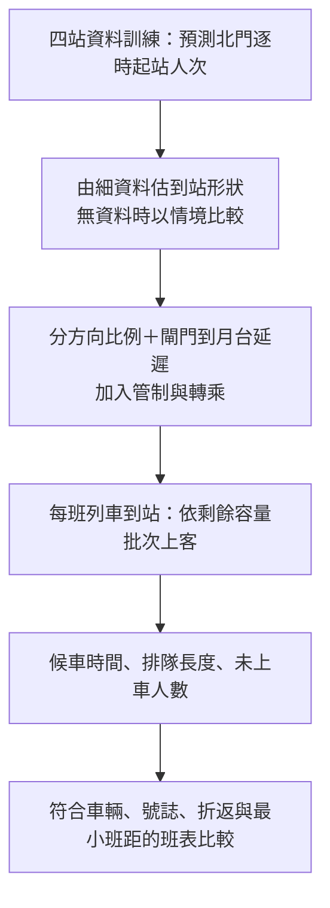
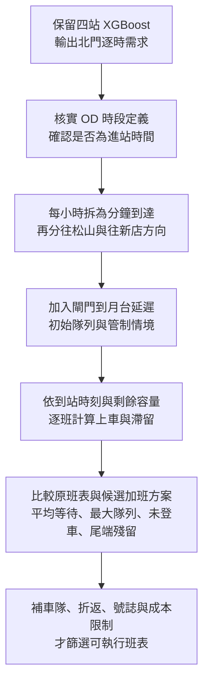

# 排隊與列車調度：分鐘到站型態的資料依據

查核日期：2026-10-13。**有文獻與臺灣官方實測圖支持「檢查短時間內的集中到站」，但目前還沒有取得北門煙火活動的一／五分鐘實測序列。因此不能直接判定北門均勻到達，也不能指定某種集中分布為真。**

## 1. 已找到什麼

| 來源與位置 | 可用證據 | 對本案的界線 |
|---|---|---|
| [Santanam 等（2021）, Public Transit for Special Events: Ridership Prediction and Train Optimization](https://arxiv.org/html/2106.05359)，§VI-A、圖 13、§VI-C | 用 AFC 進站時間彙整五分鐘曲線，再以歷史平均形狀分配預測人流，銜接列車模擬 | MARTA 球場與北門不同；方法可參考，曲線、方向比例與容量不能照搬。其部分結束時間曾事後調整，本案 D−1 不能如此處理 |
| [交通部運輸研究所《2019 年臺灣鐵道容量手冊》](https://www.iot.gov.tw/uploads/asset/data/65af90f83673763b538fae2a/2019%E5%B9%B4%E8%87%BA%E7%81%A3%E9%90%B5%E9%81%93%E5%AE%B9%E9%87%8F%E6%89%8B%E5%86%8A.pdf#page=528)，都會捷運篇第 3 章，印刷頁 3-4～3-5（PDF 第 528～529 頁），圖 3-1／3-2 | 北捷淡水站平、假日每十五分鐘進站人數；圖上有時段內變動 | 是臺灣實測先例，非北門煙火、非一分鐘資料；不能用它校準北門散場尖峰 |
| [臺北市資料大平臺：北捷分時進出量](https://data.taipei/dataset/detail?id=63f31c7e-7fc3-418b-bd82-b95158755b4d) | 現有專案使用逐時起訖站人次 | 能建模每小時總量，不能還原小時內到達時間 |
| [北捷 API 使用規範](https://www.metro.taipei/cp.aspx?n=BDEB860F2BE3E249)及[資料說明](https://www-ws.gov.taipei/001/Upload/405/relfile/18288/116939/26d47117-1927-48fb-9293-3f7879ec8092.pdf) | 列車位置約十五秒更新、車廂擁擠等級與到站倒數約三十秒更新；需申請、審核 | 更新頻率不是乘客計數時間粒度；擁擠等級不是精確剩餘容量，也未證明提供歷史活動資料下載 |

Santanam 文獻支持「歷史到站形狀＋需求預測＋列車模擬」的研究路線，不證明北門必定是常態、Gamma、Poisson 或單一尖峰。本文下面的資料需求及公式是本專案的實作建議。

## 2. 優先取得的資料

**先向北捷詢問：能否提供活動日北門站、每五分鐘的匿名彙總進站計數。** 一分鐘最佳；五分鐘也比逐時資料更有辨識力，但同一五分鐘內的到站與發車先後仍有不確定性。此處僅列需求，未代為寄信或申請。

| 優先度 | 要求欄位 | 用途 |
|---|---|---|
| 第一 | 活動日期、車站、時區、區間起訖、進站人次；最好另分入口／閘門，出站另列 | 辨認到站高峰位置、寬度、是否多波 |
| 第一 | 進站管制開始／結束、放行方式、站外排隊概況 | 刷卡數可能受管制截斷，不能當作沒有管制的需求 |
| 第二 | 分方向列車實際到離站時刻、編組、北門上客前剩餘可用容量、下車量 | 模擬每班車可載多少人，而非直接用全列名目容量 |
| 第二 | 分方向旅客比例、閘門到月台步行時間樣本、轉乘旅客 | 將進站流量換成真正的月台候車到達 |
| 驗證 | 月台排隊人數／滯留、候車時間樣本、每班未能上車人數 | 校準與驗證排隊模型 |

不需要卡號、姓名或逐人識別資料。若拿不到歷史彙總，可以在取得必要場地許可後，以未來活動的人工定點計數做匿名五分鐘調查；清楚記錄計數位置與涵蓋入口。活動場地人流、車站入口人流、閘門刷卡人流及月台到達是不同母體，不能互換。

## 3. 取得細資料後怎麼做

1. 以每場活動 **D−1 已公告的預定展演結束時間**對齊；額外保留實際結束時間作事後診斷，不能用它替換事前輸入。
2. 畫每場、每五分鐘的進站曲線，檢查是否有寬峰、集中峰、多波、管制影響。先做描述，不先假定分布。
3. 只用過去活動估計每個小時內各分鐘／五分鐘所佔比例。少量場次先用可解釋的平滑平均曲線，避免將每場峰值對齊後誤以為事前能精準知道峰值時刻。
4. 使用新的逐時總量預測乘以比例，確保各分鐘相加回原小時總量。若抽樣整數人數，可在小時內用多項分配，固定總量；不能獨立四捨五入後無視總量差。
5. 以整場留出驗證分鐘曲線與累積到站曲線，再驗證候車與滯留。不能把一場的分鐘列隨機切到訓練、測試兩側。

記第 $h$ 小時的預測起站人次為 $\hat N_h$，歷史估計的非負形狀為 $g(t)$，則在該小時的分鐘格點 $m$：

$$
w_{h,m}=\frac{g(t_{h,m})}{\sum_{j=1}^{60}g(t_{h,j})},\qquad
\hat A_{h,m}=\hat N_h w_{h,m},\qquad
\sum_{m=1}^{60}\hat A_{h,m}=\hat N_h.
$$

分母為零須有明確備援，不能直接除零。這只是保持總量的分配式；$g$ 必須由相同乘客母體的細時間資料估計。若另建「一般日背景＋活動額外人流」，兩部分應先拆清楚，不能把所有起站旅客都套用活動散場波形。

## 4. 目前沒有分鐘實測，能做什麼

- **均勻情境：**一小時每分鐘平均 $\hat N_h/60$。這是基準情境，不是資料已證明的分布。
- **寬峰情境：**同一小時的人數集中但較分散，依預定結束加步行時間設候選峰位。
- **集中峰情境：**更短時間到達大部分旅客；可另測雙波與管制造成的放行波。
- 峰位、峰寬、方向比例、剩餘容量都做範圍敏感度，所有情境守住相同小時總量。比較哪種班表在各情境下都較穩定，而非把某一條假設曲線的答案稱為北門最佳班表。

**均勻時間形狀與 Poisson 到達不是同義詞。** 每分鐘固定同人數是確定性分配；固定強度的 Poisson 過程每分鐘計數仍隨機。即使五分鐘平均形狀已知，批次到達、同行群體、管制仍可能造成額外波動，應由細資料檢查，不先把獨立性或指數間隔當事實。

## 5. 怎麼接排隊模擬

單一方向、既定列車順序下，可先用以下批次服務守恆式：

$$
B_k=\min\{Q_{k-1}+A_k,C_k^{\mathrm{remain}}\},\qquad
Q_k=Q_{k-1}+A_k-B_k.
$$

$A_k$ 是兩班車之間抵達月台的人次；$Q_{k-1}$ 是上一班後仍等待的人數；$C_k^{\mathrm{remain}}$ 是本班可讓北門旅客上車的容量；$B_k$ 是實際上車人數。假設旅客未棄排且沒有未建模的其他來源；若有須另加流入／流出。

這個遞推給排隊長度與滯留；要算候車時間仍須保存旅客或批次的到達時間、採用明確排隊規則。列車是間歇批次載客，不能直接拿逐時人次除 60 就宣稱已完成 M/M/c。先比較可行班距情境，再加入車隊、號誌、折返與成本限制談調度最佳化。

## 6. 目前可以向老師如何說

> 我們已完成逐時需求預測及散場優先調參。分鐘到站曲線目前尚無北門實測，因此排隊階段先做保持逐時總量的情境分析。方法參考特殊活動的 AFC 五分鐘曲線研究；下一步申請北門彙總刷卡與營運資料，驗證到站形狀及候車結果，再討論列車調度。

來源 PDF 頁面已在本機渲染核對；參考資料位於 `.local/analysis_v11/references/`，不進 Git。以上官方網址可供組員直接查閱。

## 7. 保留目前預測模型後的串接計畫（2026-10-15）

### 7.1 這次保留什麼、目前做到哪裡

依剛討論的最低 MAE 版本，後續候車研究先沿用 **V14 四站 XGBoost、`frozen_w4`，相同九場北門 MAE 440.28**；三站 491.32 留作對照。本次不重訓、不修改參數／已存預測、不更換網站模型。這是保留研究基準，不將反覆使用九場的結果升格為未見測試；歷史 D−1 可得性與來源時段定義限制仍在。

- 既有 `src/analysis_v1/queueing.py` 能分配逐時總量、分方向、加入固定站內延遲，並用列車到站事件計算上車、滯留、隊列面積及剩餘人數。
- 目前是確定性流體情境；有 M/M/c 輔助函式，但列車部分使用批次服務。舊範例指定 Stacking、0.6／0.4 方向比、5 分鐘延遲、每班剩餘 300 人、6／4／3 分鐘班距，全部是示例假設，不能沿用為北捷已知數據。
- 尚未有新 XGBoost 的排隊報告、旅客／到達批次層級的 95 百分位等待、經校準的分鐘曲線、可執行的列車最佳班表；網站粒子也仍是示意。

### 7.2 第一版的範圍與流程

先做北門單站、往松山與往新店方向的候車隊列；南向區間車的終點須保留，不能讓所有目的地旅客都任意登上短程車。其他周邊站先保留需求比較，真正加班車的可行性仍需檢查整條松山新店線。

若已確認模型輸出是進站閘門計數，只需閘門到月台的延遲；不能再加一次會場到車站步行時間。若存在站外限流，還需另外建站外隊列，因刷卡數不等於未受限制的到站需求。

### 7.3 還缺哪些資料、如何取得

| 優先 | 資料／最小欄位 | 現況與用途 | 取得方式 |
| --- | --- | --- | --- |
| 0 | OD 時段定義、時區、區間起訖 | 尚未完全核實；決定逐時量能否當進站到達 | 向原資料提供者確認以進站或出站時間分箱，保留正式說明 |
| 1 | 每 1–5 分鐘進站量、入口、管制時段 | 缺；辨認小時內是均勻、集中或多波 | 向北捷詢問匿名彙總 AFC；也可在許可下做未來活動定點計數。目前未找到可直接下載的北門歷史分鐘序列 |
| 1 | 每時段往兩方向比例、路線／轉乘選擇 | 未校準；總人數不等於單方向需求 | 先以過去北門出發 OD 搭配候選路徑估比例，多路徑旅次保留分配不確定性，再以方向計數核對 |
| 1 | 北門分方向逐班到／離站時刻、終點、班表版本 | 有公開計畫資料管道；缺已核實的歷史煙火加班實績 | 官方車站時刻表、發車班距、旅行時間；活動加班表與實際到離站另詢問北捷。現行一般班表不能直接當歷史活動實績 |
| 1 | 逐班到站前載客、下車、允許上車容量 | 缺；是候車計算最關鍵的服務量之一 | 向北捷申請彙總營運／載重資料，或以經校準的低中高容量情境。擁擠等級不能直接轉成精確人數 |
| 2 | 閘門到月台時間、模擬起點隊列、前後時段需求 | 缺；避免錯估到達時間、假設零排隊或過早清空 | 站內計時樣本、開始前隊列計數、補前後背景進站量。若只追蹤 18–23 時段這批旅客，要明說清空的是這批需求 |
| 2 | 逐班未登車人數、候車樣本、隊列峰值 | 缺；用來校準及獨立驗證模擬 | 未來活動人工匿名觀測或北捷提供彙總；候車樣本要能對應到達及實際登車時間 |
| 3 | 可調度車數、插車位置、全線最小班距、折返／行車／停站時間、司機、班表限制 | 未取得完整活動條件；決定方案是否營運可行 | 北捷營運資料／合作，公開路線資料只能提供部分條件；月台可用候車空間另需現場／營運核定資料 |
| 3 | 增開列車的邊際成本、行駛距離與時間 | 現有年度成本可參考，但不能直接當每增班成本 | 用列車公里／車時對應適當成本，區分全列與單節車廂口徑；固定成本不直接攤成每班新增支出 |

**已核對的公開管道：**[北捷 API 清單](https://www.metro.taipei/cp.aspx?n=BDEB860F2BE3E249) 列有車站時刻表、發車班距、列車旅行時間與首末班車，部分連到 TDX；列車位置、車廂擁擠度、到站倒數等另須北捷會員申請。TDX 的存取條件需依其平台辦理，不因北捷表格未標會員就保證免驗證。即時 API 也不能保證有歷史煙火資料。

[北捷松山新店線一般班距](https://www.metro.taipei/cp.aspx?n=EAD981369A065968&s=0F3F913C344BA050) 與 [北門站資訊](https://web.metro.taipei/pages2026/WebStation/105/7) 可作現況對照；特殊活動可能調整服務。所有班表都保存適用日期、方向、終點、資料版本及取得時間。

此處只是整理需求，尚未代為寄信或提出資料申請；不需要卡號、姓名等個人識別資料。

### 7.4 排隊怎麼算、怎樣驗證

對每個方向，用第 5 節的批次守恆式：上一班殘留＋兩班間到達＝本班上車＋本班殘留。簡化下的可上車容量為

$$
C_k^{\mathrm{remain}}=\max\{0,K_k-L_k^{\mathrm{before}}+D_k\},
$$

其中 $K_k$ 是採用的可服務容量、$L_k^{\mathrm{before}}$ 是抵站前載客、$D_k$ 是本站下車量；三者須用同一列車／車廂口徑，且 $D_k\le L_k^{\mathrm{before}}$。實務上還可能受停站時間、車廂不均及終點相容性限制，不應一律把整列空間都當能在北門立即使用。

教學例：上一班殘留 100 人、這段新增 500 人、本班還能載 400 人，則 400 人上車、200 人留下。這不能單獨算出平均等待，因為仍不知道每人何時加入隊列。

現有流體核心可算等待人分鐘 $\int Q(t)dt$；初始隊列為零、所有模擬到達都完成上車時，除以總到達量得到該批旅客的平均等待。若還有人留下，必須另報殘留及截尾，不能只報已上車者平均。要報 95 百分位等待，下一版需保存到達批次與登車時刻、明訂先到先上等規則，不能從單一平均值推算。

第一輪先比較：原班表、預定散場前後加密的候選班表、少量插車方案。使用相同需求情境比較等待、最大隊列、每班殘留、清空時間及加班車數，尚無成本時先呈現「多加幾班、減少多少等待」的取捨，不任意把人分鐘與金額相加。新增班次後上游載客與剩餘容量也可能改變，需做全線負載推估或清楚限定為固定剩餘容量的條件情境。

資料不足時比較均勻／寬峰／集中峰、不同方向比與剩餘容量；保持每小時總量，保留站內延遲造成的跨時段尾端。設定的敏感度區間不是信賴區間，不能拿 MAE 440 直接當作某個信賴水準的需求加成。當日真實到站／載客可用來事後校準驗證，不能偷偷當成前一天已知輸入。

### 7.5 實作順序與成果

1. 保留模型與參數；另建需求輸出介面，欄位含模型版本、活動日期、車站、來源區間、預測人次與 D−1 資料狀態。
2. 核實時間定義、取得官方班表，整理方向與剩餘容量的已知值及假設值。
3. 讓既有批次核心讀取 XGBoost 輸出；分鐘形狀改成可逐場／逐時配置，加入初始隊列、尾端需求、終點相容性與到達批次記錄。
4. 先完成情境比較報告：分鐘需求對運能、兩方向隊列曲線、各班上車／殘留、等待分布及加班車數取捨。
5. 以未用來調整模型的活動校準／驗證候車，再加入完整營運限制篩選班表；最後才把可信指標接到網站。缺資料階段呈現「情境模擬」，不稱真實乘客軌跡或已驗證最適班表。

方法參考 [Santanam 等，Public Transit for Special Events（2021）](https://arxiv.org/html/2106.05359) 的 §VI-A 五分鐘到站形狀與 §VI-C 列車模擬。本案選擇北門雙方向、資料介面、情境集合及後續限制是應用設計；原文的 MARTA 容量與到站比例不能直接帶入北捷。

### 7.6 第一輪已完成（2026-10-15）

已完成上列步驟中的官方一般班表收集、七表入庫、V14 四站 XGBoost 北門輸出串接，以及均勻／寬峰／集中峰、方向比與剩餘容量的 1,134 組單方向情境；[結果與圖](../result/queue_dispatch_v1/report.md)、[資料與重跑方式](metro_operations.md)。班表是 2026/8/30 或 10/1 起的一般離站表，不能當成九場歷史活動實際營運；圖上的候車是條件情境，分鐘分布並未校準。新增班次的可行排程、FIFO 個別等待分布、全線載客推估與活動現場驗證仍是後續工作。
