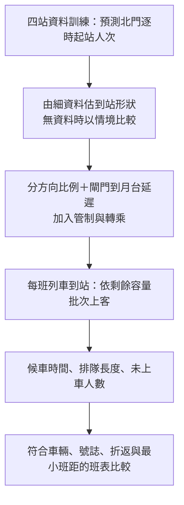

# 排隊與列車調度：分鐘到站型態的資料依據

查核日期：2026-10-13。**有文獻與臺灣官方實測圖支持「檢查短時間內的集中到站」，但目前還沒有取得北門煙火活動的一／五分鐘實測序列。因此不能直接判定北門均勻到達，也不能指定某種集中分布為真。**

## 1. 已找到什麼

| 來源與位置 | 可用證據 | 對本案的界線 |
|---|---|---|
| [Santanam 等（2021）, Public Transit for Special Events: Ridership Prediction and Train Optimization](https://arxiv.org/html/2106.05359)，§VI-A、圖 13、§VI-C | 用 AFC 進站時間彙整五分鐘曲線，再以歷史平均形狀分配預測人流，銜接列車模擬 | MARTA 球場與北門不同；方法可參考，曲線、方向比例與容量不能照搬。其部分結束時間曾事後調整，本案 D−1 不能如此處理 |
| [交通部運輸研究所《2019 年臺灣鐵道容量手冊》](https://www.iot.gov.tw/uploads/asset/data/65af90f83673763b538fae2a/2019%E5%B9%B4%E8%87%BA%E7%81%A3%E9%90%B5%E9%81%93%E5%AE%B9%E9%87%8F%E6%89%8B%E5%86%8A.pdf#page=528)，都會捷運篇第 3 章，印刷頁 3-4～3-5（PDF 第 528～529 頁），圖 3-1／3-2 | 北捷淡水站平、假日每十五分鐘進站人數；圖上有時段內變動 | 是臺灣實測先例，非北門煙火、非一分鐘資料；不能用它校準北門散場尖峰 |
| [臺北市資料大平臺：北捷分時進出量](https://data.taipei/dataset/detail?id=63f31c7e-7fc3-418b-bd82-b95158755b4d) | 現有專案使用逐時起訖站人次 | 能建模每小時總量，不能還原小時內到達時間 |
| [北捷 API 使用規範](https://www.metro.taipei/cp.aspx?n=BDEB860F2BE3E249)及[資料說明](https://www-ws.gov.taipei/001/Upload/405/relfile/18288/116939/26d47117-1927-48fb-9293-3f7879ec8092.pdf) | 列車位置約十五秒更新、車廂擁擠等級與到站倒數約三十秒更新；需申請、審核 | 更新頻率不是乘客計數時間粒度；擁擠等級不是精確剩餘容量，也未證明提供歷史活動資料下載 |

Santanam 文獻支持「歷史到站形狀＋需求預測＋列車模擬」的研究路線，不證明北門必定是常態、Gamma、Poisson 或單一尖峰。本文下面的資料需求及公式是本專案的實作建議。

## 2. 優先取得的資料

**先向北捷詢問：能否提供活動日北門站、每五分鐘的匿名彙總進站計數。** 一分鐘最佳；五分鐘也比逐時資料更有辨識力，但同一五分鐘內的到站與發車先後仍有不確定性。此處僅列需求，未代為寄信或申請。

| 優先度 | 要求欄位 | 用途 |
|---|---|---|
| 第一 | 活動日期、車站、時區、區間起訖、進站人次；最好另分入口／閘門，出站另列 | 辨認到站高峰位置、寬度、是否多波 |
| 第一 | 進站管制開始／結束、放行方式、站外排隊概況 | 刷卡數可能受管制截斷，不能當作沒有管制的需求 |
| 第二 | 分方向列車實際到離站時刻、編組、北門上客前剩餘可用容量、下車量 | 模擬每班車可載多少人，而非直接用全列名目容量 |
| 第二 | 分方向旅客比例、閘門到月台步行時間樣本、轉乘旅客 | 將進站流量換成真正的月台候車到達 |
| 驗證 | 月台排隊人數／滯留、候車時間樣本、每班未能上車人數 | 校準與驗證排隊模型 |

不需要卡號、姓名或逐人識別資料。若拿不到歷史彙總，可以在取得必要場地許可後，以未來活動的人工定點計數做匿名五分鐘調查；清楚記錄計數位置與涵蓋入口。活動場地人流、車站入口人流、閘門刷卡人流及月台到達是不同母體，不能互換。

## 3. 取得細資料後怎麼做

1. 以每場活動 **D−1 已公告的預定展演結束時間**對齊；額外保留實際結束時間作事後診斷，不能用它替換事前輸入。
2. 畫每場、每五分鐘的進站曲線，檢查是否有寬峰、集中峰、多波、管制影響。先做描述，不先假定分布。
3. 只用過去活動估計每個小時內各分鐘／五分鐘所佔比例。少量場次先用可解釋的平滑平均曲線，避免將每場峰值對齊後誤以為事前能精準知道峰值時刻。
4. 使用新的逐時總量預測乘以比例，確保各分鐘相加回原小時總量。若抽樣整數人數，可在小時內用多項分配，固定總量；不能獨立四捨五入後無視總量差。
5. 以整場留出驗證分鐘曲線與累積到站曲線，再驗證候車與滯留。不能把一場的分鐘列隨機切到訓練、測試兩側。

記第 $h$ 小時的預測起站人次為 $\hat N_h$，歷史估計的非負形狀為 $g(t)$，則在該小時的分鐘格點 $m$：

$$
w_{h,m}=\frac{g(t_{h,m})}{\sum_{j=1}^{60}g(t_{h,j})},\qquad
\hat A_{h,m}=\hat N_h w_{h,m},\qquad
\sum_{m=1}^{60}\hat A_{h,m}=\hat N_h.
$$

分母為零須有明確備援，不能直接除零。這只是保持總量的分配式；$g$ 必須由相同乘客母體的細時間資料估計。若另建「一般日背景＋活動額外人流」，兩部分應先拆清楚，不能把所有起站旅客都套用活動散場波形。

## 4. 目前沒有分鐘實測，能做什麼

- **均勻情境：**一小時每分鐘平均 $\hat N_h/60$。這是基準情境，不是資料已證明的分布。
- **寬峰情境：**同一小時的人數集中但較分散，依預定結束加步行時間設候選峰位。
- **集中峰情境：**更短時間到達大部分旅客；可另測雙波與管制造成的放行波。
- 峰位、峰寬、方向比例、剩餘容量都做範圍敏感度，所有情境守住相同小時總量。比較哪種班表在各情境下都較穩定，而非把某一條假設曲線的答案稱為北門最佳班表。

**均勻時間形狀與 Poisson 到達不是同義詞。** 每分鐘固定同人數是確定性分配；固定強度的 Poisson 過程每分鐘計數仍隨機。即使五分鐘平均形狀已知，批次到達、同行群體、管制仍可能造成額外波動，應由細資料檢查，不先把獨立性或指數間隔當事實。

## 5. 怎麼接排隊模擬

單一方向、既定列車順序下，可先用以下批次服務守恆式：

$$
B_k=\min\{Q_{k-1}+A_k,C_k^{\mathrm{remain}}\},\qquad
Q_k=Q_{k-1}+A_k-B_k.
$$

$A_k$ 是兩班車之間抵達月台的人次；$Q_{k-1}$ 是上一班後仍等待的人數；$C_k^{\mathrm{remain}}$ 是本班可讓北門旅客上車的容量；$B_k$ 是實際上車人數。假設旅客未棄排且沒有未建模的其他來源；若有須另加流入／流出。

這個遞推給排隊長度與滯留；要算候車時間仍須保存旅客或批次的到達時間、採用明確排隊規則。列車是間歇批次載客，不能直接拿逐時人次除 60 就宣稱已完成 M/M/c。先比較可行班距情境，再加入車隊、號誌、折返與成本限制談調度最佳化。

## 6. 目前可以向老師如何說

> 我們已完成逐時需求預測及散場優先調參。分鐘到站曲線目前尚無北門實測，因此排隊階段先做保持逐時總量的情境分析。方法參考特殊活動的 AFC 五分鐘曲線研究；下一步申請北門彙總刷卡與營運資料，驗證到站形狀及候車結果，再討論列車調度。

來源 PDF 頁面已在本機渲染核對；參考資料位於 `.local/analysis_v11/references/`，不進 Git。以上官方網址可供組員直接查閱。
