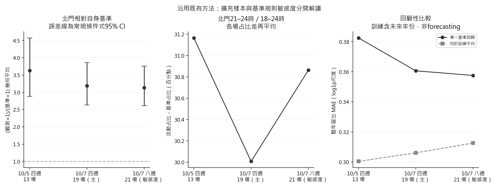
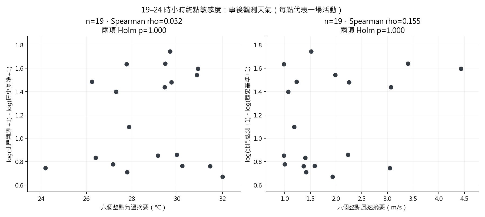
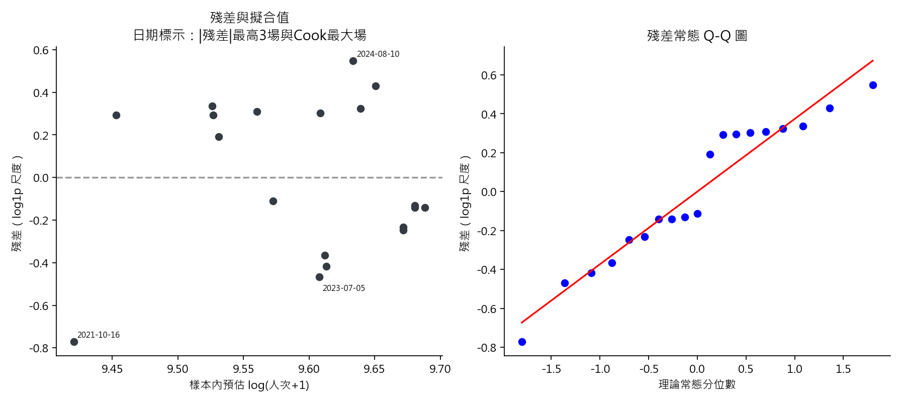

# 2026-10-07：補齊資料後沿用既有方法的完整重跑

**主要比較由四週基準的13場、9年擴充為19場、10年；北門19場都高於自身歷史基準，配對比值幾何平均由3.6297降為3.1874。** 四站相對增幅排序仍一致，晚間後段占比高於基準；原兩項天氣關聯仍無清楚證據，單一基準回歸的整年留出誤差仍高於同折訓練平均。本次只是補資料後重跑原方法，並非獨立新樣本確認或因果估計。

| 跟10/5相比變了什麼 | 10/5 | 本次四週主結果 |
|---|---:|---:|
| 可比較活動／年份 | 13場／9年 | 19場／10年 |
| 北門相對歷史基準幾何比值 | 3.6297 | 3.1874 |
| 每場北門是否都高於基準 | 13/13 | 19/19 |
| 北門後段占比平均高出基準 | 31.17百分點 | 30.01百分點 |
| 四站增幅排序 | 每場一致 | 每場仍一致 |
| 兩項天氣關聯、回歸留年比較 | 無清楚關聯；回歸較差 | 結論未改變 |

完整檢定、區間與敏感度列於後文。八週21場屬基準規則敏感度；不取代四週19場主結果。

## 1. 來源、樣本及本次改動

- 來源：新建唯讀MySQL快照（活動表、四站逐時／視窗、臺北主測站及已核對天氣視圖）；同時凍結本機Parquet、日曆、已核定八週候選日、10/5比較輸出。來源擷取時間、查詢與SHA-256見[總manifest](../../results/research_review/2026-10-07-refresh/source_manifest.json)；私有快照位於`.local/research_review/2026-10-07-refresh`，`--reuse-snapshot`完全使用凍結來源。
- 補齊201907、202306、202507後共17個月份。26日期仍為21已舉行、4取消、1延期；四站×26日期×6時段共624列，104個視窗均與逐時總量／基準一致。
- **主規則沿用10/5：**18≤來源時段<24；前7/14/21/28天，同站同時段，排除活動表全部日期，每小時至少2個完整比較日，不補零、不改時段、不加日曆配對。19場中基準2/3/4日分別6/5/8場。2023-08-09、2023-08-16仍因四週候選全落在活動表而不能納入。
- 新增主要日期：2019-08-03、2023-07-05、2023-07-12、2023-07-19、2025-08-06、2025-08-20。舊13場的觀測總量、基準及基準日數變動筆數各為0、0、0；主結果差異因納入額外6場，並非更改舊13場公式。
- **八週是規則改變的敏感度：**沿用已同意的`same_weekday_calendar_56d_nearest4_v1`，前8個同星期日期、排除全部活動日、相同政府日曆假日／補班類別及註記、取最近至多4個完整日、最低2日，可比較21場；不是把它替換成主要規則。104筆視窗及候選日均以凍結的逐時Parquet重建核對。
- 天氣官方值與來源標籤已有1008筆核對；本次主站504筆全部核對一致。23:59已解釋為翌日00:00的小時終點。主結果仍保留18..23整點；另列19..24小時終點，分開呈現時間定義敏感度。來源時間核對**不代表OD刷卡分箱與氣象曝露已精確對齊**。

同一年可能共享比較日；19場不是19個已證實獨立的實驗，76站別列、456逐時列更不能冒充獨立事件。財務資料的10個預算年、5個宣導年沒有展開為大量獨立樣本，本輪未新增多因子、因果或排隊模型。年度預算、宣導所需經費及其比值另見[年度財務描述表](../../results/research_review/2026-10-07-refresh/data_inventory/年度預算與宣導經費.csv)；「所需／原列法定」不是實際支出占比，僅作描述。

## 2. 與10/5的數值對照

| 版本／規則 | 場／年 | 北門幾何比值 | 配對F=t² | Friedman Q／W | 後段占比差（百分點） | OLS R² | 留年MAE：回歸／訓練平均 |
|---|---:|---:|---:|---:|---:|---:|---:|
| 2026-10-05 四週13場 | 13/9 | 3.6297 | 148.0164 | 39.0/1.000 | 31.17 | 0.1346 | 0.3824/0.3004 |
| 2026-10-07 四週19場 | 19/10 | 3.1874 | 161.3601 | 57.0/1.000 | 30.01 | 0.0431 | 0.3606/0.3061 |
| 2026-10-07 八週21場（敏感度） | 21/10 | 3.1327 | 172.1627 | 63.0/1.000 | 30.86 | 0.0194 | 0.3575/0.3126 |

比值定義為`exp(mean(log(1+Y)−log(1+B)))`，不是兩個平均相除。晚間後段為來源分箱21、22、23時，占18..23六小時總量；MAE為log1p尺度。[完整CSV](../../results/research_review/2026-10-07-refresh/comparison_20261005_vs_20261007.csv)／[JSON及舊樣本核對](../../results/research_review/2026-10-07-refresh/comparison_summary.json)。



## 3. 四週19場主結果：配對增幅、年份敏感度

對每場北門計算`d=log(1+Y)−log(1+B)`，既有單樣本t之平方F檢查`E(d)=0`。不是將觀測與基準當成38個獨立樣本。

| 指標 | 19場主結果 |
|---|---:|
| 平均log1p差 | 1.159216 |
| F(1,18)，條件式雙尾p | 161.360108；2.00801e-10 |
| 幾何比值、常規95% CI | 3.1874；2.6313–3.8611 |
| 正／零差場數，符號檢定p | 19／0；3.8147e-06 |
| 10年等權：幾何比值、95% CI | 3.5062；2.7553–4.4617 |
| 10年等權：F(1,9)、條件式p | 138.6561；9.04405e-07 |
| 逐次移除一整年：幾何比值範圍 | 3.0855–3.4091 |
| 年均值bootstrap：比值百分位95%區間 | 2.8742–4.2802 |
| Shapiro–Wilk W、p | 0.8397；0.00458047 |

F與CI需要事件差值獨立、可比且近似常態等工作假設；目前未證實。符號檢定改測方向機率而非平均幅度，仍不能解決同年／共用基準相依。年度等權改變估計目標，留年與固定種子20261005、20,000次年度bootstrap均屬敏感度；10年不足以保證區間涵蓋率。基準僅2–4日，其估計誤差未另建模型。[JSON](../../results/research_review/2026-10-07-refresh/four_week_primary/statistics/summary.json)／[19場CSV](../../results/research_review/2026-10-07-refresh/four_week_primary/statistics/primary_beimen_events.csv)／[留年CSV](../../results/research_review/2026-10-07-refresh/four_week_primary/statistics/leave_one_year_out.csv)。


## 4. 四站、晚間占比與固定七項Holm

同19場四站的18–24時總量描述如下；差值為觀測減自身歷史基準，未扣除其他同日因素。

| 站名 | 觀測平均人次 | 基準平均人次 | 平均差值 | 幾何比值 |
|---|---:|---:|---:|---:|
| 北門 | 15,649.5 | 4,732.9 | 10,916.5 | 3.1874 |
| 大橋頭站 | 7,839.3 | 3,767.0 | 4,072.4 | 2.0164 |
| 雙連 | 9,956.3 | 7,121.0 | 2,835.3 | 1.4141 |
| 民權西路 | 8,039.5 | 7,420.7 | 618.8 | 1.1079 |

Friedman Q=57.0、Kendall W=1.000，19場相對增幅皆為北門＞大橋頭站＞雙連＞民權西路。199,999次場內標籤置換p=5e-06為本次解析度下限，不是精確尾機率或p=0；W為排名一致度，不是人流解釋比例。固定站別的可交換性未經隨機設計保證。

北門對各其他站皆19正、0負、0零。北門後段占比平均59.05%，基準29.05%，平均配對差30.01個百分點；19場均正。全21場描述中，北門18/21場峰在21時，最大一小時占六小時總量中位數42.01%。來源時段不能當作實際展演結束或候車時間。

| 既有固定問題 | 場／非零配對數 | 原始p | 七項Holm p |
|---|---:|---:|---:|
| 四站增幅的整體比較 | 19 | 5e-06 | 2.67029e-05 |
| 北門增幅與大橋頭站比較 | 19 | 3.8147e-06 | 2.67029e-05 |
| 北門增幅與雙連比較 | 19 | 3.8147e-06 | 2.67029e-05 |
| 北門增幅與民權西路比較 | 19 | 3.8147e-06 | 2.67029e-05 |
| 北門晚間後段占比與基準比較 | 19 | 3.8147e-06 | 2.67029e-05 |
| 氣溫與北門相對增幅 | 19 | 0.85798 | 0.85798 |
| 風速與北門相對增幅 | 19 | 0.34102 | 0.68204 |

七項為四站整體1項、北門對三站3項、北門占比1項、原時段天氣2項；**未包含基本F、OLS係數、年度敏感度、八週規則與另一時間對齊**，不可聲稱涵蓋所有研究嘗試。Holm無法修復單一p因相依、混雜或不可交換而失效。所有結果仍探索性。[七項CSV](../../results/research_review/2026-10-07-refresh/four_week_primary/extended_statistics/tests.csv)／[四站JSON含年度結果](../../results/research_review/2026-10-07-refresh/four_week_primary/station_time/summary.json)／[配對CSV](../../results/research_review/2026-10-07-refresh/four_week_primary/station_time/station_pairwise_sign.csv)／[尖峰CSV](../../results/research_review/2026-10-07-refresh/four_week_primary/station_time/station_peak_descriptive.csv)。


## 5. 天氣：維持原時段，另列已核對小時終點

來源是臺北主測站466920，並非現地量測；21個已舉行日期各有24筆主站觀測，兩個固定時窗各選6點，氣溫／風速均需6點有效才摘要。氣溫是各觀測時點值；風速為六個「整點前10分鐘均值」之平均，**不是連續六小時平均風速**。19..24把原18:00換為日末23:59（正規化翌日00:00）；21場兩個變數的摘要皆改變。

兩項Spearman以`abs(rho)`作雙尾配對置換，99,999次、原種子20261005／20261006、加一p；最低10個有效配對且各有至少5個不同值。仍以北門log1p相對增幅為反應量，沒有改變變數或按p選時段。

| 基準 | 氣象時窗 | 變數 | n | rho | 置換p | 本時窗兩項Holm p |
|---|---|---|---:|---:|---:|---:|
| 四週19場 | 18..23 原整點標籤 | 氣溫 | 19 | 0.0439 | 0.85798 | 0.85798 |
| 四週19場 | 18..23 原整點標籤 | 風速 | 19 | 0.2298 | 0.34102 | 0.68204 |
| 四週19場 | 19..24 已核對小時終點 | 氣溫 | 19 | 0.0316 | 0.89939 | 1 |
| 四週19場 | 19..24 已核對小時終點 | 風速 | 19 | 0.1553 | 0.52238 | 1 |
| 八週21場 | 18..23 原整點標籤 | 氣溫 | 21 | -0.0156 | 0.94827 | 0.94827 |
| 八週21場 | 18..23 原整點標籤 | 風速 | 21 | 0.1948 | 0.39361 | 0.78722 |
| 八週21場 | 19..24 已核對小時終點 | 氣溫 | 21 | -0.0234 | 0.92282 | 1 |
| 八週21場 | 19..24 已核對小時終點 | 風速 | 21 | 0.1319 | 0.56718 | 1 |

19場原時段的年度及留年描述如下；年度均值相關不是事件層相關，同年與季節差異仍可能主導。

| 變數 | 年數 | 年平均相關rho | 逐次留年rho範圍 |
|---|---:|---:|---:|
| 氣溫 | 10 | 0.7939 | -0.0753–0.3679 |
| 風速 | 10 | 0.4667 | 0.1146–0.4214 |

各情境尚無清楚單調關聯證據，不能宣稱天氣無影響；置換仍依賴事件間可交換性。這是事後天氣，不能當作活動前已知預測。雨量T保留微量有雨，&保留後續累積而不補零；主19場原時段有雨證據7場、六點數值零12場。取消／延期5日沒有主站配對，不能用此涵蓋解釋取消原因。雲量只描述核對與覆蓋，不加新檢定。

[時段敏感度CSV](../../results/research_review/2026-10-07-refresh/weather_timing_sensitivity.csv)／[原時段JSON](../../results/research_review/2026-10-07-refresh/four_week_primary/weather_regression/summary.json)／[19–24終點JSON](../../results/research_review/2026-10-07-refresh/four_week_primary/weather_aligned/summary.json)／[逐場天氣CSV](../../results/research_review/2026-10-07-refresh/four_week_primary/weather_aligned/weather_event_summary.csv)。




## 6. 原單一回歸與整年留出

只擬合`log(1+Y)=alpha+beta log(1+B)+error`，n=19、殘差自由度17。截距6.805926；斜率0.330806、條件95% CI -0.4671–1.1287，樣本內R²=0.0431。CI將歷史基準視為固定且未加其估計誤差，假定獨立、近似常態與等變異殘差。Shapiro殘差p=0.173344，不能由未拒絕推得模型已驗證；最大Cook距離1.6516為2021-10-16，沒有據此刪樣本。

| 19筆整年留出結果（log1p尺度） | MAE | RMSE |
|---|---:|---:|
| 原單一基準回歸 | 0.360567 | 0.431081 |
| 同折訓練活動平均 | 0.306100 | 0.390640 |

回歸仍未優於簡單參考；逐折斜率範圍-0.3012–0.5020。整年留出防止同年事件同時進入訓練／測試，但較早測試年仍使用較晚資料，**是回顧性敏感度，不是未來預測回測**。未把exp回轉當作條件平均人次。[模型JSON](../../results/research_review/2026-10-07-refresh/four_week_primary/weather_regression/summary.json)／[逐折CSV](../../results/research_review/2026-10-07-refresh/four_week_primary/weather_regression/regression_loyo.csv)／[診斷CSV](../../results/research_review/2026-10-07-refresh/four_week_primary/weather_regression/regression_event_diagnostics.csv)。




## 7. 八週21場僅作同方法敏感度

八週相同日曆規則把另外2場納入且可能改變其他場基準。21場北門皆正，比值3.1327，常規95% CI 2.6126–3.7562；F(1,20)=172.1627、條件p=2.76189e-11。年度等權比值3.5293，移除一年範圍3.0288–3.4676。Friedman Q=63.0、W=1.000。完整年度結果、配對符號CI、時段、天氣與OLS皆按原方法重算。

| 同七問題在八週情境中的敏感度 | n | 原始p | 情境內七項Holm p |
|---|---:|---:|---:|
| 四站增幅的整體比較 | 21 | 5e-06 | 1.5e-05 |
| 北門增幅與大橋頭站比較 | 21 | 9.53674e-07 | 6.67572e-06 |
| 北門增幅與雙連比較 | 21 | 9.53674e-07 | 6.67572e-06 |
| 北門增幅與民權西路比較 | 21 | 9.53674e-07 | 6.67572e-06 |
| 北門晚間後段占比與基準比較 | 21 | 9.53674e-07 | 6.67572e-06 |
| 氣溫與北門相對增幅 | 21 | 0.94827 | 0.94827 |
| 風速與北門相對增幅 | 21 | 0.39361 | 0.78722 |

本表的七項校正只限八週情境自身，不把它視為新增七項獨立驗證或所有敏感度的全域校正。政府辦公日分類不等於所有人工作日，八週仍有季節趨勢、未列活動、同期節慶和共享基準；不能只因樣本增加就選為唯一結論。[八週JSON](../../results/research_review/2026-10-07-refresh/eight_week_sensitivity/statistics/summary.json)／[21場CSV](../../results/research_review/2026-10-07-refresh/eight_week_sensitivity/statistics/primary_beimen_events.csv)／[候選日稽核](../../results/research_review/2026-10-07-refresh/eight_week_sensitivity/statistics/baseline_candidates.csv)／[逐時重建來源](../../results/research_review/2026-10-07-refresh/eight_week_sensitivity/statistics/selected_baseline_source_hours.csv)／[七項CSV](../../results/research_review/2026-10-07-refresh/eight_week_sensitivity/extended_statistics/tests.csv)。

## 8. 重跑與交付

在專案根目錄使用現有環境，不新增套件、不寫MySQL；未覆寫10/5或今日稍早10/7成果。

```powershell
.\.venv\Scripts\python.exe -X utf8 scripts/research_review/refresh_20261007.py --reuse-snapshot
# 若要另建一份當下來源，指定新的私有來源與輸出路徑，省略 --reuse-snapshot：
.\.venv\Scripts\python.exe -X utf8 scripts/research_review/refresh_20261007.py --snapshot-root .local/research_review/my-new-run --output results/research_review/my-new-run --report .local/research_review/my-new-run/report.md
```

[重跑程式](../../scripts/research_review/refresh_20261007.py)沿用既有四支統計模組，保留舊預設；新版路徑／n可指定。每個模組有CSV、JSON、圖與來源manifest；全套來源檔凍結與hash防止重現時靜默讀到改版輸入。新結果是探索性關聯：不能等同現地觀眾、站間個人移動、排隊長度、煙火因果倍數或已驗證的營運預測。

方法依據與10/5相同：[SciPy單樣本t](https://docs.scipy.org/doc/scipy/reference/generated/scipy.stats.ttest_1samp.html)、[Friedman](https://docs.scipy.org/doc/scipy/reference/generated/scipy.stats.friedmanchisquare.html)、[精確二項檢定](https://docs.scipy.org/doc/scipy/reference/generated/scipy.stats.binomtest.html)、[置換](https://docs.scipy.org/doc/scipy/reference/generated/scipy.stats.permutation_test.html)、[OLS](https://docs.scipy.org/doc/scipy/reference/generated/scipy.stats.linregress.html)、[Holm](https://stat.ethz.ch/R-manual/R-devel/library/stats/html/p.adjust.html)。本輪未引入新的網路方法。
