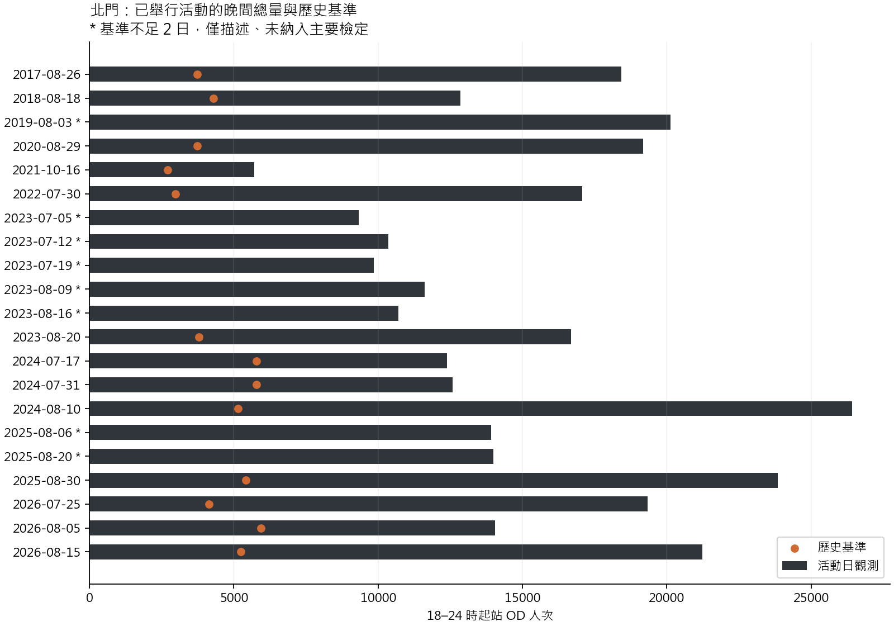
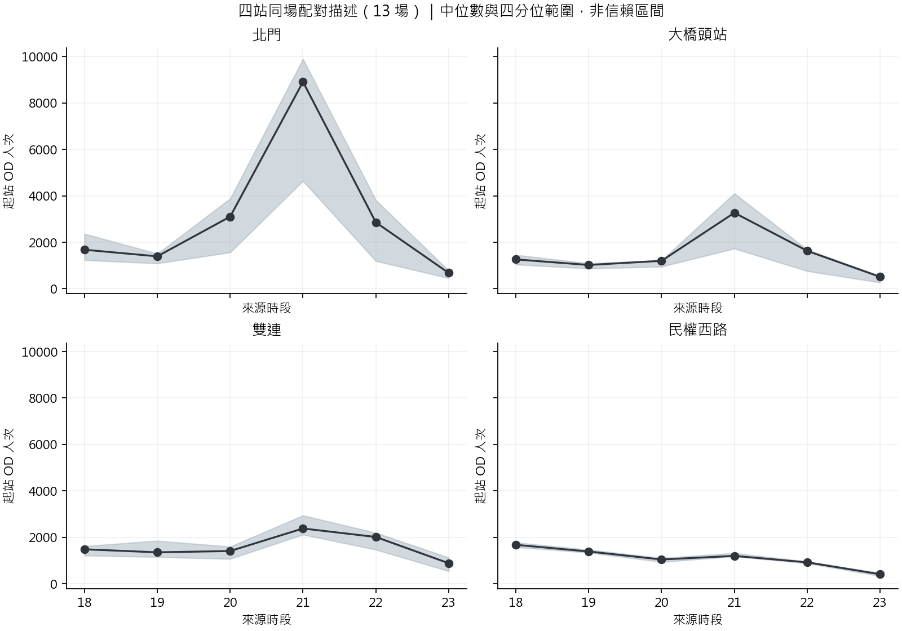
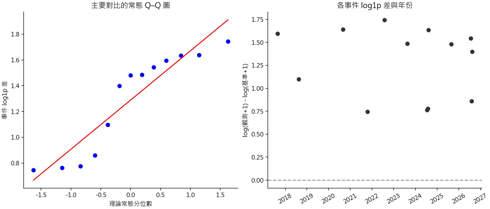

# 大稻埕活動人流：基礎統計彙整

資料擷取與分析：2026-10-05。這份是可重跑的探索性分析，尚未建立正式預測或因果模型。

**目前最清楚的結果：北門在有足夠歷史比較日的 13 場活動，18–24 時起站 OD 總量全部高於自身歷史基準；四個周邊站以北門的相對增幅最大。** 但只有 13 場、9 個年份，而且常態假設有疑慮，不能把很小的 p 值當作「煙火造成多少人流」的確證。

## 1. 用了哪些資料，是否過時

主要資料由現有 `app.backend.database._read_json` 執行固定、唯讀 MySQL SELECT，使用 `taipei_metro_analysis` 的活動表、逐時表與 `v_regression_event_station`。沒有更改資料庫、原始 CSV 或原有分析表。

| 檢查 | 結果 |
|---|---:|
| 活動日期 | 26 日：21 已舉行、4 取消、1 延期 |
| 四站 × 日期的 18–24 時視窗 | 104 列，104 列起站資料完整 |
| 四站逐時資料 | 624 列；起站人次無缺值，歷史基準缺 264 列 |
| 逐時重算總量／峰值／基準與 MySQL 視窗 | 104/104 一致 |
| 26 日、全站標籤、18–24 時可用起站列的加總 | 17,189,198 人次（SUM 略過 NULL） |
| 同視窗可用迄站列的加總 | 17,189,198 人次（SUM 略過 NULL），與可用起站列加總一致 |
| MySQL 與本機 `station_hourly.parquet` 可用列加總 | 26/26 日期一致；不代表全站標籤都完整 |
| 全站標籤時段完整度 | 19 日有未完整標籤時段；起站共 342 列、迄站共 1,596 列 |
| 9/29 Parquet 快照與目前 MySQL | 所選 104 列的總量、基準、基準天數、活動狀態及聲量缺值旗標均一致 |

既有前處理摘要記錄 116,732,817 列乾淨 OD、全下載月份 839,324,028 人次，起／迄加總相等。**這個全月份數字引用既有摘要，本次沒有重新掃描全部原始 OD**；本次重新核對的是上述活動日 18–24 時可用列的彙總。`SUM` 會略過 NULL，兩端加總相等只能證明可用列對帳，不能推出全站完整。2023–2026 的 19 個日期，每日起站有 18 個、迄站有 84 個標籤時段未完整；合計分別為 342、1,596 列。這可能反映歷史站名全集中部分標籤未在該期來源出現，**不能直接當成已證實的實際漏報**。四個核心站的 624 列起站資料均完整，主要 13 場樣本及檢定數字不受此項修正影響。逐日旗標、NULL 與未完整列數見 `network_reconciliation.csv`。本次檢查不是原始資料來源真實性或全部欄位的完整認證。

`origin_count` 是同一來源時段依「起站」加總的人次。官方時段究竟按哪種刷卡時間分箱尚未核實；迄站欄位不能直接稱作該小時實際出閘人數。這些是旅次人次，不是現場參與者、不是真實候車人數，也不能還原步行軌跡。四站沿用原始標籤「北門、大橋頭站、雙連、民權西路」，未擅自合併其他歷史站名。

## 2. 分析規則與樣本篩選

在查看結果前固定主要問題與規則：

1. 北門為主要車站；一個 `event_date` 算一場，不能把 6 個小時或 4 個車站算成 24 場。
2. 描述已舉行活動的 18:00 ≤ 來源時段 < 24:00；六小時必須完整，不補零。
3. 歷史基準沿用前 7／14／21／28 天，同站同時段、已下載且完整、排除活動表所有日期的平均；六個逐時平均相加成基準總量。
4. 主要比較要求每小時至少 **2 個**基準日。21 場中 13 場符合：4 場有 2 日、4 場有 3 日、5 場有 4 日。這是事先選定的最低涵蓋門檻，不代表 2 日已足以穩定估計基準。
5. 四站只做同一組 13 場的配對描述，沒有額外跑四次顯著性檢定；取消／延期另表描述，不當成隨機對照組。

| 年份 | 已舉行 | 取消／延期 | 可納入北門主要比較 |
|---|---:|---:|---:|
| 2017 | 1 | 0 | 1 |
| 2018 | 1 | 0 | 1 |
| 2019 | 1 | 0 | 0 |
| 2020 | 1 | 1 | 1 |
| 2021 | 1 | 0 | 1 |
| 2022 | 1 | 0 | 1 |
| 2023 | 6 | 2 | 1 |
| 2024 | 3 | 1 | 3 |
| 2025 | 3 | 1 | 1 |
| 2026 | 3 | 0 | 3 |

未納入比較的 8 場已舉行活動都有起站總量，只是歷史基準為空：2019-08-03、2023-07-05、2023-07-12、2023-07-19、2023-08-09、2023-08-16、2025-08-06、2025-08-20。缺值並非活動當天沒有人。

補上 **201907、202306、202507** 原始月份可增加部分場次的候選基準。尤其 2023-08-09 與 2023-08-16，前 7／14／21／28 日全落在活動表日期，依現行規則全部排除，**補上個月份仍不能解決**。若要延長基準視窗或改控制日選法，需事先另訂規則、重新計算，不能看到結果後只挑有利日期。每個候選日期是否缺月份、被活動表排除、六小時是否完整，已逐一存入 `baseline_candidates.csv` 並與 MySQL 基準重算核對。

## 3. 基礎描述結果

下面四站使用**同一組 13 場**，數字為每場 18–24 時總量的算術平均；「差值」只是觀測減自身歷史基準，未扣除天氣、節日、疫情或其他同期活動。

| 站名 | 活動觀測平均人次 | 基準平均人次 | 平均差值人次 | 配對比值的幾何平均* |
|---|---:|---:|---:|---:|
| 北門 | 16,905.2 | 4,514.5 | +12,390.8 | 3.630 |
| 大橋頭站 | 8,427.1 | 3,608.8 | +4,818.2 | 2.276 |
| 雙連 | 9,781.0 | 6,544.4 | +3,236.6 | 1.505 |
| 民權西路 | 7,259.1 | 6,472.3 | +786.8 | 1.146 |

\* 每場先算 `(觀測+1)/(基準+1)`，再取幾何平均；不是兩個算術平均相除，也不是「新增人次占比」。加 1 是事先固定的 log1p 轉換。

若包含所有 21 場已舉行活動，北門總量的平均為 **15,221.8 人次**、中位數 **13,992 人次**，與可比較的 13 場不同。基準缺值集中在特定年份和系列活動，因此 13 場結果不能無條件推廣到所有活動。

13 場的逐時中位數顯示北門在 **21 時來源分箱**最高，為 **8,910 人次**；大橋頭同時為 3,271、雙連為 2,380。民權西路的中位數高點在 18 時，為 1,676。這是時段分布描述，尚不能直接等同「煙火結束後多少分鐘」或實際排隊尖峰。





圖 2 陰影是 13 場的四分位範圍，**不是**平均數信賴區間。不同小時中位數之和也不等於活動總量的中位數。

## 4. F 檢定：有做，但只能作探索性結果

本次沒有任意跑單因子 ANOVA 或做變異數相等 F 檢定，而是固定一個配對問題：

\[
d_i=\log(1+Y_i)-\log(1+B_i),\qquad H_0:E(d_i)=0.
\]

其中 `Y_i` 是第 i 場北門六小時觀測總量，`B_i` 是同場的歷史基準總量。對每場差值做單一樣本 t 檢定，等價於僅含截距的差值模型測試截距為零，**F = t²，分子自由度 1、分母自由度 n−1**。這不是把 13 個活動值與 13 個基準值當成 26 個獨立樣本。計算與信賴區間依 [SciPy 單樣本 t 檢定](https://docs.scipy.org/doc/scipy/reference/generated/scipy.stats.ttest_1samp.html)，線性限制 F 檢定的對應意義見 [statsmodels 官方文件](https://www.statsmodels.org/stable/generated/statsmodels.regression.linear_model.OLSResults.f_test.html)。

| 指標 | 結果 |
|---|---:|
| n | 13 場，9 年份 |
| 平均 log1p 差 | 1.28916 |
| t | 12.1662 |
| F(1, 12) | 148.0164 |
| 常規雙尾 p | 4.148 × 10⁻⁸ |
| 配對比值幾何平均 | 3.6297 |
| 常規 95% 比值信賴區間 | 2.8814–4.5724 |
| 標準化配對平均差（平均差／差值標準差） | 3.3743 |

**上述 p 值及 CI 依賴事件差值獨立、同分布且近似常態的工作假設；目前不能保證成立。** Q–Q 圖有偏離，Shapiro–Wilk W=0.8403、p=0.0214，提供常態性疑慮；所以不把常規 F 檢定當作已通過假設的確證檢定。[Shapiro 檢定的虛無假設是常態分布](https://docs.scipy.org/doc/scipy/reference/generated/scipy.stats.shapiro.html)，即使日後未拒絕也不表示證明常態。

此外，同一年事件可能共享歷史比較日，基準只有 2–4 天且精度不一；COVID-19、路網與交通習慣、活動規模、節假日和天氣也可能同時改變。取 log 不會自動消除這些問題。基準估計誤差與時間相依尚未另建模型，CI 不能視為已涵蓋所有不確定性。



預先規劃的敏感度檢查未用來挑顯著結果：

- **符號檢定**：13/13 場差值為正，雙尾 p=0.000244。這改測正負方向機率是否為 1/2，不要求常態，也不測平均幅度；仍要求適當獨立／可比觀察，不能修復共用基準或選樣偏差。使用 [SciPy 精確二項檢定](https://docs.scipy.org/doc/scipy/reference/generated/scipy.stats.binomtest.html)。
- **每年先平均，再讓 9 年等權**：幾何比值 3.8404；常規 F(1,8)=152.1775、p=1.737×10⁻⁶，常規 CI 2.9863–4.9387。估計目標改成「每年等權」，不再讓 2024、2026 各三場權重較高；它不消除跨年變遷，9 年也很少。
- **逐次留掉一整年**：剩餘活動等權的幾何比值介於 3.4947–3.8909，方向未因某單一年份移除而逆轉。
- **年度平均值重抽樣**：以年為單位、等年權、固定種子 20261005、20,000 次 percentile bootstrap，比值區間 3.1216–4.6469。只有 9 年，這個區間也是探索性敏感度，不宣稱已取得可靠母體涵蓋率。

保守結論是「可用樣本中，北門活動晚間流量相對該站先前同星期基準偏高且方向一致」，不是「煙火確定造成 3.63 倍人潮」，更不是可拿來決定列車班距的已驗證公式。

## 5. 下一步可做與暫緩項目

1. 先補缺月份並事先訂好密集連續活動的基準選法，增加有合理比較日的事件；保留本次規則與結果，避免覆寫實驗歷史。
2. 補官方假日／補班、活動實際開始結束時間、同日其他活動、可對齊的天氣；決定是事後解釋還是活動前預測。事後觀測天氣和散場後社群文字不能直接放進事前模型。
3. 樣本量與變數定義清楚後，先做少量變數的回歸，依年份／整場活動留出驗證；目前不把很多欄位塞進 13 場資料裡挑顯著。
4. M/M/c 或候車模擬還需要方向別到達、列車班距／容量、服務／候車資料與假設檢查；逐時 OD 無法直接驗證分鐘到達的 Poisson 性或服務時間分布。

## 6. 重跑與查核

在專案根目錄執行（環境準備由 `analysis` dependency group 提供）：

```powershell
uv sync --group notebook --group analysis --all-extras
uv run --group notebook --group analysis --all-extras python scripts/research_review/basic_statistics.py
# 重現本次私有快照；不重新查 MySQL，但仍讀本機處理後 Parquet 核對
uv run --group notebook --group analysis --all-extras python scripts/research_review/basic_statistics.py --reuse-snapshot
# 測試候選基準日從六小時缺掉一小時時，程式確實停止並指明日期／站名
uv run --group notebook --group analysis --all-extras python scripts/research_review/basic_statistics.py --self-test
# 可另外指定 --root 專案路徑 與 --output 輸出路徑，避免覆寫既有成果
```

主要檔案：

- [分析程式](../../scripts/research_review/basic_statistics.py)：固定查詢、完整度與對帳、統計及製圖；讀資料但不寫 MySQL。
- [機器可讀彙整](../../results/research_review/2026-10-05/statistics/summary.json)與 [來源／套件／輸出 SHA-256](../../results/research_review/2026-10-05/statistics/source_manifest.json)。
- [13 場主要資料](../../results/research_review/2026-10-05/statistics/primary_beimen_events.csv)、[排除名單](../../results/research_review/2026-10-05/statistics/excluded_beimen_events.csv)、[基準候選日](../../results/research_review/2026-10-05/statistics/baseline_candidates.csv)。
- [四站彙總](../../results/research_review/2026-10-05/statistics/station_descriptive.csv)、[逐時中位數／四分位](../../results/research_review/2026-10-05/statistics/hourly_profile.csv)、[取消／延期描述](../../results/research_review/2026-10-05/statistics/cancelled_postponed.csv)。

私有資料擷取快照留在 `.local/research_review/2026-10-05/statistics_snapshot.json`（Git 已忽略）；公開結果只包含聚合人次與活動日期，沒有社群個人資料。審查後新增的全站標籤完整度均由原始快照已有的 `rows`、`origin_nonnull`、`destination_nonnull` 及完整度計數推導，沒有以新的查詢冒用舊擷取時間。基準候選日若只有 1–5 小時完整，程式會拋出包含事件日期、站名、候選日期及完整小時數的明確錯誤，停止目前的視窗層級重建；需另實作逐時重建才能支援該情況，不能跳過檢查。

報告是本次快照的解讀；之後改資料重跑程式會更新結果 JSON、CSV 與圖，需相應更新本文。所有數字以輸出檔的未四捨五入值為準。
