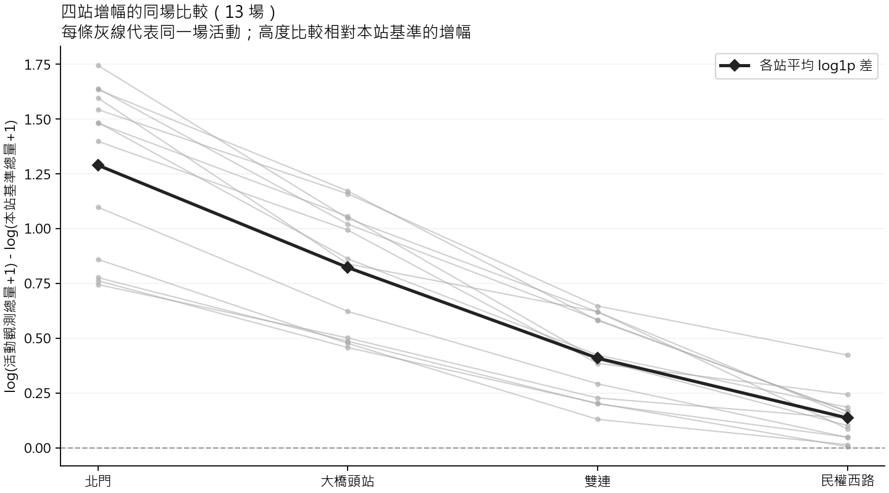
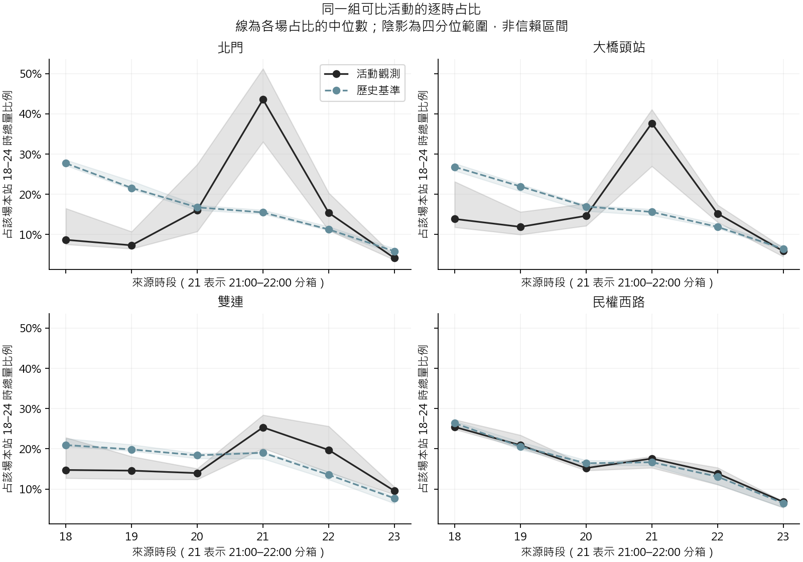
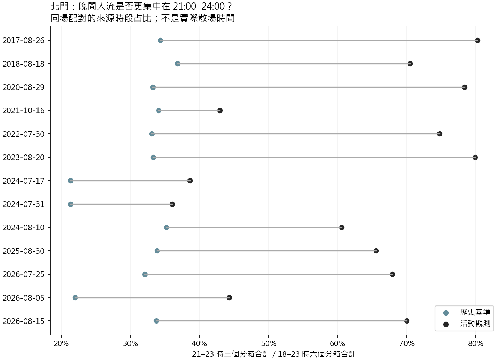

# 四站增幅、尖峰與時段集中分析

分析日期：2026-10-05。這是看過前一版描述結果後的擴充探索；以下問題與算法在**本輪計算前固定**，不是研究開始前的預註冊，也不是用獨立新樣本驗證。

**13 場可比較活動中，相對本站歷史基準的增幅，每場都是北門、大橋頭站、雙連、民權西路依序遞減。北門人流也更集中於 21:00–24:00 來源分箱。** 這支持把北門列為後續研究重點，但不能推論觀眾選站機制、實際散場軌跡或因果效果。

## 1. 資料單位與固定比較

沿用 2026-10-05 07:08:40 UTC 擷取的唯讀 MySQL 快照，重新核對 26 日 × 四站 × 六小時，共 624 列，以及 104 筆視窗總量、峰值、基準及基準日數，全部一致。沒有重新查詢或修改資料庫。

- 描述範圍：21 場已舉行活動，四站 18:00 ≤ 來源時段 < 24:00 均完整。
- 比較範圍：原本北門主要樣本的 13 場、9 年份；同場四站每個小時均至少有兩個歷史比較日。其餘 8 場缺合理基準，保留於描述，不補零。
- 歷史基準：同站同時段前 7／14／21／28 天中已下載且完整、排除活動表日期者的平均。不是完整 28 天平均。
- 一場活動是分析單位，四站是同場重複觀察；不能把 52 筆站別列或 312 筆逐時列當成獨立事件。
- `origin_count` 是來源時段的起站 OD 人次。尚未確認刷卡分箱定義，不能稱為實際候車到達，也不能把 21–23 三個分箱合計稱作「散場後」。本報告「21:00–24:00」一律指這三個來源分箱。

## 2. 哪一站相對平常增幅更大？

對第 i 場、第 s 站計算

\[
d_{is}=\log(1+Y_{is})-\log(1+B_{is}),
\]

其中 Y、B 為 18–24 時觀測與基準總量。比較的是**各站相對自身基準的變化**，不是直接比較四站總人數。加 1 沿用原分析規則。

| 站別 | 每場增幅的平均名次¹ | 配對比值的幾何平均² |
|---|---:|---:|
| 北門 | 4.00 | 3.630 |
| 大橋頭站 | 3.00 | 2.276 |
| 雙連 | 2.00 | 1.505 |
| 民權西路 | 1.00 | 1.146 |

¹ 每場四站由小到大排名，4 代表增幅最高。² `exp(mean(d))`，即 `(Y+1)/(B+1)` 的幾何平均，不是兩站人次比，也不是因果倍數。



用 **Friedman 同場區集比較**檢查四站是否有一致的分布／排序差異，得到 **Q=39、Kendall W=1.000**。W 使用含並列名次修正的 `Q/[n(k−1)]`，描述樣本中名次的一致程度；此處 13 場排序完全相同。W=1 不代表解釋了 100% 人流，更不代表已證實因果。

只有四站，[SciPy 官方文件](https://docs.scipy.org/doc/scipy/reference/generated/scipy.stats.friedmanchisquare.html)對小規模重複樣本的卡方近似 p 值有適用限制，因此本次主要參考**場內標籤置換**：每場獨立隨機排列四站標籤，保留同場四個值，統計 Q 的右尾。固定種子 20261005、199,999 次中，0 次 Q 達到觀測值，採 `(b+1)/(B+1)` 得 **Monte Carlo p=0.000005**。這是本次模擬可報的解析度下限，**不是 p=0，也不是真實尾機率精確等於這個數字**。置換與加一公式依 [SciPy 配對置換說明](https://docs.scipy.org/doc/scipy/reference/generated/scipy.stats.permutation_test.html)實作。僅供參照的卡方近似 p 保存在 JSON，不作主要證據。

置換成立需要虛無假設下同場四站標籤可交換，以及各區集的適當獨立性。車站是觀察資料中的固定地點，並未隨機分派；相對基準轉換不會保證可交換。若分布形狀或站別變異本就不同，結果也不能只解釋成平均位置差。共享比較日、同年系列活動及跨年變遷仍可能影響推論。因此上述 p 是**條件式、探索性結果**。

### 北門與另外三站的配對方向

另固定比較 `d北門−d其他站`，用雙尾精確符號檢定測試非零差值為正的機率是否為 1/2。三個比較作同一家族的 Holm 校正，沒有把四站拆成獨立組。

| 比較 | 正／負／零場數 | log1p 差值中位數 | 原始 p | Holm（三項）p |
|---|---:|---:|---:|---:|
| 北門 − 大橋頭站 | 13／0／0 | 0.4243 | 0.0002441 | 0.0007324 |
| 北門 − 雙連 | 13／0／0 | 0.9746 | 0.0002441 | 0.0007324 |
| 北門 − 民權西路 | 13／0／0 | 1.1553 | 0.0002441 | 0.0007324 |

每個比較正向機率的未同時校正 Clopper–Pearson 95% 區間均為 0.7529–1.0000；它是方向機率的區間，不是增幅量的區間，仍依賴可比獨立試驗的工作假設。符號檢定不要求常態或差值對稱，但不檢驗平均增幅。算術上恰為零的差值會排除，並另列零值數，本次沒有零值。算法依 [SciPy 精確二項檢定](https://docs.scipy.org/doc/scipy/reference/generated/scipy.stats.binomtest.html)；Holm 使用由小到大累積最大值的逐步校正，對應 [statsmodels 的 Holm 方法](https://www.statsmodels.org/stable/generated/statsmodels.stats.multitest.multipletests.html)。

## 3. 人流集中在哪些時段？

先對每場計算「最大一個小時／當晚六小時總量」，再跨場取中位數；不是先把所有活動人次混在一起加總。峰值若並列，保留所有時段；目前 21 場四站均無並列。

| 站別 | 21 場峰值來源時段分布 | 單一尖峰小時占比中位數（四分位範圍） |
|---|---|---:|
| 北門 | 21 時：18 場；20 時：3 場 | 42.01%（33.05%–47.88%） |
| 大橋頭站 | 21 時：15 場；18 時：6 場 | 28.24%（27.12%–38.54%） |
| 雙連 | 18 時：11 場；21 時：8 場；22 時：2 場 | 27.91%（26.67%–28.95%） |
| 民權西路 | 18 時：21 場 | 27.26%（25.12%–37.36%） |

四分位範圍描述活動間差異，不是信賴區間。北門晚間流量集中於一個來源小時的現象比其他站明顯；若要驗證分鐘層級擁擠，仍需更細的到達與服務資料。

下圖改用**同一組 13 場**比較活動與基準的逐時占比，避免拿 21 場活動和 13 場基準混比。每場先除以本站六小時總量，再取中位數；各時段的中位數不一定加總為 100%。



## 4. 北門後段占比是否高於歷史基準？

本輪固定一個時段問題：各場北門的 `21:00–24:00 人次 / 18:00–24:00 人次`，減去同場基準的相同比例。

| 站別 | 活動後段占比平均 | 基準後段占比平均 | 平均配對差（百分點） |
|---|---:|---:|---:|
| 北門 | 62.28% | 31.11% | +31.17 |
| 大橋頭站 | 57.01% | 33.17% | +23.84 |
| 雙連 | 53.63% | 37.73% | +15.91 |
| 民權西路 | 35.38% | 33.77% | +1.61 |

僅北門做推論，其餘站為描述。北門配對差中位數 **+33.64 百分點**，四分位範圍 +22.29 至 +41.64 百分點。13 場均為正，雙尾精確符號檢定原始 **p=0.0002441**。這不是「人流增加 31.17%」；它是同晚人流分布中，後三個分箱的比例平均增加 31.17 **百分點**。



因為此前已見過逐時趨勢，此項應視為後續探索。跨越站別、時段與天氣等本輪問題時，請以[總彙整](README.md)的全七項 Holm 校正為準；本頁保留原始 p 與站別三項校正，方便查核，不宣稱控制整個歷次研究的家族錯誤率。

## 5. 對年份權重與相依性的敏感度

先在年內取各站平均 log1p 增幅，再將九個年份等權比較：Friedman Q=27、W=1；199,999 次置換仍 0 次達到觀測 Q，Monte Carlo p=0.000005，具有相同解析度限制。三個北門對比各為九年全正，符號檢定原始 p=0.003906、三項 Holm p=0.011719。逐次刪除一整年後，北門對其他三站的平均增幅差均維持正向。

北門後段占比配對差按年平均後，九年均為正、等年權平均 **+33.78 百分點**；雙尾符號檢定 p=0.003906。逐次留掉一年，剩餘活動等權平均差介於 **+29.88 至 +34.78 百分點**。

這些結果檢查是否過度依賴某一年，沒有證明事件或年份獨立，也沒有修復 13 場選樣、基準天數只有 2–4 天、疫情、天氣及同期活動等問題。年度結果估計的是「年等權」問題，與活動等權的主要結果不同；敏感度 p 不當成新增的獨立確認證據。

## 6. 重跑、輸出與查核

在專案根目錄、既有分析環境執行：

```powershell
.\.venv\Scripts\python.exe -X utf8 scripts/research_review/station_time_statistics.py
.\.venv\Scripts\python.exe -X utf8 scripts/research_review/station_time_statistics.py --self-test
```

程式可帶 `--root`、`--snapshot`、`--output`、`--permutations`；改變置換次數會改變 Monte Carlo 解析度，報告數字需隨輸出更新。預設重現原私有快照，不連線 MySQL；換新快照需同步提供原主要樣本 CSV，程式會核對日期與數值，不靜默改樣本。

- [程式](../../scripts/research_review/station_time_statistics.py)、[完整數值 JSON](../../results/research_review/2026-10-05/station_time/summary.json)、[來源與輸出雜湊](../../results/research_review/2026-10-05/station_time/source_manifest.json)。
- [52 筆同場站別對比](../../results/research_review/2026-10-05/station_time/event_station_contrasts.csv)、[三組符號檢定](../../results/research_review/2026-10-05/station_time/station_pairwise_sign.csv)。
- [84 筆活動站別時段特徵](../../results/research_review/2026-10-05/station_time/event_station_time_features.csv)、[504 筆逐時占比](../../results/research_review/2026-10-05/station_time/hourly_shares.csv)、[峰值彙整](../../results/research_review/2026-10-05/station_time/station_peak_descriptive.csv)。

選定比較中的缺值、負數、缺少時段、重複鍵、原主要 CSV 數值差異或小時／視窗對帳失敗，程式會停止；未納入比較的缺基準資料則保留缺值。計算檢查包含並列名次的 36 種小型置換與 SciPy Friedman 逐一比對、Holm 排序還原、符號檢定零值處理和隨機種子再現。另在私有測試副本刪掉一個小時，確認程式明確拒絕並保留原快照不變；三張圖已開圖確認中文及數字無裁切。所有小數顯示作四捨五入，未四捨五入值保留於 JSON／CSV。
