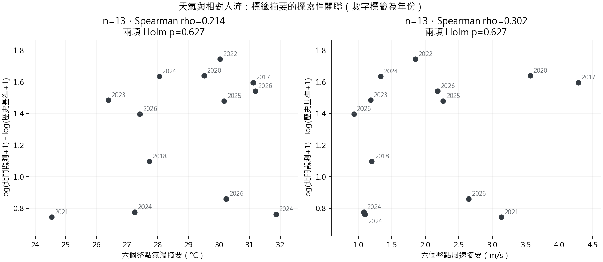
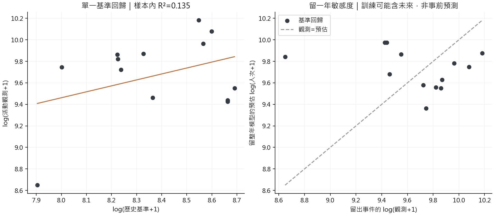
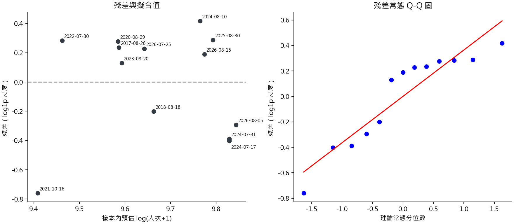

# 擴充統計：天氣關聯與簡單基準回歸

分析日期：2026-10-05。這是看過前輪人流結果後新增的探索，不是研究開始前的預註冊。本輪計算前固定兩個天氣變數、同一批 13 場活動、同一個相對人流指標，以及一個單一解釋變數回歸，沒有依 p 值更換時段、篩選變數或增加模型。

**目前沒有清楚證據顯示氣溫或風速與北門相對基準人流有單調關聯；不能據此說天氣沒有影響。只用一般日基準建立的簡單回歸也沒有優於「訓練活動平均值」的樸素比較方法，暫不適合拿去做精準預測。**

## 1. 天氣先怎麼整理

使用新的一次唯讀 MySQL 查詢，連接 `event_weather_station` 中唯一的 `primary` 主站與 `weather_observation`，不將多個測站同時 join 而放大活動列。這次主站全部是臺北站 `466920`，資料庫標記距大稻埕約 2.2 km；它不等於活動現地量測。

固定只使用活動當日 **18:00、19:00、20:00、21:00、22:00、23:00 六個整點標籤**。同項目六點都有數值、且無非空品質旗標才取算術平均。23:59／日末未核實標籤直接排除；五點資料不會補成六點。

| 涵蓋項目 | 本次結果 |
|---|---:|
| 活動目錄 | 26 日期 |
| 有 primary 主站及完整六點的日期 | 21 個已舉行活動 |
| 主站全日觀測 | 504 列 |
| 排除的主站 23:59／日末未核實標籤 | 21 列 |
| 實際選用整點 | 126 列＝21 × 6 |
| 可算六點平均氣溫／風速 | 各 21 場 |
| 前輪固定的 13 場是否都有完整天氣 | 是，兩項配對樣本均 n=13 |
| 選定時段可用雲量 | 90/126 列；其中 72 列有方法待核對旗標 |

天氣的 `observed_at` 是來源時間標籤，尚未確認各要素與 OD 分箱的精確代表區間。因此這次只稱作**整點標籤摘要**，不宣稱它是活動期間精準曝露量。[CODiS 官方說明](https://codis.cwa.gov.tw/pdf_data/Readme.pdf)指出風速是整點前 10 分鐘平均，所以本次風速為「六個 10 分鐘均值的平均」，不是連續六小時均速。官方也說明 2026 年起總雲量改為衛星推估，既有跨年方法標記有待查核，故雲量只盤點涵蓋、不作相關或回歸。

雨量特殊碼保留：`T` 是微量有雨證據，不補成零；`&` 是累積至後續，不能任意分派；缺值仍未知。不計算可能誤導的六小時雨量總和，也不對小組別跑顯著性檢定。

| 日期範圍 | 至少一點有雨／T | 六點都明確數值 0 | 未知 |
|---|---:|---:|---:|
| 全部 26 日期 | 7 | 14 | 5 |
| 已舉行 21 場 | 7 | 14 | 0 |
| 主要分析 13 場 | 5 | 8 | 0 |

選定 126 點中有 119 個數值雨量、7 個 `T`，本窗沒有 `&`；程式仍處理 `&` 並測試不補零。全部未知的 5 日恰是 4 個取消日與 1 個延期日，沒有 primary 關聯；**不能用只涵蓋施放日的天氣反推取消原因**。「六點數值零」也不保證活動整段時間或現地完全沒下雨。

## 2. 氣溫、風速與相對人流

維持前輪固定的 13 場北門活動，反應量是：

\[
d_i=\log(1+Y_i)-\log(1+B_i),
\]

其中 `Y` 為 18–24 時起站 OD 總量，`B` 為前輪已審查的歷史基準。這是旅次相對量，不是到場人數或天氣因果效應。兩項預定檢定都要求 pairwise n≥10、天氣與反應量各至少 5 個不同值；本次兩項各有 13 個不同值。

小樣本不直接用 Spearman 的大樣本近似 p 值。[SciPy 官方文件](https://docs.scipy.org/doc/scipy/reference/generated/scipy.stats.spearmanr.html)建議小樣本考慮置換。本次固定反應量、隨機重配天氣的秩，使用 `abs(rho)` 作雙尾統計量，99,999 次 Monte Carlo 置換；公式為 `(超越次數+1)/(99999+1)`，不可能報 p=0。這是 [SciPy `pairings` 置換](https://docs.scipy.org/doc/scipy/reference/generated/scipy.stats.permutation_test.html)的關聯檢定；浮點相等採該工具的容差。

| 項目 | n | Spearman ρ | 原始置換 p | 本模組兩項 Holm p | 超越次數／99,999 | seed |
|---|---:|---:|---:|---:|---:|---:|
| 六點氣溫摘要 | 13 | 0.2143 | 0.48072 | 0.62748 | 48,071 | 20261005 |
| 六點風速摘要 | 13 | 0.3022 | 0.31374 | 0.62748 | 31,373 | 20261006 |

兩項校正內：較小 p 乘 2，另一項取與前者的累積最大值，上限為 1。這只處理此模組的 **2 項**，不代替主彙整對本輪 7 項分析的整體校正。數字顯示此樣本沒有清楚單調關聯證據；樣本少、暴露時間未核實且選樣集中，無法排除其他型態或更小的影響。



敏感度只作描述，不再找另一個 p 值：

| 敏感度 | 氣溫 ρ | 風速 ρ |
|---|---:|---:|
| 每年先平均成 9 個年份再計算相關 | 0.5833 | 0.3000 |
| 逐次排除一整年後，剩餘事件的相關範圍 | 0.0000–0.3939 | 0.1273–0.5175 |

年度聚合改變估計目標，氣溫的數字變化也提醒跨年差異不能忽略。跨事件置換要求可交換性；同年活動、共用歷史比較日、季節／疫情／活動規模等可能違反它。年度彙整或留一年不能證明這些假設成立。這些都是**事後觀測天氣**，不是前一天已知的天氣預報。

## 3. 一個簡單回歸，是否比不放基準更有用

只估一個預定模型，沒有加入天氣或其他變數：

\[
\log(1+Y_i)=\alpha+\beta\log(1+B_i)+\varepsilon_i.
\]

13 場、殘差自由度 11。估計與標準誤以 [SciPy `linregress`](https://docs.scipy.org/doc/scipy/reference/generated/scipy.stats.linregress.html)計算，並另用設計矩陣與殘差平方和核對標準誤。

| 項目 | 估計 | 條件式 95% CI |
|---|---:|---:|
| 截距 α | 5.03574 | −2.77449–12.84597 |
| 基準斜率 β | 0.55321 | −0.37778–1.48420 |

樣本內 **R²=0.1346**，只表示本模型解釋約 13.46% 的樣本 log1p 流量變異，不是預測準確率。斜率的常規條件 p=0.21760，屬模型描述，不納入主要 7 項檢定，也不據此宣稱一般日基準有或沒有因果影響。

CI 將已估出的歷史基準視為固定輸入，未另外納入基準估計誤差；它依賴獨立、常態與等變異殘差等工作假設。殘差 Shapiro p=0.04481、Q–Q 有偏離，因此不能把此 CI 當成已驗證涵蓋率的正式推論。最大 Cook 距離為 **1.7919，2021-10-16**；這筆較有影響，沒有因此擅自刪除。



逐次留出一整年，在其餘年份重新估計截距／斜率；同折另用「訓練活動 log1p 流量的平均」作樸素參考。只報 log1p 尺度，不把 exp 轉回值冒充條件平均人次。

| 留整年後，合併 13 個留出事件 | MAE（log1p） | RMSE（log1p） |
|---|---:|---:|
| 基準回歸 | 0.38244 | 0.46298 |
| 同折訓練活動平均值 | **0.30043** | **0.40168** |

**基準回歸在這份資料的留年比較較差。** 各折斜率介於 −0.1578–0.8636，方向也不穩定。這只能反映目前小樣本、有限基準變異與事件差異下的回顧性表現，不能推論基準永遠無用。訓練折可能含留出年之後的資料，所以 LOYO 是敏感度比較，**不是事前 forecasting 效能**；未來應採時間順序回測。



## 4. 這次得到的實際方向

目前不宜增加更多天氣交互作用或多因子回歸來找顯著。優先補一般日比較月份、處理連續系列活動的基準規則、核實時間分箱與活動散場時點，再增加樣本與少量有事前意義的變數。天氣與人流關聯需要區分氣象站距離、量測方法、時段代表性及活動樣本選擇；目前的結果不適合用來設定真實候車時間或列車班距。

## 5. 重跑與稽核

在專案根目錄執行：

```powershell
uv sync --group notebook --group analysis --all-extras
uv run --group notebook --group analysis --all-extras python scripts/research_review/weather_regression_statistics.py
# 使用本次新的天氣快照重現，不重新查 MySQL
uv run --group notebook --group analysis --all-extras python scripts/research_review/weather_regression_statistics.py --reuse-snapshot
# 六點缺一點、23:59排除、T與&處理的失敗／邊界案例
uv run --group notebook --group analysis --all-extras python scripts/research_review/weather_regression_statistics.py --self-test
```

可指定 `--root`、`--output`。本次沒有修改前輪程式、報告、13 場 CSV、快照或 MySQL；先核對前輪 CSV 的 manifest 雜湊，再沿用資料。

- [新分析程式](../../scripts/research_review/weather_regression_statistics.py)
- [完整數字與規則](../../results/research_review/2026-10-05/weather_regression/summary.json)
- [天氣各日摘要](../../results/research_review/2026-10-05/weather_regression/weather_event_summary.csv)、[13 場串接資料](../../results/research_review/2026-10-05/weather_regression/primary_weather_merged.csv)
- [回歸殘差／影響值](../../results/research_review/2026-10-05/weather_regression/regression_event_diagnostics.csv)、[逐折留年結果](../../results/research_review/2026-10-05/weather_regression/regression_loyo.csv)
- [來源時間、query SHA-256、輸入／輸出雜湊及套件版本](../../results/research_review/2026-10-05/weather_regression/source_manifest.json)

新的唯讀天氣快照位於 `.local/research_review/2026-10-05/weather_extended/weather_snapshot.json`，與前輪分開，記錄本次擷取時間及查詢雜湊。報告數字對應本次快照；未來改資料重跑後需同步更新文字解讀。方法來源皆於 2026-10-05 查閱。
