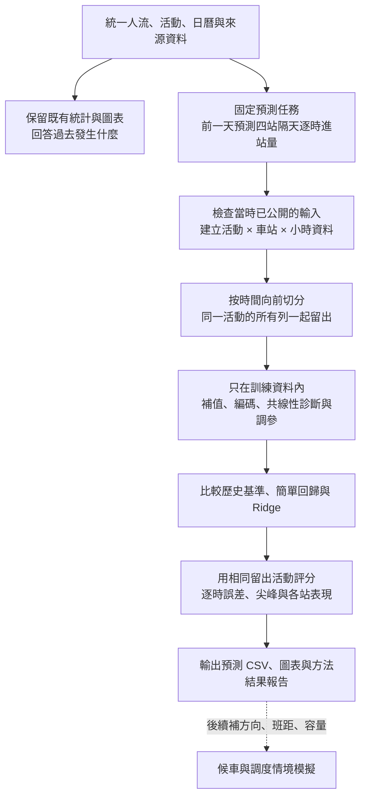

# 大稻埕人流分析整合與事前預測流程

本方案整合組員的《大稻埕煙火人流分析報告_2026-10-07_修訂版.md》與已選定的目標：**在活動前一天，預測隔天四個周邊站的逐時進站人次。**建議先完成晚間 18:00–24:00，再擴充整日；四站為北門、大橋頭、雙連、民權西路。

主線採「既有統計釐清現象 → 統一預測資料 → 比較簡單基準、OLS、Ridge → 向前回測 → 輸出人流 → 後續候車模擬」。組員的工作可保留，但第 8、9 章不宜原樣接成兩道連續篩選。

**狀態：這是整合與執行規格，尚未訓練新模型。**附件第 8 章明載未重估模型、未算新 VIF；第 9 章也沒有本研究六個模型的係數或預測結果。若組員另有程式或數值表，仍須連同資料版本、切分方式一起核對。

## 1. 哪些保留、哪些移出主分析

以下的「移除」指改寫報告主流程，不是刪除資料庫、程式或原始報告。

| 修訂版內容 | 處理方式 | 整合後的用途 |
| --- | --- | --- |
| 第 2 章資料定義、四週／八週基準 | 保留 | 固定人次口徑、比較日及樣本來源。19 場與 21 場結果分開標示。 |
| 第 3–6 章活動差異、站間比較、後段占比、天氣相關 | 保留並集中為「探索分析」 | 說明北門增幅及晚間集中現象；不以單變數 p 值決定所有預測特徵。 |
| 第 7 章單一背景量 OLS | 保留為舊模型比較 | 留年 MAE 0.360567 高於訓練平均 0.306100，這個負結果有價值；兩數均為 log1p 尺度，不能直接與新模型的人次 MAE 比較。 |
| 第 8.2–8.4 的欄位定義、缺值、重複表示、類別編碼與 VIF 原理 | 保留、改成共同資料規格 | 所有模型共用同一份合格輸入；VIF 留作線性模型診斷。 |
| 第 8.4–8.5 的「組內挑選 → 跨組逐步加入」 | 移出第一版主流程 | 避免反覆以同一批驗證成績選變數。先指定少量有理由的變數，再比較模型。 |
| 第 9.1 的 He 等人文獻介紹 | 保留 | 支持多元回歸及站點差異的研究思路；交代原研究與本研究的不同。 |
| 第 9.2–9.5 的六式 OLS、AIC 後退、十折驗證 | 移至備選方法 | 主目標先統一為逐時進站量；不把少量活動再按平日／週末切成小組。 |
| 第 10 章 Holm 與四／八週敏感度 | 保留 | 與原探索性檢定放一起；原七項校正不涵蓋之後所有新模型嘗試。 |
| 第 11 章年度預算、宣導經費與比例 | 保留年度描述，暫不納入首版預測 | 預算約 10 年、宣導約 5 年；重複接到站時列不會增加獨立年度資訊。年度表及 FK 保留。 |
| 文字雲、分群、深度遷移、強化學習 | 文字雲留描述，其餘列後續 | 先回答能否準確預測；不要求每個方法都出現在第一版。 |

第 8 章設定「北門每場 log1p 總量、固定保留基準、逐步加變數」；第 9 章卻改為「四站每場原人次、六個應變數、從完整模型往後刪」。兩者連目標、樣本與選模方向都不同，不能把 VIF → 驗證誤差挑選 → AIC 再刪選串成必經程序。

**需明確改寫三處：**

1. 第 8.5 所說的「外層留年」仍可能拿未來預測過去；正式事前評估改為外層按時間向前切分。
2. 第 9.5 同場四站同折的原則保留，並擴充到同場所有小時；僅分組而不保持時間方向，仍不夠。
3. 第 9.5 的普通 OLS 標準誤、t、F 不自動處理同場／同年相依。第一版重點放留出預測誤差，係數先作條件關聯說明；不直接套普通 p 值宣布重要因子。

## 2. 簡單中文 workflow

簡單說：**先整理能事先知道的資料，再用過去預測後來；比贏簡單方法後，才把預測拿去做候車模擬。**

## 3. 統一 input 與 output

建議固定預測截止時間為活動前一天 18:00（臺北時間）；這是待實作採用的規格建議。每列為「活動日期 × 車站 × 小時」，`y` 為該站該小時的起站／進站 OD 人次。

晚間先輸出每場 4 站 × 6 小時＝24 個預測。21 場已辦活動可形成 504 個站時列，但活動層級資訊仍只有 21 場、10 個年度；不得隨機打散 504 列後稱為獨立驗證。最終可回測場數還要扣除初始訓練期及不合格輸入。

| 資料 | 第一版如何用 | 必要條件 |
| --- | --- | --- |
| 歷史同站同時段人流 | 建立一般日基準，作主要輸入 | 使用截止時間前已發布的 OD。資料的觀測日期早，不等於當時已能下載。 |
| 車站、小時、日型 | 第一版固定候選 | 加站別與時段效果；日型採互斥編碼，不重複塞入星期、週末、含週末假日等完整表示。 |
| 活動預定時間／長度 | 預先指定的擴充特徵組 | 只用當時公告值。開始、長度、由兩者算出的結束，不同時作三份獨立資訊。 |
| 天氣 | 有歷史預報才作事前輸入 | 預報發布時間不晚於截止點，預報有效時間對應目標小時；現在的 CODiS 實測留在回顧分析。 |
| 搜尋熱度／Threads／PTT | 暫留描述與假設形成 | 目前社群樣本集中 2026，不能補成跨年聲量；活動後貼文也不能預測該活動。 |
| 年度財務 | 年度附表與後續敏感度 | 首版排除；未來若加，須核對金額口徑及公開時間，評估跨年泛化。 |
| 同晚人流、尖峰、實際占比 | 訓練標籤或評估項目 | 不可當同晚預測的輸入；過去已公開活動的同類指標則可另定歷史特徵。 |

第一個要補的產物是**資訊可用性表**：每個特徵記錄 `source_version`、`observed_at`、`available_at`、`forecast_cutoff` 與是否可用。訓練活動的人流標籤也必須當時已可取得。

若無法證明歷史 OD 的發布時間，先把結果標為「假設可取得歷史資料的回顧式向前驗證」；不能直接宣稱重現真實 D−1 預測。若只有較早月份公開，就用當時最新可用月份建基準，而非偷用尚未發布的前七日人流。

現有合併表 `event_station_hourly_context.csv` 可作整理起點，不能整表直接餵模型：包含事後天氣、結果衍生欄位，以及重複在每小時列上的活動總量。尤其四週逐時基準與八週六小時總量不是同一單位；若採八週逐時基準，須從合格比較日重新按小時計算。

## 4. 第一版怎麼建模比較好

**先比較三類，不預設複雜模型必勝。**OLS 與 Ridge 使用同一份少量、事先指定的輸入；將平日、週末合併，以日型表示差異。不要按車站、小時、日型各自切成數十個微小模型。

| 模型 | 角色 | 實作重點 |
| --- | --- | --- |
| 歷史基準 | 判斷新模型是否值得做 | 包含一般日基準，以及「一般日基準 × 過去活動倍率」；倍率只由訓練活動估計，不能套用全 19 場的既有倍率。 |
| 預先指定的 OLS 多元回歸 | 保留組員的回歸主線 | 主體採歷史基準、站別、時段與日型；活動安排另以預定擴充規格比較。不做全面逐步淘汰。 |
| Ridge 回歸 | 優先候選的預測模型 | 與 OLS 使用相同資料，對係數加收縮以降低不穩定；連續輸入的標準化及收縮強度選擇只在訓練資料內完成。 |

第一版應變數可統一採原人次，OLS／Ridge 的基本形式為：

\[
Y_{i,s,h}=\alpha+\beta B_{i,s,h}+a_s+b_h+\gamma^{\mathsf T}C_i+\varepsilon_{i,s,h}.
\]

其中 `i` 是活動、`s` 是車站、`h` 是小時；`B` 是當時可用的逐時背景量，`C` 為少量日型欄位。活動安排的擴充規格再加入公告特徵；Ridge 對所估係數施加懲罰。此式是本專案的候選設計，不是已估出來的結果，也未宣稱能充分捕捉每站不同的尖峰曲線。負預測以事先固定的非負截斷規則處理，回測與實際輸出一致。

這與舊第 7 章的北門逐場 log1p 模型不同，因此要重新訓練與回測。若後續比較 log1p 模型，另記回轉規則；直接指數回轉不能自動稱為原人次的條件平均。

VIF 在 OLS 中用來提醒係數難以分開解釋；不是所有模型的通行證。保留完全重複欄位清理，但不要求 Ridge 或樹模型一定先通過 VIF＜5。調整 GVIF 也不能直接套普通 VIF 的同一數值門檻。

第二輪再把**淺層 XGBoost**放進相同回測比較非線性與交互作用；若沒有穩定改善，維持較簡單模型。若嘗試「背景模型＋活動殘差修正」，殘差訓練須來自折內留出的背景預測，不用背景模型對自身訓練列的過度樂觀擬合殘差。

少量變數與收縮的理由可參考 Heinze 等人（2018）§2.4、§3.1及表3：反覆選模會增加不穩定與推論偏誤，資訊有限時可考慮 Ridge 等收縮方法。這不代表 AIC 永遠不能用，也不保證 Ridge 必然最佳。[出版者全文](https://onlinelibrary.wiley.com/doi/full/10.1002/bimj.201700067)

## 5. 如何確認真的有預測能力

主回測依年份向前，例如「只用 2022 年以前已取得資料訓練 → 預測 2023 年合格活動」，再擴張訓練年預測下一年。起始訓練年數與最低場數先依資料盤點決定並記錄；早期不足以建模的年份不硬湊十折。

同場所有車站與小時必須同邊。外層測試資料不能用來補值、挑變數、估標準化尺度或調參；需要調參時，在訓練年度內再做較小的向前切分。若內層可用活動太少，使用事先固定的簡單設定並揭露限制，不反覆依外層成績改參數。

按時間切分的依據是 Hyndman 與 Athanasopoulos 的時間序列驗證原則；把選模留在訓練程序內則由 Varma 與 Simon 的巢狀驗證研究支持。前者不自動解決發布延遲，後者也不自動解決時間相依，兩者需一起落實。[向前驗證教材 §5.10](https://otexts.com/fpp3/tscv.html)、[巢狀驗證原文](https://pmc.ncbi.nlm.nih.gov/articles/PMC1397873/)

評估固定使用相同合格測試活動，報告：

- **主要指標：逐時 MAE（人次）。**先算每場 24 個站時格的平均，再對場次平均。
- **次要指標：RMSE、四站各自 MAE、每站六小時總量誤差、尖峰人次與尖峰時刻誤差。**不能只看總平均掩蓋北門尖峰失準。
- **逐場及逐年誤差表。**明列測試場數、失敗或排除原因，以及相對簡單基準改善多少；年度等權結果可另作敏感度。

四週與八週規則各有不同覆蓋率，不能用四週 19 場的分數直接對八週 21 場宣布模型輸贏。比較方法時用共同測試場次，額外場次另列覆蓋率與成績。

既有 2026 結果已經反覆查看，不宣稱它是完全未見的最終測試集。這輪屬歷史回測；真正鎖定規格後的前瞻驗證，留給之後新發生的活動。已辦 21 場也只支持已舉辦情境，尚不包含臨時取消的預測能力。

## 6. 如何接到排隊理論、地圖與後續方法

**預測人流是排隊模型的需求輸入，兩者不是同一個模型。**分站小時進站量還需轉成分方向、較短時間格的月台到達，配上列車班距、可上車容量與旅客走行延遲，才能模擬等候。

列車有批次上車、容量限制及時刻表，第一選擇是相應的離散事件／批次服務模擬。M/M/c 可另用於具有相應到達及服務假設的閘門服務情境；不能把 c 直接當列車數，就宣布算出真實等車時間。小時量拆成分鐘量的方式是額外假設，需做敏感度與實際排隊資料校準。

Santanam 等人（2021）的 §IV、VI 採用「背景人流 → 活動需求預測 → 時間分布 → 列車模擬」架構，可支持這個串接方向。他們有更細的 AFC／列車相關資料；本案仍需補齊，且文中的部分事後活動特徵不能照搬作 D−1 輸入。[作者原文](https://arxiv.org/html/2106.05359v1)

網站可先呈現四站預測曲線、尖峰與假設下的流向動畫。**現有資料不能還原煙火現場至車站的個人步行軌跡。**目的站 OD 可呈現捷運旅程的目的地分布，但來源時段歸屬的目的站計數不能冒充真正的同時段出閘量。

分群可在訓練歷史曲線上做描述性分型；不可先看待預測活動的完整人流曲線才判定它是哪一群。正常日預訓練與活動微調可列後續遷移方案；強化學習則等有經校準的候車模擬器、可採取的調度動作及成本後再研究。這些均不列第一版必做項目。

## 7. 接下來的工作與交付物

| 順序 | 工作 | 完成時應看到什麼 |
| --- | --- | --- |
| 1 | 建立輸入資格與單位表 | 每欄定義、當時可得時間、缺值比例、首版採用與否；特別查 OD 公開延遲。 |
| 2 | 產生逐站逐時預測用表 | 活動、車站、小時唯一鍵；特徵與答案分開；保留排除紀錄。 |
| 3 | 固定向前切分與少量候選模型 | 訓練／測試年份、測試場次及評分規格；凍結後才比較。 |
| 4 | 跑歷史基準、OLS、Ridge | 同場對照的真值、預測、誤差、各站曲線及所用輸入版本。 |
| 5 | 寫結果報告並接網站 | 每個方法均交代「為何採用、文獻支持、實際結果、限制」；沒有勝出也如實保留。 |

建議整合後的正式報告順序：研究問題與資料 → 既有探索發現 → 事前輸入與變數診斷 → OLS／Ridge／基準比較 → 向前回測結果 → 後續候車情境 → 限制與文獻。六式 OLS／AIC 文獻方案放附錄，不和主流程並列成已完成的模型。

## 8. 文獻對照

| 文獻 | 支持什麼 | 不代表什麼 |
| --- | --- | --- |
| He, Zhao & Tsui（2018），*An Analysis of Factors Influencing Metro Station Ridership: Insights from Taipei Metro*，§II–IV、表II–IV。[作者稿](https://arxiv.org/pdf/1904.01280) | 站點運量可用多元回歸探討；原文確有 AIC 後退與六式 OLS。 | 原研究為 2015 年一週、108 站的平均日運量，非煙火 D−1 逐時預測。其十折 R² 不是本案成果。 |
| Heinze, Wallisch & Dunkler（2018），*Variable selection – A review and recommendations for the practicing statistician*，§2.4、§3.1。[全文](https://onlinelibrary.wiley.com/doi/full/10.1002/bimj.201700067) | 選模的不穩定性、收縮與穩定性檢查。 | 不是全面禁止 AIC，也不能照搬醫學 EPV 門檻為活動場數規則。 |
| Varma & Simon（2006），*Bias in error estimation when using cross-validation for model selection*。[全文](https://pmc.ncbi.nlm.nih.gov/articles/PMC1397873/) | 調參／選模與最終測試應分離。 | 巢狀驗證本身不保證時間方向正確。 |
| Hyndman & Athanasopoulos（2021），*Forecasting: Principles and Practice*，§5.10。[作者教材](https://otexts.com/fpp3/tscv.html) | 用過去資料預測後來、逐步推進預測起點。 | 不代表月資料當時已公開；發布時間仍需核對。 |
| Santanam, Trasatti, Van Hentenryck & Zhang（2021），*Public Transit for Special Events: Ridership Prediction and Train Optimization*，§IV、VI。[作者預印本](https://arxiv.org/html/2106.05359v1) | 特殊活動需求預測與運輸模擬可分階段串接。 | 不保證複雜模型勝過簡單回歸，也不補足本案缺少的列車與排隊資料。 |
| Chen & Guestrin（2016），*XGBoost: A Scalable Tree Boosting System*。[作者稿](https://arxiv.org/abs/1603.02754) | 後續樹模型的算法來源。 | 不證明 21 場活動足以取得良好外推表現。 |

既有數值與圖表仍以[10/7 分析報告](大稻埕煙火人流分析報告_2026-10-07.md)及其來源快照為準。本文件提出的向前回測、逐時多元回歸與 Ridge 尚無新成績。
