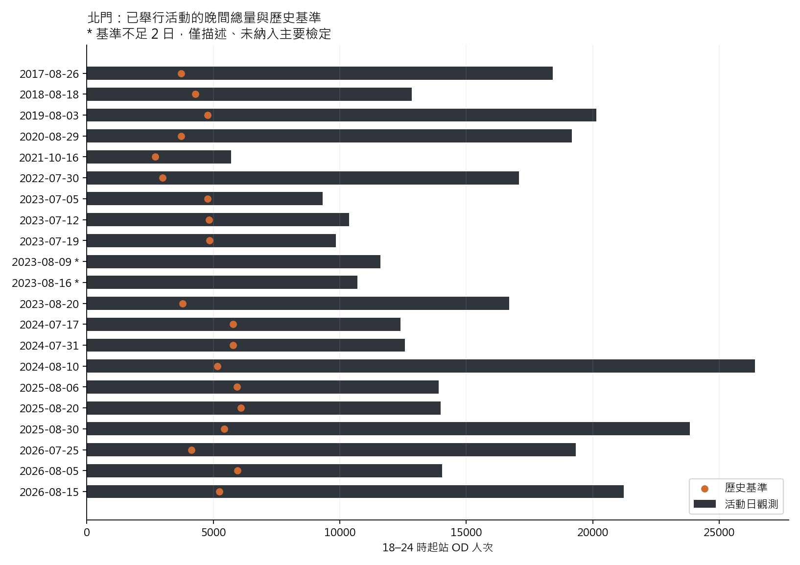
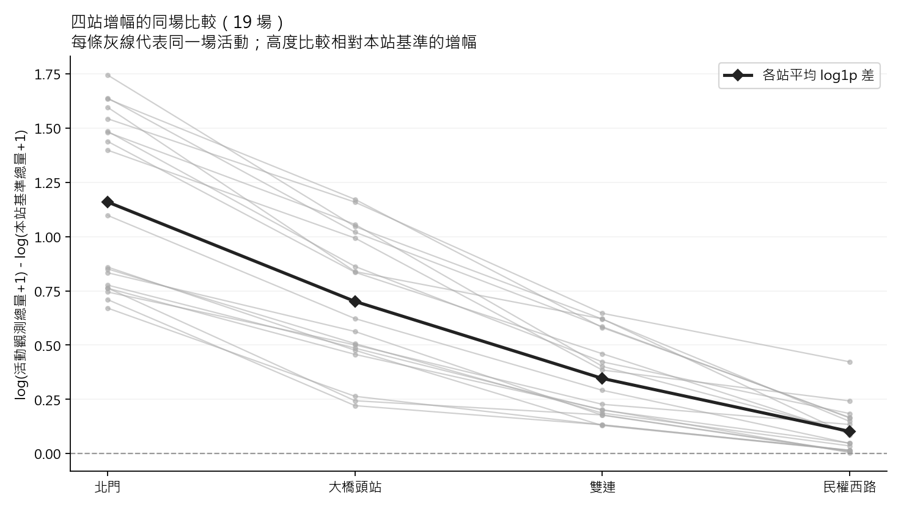
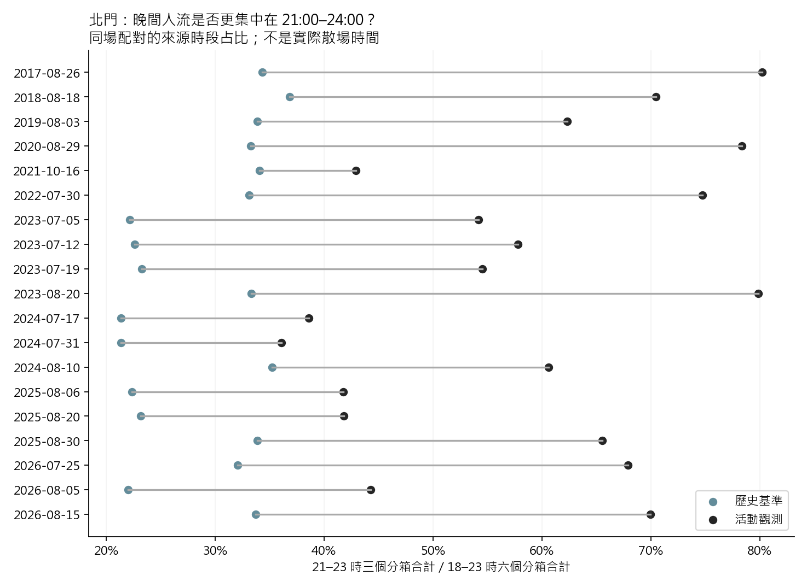
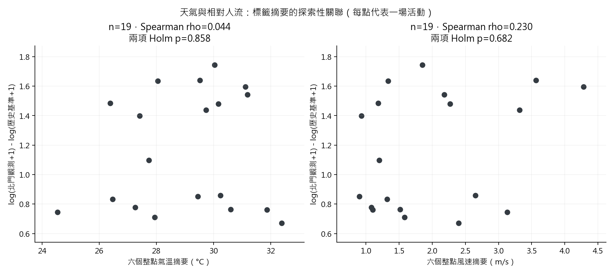
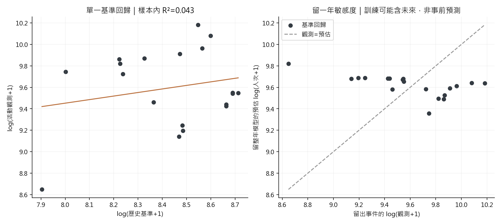

# 大稻埕煙火活動與周邊捷運人流：文獻依據、分析方法與實證結果

## 摘要

本研究探討大稻埕煙火活動期間，北門、大橋頭、雙連與民權西路四站的晚間起站人流，如何偏離各站的一般日基準，以及人流是否集中於晚間後段。主要分析納入前四週有足夠比較日的 **19 場已辦活動、10 個年度**；另以八週日曆配對基準分析全部 **21 場已辦活動**，作為敏感度比較。

北門活動日 18–24 時平均起站量為 **15,649.5 人次**，基準為 **4,732.9 人次**，平均差為 **10,916.5 人次**。19 場的北門起站量皆高於自身基準，且四站的相對增幅排序全部為北門、大橋頭、雙連、民權西路。北門 21–24 時占六小時起站量的比例，活動日平均為 **59.05%**，基準日為 **29.05%**，平均配對差為 **30.01 個百分點**。因此，現有資料最一致的發現是北門的相對增幅與晚間後段集中程度。

事件層級的氣溫、風速相關檢定未提供清楚的單調關聯證據；但年度平均氣溫與年度平均增幅呈較高正相關，顯示分析層級會影響結果，不能概括為「天氣無影響」。單一背景人流回歸的樣本內 R² 為 **0.0431**，整年留出誤差仍高於訓練平均值，尚未展現優於簡單基準的預測能力。

上述為觀察性、探索性結果。同年活動、重用比較日與活動規模等因素仍可能造成相依或混雜；常規 p 值與區間不構成煙火因果效果、實際候車時間或最佳加班車方案的證明。

## 1. 研究問題與文獻脈絡

本研究依序回答五個問題：

1. 北門活動日晚間的起站量，相較自己的歷史一般日基準增加多少？
2. 四個周邊站的相對增幅是否一致，哪一站最突出？
3. 活動日的人流是否更集中在 21–24 時？
4. 氣溫、風速與活動日的相對增幅是否有單調關係？
5. 一般日背景量能否有效預測活動日人流？

### 1.1 為何先建立一般日基準

[Santanam 等人（2021）](https://arxiv.org/abs/2106.05359)以亞特蘭大 MARTA 的 AFC 資料研究特殊活動人流，在第 IV.A 節建立按站別、平假日及進出方向區分的 15 分鐘歷史人流分布，再於第 IV.B 節比較活動人流與基準。該研究支持「先估一般背景，再辨認活動期間偏離」的研究架構。本研究借用此概念，但只有小時 OD，故使用小時彙總；沒有重現該文的 15 分鐘分布、90 百分位增量規則或列車乘客辨識模型。

[Fernandes 等人（2025）](https://doi.org/10.1016/j.trpro.2025.04.020)比較足球賽事相關車站的活動日與前一週人流，並分析散場時段變化（第 2.1、3.1 節）。這支持同星期比較及時序描述的研究動機。該文的多元回歸依變數是到場人數，不能因題名提到 metro ridership，就將其回歸結果視為本專案捷運起站量模型的直接驗證。

**本專案的選擇與文獻須分開：**前四週、18–24 時、至少兩個比較日、北門為主要站，以及 log1p 差值，皆為既有專案分析規格；上述論文沒有規定大稻埕一定應使用這些數值。文獻提供選法的理由，方法假設是否適合本資料仍須另外檢查。

### 1.2 方法與研究問題的對應

| 問題 | 本次實際使用的方法 | 主要方法依據 | 方法能回答的範圍 |
| --- | --- | --- | --- |
| 活動與基準的差異 | 每場配對 log1p 差、單樣本 t／F=t²、符號檢定 | NIST 配對觀測與符號檢定說明 | 平均差與方向一致性；不識別因果 |
| 四站相對增幅 | Friedman 統計量、場內置換、Kendall W、北門對其他站符號比較 | Friedman（1937）；Phipson 與 Smyth（2010） | 同場站別排名及其一致性 |
| 晚間集中程度 | 各場後段占比、配對差、符號檢定、峰值描述 | NIST 符號檢定；活動運輸文獻的時序分析概念 | 所觀察起站量的時間分布 |
| 天氣與增幅 | Spearman 秩相關、雙尾配對置換 | Spearman（1904）；SciPy 小樣本說明 | 單調關聯；不等於因果或所有非線性關係 |
| 背景量的解釋／預測能力 | 單變數 OLS、殘差診斷、整年留出、MAE／RMSE | NIST 最小平方法；Roberts 等人（2017）；Hyndman 與 Athanasopoulos（2021） | 樣本內關係與跨年度回顧比較 |
| 多個問題同時檢查 | 固定七項檢定的 Holm 校正 | Holm（1979） | 在各 p 值有效的條件下控制該家族錯誤率 |

原始論文、官方方法文件與可定位章節列於第 11 節。工具文件用來核對實作，領域論文用來說明研究設計；兩者都不能替本資料的獨立性或可交換性背書。

## 2. 資料、分析單位與基準建立

### 2.1 可使用多少資料

| 資料層級 | 現有數量 | 本文用途 |
| --- | ---: | --- |
| 清理後 OD | 17 個月份、140,789,493 列 | 建立各站逐時人流；不能把列數當成獨立活動場數 |
| 活動目錄 | 26 個日期：21 已辦、4 取消、1 延期 | 判定活動狀態與排除比較日 |
| 四站活動日晚間資料 | 4 站×26 日×6 小時＝624 列 | 先彙整為每場、每站一筆 |
| 四週主要比較 | 19 場、10 年 | 主要配對分析、四站比較、天氣與回歸 |
| 八週敏感度比較 | 21 場、10 年 | 檢查基準規則改變後的結果 |
| 已核對氣象 | 4 測站共 1,008 筆 | 主測站臺北站 466920 的六點氣溫／風速摘要 |
| 年度財務 | 10 年活動預算、5 年宣導所需經費 | 一年一筆描述，不複製為每場經費 |

2019/07、2023/06、2025/07 補齊後，主要可比較活動由 13 場增加至 19 場。新增六場為 2019-08-03、2023-07-05、2023-07-12、2023-07-19、2025-08-06、2025-08-20。原來 13 場的觀測量與基準均未改變；新舊結果不同主要來自納入額外場次。

此處的「起站人次」指 OD 資料中以該站為旅程起點的人次，不是去重後的現場觀眾數。`destination_count_same_source_bin` 尚未證實代表目的站實際出閘時刻，因此本文不將它當作同小時真實出站流量，也不由此還原個人步行軌跡。

### 2.2 四週主要基準如何計算

對活動 i、車站 s、來源時段 h，定義觀測起站量為 N(i,s,h)，比較日為活動日期往前 7、14、21、28 天。比較日須排除活動表中所有日期，包含取消與延期日期；各小時須至少有兩個可用比較日。

六小時觀測總量及基準為：

$$
Y_{is}=\sum_{h=18}^{23}N(i,s,h),\qquad
B_{is}=\sum_{h=18}^{23}\frac{1}{m_{ish}}\sum_{j\in\mathcal C_{ish}}N(j,s,h).
$$

其中，C 為該站該小時合格比較日集合，m 為其日數；不將缺失量補成零。本次主要樣本中，各場最低基準日數為 2、3、4 天者分別有 6、5、8 場。

2023-08-09 與 2023-08-16 前四個同星期日均落在活動表內，故未進入 19 場主要比較，但保留在全部 21 場的描述與八週敏感度分析。這項排除依基準可用性決定，並非看到其人流大小後剔除。

四週基準保留同星期與同時段的背景，**沒有**在主要規則中再匹配假日。它是比較參考，不是已識別的「若無煙火會發生什麼」因果反事實；未登錄活動、整段夏日節、疫情與其他交通變化仍可能影響比較。

## 3. 分析一：北門活動日是否持續高於基準

### 3.1 文獻依據與採用理由

NIST 的 [Analysis of paired observations](https://www.itl.nist.gov/div898/handbook/prc/section3/prc311.htm)說明，當兩筆觀測能一一對應時，可先計算配對差，再對差值的平均進行 t 檢定。本研究一場活動對應自己的歷史基準，故以「場」保留配對，而非將觀測與基準拆成 38 個獨立樣本。

本專案將差值定義為：

$$
d_i=\log(1+Y_i)-\log(1+B_i),\qquad
t=\frac{\bar d}{s_d/\sqrt n},\qquad F=t^2.
$$

檢查的虛無假設為 H₀：E(d)=0。若差值符合獨立、同分布的常態工作模型，t 的自由度為 n−1，而其平方對應分子自由度 1 的 F。本報告中的 F 是配對 t 的平方，**不是兩組原始人次的變異數比檢定，也不是多因子模型的總體 F**。

log1p 是既有專案的尺度選擇，用以表達相對變化並減少大人次場次對尺度的支配；加 1 使零值亦能定義。它不保證常態。另依 [NIST Sign Test](https://www.itl.nist.gov/div898/software/dataplot/refman1/auxillar/signtest.htm)只計算正、負差的方向，剔除零差，作為不依賴差值幅度的補充；符號檢定仍需要跨場方向獨立等假設。

### 3.2 實際結果

| 指標 | 結果 |
| --- | ---: |
| 活動日六小時平均起站量 | 15,649.5 人次 |
| 自身一般日基準平均 | 4,732.9 人次 |
| 每場配對差的平均 | ＋10,916.5 人次 |
| 平均 log1p 差 | 1.159216 |
| F(1,18)／常規雙尾 p | 161.360108／2.00801×10⁻¹⁰ |
| 正／負／零差 | 19／0／0 場 |
| 精確雙尾符號 p | 3.81470×10⁻⁶ |
| 配對比值幾何平均 G | 3.1874 |
| G 的常規 95% 信賴區間 | 2.6313–3.8611 |

G＝exp(mean(d))，即各場 (Y+1)/(B+1) 的幾何平均；它不是 15,649.5 除以 4,732.9，也不是「煙火使人流增加 3.19 倍」的因果倍率。表內平均量各自四捨五入，差值由未四捨五入資料計算。



*圖1保留全部 21 場觀測，其中 19 場有各自的合格基準；標星號的 2023-08-09、2023-08-16 僅作描述，未納入本節檢定。比較並非使用同一個固定背景人數。*

### 3.3 結果代表什麼，以及推論界線

19 場皆為正差，配對差的幅度也大，顯示「活動日晚間北門起站量高於這套歷史基準」是本資料中一致的現象。然而，差值的 Shapiro–Wilk p＝0.00458，已提示常態假設存疑；同年活動也可能相依。因此，小 p 值不應單獨作為定論，常規信賴區間也不是已驗證的涵蓋範圍。

既有的年度敏感度分析先將同年度 d 取平均，再令 10 個年度等權，得到 G＝**3.5062**；逐次移除一整年、其餘事件等權重算，G 在 **3.0855–3.4091** 之間。年度均值的 20,000 次 bootstrap 得到比值百分位區間 **2.8742–4.2802**。這些結果顯示描述方向未被單一年份反轉，但年度等權改變了估計對象，10 年也不足以保證區間可靠；這並非已執行年度分群 CR2 修正。

數據：[19 場逐場結果](../../results/research_review/2026-10-07-refresh/four_week_primary/statistics/primary_beimen_events.csv)、[完整統計及診斷](../../results/research_review/2026-10-07-refresh/four_week_primary/statistics/summary.json)。

## 4. 分析二：四站的相對增幅是否不同

### 4.1 文獻依據與採用理由

[Friedman（1937）](https://doi.org/10.1080/01621459.1937.10503522)提出以排名處理區組比較；這提供同一區組內比較多個處理／條件的基礎。本研究把「同一活動」視為區組，四站視為重複比較的條件，對各站的 d(i,s) 排名。這比直接比較四組原始人次更能對準「相對各站背景的增幅」，並保留同場關係。

使用 Friedman 統計量 Q，並以 W＝Q/[n(k−1)] 描述排名一致性；此處 n＝19、k＝4。本樣本四站無並列排名，故不需額外並列修正。W＝1 表示場次之間的站別排序一致，不代表模型解釋了 100% 人流。

由於只有四個站，[SciPy 的 Friedman 說明](https://docs.scipy.org/doc/scipy/reference/generated/scipy.stats.friedmanchisquare.html)對卡方近似 p 的適用規模提出限制，本次沿用場內站別標籤置換計算尾端機率。共作 199,999 次，依 [Phipson 與 Smyth（2010）](https://doi.org/10.2202/1544-6115.1585)所討論的隨機置換 p 值處理，使用「（至少同樣極端的次數＋1）／（模擬次數＋1）」。**置換不會自動使固定車站可交換**，因此其 p 仍取決於工作假設；排名描述本身則可直接由觀測資料核對。

### 4.2 實際結果

| 車站 | 活動日平均起站人次 | 基準平均人次 | 平均配對差 | 配對比值幾何平均 |
| --- | ---: | ---: | ---: | ---: |
| 北門 | 15,649.5 | 4,732.9 | ＋10,916.5 | 3.1874 |
| 大橋頭 | 7,839.3 | 3,767.0 | ＋4,072.4 | 2.0164 |
| 雙連 | 9,956.3 | 7,121.0 | ＋2,835.3 | 1.4141 |
| 民權西路 | 8,039.5 | 7,420.7 | ＋618.8 | 1.1079 |

19 場的相對增幅排名全部為 **北門＞大橋頭＞雙連＞民權西路**。Friedman Q＝**57**，Kendall W＝**1**；置換未出現與觀測值一樣極端的模擬，故加一 p＝**0.000005**。這是此次模擬的解析度下限，不是 p＝0，也不是完整枚舉所得的精確尾機率。

北門對另外三站的配對增幅差均為 19 正、0 負、0 零，各符號檢定原始 p＝3.81470×10⁻⁶。將整體四站比較及三個配對放入第 8 節固定七問題後，各校正 p 均為 2.67029×10⁻⁵。



*每條灰線代表同一場活動；比較的是各站相對自身基準的 log1p 差，而非原始人次大小。*

### 4.3 結果解釋

北門的相對增幅最大，以表中平均配對差比較，增加人次也最多。雙連的活動日平均人次高於大橋頭，卻不代表其活動增幅較大，因為雙連平常的背景人流也較高。這說明原始總量與相對增幅應一起呈現。

此結果支持將北門列為活動人流觀察的重點站，但無法推論旅客由活動場地走哪條路、各站旅客是否互相轉移，或其他三站是未受活動影響的控制組。

數據：[站別描述 CSV](../../results/research_review/2026-10-07-refresh/four_week_primary/statistics/station_descriptive.csv)、[站間配對 CSV](../../results/research_review/2026-10-07-refresh/four_week_primary/station_time/station_pairwise_sign.csv)。站間 CSV 另保留「三配對家族」的 Holm p；本文統一引用第 8 節「七問題家族」，兩者家族範圍不同。

## 5. 分析三：人流是否集中在晚間後段

### 5.1 文獻依據與計算方式

活動運輸文獻顯示，總人流之外還需檢查活動前後的時間分布；Fernandes 等人（2025）第 3.1 節即比較賽事散場附近的人流時序。本研究沒有已核實的實際散場時刻，故使用事先沿用的固定來源時段 **21–24 時**，不稱其為精準的「散場後三小時」。

每場先計算：

$$
L_i^{obs}=\frac{\sum_{h=21}^{23}N(i,\text{北門},h)}{Y_i},\qquad
L_i^{base}=\frac{\sum_{h=21}^{23}\widehat N^{base}(i,\text{北門},h)}{B_i},\qquad
\Delta L_i=L_i^{obs}-L_i^{base}.
$$

占比是本專案定義的描述指標；檢查 ΔL 方向時沿用 NIST 所述配對符號方法。先算各場占比再平均，可避免直接合併所有人次而讓大場次決定結果。

### 5.2 實際結果與解釋

| 19 場配對結果 | 數值 |
| --- | ---: |
| 活動日 21–24 時占比的平均 | 59.05% |
| 基準 21–24 時占比的平均 | 29.05% |
| 平均配對差 | ＋30.01 個百分點 |
| 占比差為正 | 19／19 場 |
| 原始符號 p／七問題 Holm p | 3.81470×10⁻⁶／2.67029×10⁻⁵ |

另外，不要求有歷史比較日、只描述全部 **21 場已辦活動**時，北門有 **18 場**的最大單小時起站量落在來源 **21 時分箱（21–22 時）**，其餘 3 場在 20 時分箱。最大單一小時占六小時總量的中位數為 **42.01%**。



*每一組線段比較同一場的兩個占比；19 場配對與 21 場峰值描述使用不同納入條件。*

結合第 3 節，可見活動日不只是總量較高，起站量也向晚間後段集中。但小時旅次量不等於月台到達率，且本資料沒有實測隊列與列車剩餘容量，因此仍不能換算成真實等待分鐘數或確定所需加班列車數。

數據：[逐場時段指標](../../results/research_review/2026-10-07-refresh/four_week_primary/station_time/event_station_time_features.csv)、[21 場峰值描述](../../results/research_review/2026-10-07-refresh/four_week_primary/station_time/station_peak_descriptive.csv)。

## 6. 分析四：天氣與北門相對增幅

### 6.1 文獻依據與採用理由

[Spearman（1904）](https://doi.org/10.2307/1412159)討論以排名量測關聯，原文包含「Comparison by rank」；本研究使用現行 Spearman 秩相關，檢查天氣較高時，相對增幅是否傾向較高或較低，不預設線性斜率。計算為兩組資料排名間的 Pearson 相關，即 rho＝corr(rank(x), rank(d))，並列值使用平均名次。

[SciPy 的 Spearman 說明](https://docs.scipy.org/doc/scipy/reference/generated/scipy.stats.spearmanr.html)建議小樣本考慮置換，而不直接依賴漸近 p。故本次每項作 99,999 次配對置換，以 |rho| 判斷雙尾極端程度，使用加一 p。這不要求原數值常態，但仍依賴事件間可交換等假設。

反應量是第 3 節的北門 d；兩個固定解釋變數是臺北主測站六個來源標籤的平均氣溫與平均風速。本次主要時間定義保留 **18、19、20、21、22、23 時**，以便與 10/5 同方法比較；另分析已核對的 **19–24 小時終點**。每個氣溫值是觀測時點值，每個風速值是前十分鐘平均，不能稱為連續六小時平均曝露。

臺北測站並非活動現場量測；核對報表小時終點，也不代表 OD 人流與旅客真實天氣曝露已精確對齊。本次使用事後實測天氣，不是活動開始前可取得的天氣預報。

### 6.2 事件層級的實際結果

| 基準／氣象時窗 | 變數 | 場數 | Spearman rho | 原始置換 p | 七問題 Holm p |
| --- | --- | ---: | ---: | ---: | ---: |
| 四週／18–23 原標籤 | 氣溫 | 19 | 0.0439 | 0.85798 | 0.85798 |
| 四週／18–23 原標籤 | 風速 | 19 | 0.2298 | 0.34102 | 0.68204 |

改用 19–24 報表終點後，氣溫 rho＝**0.0316**、置換 p＝**0.89939**；風速 rho＝**0.1553**、置換 p＝**0.52238**。這個替代時窗另作兩項家族校正，兩者皆為 1，不併入主要七問題家族。兩種時間定義都未在事件層級提供清楚單調關聯證據。



*每點為一場活動；使用原 18–23 標籤，未將四站共用天氣當成四筆獨立樣本。圖上標示的是天氣兩項家族校正，這兩個值在本次資料中恰與表中的七問題家族校正值相同。*

### 6.3 年度平均呈現不同結果，不能省略

先在同年內平均天氣與 d，再對 **10 個年度均值**計算相關，原時窗的氣溫 rho＝**0.7939**，風速 rho＝**0.4667**。年度聚合的氣溫相關明顯高於逐場的 0.0439；替代時窗的年度氣溫相關也較高（rho＝0.8545）。這些年度數字是既有敏感度中的**描述性相關**，沒有另外增加年度顯著性檢定。

因此，正確的結論是：「逐場天氣與人流增幅的兩項檢定未提供清楚證據，但年度平均層級出現較強正相關，值得日後釐清。」年度趨勢、場次組成、季節及疫情等可能影響聚合結果；此處沒有識別其原因，不能直接推論同一年內升溫會增加多少旅客，也不能概括為天氣完全無影響。

原時窗主要 19 場中，7 場有降雨或微量有雨的證據，12 場六點皆為數值零。本輪沒有新增雨量兩組檢定；雲量有不同量測方式／觀測時點，未直接混用為新回歸變數。五個取消／延期日缺主站配對，不能由本樣本推論天氣導致取消的機率。

數據：[天氣摘要與既有模型 JSON](../../results/research_review/2026-10-07-refresh/four_week_primary/weather_regression/summary.json)、[全部時間敏感度 CSV](../../results/research_review/2026-10-07-refresh/weather_timing_sensitivity.csv)。

## 7. 分析五：一般日人流能否預測活動日人流

### 7.1 文獻依據與模型設定

Santanam 等人（2021）包含活動人流回歸與預測，支持把「能否預測活動需求」列為研究問題；但他們使用的資料與特徵更豐富，其模型表現不能移植到本專案。本次先依 [NIST 最小平方法](https://www.itl.nist.gov/div898/handbook/pmd/section4/pmd431.htm)，建立一個可清楚解釋的背景量模型：

$$
z_i=\log(1+Y_i),\qquad x_i=\log(1+B_i),\qquad
z_i=\alpha+\beta x_i+\varepsilon_i.
$$

此模型只含截距及背景量，**沒有加入天氣、宣導、預算或活動時長**。選擇小模型是本輪既有分析規格，不是文獻已證明其他因子無用。NIST 的方法說明提供最小化殘差平方和的估計依據；常規斜率區間仍把 B 視為固定，並依賴誤差獨立、常態及等變異等假設。

### 7.2 擬合結果

$$
\widehat{\log(1+Y)}=6.805926+0.330806\log(1+B).
$$

| 指標 | 19 場結果 |
| --- | ---: |
| 斜率 beta | 0.330806 |
| 斜率常規 95% 信賴區間 | −0.4671–1.1287 |
| 斜率條件式 p（未列入七問題校正） | 0.3939 |
| 樣本內 R² | 0.0431 |
| 殘差自由度 | 17 |
| 殘差 Shapiro–Wilk p（診斷） | 0.1733 |
| 最大 Cook 距離／日期 | 1.6516／2021-10-16 |

斜率區間跨零、R² 很低，顯示僅靠此背景量的線性關係，難以解釋本批活動的 log1p 人流變化。殘差常態檢定未拒絕，不等於模型假設已成立；2021-10-16 是高影響觀測，但並未因影響大就刪除。

### 7.3 為何做整年留出，以及它的結果

[Roberts 等人（2017）](https://doi.org/10.1111/ecog.02881)討論具時間、空間與階層結構資料的交叉驗證，提醒驗證切分必須配合預測目標與資料相依。基於此原則，本專案每次整個留出一個年度，再用其餘年度擬合，以免同年活動同時出現在訓練與測試。這是本專案對該原則的具體應用，不是該文驗證過的大稻埕方案。

依 [Hyndman 與 Athanasopoulos（2021），第 5.8 節](https://otexts.com/fpp3/accuracy.html)，以未參與擬合的觀測比較誤差，並與簡單模型對照。此處兩個候選使用相同的 19 筆留年測試觀測；簡單參考值為該折訓練活動的 **log1p 人流平均**，不是先平均原始人次再取對數。

| 整年留出結果，全部為 log1p 尺度 | MAE | RMSE |
| --- | ---: | ---: |
| 單一背景量回歸 | 0.360567 | 0.431081 |
| 同折訓練活動平均 | **0.306100** | **0.390640** |

MAE 是平均絕對誤差，RMSE 是均方根誤差，兩者愈小愈好。上述數值不是錯誤人次，也不是百分比。回歸在兩項指標皆較差，因此尚未證明增加背景量斜率有預測優勢；跨折斜率亦在 −0.3012–0.5020 之間變動。



*左圖為樣本內關係，右圖為各場在整年留出時的擬合值與觀測值；兩者不可混為同一種預測驗證。*

整年留出仍可能以 2026 年訓練來預測較早年份，故它是**跨年度回顧比較，尚非事前預測回測**。真正向前回測還需按時間切分並核對資料發布時點；這是已提出、尚待同意的新分析。本報告也未把 exp 回轉值宣稱為原人次尺度的條件平均。

數據：[每場留年預測與訓練年份](../../results/research_review/2026-10-07-refresh/four_week_primary/weather_regression/regression_loyo.csv)、[殘差及影響診斷](../../results/research_review/2026-10-07-refresh/four_week_primary/weather_regression/regression_event_diagnostics.csv)。

## 8. 多重比較與基準敏感度

### 8.1 為什麼需要 Holm 校正

同時檢查多個問題，若每題都直接以 0.05 判斷，整體出現誤判的機會會提高。[Holm（1979）](https://www.jstor.org/stable/4615733)提出逐步的多重檢定程序；本次沿用既有分析中的七個問題，對其原始 p 排序、套用逐步調整，再還原問題順序。該家族沿用舊版規格，**不宣稱為研究開始前已預註冊**。

| 四週主要分析的七個問題 | 原始 p | 七問題 Holm p |
| --- | ---: | ---: |
| 四站相對增幅整體比較 | 0.000005 | 0.0000267029 |
| 北門對大橋頭的增幅方向 | 0.0000038147 | 0.0000267029 |
| 北門對雙連的增幅方向 | 0.0000038147 | 0.0000267029 |
| 北門對民權西路的增幅方向 | 0.0000038147 | 0.0000267029 |
| 北門後段占比相對基準的方向 | 0.0000038147 | 0.0000267029 |
| 氣溫與北門增幅 | 0.85798 | 0.85798 |
| 風速與北門增幅 | 0.34102 | 0.68204 |

在各原始 p 及其工作假設有效的前提下，校正後前五項仍小於 0.05，兩項天氣未達此門檻。Holm 的錯誤率性質不表示原始置換假設或事件獨立性已獲證明。

主要 F、OLS 斜率、年度敏感度、八週規則及替代天氣時窗不在這七項內；不能把此表稱為涵蓋全部研究嘗試的校正。數據：[固定七問題 CSV](../../results/research_review/2026-10-07-refresh/four_week_primary/extended_statistics/tests.csv)。

### 8.2 八週基準是否改變結論

沿用既已同意的八週方案：往前八個同星期日期、排除全部活動日期、匹配政府日曆假日／補班類別及備註，要求六小時完整，取最近最多四日且至少兩日。這是本專案的另一套比較規則，不是 Holm 或 Friedman 文獻規定的時窗。

| 指標 | 四週主要分析 | 八週日曆配對敏感度 |
| --- | ---: | ---: |
| 場數／年份 | 19／10 | 21／10 |
| 北門配對比值幾何平均 | 3.1874 | 3.1327 |
| 常規 95% 信賴區間 | 2.6313–3.8611 | 2.6126–3.7562 |
| 北門高於基準的場數 | 19／19 | 21／21 |
| Friedman Q／W | 57／1 | 63／1 |
| 北門後段占比平均差 | ＋30.01 百分點 | ＋30.86 百分點 |
| 回歸留年 MAE／訓練平均 MAE | 0.3606／0.3061 | 0.3575／0.3126 |

兩套規則的主要描述方向相近，顯示本次結果並未因延長比較窗而反轉。但八週方案同時改變比較日及可納入場次，不能把差異全部歸因於其中一項，也不能把它當第二批獨立驗證。更長期間可能引入季節與活動安排變化。

## 9. 新增的年度經費、日曆與活動時間如何使用

### 9.1 年度經費的描述結果

本次依資料庫的年度表整理金額。分子為「相關宣導案所需經費合計」，分母為「原列法定活動預算」；一年只保留一筆，不將同一年度金額分別當成每場活動的投入。

| 年度 | 原列法定活動預算（元） | 宣導案所需經費（元） | 所需經費／原列預算 |
| --- | ---: | ---: | ---: |
| 2017 | 5,600,000 | 缺資料 | 無法計算 |
| 2018 | 5,600,000 | 缺資料 | 無法計算 |
| 2019 | 5,600,000 | 缺資料 | 無法計算 |
| 2020 | 5,600,000 | 缺資料 | 無法計算 |
| 2021 | 5,600,000 | 缺資料 | 無法計算 |
| 2022 | 6,500,000 | 3,319,440 | 51.07% |
| 2023 | 9,000,000 | 1,592,694 | 17.70% |
| 2024 | 12,000,000 | 3,561,520 | 29.68% |
| 2025 | 12,000,000 | 2,350,041 | 19.58% |
| 2026 | 20,000,000 | 2,270,703 | 11.35% |

這是預計金額口徑的描述，並非最終實際支出率。2024 年的年度預算科目包含移入河岸童樂會的 300 萬元，不能將跨年預算增加全當煙火加碼。不同年度宣導案與活動預算的範圍也未必完全一致，因此較低比率不能直接解讀成較少行銷、更高效率或較低行銷影響。

宣導只有五個年度有金額；將金額重複到 19 場、四站或各小時，不會增加獨立的年度經費變化。本輪沒有進行「宣傳費造成多少旅客」的回歸或 ROI 估計。逐年來源網址、金額口徑與缺值見[年度經費 CSV](../../results/research_review/2026-10-07-refresh/data_inventory/年度預算與宣導經費.csv)。

### 9.2 其他新增資料的角色

| 新資料 | 已如何進入本次工作 | 本次尚未估計的內容 |
| --- | --- | --- |
| 一般日 OD | 增加四週可比較活動，並重建背景量 | 沒有把 OD 列數當活動樣本數 |
| 政府日曆 | 八週敏感度的假日／補班配對 | 主模型未新增日曆係數 |
| 核對後氣象 | 氣溫、風速相關及替代時間定義 | 未新增雨量、雲量多因子模型 |
| 活動公告時間 | 分清公告／推算結束與實際結束 | 實際結束未核實，未估分鐘散場或候車 |
| 年度預算、宣導 | 第 9.1 節一年一筆描述 | 未估行銷因果效果 |

可串接欄位增加，並不代表應一次將所有欄位放入 19 場的模型。本輪先把已完成方法的結果與限制交代清楚；待批准的新模型仍列於[新方法提案](new_methods_2026-10-07.md)，不混入本報告的實證結論。

## 10. 綜合討論與可採用的結論

**第一，北門是本批活動中相對人流變化最一致的站。** 不論以四週或八週基準比較，北門均高於自身背景，四站增幅排序一致。這是站別比較的觀測結果，可以作為後續配置觀測點及分析對象的理由，但不等於證明站間分流的因果機制。

**第二，活動日的北門起站量明顯集中在晚間後段。** 19 場的後段占比皆提高，全 21 場中 18 場在 21 時分箱達峰。後續若取得方向、實際到離站與容量資料，這個時段值得優先檢查；在此之前不能從小時 OD 直接推導候車隊列。

**第三，既有分析尚未建立可信的事前需求預測。** 事件層天氣相關弱、年度聚合卻較強，仍需釐清層級與共同趨勢；只使用背景量的回歸未勝過訓練平均。天氣尚未納入預測模型，不能用相關檢定宣稱其預測能力已被否定。

本報告尚未完成煙火的因果效果、年度行銷效果、事前人流預測或真實候車模型。已完成的描述及探索檢定可用於研究問題聚焦；推論仍受少量活動、共享基準、年度差異、時間量測與未觀測因素限制。

## 11. 參考文獻、方法來源與查核範圍

下列連結查閱日期為 2026-10-07。本文主要轉述方法用途，未將外部研究的效果大小或預測準確率當成本專案結果。

### 11.1 活動運輸與統計文獻

1. Santanam, T., Trasatti, A., Van Hentenryck, P., & Zhang, H. (2021). *Public Transit for Special Events: Ridership Prediction and Train Optimization*. arXiv:2106.05359v1（預印本）。[原文與版本](https://arxiv.org/abs/2106.05359)。本文引用第 IV.A–B 節，PDF 第 3–4 頁的基準／活動人流分析；未移植其列車辨識或模擬。
2. Fernandes, P., Santos, L., Bandeira, J. M., & Macedo, E. (2025). *Multiple linear regression of metro ridership in the context of football events: a case study of Metro de Lisboa*. Transportation Research Procedia, 86, 151–158. [DOI／出版商入口](https://doi.org/10.1016/j.trpro.2025.04.020)。以專案保存的出版全文核對，引用第 2.1 節（p.153）的前七日比較，以及第 3.1 節（pp.154–155）的活動人流時序；第 2.2 節明定其回歸依變數為到場人數，與本研究不同。
3. Friedman, M. (1937). *The Use of Ranks to Avoid the Assumption of Normality Implicit in the Analysis of Variance*. Journal of the American Statistical Association, 32(200), 675–701. [DOI](https://doi.org/10.1080/01621459.1937.10503522)。用途：區組內排名比較的歷史方法依據。本次核實原出版書目，未取得可完整讀取的原刊全文；操作定義另以 SciPy 官方文件核對，不冒稱已核對原論文公式或 W 的原始出處。
4. Spearman, C. (1904). *The Proof and Measurement of Association between Two Things*. The American Journal of Psychology, 15(1), 72–101. [原期刊存檔](https://www.jstor.org/stable/1412159)。用途：秩關聯的原始方法脈絡；書目及目錄核對，現行計算與小樣本處理由下列 SciPy 文件補充。
5. Holm, S. (1979). *A Simple Sequentially Rejective Multiple Test Procedure*. Scandinavian Journal of Statistics, 6(2), 65–70. [原期刊存檔](https://www.jstor.org/stable/4615733)、[原刊掃描全文](https://www.ime.usp.br/~abe/lista/pdf4R8xPVzCnX.pdf)。第 2 節 pp.66–67，Scheme I 與 Theorem 1 支持逐步家族校正；不要求檢定之間獨立，但不能修復無效的個別 p。
6. Phipson, B., & Smyth, G. K. (2010). *Permutation P-values Should Never Be Zero: Calculating Exact P-values When Permutations Are Randomly Drawn*. Statistical Applications in Genetics and Molecular Biology, 9(1), Article 39. [DOI](https://doi.org/10.2202/1544-6115.1585)、[作者全文](https://gksmyth.github.io/pubs/PermPValuesPreprint.pdf)。作者稿第 4–6 節 pp.6–8 討論隨機置換與加一計算；放回抽樣時，加一值可屬有效但保守的值，不一定等於窮舉精確尾機率。本文不因採加一式而宣稱完成全排列。
7. Roberts, D. R., et al. (2017). *Cross-validation strategies for data with temporal, spatial, hierarchical, or phylogenetic structure*. Ecography, 40(8), 913–929. [DOI／原刊全文](https://doi.org/10.1111/ecog.02881)。核對 HTML 的 “The problem of structured data”、“Blocking to account for spatial and temporal autocorrelation” 及 “Challenges and limitations” 小節；用途是驗證方式應配合資料結構及外推目標，本研究整年留出是具體應用而非原文案例。
8. Hyndman, R. J., & Athanasopoulos, G. (2021). *Forecasting: Principles and Practice* (3rd ed.). OTexts. [第 5.8 節](https://otexts.com/fpp3/accuracy.html)。用途：區分樣本內擬合與測試誤差，以及 MAE／RMSE 定義；沒有套用該書的特定時間序列模型。

### 11.2 直接核對的官方方法文件

- NIST/SEMATECH. [Analysis of paired observations，§7.3.1.1](https://www.itl.nist.gov/div898/handbook/prc/section3/prc311.htm)：配對差與 t 統計量。
- NIST Dataplot. [Sign Test](https://www.itl.nist.gov/div898/software/dataplot/refman1/auxillar/signtest.htm)：正負差、零差剔除及二項機率。
- NIST/SEMATECH. [Least Squares，§4.4.3.1](https://www.itl.nist.gov/div898/handbook/pmd/section4/pmd431.htm)：最小平方法。
- SciPy. [Friedman](https://docs.scipy.org/doc/scipy/reference/generated/scipy.stats.friedmanchisquare.html)、[Spearman](https://docs.scipy.org/doc/scipy/reference/generated/scipy.stats.spearmanr.html)：適用資料、近似限制及小樣本置換說明。
- R 官方統計文件. [p.adjust](https://stat.ethz.ch/R-manual/R-devel/library/stats/html/p.adjust.html)：Holm 方法與參考文獻。本文只引用方法說明，實際計算使用既有 Python 程式。

## 附錄：數據、程式與重現入口

本報告的數值直接來自 `results/research_review/2026-10-07-refresh/`，未為寫作重新選取樣本或試跑新模型。圖表沿用已完成的輸出。

| 內容 | 可追溯檔案 |
| --- | --- |
| 分析快照、版本與輸出清單 | [source_manifest.json](../../results/research_review/2026-10-07-refresh/source_manifest.json) |
| 主分析、敏感度與舊版比較 | [comparison_summary.json](../../results/research_review/2026-10-07-refresh/comparison_summary.json) |
| 既有分析的完整數值審查 | [審查報告](review_2026-10-07.md) |
| 資料涵蓋與年度金額 | [清冊 JSON](../../results/research_review/2026-10-07-refresh/data_inventory/inventory_summary.json) |
| 一次重現所有既有分析 | [refresh_20261007.py](../../scripts/research_review/refresh_20261007.py) |

原分析使用 Python 3.10.11、SciPy 1.15.3；網頁方法文件僅作說明，未將線上文件版本當成本次實際執行版本。需現有環境及本機 `.local/` 私有快照，在專案根目錄執行：

```powershell
.\.venv\Scripts\python.exe -X utf8 scripts/research_review/refresh_20261007.py --reuse-snapshot
```

此指令重現既有數值報告；本文是另行整理的文獻與結果敘述，不由重跑器覆寫。八週／天氣時窗敏感度為已完成項目，年度分群 CR2、新向前回測及新增模型仍維持提案狀態。
