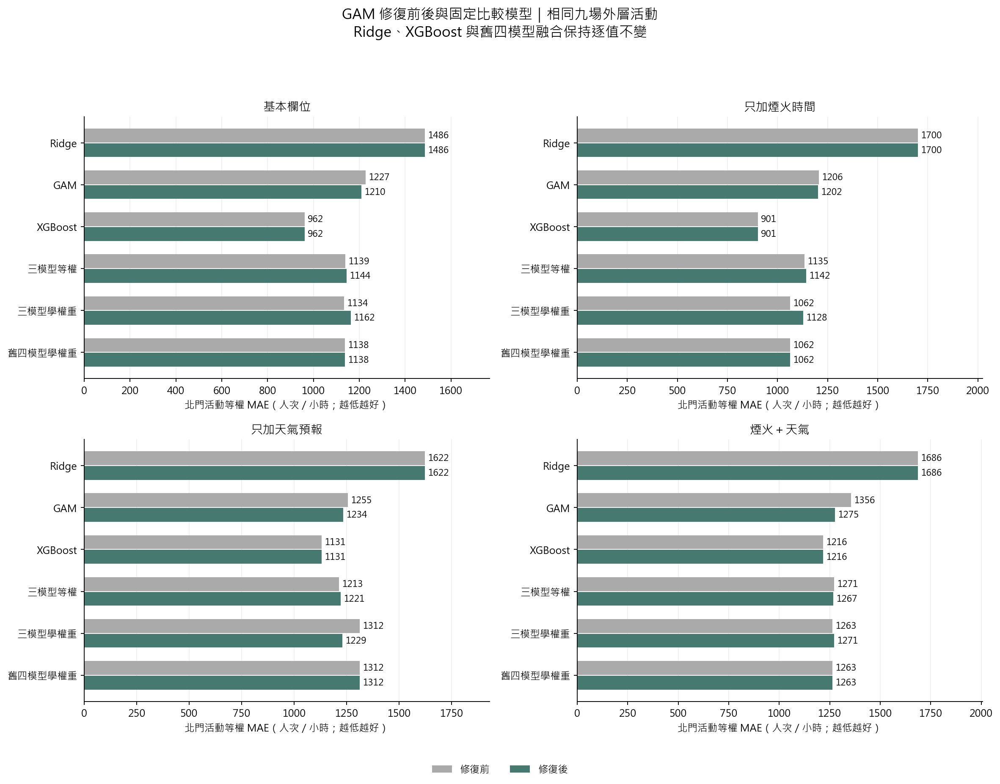
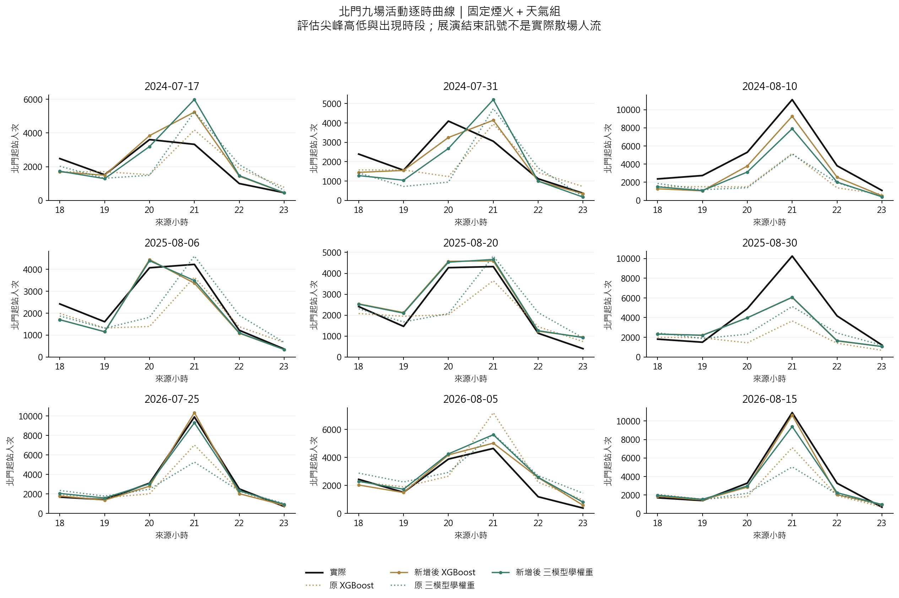

# 人流分析：資料、實作與驗證流程

目前版本對應 `src/run_analysis_v7.py` 與 `src/analysis_v7/`；**第 18 節修正 GAM 低支持度與無懲罰外插問題，重新比較 Ridge／GAM／XGBoost 等權及學權重融合**。新結果見 [第七版報告](result/analysis_v7/report.md)，設定與來源雜湊見 [執行紀錄](result/analysis_v7/both/run_manifest.json)。第 1–17 節保留各版方法與當時結果；第五、六版八種既有方法作逐筆不變的對照，舊版 Forward Selection 不能當作本版的完整設計 OLS。

北門原版診斷見 [第 12 節](#12-北門尖峰診斷與改善順序)；其中 Ridge 交互與 XGBoost 調參已於 [第 13 節](#13-第二版實作與實際改善結果) 執行，其他建議仍待驗證。

**本版完成歷史資料的向前驗證，尚未證明資料在當年活動前一天已經可取得。** 列車部分是明示假設下的容量情境，尚未建立可直接採用的營運班表。

## 1. 研究單位與目標

- 一列為「活動日期 × 車站 × 小時」，目標 `y` 是來源資料該小時的起站人次 `origin_count`。
- `origin_count` 是同來源時段按起站加總，暫作進站需求代理；[前處理規格](docs/data_preprocessing.md#2-時間站名與資料品質) 尚未核實原始時段以進站或出站刷卡時間分箱。接排隊前須先取得官方定義，不能直接宣稱是月台到達時間。
- 車站為北門、大橋頭站、雙連、民權西路；時段為 18、19、20、21、22、23 時，共 6 個小時區間。
- 2017–2026 年原清單有 26 個日期；21 場已辦活動（held）納入，每場 4 × 6 = 24 列，共 504 列；4 場取消（cancelled）與 1 場延期（postponed）排除，也不作比較日。
- 本版估計的是「條件於活動有舉辦」的人流，不是預測活動取消與否，也不涵蓋所有原定活動日。
- 年度場數依序為：2017–2022 年各 1 場、2023 年 6 場、2024–2026 年各 3 場。
- **504 列不等於 504 個獨立活動。** 同場不同站與時段、同年度活動可能相依，因此時間切分保留整場及整年。
- 起站人次尚不能直接解釋成月台到達、特定方向候車或煙火觀眾實際移動軌跡。

## 2. 必需資料與讀取方式

隊員需私下取得以下三檔，依相同相對路徑放在專案內；本版不用連線 MySQL，也不寫回 SQL。

| 私有輸入 | 主要用途與必要欄位 |
|---|---|
| `data/processed/event_station_hourly_context.csv` | 活動狀態與目標：`event_date`、`station`、`hour_start`、`event_status`、`origin_count`；核對 `baseline_window_mean_56d`、`baseline_dates_56d`、`baseline_n_days_56d` |
| `data/processed/calendar_baseline/candidate_audit.csv` | 比較日稽核：`event_date`、`station`、`candidate_date`、`lag_days`、`selected`；若有 `candidate_origin_total` 也核對 |
| `data/processed/station_hourly.parquet` | 重新讀取逐時數量：`service_date`、`station`、`source_hour`、`origin_count`、`origin_complete` |

可選輸入為 `.local/research_review/2026-10-07-refresh/statistics_snapshot.json`。只讀活動日期、無人機實況與實際煙火秒數，增加 EDA 欄位；不存在時仍能跑相同預測，缺值圖會反映未知，不能冒填「無」。

`data.py` 以 DuckDB 限定所需日期、四站及 18–23 時讀取已彙整的 Parquet，不重新掃描全部原始 OD。三個必需檔與實際讀取的可選檔均計算 SHA-256。

### 2.1 不符合即停止的條件

1. 必需檔或必要欄位缺少；日期缺失、帶時區或不是日期午夜；`hour_start` 不為同一天整點。
2. 同日期活動狀態矛盾，或活動／車站／小時主鍵重複；任一已辦活動缺少四站六時段完整格子。
3. 目標或歷史人次不是有限、非負整數，或 `origin_complete` 不為真；不把缺測當成零。
4. 已選比較日重複、不是活動前 7–56 天的整週間隔、包含清單中的活動日期，或每場每站不足 2 日／超過 4 日。
5. 比較日對活動與車站的涵蓋不一致，或任一比較日缺少 18–23 時的 6 筆完整資料。
6. context 目標與 Parquet 不符；選定日期／日數與 context 記錄不符；比較日總量或重建逐時基準的六小時加總不符。
7. 核心輸入出現 NaN、無限值或負基準；可選快照若存在卻有必要欄位缺漏／重複日期，也會停止。

本程式沿用既有日曆選日稽核的 `selected` 結果，再做上述檢查；不宣稱重新驗證了所有歷史日曆公告版本。

## 3. 56 天基準如何重建

令 $C_{e,s}$ 為活動 $e$、車站 $s$ 的已選比較日期集合。每個比較日早於活動日 7–56 天、同星期幾，排除活動清單日期；由既有稽核保留 2–4 個可用日期。

同站同時段的基準為：

$$
B_{e,s,h}=\frac{1}{|C_{e,s}|}\sum_{d\in C_{e,s}}Y_{d,s,h}.
$$

- 基準從 Parquet 的各小時人次重新計算，沒有把六小時總量直接貼到每一小時。
- 驗證 $\sum_{h=18}^{23}B_{e,s,h}$ 等於 context 的 `baseline_window_mean_56d`。
- 這個基準本身也是比較方法：$\widehat Y^{base}_{e,s,h}=B_{e,s,h}$。
- 使用 56 天窗口可涵蓋 21 場；較早的 28 天主要樣本只有 19 場，本版沒有混用兩種樣本評分。
- 比較日期早於活動只證明「觀測時間在過去」，**不證明該 OD 已在 D−1 發布**。同年較早的一般日可作後續活動輸入，但仍缺發布時間證據。

## 4. 變數種類與事前可用性

程式使用明確白名單，不會把所有數值欄自動投入模型。

| 變數 | 型別／層次 | 本版用法與限制 |
|---|---|---|
| `baseline_hourly_56d` | 非負連續；站 × 小時 | 固定核心；由過去日期重建，但發布時間未核實 |
| `station` | 名目類別；站 | 固定核心；以訓練類別建立虛擬變數並保留參考站 |
| `hour` | 類別；小時 | 固定核心；以時段虛擬變數建模，不強迫單一直線趨勢 |
| `is_weekend` | 0／1；活動 | 額外候選；依日期計算週六／週日，不等同國定假日 |
| `day_of_year` | 整數；活動 | 額外候選；年內日序，不代表已辨識季節因果效果 |
| `year_index` | 整數；年度 | 額外候選；年份減 2017，描述年度趨勢 |
| 實測氣溫、風、雨、雲量 | 時間點或時段；氣象站 | 僅 EDA；不是活動前一天的歷史預報版本 |
| 無人機實況、實際煙火秒數 | 0／1／未知、連續；活動 | 僅 EDA；不是已核實公告時間的預定節目 |
| 活動預算、宣導經費 | 金額；年度 | 不進模型；年度一筆，不能展開後當成多場獨立資訊，且可用年份與發布時間不足 |
| 社群聲量、Google Trends | 計數或相對指標；日期／活動 | 不進模型；尚無完整可比的歷史 D−1 版本 |

`event_date`、`year` 用於索引與切分，不會當成額外自由特徵。未來若加入天氣、無人機或預算，需先記錄 `available_at`；天氣另存 `forecast_issued_at` 與預報有效時間。預測截止後才知道的值不能回填歷史訓練輸入。

### 4.1 缺值與氣象口徑

- 核心／目標 504 列完整；缺失會停止，沒有全資料補值或以測試資料估補值參數。
- 21 場 × 6 氣象時點共 126 個唯一時點，四站共用氣象不能算成 504 份獨立觀測。
- 氣溫為報時點值、風速為報時前 10 分鐘平均；不能任意改稱同一種整點一小時平均。
- 雨量為以報時點結束的一小時雨量。119 筆可量化、7 筆微量雨 `T`，涉及 3 場；`T` 保留狀態，不改成 0，也不自行指定 0.05 mm。
- 雲量為報時點十分量，不是衛星雲覆蓋率；90 個值、36 個缺值，15 場六點完整。保留測量型態與核實狀態，不把方法未核實當成已完全可比。
- 氣溫／風速 21 場完整、雨量 18 場完整、雲量 15 場完整；活動平均要求六點都可量化，不能用較少時點冒充完整平均。
- 可選快照中的無人機只有 3 場已知、18 場未知；實際煙火秒數 21 場有值。缺值率按各欄實際資料層次呈現。

### 4.2 先做哪些變數檢查

`eda.py` 產生年度場數、缺值概況、活動層次 Spearman 相關及描述統計。

- 活動層次資料把四站六時段人次／基準加總，每場只保留一筆週末、日序、年度及共享天氣平均。
- 相關矩陣用成對完整資料，另輸出每對有效場數；不提供假定 504 列獨立的相關 p 值，也不解釋為因果。
- 訓練內 VIF 定義 $\mathrm{VIF}_j=1/(1-R_j^2)$，用於辨認設計矩陣冗餘；不是「超過 5 或 10 就自動刪掉」的規則。
- VIF、係數與 OLS 留出殘差都另存圖／表。係數是訓練內標準化尺度，不是已校正選模不確定性的效果估計。
- 本版沒有用 AIC 選變數、沒有選後普通 p 值或 F 檢定宣稱入選因子顯著。目的先是預測，選擇準則為訓練內時間驗證 MAE。

## 5. 三層年度向前驗證

**2017–2023 年作初始累積訓練，2024–2026 年作外層評估；不隨機拆散同場的小時或車站。** 此資料先前已被探索，因此也不宣稱是完全未接觸資料的確認性實驗。

| 外層測試年 | 可用訓練年 | 訓練場數／列數 | 測試場數／列數 | 學權重的中層 OOF 場數 |
|---|---|---:|---:|---:|
| 2024 | 2017–2023 | 12／288 | 3／72 | 8 |
| 2025 | 2017–2024 | 15／360 | 3／72 | 11 |
| 2026 | 2017–2025 | 18／432 | 3／72 | 14 |

1. **內層：選變數／調參。** 在當次訓練集內以更早年訓練、下一驗證年評分。最少 2 場起始訓練、至少 2 個有效內層年度折。
2. **中層：建立權重訓練資料。** 最少 4 場訓練起步，每次重新完成內層選模，再預測較晚年度。這些未參與該次基模型訓練的預測稱 OOF 預測。
3. **外層：共同評分。** 只使用外層訓練年度的中層 OOF 學權重，再用全部外層訓練資料擬合基模型，預測該測試年全部活動。

例如評估 2024：中層依序用截至 2020、2021、2022 年的資料預測 2021、2022、2023 年；權重沒有使用 2024 真值。內層又在各中層訓練期內切分，避免用同一驗證年同時調基模型與產生用來學權重的留出預測。

連續特徵的均值／標準差僅由當次訓練資料估計；週末與類別虛擬變數保留 0／1。常數欄移除；未見過的站別／時段不默認為參考類別。所有最終預測取 $\max(0,\widehat Y)$，避免負人次。

## 6. 三個基礎模型

### 6.1 Forward OLS

固定核心為逐時基準、站別及時段。以最小平方擬合：

$$
\min_{\beta_0,\boldsymbol\beta}\sum_{i\in\mathcal T}
\left(y_i-\beta_0-\boldsymbol x_i^\top\boldsymbol\beta\right)^2.
$$

額外候選為週末、年內日序、年度序號。每次試加一組，選內層「活動平衡 MAE」最小者；只有嚴格改善才加入，最多增加 2 組。這是貪婪選擇，不保證找遍所有子集合的全域最佳模型。

完整訓練設計若不滿秩，該候選不加入；個別 OLS 擬合遇不滿秩時回退至歷史基準並記錄，避免輸出不可辨識係數。實際外層 2024 不加額外項，2025、2026 選入週末。

### 6.2 Ridge

使用核心與全部三個候選，截距不懲罰：

$$
\min_{\beta_0,\boldsymbol\beta}\;
\frac1n\sum_{i\in\mathcal T}
\left(y_i-\beta_0-\boldsymbol x_i^\top\boldsymbol\beta\right)^2
+\lambda\|\boldsymbol\beta\|_2^2.
$$

`sklearn.Ridge` 的目標為 SSE + `alpha` × 懲罰，所以程式設定 **`alpha = n × lambda`**，讓不同訓練大小的候選懲罰可比較。候選 λ 為 0.001、0.01、0.1、1、10，依內層 MAE 選取；外層選為 1、0.1、0.1。

Ridge 縮小相關特徵係數以取捨偏差與變異，不會自動變成因果模型，也不保證一定勝 OLS。

### 6.3 XGBoost

使用相同合格特徵、平方誤差回歸與正則化加法樹；本版不是 Poisson objective。

- 小型 grid：`max_depth ∈ {1, 2}` × `n_estimators ∈ {100, 250}`，共 4 組。
- 固定 `learning_rate=0.05`、`min_child_weight=24`、`reg_lambda=10`、`subsample=1`、`colsample_bytree=1`。
- `tree_method=hist`、單執行緒、種子 20261010；以內層 MAE 選參數。
- 外層 2024 選深度 1／250 棵，2025、2026 選深度 2／100 棵。限制樹深及搜尋範圍是小樣本研究設定，不是原文指定的最佳參數。

## 7. 等權平均與 MAE Stacking

等權平均直接為三模型非負預測之平均，不另學參數。

Stacking 的 $P_{im}$ 是中層 OOF 對第 $i$ 列、模型 $m$ 的預測。令 OOF 有 $E$ 場、活動 $e$ 有 $n_e$ 列，定義每列權重 $a_i=1/(E n_{e(i)})$。求解：

$$
\begin{aligned}
\min_{\boldsymbol w,\boldsymbol u}\quad&\sum_i a_i u_i\\
\text{使得}\quad
&u_i\ge y_i-\sum_{m=1}^3w_mP_{im},\\
&u_i\ge \sum_{m=1}^3w_mP_{im}-y_i,\\
&u_i\ge0,\quad w_m\ge0,\quad \sum_{m=1}^3w_m=1.
\end{aligned}
$$

使用 `scipy.optimize.linprog(method="highs")`。非負且總和為 1 的權重形成三模型預測的凸組合，沒有額外截距；限制可減少極端外推，但不能消除小樣本不確定性。

| 外層測試年 | OLS 權重 | Ridge 權重 | XGBoost 權重 |
|---|---:|---:|---:|
| 2024 | 0.7235 | 0.0000 | 0.2765 |
| 2025 | 0.6747 | 0.2672 | 0.0581 |
| 2026 | 0.6255 | 0.2015 | 0.1729 |

單一模型頂點與等權平均都是可行權重，因此最優解在**同一份中層 OOF 訓練損失**不會較差（容許數值誤差）；這不是外層／未來一定更好的保證。本次外層等權平均反而有更小 MAE。

## 8. 指標與本次結果

外層共 9 場、216 列。若 $r_i=\widehat y_i-y_i$，則：

$$
\mathrm{MAE}=\frac1E\sum_e\frac1{n_e}\sum_{i\in e}|r_i|,
\qquad
\mathrm{RMSE}=\sqrt{\frac1E\sum_e\frac1{n_e}\sum_{i\in e}r_i^2}.
$$

| 方法 | MAE | RMSE | 實際尖峰時平均正向低估 |
|---|---:|---:|---:|
| 等權平均 | **611.72** | 1,222.62 | 1,469.51 |
| MAE Stacking | 633.75 | 1,171.31 | 1,299.66 |
| XGBoost | 646.30 | 1,264.98 | 1,548.18 |
| Forward OLS | 680.60 | **1,152.28** | **1,190.25** |
| Ridge | 691.34 | 1,372.60 | 1,722.28 |
| 一般日基準 | 871.48 | 1,791.08 | 2,379.03 |

- MAE 表示每站每小時平均絕對誤差；RMSE 對大誤差較敏感。等權平均 MAE 比基準低約 29.8%，OLS 的 RMSE 最低。
- 偏差為預測減實際，負值代表平均低估；不能以正負誤差抵消後的偏差取代 MAE。
- 尖峰低估：對每場每站的實際最高小時，計 $\max(0,y-\widehat y)$，再平均 36 個場站組合；它不是全站安全容量指標。
- 尖峰時刻 MAE：比較預測與實際最大值所在小時，並列時取較早時段；不是逐分鐘疏散結束誤差。
- **北門大型尖峰仍嚴重低估，不能直接拿本版點預測決定列車調度。** 要同時閱讀逐年、逐場、逐站指標及 2026 全部場次的時序圖。
- 外層只有 3 年，不用 216 列偽裝獨立樣本做模型優劣顯著性檢定，也不提供過度精確的信賴區間。看過結果後繼續調法，需另保留未來新場次做最終驗證。

### 8.1 為何沒有直接改做複雜計數模型

人次是非負計數，但 Poisson 的條件均值等於變異數假設、負二項的離散度、跨站／跨時段相依都需另驗證。增加站時列數不能增加獨立活動數；無人機只有 3 場已知，更不足以穩健估計交互作用或分群效果。

本版先比較 OLS、Ridge、淺層 XGBoost 的非負點預測，沒有把連續回歸描述成完整計數分布。未來可比較 Poisson／負二項或分位數模型，但應沿用年度外層驗證，並另驗證不確定區間與極端需求，不以新增方法數量代替驗證。

## 9. 如何接排隊與列車容量

`queue_report.py` 使用 **2026-08-15 北門的外層 Stacking 預測**，沒有拿實際目標當預測輸入。以下全部是情境參數：方向 A／B 比例 0.6／0.4、小時內均勻到達、固定步行 5 分鐘、初始隊列 0、每班剩餘容量 300 人；比較班距 6、4、3 分鐘，另延伸服務 120 分鐘。此處暫把起站時段量視為進站量；須先確認來源為進站刷卡分箱，才可將這段延遲解釋為閘門至月台時間，且不能再加入活動場地至車站時間。

列車用批次服務：列車 $k$ 到站前後隊列為 $Q_k^-$、$Q_k^+$，兩班間新到達量為 $A_k$，剩餘容量為 $C_k$：

$$
Q_k^-=Q_{k-1}^+ + A_k,\qquad
b_k=\min(Q_k^-,C_k),\qquad
Q_k^+=Q_k^- - b_k.
$$

程式在分鐘區間內採均勻連續流入、列車時刻瞬間登車，精確積分此流體假設下的 $\int Q(t)\,dt$ 作等待人分鐘，檢查到達＝登車＋殘留。只有初始隊列為零且全部清空時，才用等待人分鐘／全部到達數表示完整平均等待。

- 各班剩餘容量不是整列車額定容量；沒有推估上游載客、轉乘、放棄排隊或改道。
- 這次情境都沒有跨班積壓，平均等待分別約 3、2、1.5 分鐘，是均勻到達且容量充足時的半班距結果，**不證明真實煙火散場不擁擠**。
- 點預測人流的流體試算不是隨機佇列期望等待時間；需求尖峰低估還會使候車情境過於樂觀。
- `queueing.py` 另有 M/M/c 工具，適用 Poisson 到達、指數服務、平行服務台等假設，且需 $\rho<1$ 才有穩態有限等待；**列車不是 c 個連續獨立服務台，不能直接套 M/M/c 取代批次服務。**
- 真正調度前需補：方向分流、分鐘到達曲線、列車實際時刻與剩餘容量、初始隊列、月台等待可用空間、車隊、折返時間、最小安全班距及營運成本。
- 本版沒有成本目標求解、沒有車隊與折返限制，也沒有營運安全可行性認證；尚未完成列車調度最佳化。

## 10. 執行與輸出

在專案根目錄執行：

```powershell
uv sync --group analysis
uv run --group analysis python -X utf8 src/run_analysis.py --validate-only
uv run --group analysis python -X utf8 src/run_analysis.py
uv run --group analysis python -X utf8 -m unittest discover -s tests -p 'test_analysis_v*.py'
```

第二版完成時分析測試共 59 項；第三版目前共 **84 項**。除原有資料、時間切分、交互編碼、融合與隊列測試，新增截止後資訊拒絕、預報有效時間／單位、306 筆數值重算、訓練內補值、全未知欄與基準排除測試。它們檢查程式行為，不代表已驗證營運適用性。中文圖需 Microsoft JhengHei 或 Noto Sans CJK 等中文字型。

以下指令**目前會拒絕並以結束碼 2 停止**，因為發布時間與日曆版本尚未核實；不應為了通過而任意改掉稽核旗標：

```powershell
uv run --group analysis python -X utf8 src/run_analysis.py --require-d1
```

可用 `--config` 指定設定、`--output` 指定公開結果位置、`--private-output` 指定私有輸出位置。預設輸出分為：

| 位置 | 內容 |
|---|---|
| `result/analysis_v1/report.md` | 實際中文分析結果；圖片採相對路徑，與資料夾一起分享即可 |
| `result/analysis_v1/figures/` | 模型比較、逐場誤差、完整留出曲線、權重、VIF、殘差、EDA、排隊情境 PNG |
| `result/analysis_v1/tables/` | 模型／年度／活動／車站指標、變數資格、係數、VIF、相關配對數、時間切分、內層選模及情境 CSV；UTF-8 BOM |
| `result/analysis_v1/folds.json` | 各外層訓練截止、選模、權重及中層損失 |
| `result/analysis_v1/run_manifest.json` | 來源／程式／uv.lock 雜湊、設定、套件版本、資料資格與限制 |
| `.local/analysis_v1/` | 不提交的逐筆資料 `analysis_input.csv`、`outer_predictions.csv`、`meta_predictions.csv`；外層模型及全資料研究模型 |

本版目錄為單數 **`result/`**；舊研究與文字雲仍在 `results/`。Git 分享報告圖表不需要公開 SQL。重跑要有上述三檔；只看報告和 PNG 則不需要資料庫。

全 21 場另擬合的 `research_models.joblib` 是研究物件，標記 `research_only_not_verified_d1`；其最終權重沒有拿來重新評分較早的外層測試，也不代表已上線的事前預測服務。

## 11. 文獻與本專案延伸的界線

| 原始文獻 | 可支持的做法 | 本專案自行設定／尚未驗證 |
|---|---|---|
| [Hyndman & Athanasopoulos，FPP3 §5.10](https://otexts.com/fpp3/tscv.html) | 以過去資料預測之後時點，使用時間序列交叉驗證 | 整年度／活動分組、2024–2026 外層年與發布時間稽核 |
| [Heinze、Wallisch & Dunkler（2018）](https://doi.org/10.1002/bimj.201700067)，§2.2、2.4 | 變數選擇與選後推論的限制 | 本版依時間 MAE 做最多兩步 Forward Selection，不提供選後普通 p 值 |
| [Hoerl & Kennard（1970）](https://doi.org/10.1080/00401706.1970.10488634)，§0–2 | Ridge 的正則化與偏差／變異取捨 | λ grid、平均 SSE 尺度與 `alpha=nλ` 換算 |
| [Chen & Guestrin（2016）](https://arxiv.org/abs/1603.02754)，§2 | 正則化加法樹及 XGBoost 方法 | 四組淺樹 grid、活動資料特徵及本次預測表現 |
| [Breiman（1996），Stacked Regressions](https://statistics.berkeley.edu/sites/default/files/tech-reports/367.pdf)，§1、2、5、7 | 用留出預測學融合係數；原文主要採非負最小平方 | 本版改為活動平衡 MAE、總和為 1 的 LP 及年度向前 OOF，不將此完整方案冒稱原文定理 |
| [Varma & Simon（2006）](https://pmc.ncbi.nlm.nih.gov/articles/PMC1397873/) | 調參與最後評分應分開，避免選模造成樂觀評估 | 本版三層時序設計；原文不能保證克服場次少、資料版本未知與既有探索 |
| [Santanam 等，特殊活動需求預測與列車調度](https://arxiv.org/abs/2106.05359) | 需求預測銜接運輸排程的研究方向 | 本版僅完成假設批次容量比較，沒有重現其最佳化模型 |

上述文獻不是這份資料上的成功保證；表格中的 9 場結果才是本次實際執行證據。完整專案資料來源及既有參考文章見 [README：詳細說明與參考資料](README.md#詳細說明與參考資料)。

## 12. 北門尖峰診斷與改善順序

2026-10-11 核對第一版逐筆留出預測、外層模型與設計矩陣。以下保留當時診斷及改善規劃；原版成績不改寫。本日後續執行的改版比較另列第 13 節。

### 12.1 低估有多大

每場只取北門「來源時段起站人次最多的小時」，在同一小時比較預測；不是拿預測最高值與實際最高值錯時比較。單位為人次，表中人次四捨五入，百分比用未四捨五入數值計算。

| 活動日期 | 實際尖峰小時 | 實際 | Forward OLS | Ridge | XGBoost | Stacking | Stacking 低估率 |
|---|---:|---:|---:|---:|---:|---:|---:|
| 2024-07-17 | 20 | 3,608 | 2,014 | 1,435 | 1,353 | 1,831 | 49.24% |
| 2024-07-31 | 20 | 4,093 | 2,014 | 1,409 | 1,353 | 1,831 | 55.25% |
| 2024-08-10 | 21 | 11,101 | 3,897 | 1,695 | 2,685 | 3,562 | 67.91% |
| 2025-08-06 | 21 | 4,229 | 3,385 | 2,444 | 3,314 | 3,129 | 26.00% |
| 2025-08-20 | 21 | 4,321 | 3,385 | 2,383 | 3,314 | 3,113 | 27.96% |
| 2025-08-30 | 21 | 10,251 | 4,480 | 2,880 | 3,048 | 3,969 | 61.28% |
| 2026-07-25 | 21 | 9,893 | 4,146 | 2,997 | 3,899 | 3,872 | 60.87% |
| 2026-08-05 | 21 | 4,642 | 3,429 | 2,578 | 3,447 | 3,261 | 29.76% |
| 2026-08-15 | 21 | 10,904 | 4,166 | 2,951 | 3,899 | 3,875 | 64.46% |

九場全數低估，逐場低估率平均 **49.19%**；把九場尖峰人次加總後計算的低估比例為 **54.88%**。兩者加權方式不同，不能混稱同一指標。來源為私有 `.local/analysis_v1/outer_predictions.csv`；另可查看公開的 [2026 年三場留出曲線](result/analysis_v1/figures/heldout_profiles_latest.png)。

### 12.2 為什麼低估：已確認什麼、還需驗證什麼

1. **已見過大流量，卻連訓練尖峰也擬合不足。** 2024／2025／2026 外層模型的訓練資料分別有 12／15／18 場活動，北門歷史尖峰最大值為 9,826／11,101／11,101。2026 模型在自己的訓練資料上，仍把 2024-08-10 的 11,101 預測成約 4,420（OLS）、3,033（Ridge）、3,899（XGBoost）。這是欠擬合證據，不能只說未來人流超出歷史範圍；訓練擬合值不納入外層成績。
2. **OLS／Ridge 沒有「車站 × 小時」交互作用。** `models.py` 的 `Encoder` 只有站別與小時主效果；2026 OLS 的 21 時係數約 +2,541，所有站共用。九場測試的 21 時，Stacking 在北門平均低估 3,329，民權西路卻平均高估 1,253。這與共享時段效果無法表達不同站的尖峰形狀一致；需要加入交互作用的對照實驗，才能量化它造成多少誤差。
3. **XGBoost 的複雜度限制可能過強。** 實際選出的樹深為 1／2／2，`min_child_weight=24`；平方誤差、等列權重下，實際葉片 cover 最少為 24。訓練中「北門 21 時」只有 12／15／18 列，單一葉片無法只涵蓋這組列。這會限制局部區分，但不代表整個加法樹集合數學上不能表達尖峰；應用內層驗證比較較小葉片門檻與樹深，不能直接認定放寬必然變好。
4. **活動差異與散場時刻尚未成為輸入。** 本版沒有 D−1 公告的預定結束時間、展演類型／長度及歷史天氣預報。2026 三場實際尖峰約 9,893、4,642、10,904，Stacking 卻只在約 3,261–3,875 之間。2024 兩場 7 月活動實際在 20 時達峰，Stacking 則在 21 時達峰；高度與時間都需改善。這些結果不證明無人機或天氣具有因果效果。
5. **選模目標與容量需求不同。** 目前以四站六時段的活動平衡 MAE 選模；每場北門單一尖峰只占 24 列中的 1 列，並未另加容量損失權重。這不是說它只占損失的 1/24，而是整體平均誤差最小不等於北門最危險時段低估最少。
6. **只改融合權重救不了共同低估。** 本版非負權重總和為 1，因此

   $$
   \min_m\widehat y_m\leq\sum_m w_m\widehat y_m\leq\max_m\widehat y_m.
   $$

   2026-08-15 的三模型最高只到約 4,166，任何這類權重都無法變成實際的 10,904。應先改善基模型，不能期待 Stacking 自動補出沒有任何基模型預測到的尖峰。

結論是：**先修正欠擬合與活動／時段資訊，再處理容量風險；重做 VIF 或換融合權重本身不夠。** 各項改善的幅度尚未驗證。

### 12.3 下一版依序做什麼

| 順序 | 具體改動 | 驗收方式 |
|---|---|---|
| 1. 先改形狀 | 同一批資料增加「車站 × 小時」，優先比較有／無交互作用的 Ridge；再單獨試「車站 × 週末」 | 同樣年度向前切分；比較北門各場曲線、尖峰低估及峰值時間，同時檢查其他站有沒有變差 |
| 2. 再調 XGBoost | 在內層比較葉片門檻及樹深；限制搜尋範圍，不能用外層真值選參數 | 調參及權重訓練都重新執行；21 場仍是 21 場，不能把 504 列當獨立樣本 |
| 3. 補事前資訊 | 公告開始／預定結束、預定煙火或無人機、預定長度；另補歷史天氣預報的發布及有效時間 | 每欄通過 D−1 可得時間核對；未知無人機不能填 0，實測天氣不能冒充預報 |
| 4. 比較總量與形狀分開 | 比較直接逐時預測、一般日基準＋活動增量、站點總量搭配相對散場曲線 | 曲線、標準化與選模只用訓練期；不能依測試場實際尖峰移動散場時間 |
| 5. 加入容量風險預測 | 在點預測以外，比較事先指定的 P50／P80／P90 或低估成本損失 | 看 pinball loss、涵蓋率、北門尖峰低估、隊列敏感度；不只看全站 MAE |
| 6. 重做融合與最終驗證 | 基模型改好後重新產生時間 OOF，再學權重並與等權比較 | 舊外層作回顧比較；因已用其結果診斷，需另留未來新活動確認改善 |

第一步先檢驗一組交互作用，避免同時換資料、損失及模型後無法知道改善來源。只有 21 場活動，暫不為每個車站各建一套高自由度模型；先共用資訊並用正則化控制差異。

**總量與形狀分開的候選設計（尚未實作）：**

$$
\widehat Y_{e,s,h}=B_{e,s,h}
 +\widehat N^{\mathrm{extra}}_{e,s}\,
 p_{s,h}(t^{\mathrm{planned}}_{\mathrm{end},e}),
\qquad p_{s,h}\geq0,\quad\sum_{h\in\mathcal H}p_{s,h}=1.
$$

$B$ 為一般日基準，$N^{\mathrm{extra}}$ 是指定觀測窗口 $\mathcal H$ 內的額外需求量，$p$ 為依事前預定散場時間對齊的時段比例。$p$ 只用過去活動估計；若以非負額外需求建模，須先檢查與處理負差額，不能把所有負差額默默刪除。差額也不等同逐人辨認出的活動觀眾。若有明顯的時段移轉或整體減少，應另比較容許正負差額的增量回歸，不能強迫所有活動皆增加人流。

[Santanam 等（2021），§VI-A/B](https://arxiv.org/html/2106.05359v1) 將站點活動總人次搭配相對結束時間的歷史到達比例，以 5 分鐘建立需求；上式再加一般日基準是本案候選延伸，不是該文原式的重現。該文部分結束偏移曾依事後曲線調整，本案 D−1 流程不能照搬這種事後對齊。

**容量決策用的分位數：**若少估一人的成本為 $c_u$、多估一人的成本為 $c_o$，在分段線性損失

$$
L(y,q)=c_u(y-q)_+ + c_o(q-y)_+
$$

下，最適點預測對應條件分位數 $\tau=c_u/(c_u+c_o)$。這支持按決策成本選擇分位數，而非任意把目前點預測乘上安全係數；見 [Gneiting（2011）](https://doi.org/10.1016/j.ijforecast.2009.12.015)。列車成本通常不是簡單線性，這只是第一層需求決策近似，後續仍須模擬容量與等待成本。P90 是預測需求分位數，不是參數的 90% 信賴區間，也未保證安全；逐時 P90 相加不等於整晚總量 P90。

### 12.4 怎樣才能接到排隊與列車調度

1. **先確認時間與需求位置。** 目前預測同來源時段的起站加總；必須先核實時段為進站刷卡分箱，才能以它估進站到達。確認後再估各方向比例、閘門至月台延遲，不再加活動場地至車站步行時間。若原始分箱依出站時間，就需另取進站時段資料或驗證重建方法。歷史 OD 搭配合理路徑可作方向分配起點，但仍須觀測驗證。若存在進站管制，閘門數量無法直接還原全部到站需求與場外隊列。
2. **補時間解析度。** 取得 5 分鐘閘門資料或現場計數，估計散場集中的到達曲線。逐小時總量無法唯一還原分鐘峰值；資料未取得前要比較均勻、集中等情境，清楚標示假設，不能把均分 60 分鐘當實測。
3. **使用逐班剩餘容量。** 由列車到站前載客、下車量與可用容量推算可登車人數，搭配實際到站時刻及初始隊列。依第 9 節批次遞推計算滯留、等待人分鐘與清空時間；候車隊列也不等於包括下車及通行乘客的全部月台人數。
4. **再比較可行班表。** 納入車隊數、折返、最小班距、原班表、月台限制及加班車成本，以多條需求情境比較班表，才有調度意義。批次服務與需求驅動排程可參考 [Santanam 等（2021），§V-C Algorithm 1](https://arxiv.org/html/2106.05359v1)。

本版 0.6／0.4 方向比例、均勻到達、5 分鐘延遲、每班 300 人剩餘容量，全部仍是假設。現有結果「沒有跨班積壓」同時受到這些假設及需求低估影響，不能作為實際煙火日列車足夠的證據。

**後續進度：Ridge 交互作用與 XGBoost 調參已執行，結果見第 13 節。** 需求曲線、事前節目／天氣、分位數及營運資料仍待擴充。

## 13. 第二版實作與實際改善結果

### 13.1 交互作用的意思與診斷

第一版線性結構可寫成

$$
\widehat y_{e,s,h}=\beta_0+\beta_B B_{e,s,h}+\alpha_s+\gamma_h+\boldsymbol z_e^\top\boldsymbol\eta.
$$

$B$ 是同站同時段基準，$\boldsymbol z$ 是合格的活動日期特徵。控制這些輸入後，19 時到 21 時的差異由共用的 $\gamma_{21}-\gamma_{19}$ 表示，各站相同。第二版 Ridge 增加 $\delta_{s,h}$，讓各站的時段增幅不同：

$$
\widehat y_{e,s,h}=\beta_0+\beta_B B_{e,s,h}+\alpha_s+\gamma_h
 +\delta_{s,h}+\boldsymbol z_e^\top\boldsymbol\eta.
$$

- 在第一版 2024 外層模型的 **2017–2023、12 場訓練資料**中，21 時平均 OLS 殘差（實際−預測）為北門 **+2,599.6**、民權西路 **−1,447.4**；19 時則為 **−778.2／+550.0**。控制原有主效果後，殘差仍呈站別與時段組合的差異，支持試驗交互項。這是描述診斷，不是獨立 F 檢定或因果證明。
- `Encoder` 對站別與小時做參考類別編碼；保留兩組主效果，再相乘非參考 0／1 欄。本資料參考類別為北門、18 時，因此新增 $(4-1)(6-1)=15$ 欄，並非把車站數字編號乘上小時。
- 新項與其他係數一起受 Ridge 懲罰；截距不懲罰。沿用原數值標準化、0／1 dummy 與 λ grid，仍使用 `alpha=nλ`。Ridge 的懲罰受編碼方式影響，本次固定原參考編碼供比較，不宣稱任意換參考類別都得到相同結果。
- 交互項只對 Ridge 開啟；OLS 保持原版對照，XGBoost 仍由樹分裂學習交互。**新 Ridge 對舊 OLS 的差距同時涉及設計矩陣與懲罰，不能說完全是 Ridge 演算法本身造成。**

### 13.2 XGBoost 調參如何避免偷看當年真值

在第一次重跑前固定 [第二版設定](configs/analysis_v2.json)，不依這次外層結果追加搜尋。保留原內層年度向前切分及活動平衡 MAE：

| 參數 | 原版 | 第二版候選 | 用意 |
|---|---|---|---|
| `max_depth` | 1、2 | 1、2、3 | 容許較多條件組合，但仍限制樹深 |
| `n_estimators` | 100、250 | 100、250 | 比較加法樹數量 |
| `min_child_weight` | 固定 24 | 1、6、24 | 比較較小分群能否表達局部尖峰 |
| `reg_lambda` | 固定 10 | 1、10 | 比較葉節點權重收縮強度 |
| `learning_rate` | 0.05 | 固定 0.05 | 不增加另一個搜尋維度 |

共 $3\times2\times3\times2=36$ 組，包含原版四組；`subsample`、`colsample_bytree` 仍固定 1，平方誤差 objective、種子與執行緒不變。依 [官方定義](https://xgboost.readthedocs.io/en/stable/parameter.html)，`min_child_weight` 是 Hessian 和門檻；本案等列權重平方誤差下才對應約最少列數，**不是最少活動數**。較小門檻也增加過擬合風險。

各中層 OOF 都重新調參、訓練，之後重新學 Stacking；未沿用舊權重。三個外層年度最終均選到樹深 3、100 棵、`min_child_weight=1`、`reg_lambda=10`，各自為其內層 MAE 最小者。

| 外層年 | Ridge λ 原版 → 第二版 | 訓練場數 | OLS／Ridge／XGB 新融合權重 |
|---|---|---:|---|
| 2024 | 1 → 1 | 12 | 0.573／0.162／0.265 |
| 2025 | 0.1 → 0.001 | 15 | 0.403／0.099／0.498 |
| 2026 | 0.1 → 0.001 | 18 | 0.360／0.153／0.487 |

新舊來源 SHA-256、外層 216 列主鍵與真值一致；基準及 OLS 的預測不變。完整參數、訓練時間與候選分數見 [folds.json](result/analysis_v2/folds.json) 與 [inner_selection.csv](result/analysis_v2/tables/inner_selection.csv)。

### 13.3 改善多少，哪些場次仍不好

以下尖峰指標只針對北門 9 場，各場取實際最高小時，再比較同一小時的預測；與第 8 節平均四站尖峰不同。

| 指標 | Ridge 原版 → 第二版 | XGBoost 原版 → 第二版 |
|---|---|---|
| 全站逐時 MAE | 691.34 → 582.87（降 15.7%） | 646.30 → 523.05（降 19.1%） |
| 北門逐時 MAE | 1,532.55 → 1,177.78（降 23.1%） | 1,334.62 → 1,181.36（降 11.5%） |
| 北門尖峰平均正向低估 | 4,696.84 → 2,826.99（降 39.8%） | 4,080.99 → 3,236.04（降 20.7%） |
| 北門尖峰平均絕對誤差 | 4,696.84 → 3,192.95（降 32.0%） | 4,080.99 → 3,236.04（降 20.7%） |
| 北門峰值時間 MAE | 1.44 → 0.44 小時 | 0.22 → 0.22 小時 |

- **Ridge 9／9 場尖峰絕對誤差減少，但 2024 三場僅改善約 5–8 人次。** 當年內層仍選 λ=1，收縮後曲線幾乎不變；不能只憑「9／9」宣稱每場都有實質改善。
- 2025-08-06、2025-08-20、2026-08-05 的 Ridge 尖峰改成高估約 1,267、1,095、932 人次。因此同時報正向低估與絕對誤差，不能把高估視為零誤差。
- XGBoost 7／9 場尖峰改善，2024 兩場 20 時的尖峰預測由 1,353 降至 1,217，反而更差。散場時間移動尚未被解決。
- 2026-08-15 真值 10,904：Ridge 2,950.83 → 6,516.53，仍低估約 40.2%；XGB 3,899.47 → 5,616.40，仍低估約 48.5%。不能直接拿此結果指定營運安全容量。
- Ridge 大橋頭 MAE 422.03 → 423.43、雙連 312.20 → 318.61，略退步；XGBoost 四站 MAE 均改善。民權西路的一般日基準 MAE 156.59 仍優於所有新模型。
- 新版等權平均全站 MAE **517.85**、Stacking **538.60**；改善基模型後，學權重仍未勝簡單平均。這次不因其排名而另外調整權重或參數。

完整九場數值、曲線及有符號誤差見 [改版比較報告](result/analysis_v2/comparison/report.md)。這些歷史年度已用於第一版診斷，故本次屬探索性回顧修訂，不是新留出的確認性測試；選模偏誤的相關討論見 [Cawley & Talbot（2010）](https://jmlr.org/papers/v11/cawley10a.html)。

### 13.4 如何重現與接下去

```powershell
# 保有第一版私有預測及執行紀錄後，重跑第二版
uv run --group analysis python -X utf8 src/run_analysis.py --config configs/analysis_v2.json
```

設定自動分流至 `result/analysis_v2/` 與 `.local/analysis_v2/`；若指定覆蓋比較用的第一版輸出位置，程式拒絕執行。比較前核對輸入雜湊，比較時核對主鍵、真值與未改動的基準／OLS。兩版輸入不同時先停止，不把資料變更歸因給模型。

第二版輸出 10 張分析圖、4 張前後比較圖、指標表、候選參數分數、VIF／係數、時間切分及執行紀錄；逐筆資料與模型物件留在本機。模組仍共用 `src/analysis_v1/`，版本由設定及輸出資料夾區分，避免複製整套程式。

排隊情境亦以新 Stacking 重算。在同樣假設下，每 6 分鐘一班的方向 A 開始出現跨班滯留，表示提高需求預測會改變容量判讀；這不是觀測到真實候車。下一步仍需 D−1 公告的節目／散場、歷史預報、來源時段定義、分鐘與方向到達、剩餘容量及營運限制；增量曲線、分位數與真實調度最佳化尚未實作。


## 14. 第三版：活動前一天的節目、天氣與調參

### 14.1 預測截止與資料資格

截止固定為活動前一天 **18:00，Asia/Taipei**。這是本次的研究設計；若改為其他時間，必須重新審查來源，不能只改畫面標籤。

`d1_features.py` 逐筆檢查：來源欄位白名單、數值範圍／單位、具時區的公開時間不晚於截止、原頁更新時間；天氣另核對模式初始化與有效時間。已公布但活動當天改變的節目仍使用截止前的計畫，不以實際結果修正輸入。未知、只給區間、晚於截止或無證據的資訊均保留 NaN。

| 新欄位 | 定義 | 截止前可核對場次 |
|---|---|---:|
| planned_fireworks_minutes | 公告的純煙火分鐘，不含水幕或無人機分鐘 | 19/21 |
| planned_fireworks_start_hour | 真正煙火段預定開始，20:10 編為 20+10/60 | 16/21 |
| planned_drone | 公告有／無無人機；未提到不等於無 | 2/21，僅有已知 1 |
| planned_program_minutes | 公告整套天空展演長度；不把早年純煙火長度自動代入 | 2/21，均為 20 分鐘 |
| forecast_temperature_c | GFS 2 公尺氣溫的瞬時預報，°C | 17/21，各有 6 時點 |
| forecast_wind_speed_m_s | GFS 10 公尺風向量內插後取長度，m/s | 17/21，各有 6 時點 |
| forecast_cloud_cover_pct | GFS 全大氣瞬時總雲量，% | 17/21，各有 6 時點 |

公告來源與逐欄證據見 [d1_program_sources.json](docs/d1_program_sources.json)。使用文章發布／更新欄中較晚時間；只給日期時保守取當日末秒。這是官方頁面 metadata 的查核，不冒充持有當年網頁快照。例：2023/8/9 的可查公告於前一天 18:04 更新，超過截止，故不填入；2026 兩場 20:00 是整套無人機與煙火開始，不冒充煙火點火時間。

無人機、整套展演長度在 2026 前訓練年度均為未知，本次外層模型把它們視為全缺常數並移除。**本次接好這兩欄，但沒有可辨識的無人機效果，不能宣稱尖峰改善是無人機解釋的。** 煙火時長在 2023–2025 同年不同場次已有變化，但與壓軸／活動型態混雜，係數不能解釋為因果增量。

### 14.2 天氣真的取活動前一天的預報

程式 [collect_d1_gfs.py](scripts/collect_d1_gfs.py) 只下載 [NCAR GFS 0.25° 歷史操作型預報](https://gdex.ucar.edu/datasets/d084001/)的點位 CSV，以及 [NOAA AWS 公開存檔](https://registry.opendata.aws/noaa-gfs-bdp-pds/)物件 metadata。不是氣象站實測、ERA5 重分析或用新版模式重做的 hindcast。

- 固定 D−1 00 UTC 初始化，讀 f033／f036／f039，對應活動日 17／20／23 時；18／19／21／22 時在同一個已公開預報場內線性內插。
- 每個被使用的端點檔案都須有 AWS `LastModified ≤ D−1 10 UTC`。這證明檔案最遲於截止前已公開；初始化時間本身不代表可取得時間。
- 點位要求 25.056°N、121.510°E，最近網格 25.0°N、121.5°E，四站共用；不能解讀成站口微氣候。預報是整點瞬時值，不是來源人流小時的精確平均。
- 氣溫由 K 減 273.15；先內插 10 m 風 u、v，再計算 `sqrt(u²+v²)`；總雲量使用瞬時欄，排除六小時平均。
- NCAR 與 NOAA 以模式、初始化和 lead 對應，未宣稱兩個存檔逐位元組相同。17 場共 306 筆可用預報；四個早年場次的 72 格保留未知。
- 這次沒有合格的降雨機率歷史系列，故未加入，不能把實測雨量替代。

詳細說明、資料版本與內插權重見 [天氣查核](docs/d1_weather_audit.md)及 [預報輸入](docs/d1_weather_sources.json)。原始回應留在 `.local/d1_weather/`，JSON 同時記錄來源回應 SHA-256。

### 14.3 缺值、共線性與無歷史訓練資訊

補值在**每一內層、中層與外層訓練折**重新學習：連續欄取訓練中位數，無人機取訓練眾數，並加該欄的缺值指標。訓練全缺欄以常數占位後整欄剔除，不准使用驗證／測試年的分布補值；舊基準等核心欄仍不允許缺值。這是計算補值，不把未知宣稱為真實 0。方法背景見 [scikit-learn 缺值處理說明](https://scikit-learn.org/stable/modules/impute.html)。

所有訓練補值、已知／未知列數與被移除欄位寫入各版 `folds.json`。相同早年氣象缺口會使三個天氣 missing 指標共線，不能把無限 VIF 誤讀成資料錯誤；Ridge 能正則化，OLS 在選變數時拒絕秩不足的設計。VIF 仍只作診斷。

只含同一已知值但缺測狀態不同時，缺值旗標可能提供資訊，Forward Selection 可將整個候選組納入；其效果可能反映年代與資料取得狀況，不是該特徵本體的效果。OLS 仍最多加入兩組候選，與原版一致；Ridge／XGBoost 使用全部合格候選，不沿用 OLS 選完的集合。

### 14.4 XGBoost 參數如何調

上一版的深度 3、樹數 100 都碰到候選邊界，因此在看本次新結果以前先固定 90 組搜尋：

| 參數 | 候選 | 意義 |
|---|---|---|
| max_depth | 1、2、3、4、5 | 一棵樹最多分裂幾層；增加可能學到更細的關係，也可能過擬合 |
| n_estimators | 50、100、250 | boosting 樹數；不是越多一定越好 |
| min_child_weight | 1、6、24 | 子節點 Hessian 總和門檻；本案等權平方誤差對應列數，但不是獨立活動數 |
| reg_lambda | 1、10 | 葉節點權重的 L2 懲罰 |
| learning_rate | 固定 0.05 | 每一棵新增樹的步幅；本次未調整，避免擴張太多自由度 |

5×3×3×2=90，包含上一版全部 36 組。三個重跑版本使用相同網格、seed、活動與評分規則。2024 模型只在 2023 以前的資料做完整年度向前驗證，2025／2026 依此類推；每組將內層預測誤差先按活動等權平均，取 MAE 最低者，再以所有該外層訓練資料重估。不是先看 2024 真值，再挑最像該年峰值的參數。

[`configs/analysis_v3.json`](configs/analysis_v3.json) 的 `xgb_grid` 保存全部候選，`xgb_fixed` 保存固定參數；改候選後須完整重跑，不能只改 `folds.json`。熱圖每個「深度×樹數」格子顯示該格其他兩參數的內層最低 MAE，紅框為實際選中設定。更大網格只是擴大搜尋，不是全域最優證明；若最佳仍在邊界，先記錄而不依外測結果無限制追調。參數定義見 [XGBoost 官方文件](https://xgboost.readthedocs.io/en/stable/parameter.html)。

### 14.5 四版本比較與事前可用性的界線

| 版本 | 新公告／預報 | 56 天人流基準進模型 | XGB 組數 | 用途 |
|---|---|---|---:|---|
| analysis_v2 | 無 | 有，發布時間未核實 | 36 | 原版對照 |
| analysis_v3_tuning | 無 | 有，發布時間未核實 | 90 | 單獨看擴大調參影響 |
| analysis_v3_with_baseline | 有 | 有，發布時間未核實 | 90 | 與 tuning 比較補入新變數的影響；屬回顧敏感度 |
| analysis_v3 | 有 | **無** | 90 | 主要版本：排除發布時間未核實的基準輸入 |

四版原有來源 SHA-256、216 列外層主鍵／真值與一般日對照完全一致；新來源另外記雜湊，不能因新增檔案就聲稱所有輸入仍相同。調參對照的 OLS、Ridge、一般日基準須保持不變；新特徵版只要求一般日對照不變。

主要版的三模型、等權與 Stacking 都不使用 `baseline_hourly_56d`。OLS 若設計秩不足，備援改成訓練平均，不能偷偷用被排除的人流基準。表中的一般日基準僅為回顧式比較列，不是合格事前模型。

**這仍不是已驗證的完整上線回測。** 新模型預測欄位逐筆通過公告／預報可得性審核，但較早年度訓練標籤的當時發布時間仍未全部核實，且樣本事後篩為已舉辦活動，舊日曆版本亦有限制。`d1_deployable=False` 與 `--require-d1` 的停止條件維持；不能因新欄位已核實就解除。外層九場已用於前版診斷，本次同樣是探索式修訂比較。

完整實際數值與圖見 [四版本報告](result/analysis_v3/version_report.md)和 [主要版本完整結果](result/analysis_v3/report.md)。尖峰正向低估不允許與高估互相抵銷，另列有符號誤差與絕對誤差；不以單一活動改善替代九場結果。

本次全站／北門 MAE 結果：只擴大調參的 XGBoost 為 450.12／964.38；保留基準再加新欄為 533.17／1,216.42；排除基準的主要版為 643.12／1,236.10。**新欄未在這次整體比較中帶來增益。** 主要版北門尖峰絕對誤差 3,069.41，略低於第二版 3,236.04，但整段 MAE 反而提高，兩種指標不能混為一談。

Ridge 保留基準再加新欄後，2025／2026 的 λ 從第二版 0.001 變成 1。2026 內層 MAE 隨 λ=0.001／0.01／0.1／1／10 為 1,272.06／1,069.07／909.13／834.18／902.75，確實是依事先規則選 λ=1。21 時主效果係數從 4,978.05 縮為 198.03，與外層尖峰被壓低的現象一致；但設計矩陣、缺值模式與 λ 同時改變，未做固定 λ 的消融，不能斷言單一原因。不能為改善已看過的外層結果直接指定小 λ。

主要版 XGBoost 於 2026/8/15 21 時由第二版 5,616.40 提高至 7,355.47（實際 10,904），但 2026/8/5 同時段估約 7,410、實際 4,642，反而高估。九場圖與完整尖峰絕對誤差一併保留。

### 14.6 重現

```powershell
# 先保有 analysis_v1 / analysis_v2 的私有預測；新環境依 README 重建
uv run --group analysis python -X utf8 src/run_analysis.py --config configs/analysis_v3_tuning.json
uv run --group analysis python -X utf8 src/run_analysis.py --config configs/analysis_v3_with_baseline.json
uv run --group analysis python -X utf8 src/run_analysis.py --config configs/analysis_v3.json
uv run --group analysis python -X utf8 src/compare_analysis_v3.py
```

已提交兩份公開來源 JSON，可直接重現本次特徵，不需每次重新下載。需要更新天氣來源才執行 `scripts/collect_d1_gfs.py`；若來源變更應另開版本並重跑。原有捷運三檔與可選 EDA 快照仍需私下共享，模型／逐筆預測留 `.local/`。輸出在根目錄 `result/` 三個新版資料夾，不覆蓋 v1/v2；README 以主要版及四版比較為入口。

## 15. 第四版：煙火與天氣分開比較

### 15.1 實驗問題與固定條件

問題是「加入哪組事前候選變數後，整套建模流程的外層誤差改變」，不是估計天氣或煙火的因果效果。第三版同時更換節目、天氣與基準，不足以單獨歸因；本次建立四組消融對照：

| 設定後綴 | 新增候選 | 共同條件 |
|---|---|---|
| core | 無 | 車站、時段、日期三欄；Ridge 有站別 × 時段 |
| fireworks | 預定煙火開始時間、純煙火分鐘 | 同 core |
| weather | 事前預報氣溫、風速、雲量 | 同 core |
| both | 以上五欄 | 同 core |

四組 `include_historical_baseline=false`，**一律排除近 56 天人流基準**。每組沿用相同 21 場、504 列、外層 2024／2025／2026 各三場，共九場 216 列；各年度訓練為較早的 12／15／18 場。seed、Ridge λ 網格、90 組 XGBoost 網格、Forward 最多兩組與 Stacking LP 目標相同。只換特徵集合，不為某組另改搜尋範圍。

新輸入仍逐筆通過 §14 的 **D−1 18:00** 時間閘門；天氣用當年已公開預報，不能補入活動當天實測。訓練內補值與標準化不變。無人機、整套節目時長在所有外層訓練期均無已知資料，因此本次移除這兩個不可辨識候選。`both` 四模型逐筆外層預測與 `analysis_v3` 的最大差異為 **0**，確認未改變第三版有效設計。

這仍是探索性回顧比較：早年訓練標籤的可得時間、日曆歷史版本與已辦活動篩選限制未消失；`d1_deployable` 仍為 false。不能把五個新欄位符合 D−1，擴大宣稱整套歷史回測完全重現上線條件。

### 15.2 90 組網格內的最佳化

令候選超參數為

$$
\theta=(d,T,m,\lambda_X)\in
\{1,2,3,4,5\}\times\{50,100,250\}\times\{1,6,24\}\times\{1,10\}=\Theta,
\qquad |\Theta|=90.
$$

依序是樹深、樹數、子節點 Hessian 門檻、葉權重 L2 懲罰；學習率固定 0.05。對每個外層年度與每個變數組，先用較早年度的內層時間驗證，選

$$
\widehat\theta=\arg\min_{\theta\in\Theta}
\frac{1}{|\mathcal E_{\mathrm{inner}}|}
\sum_{e\in\mathcal E_{\mathrm{inner}}}
\frac{1}{n_e}\sum_{i\in e}|y_i-\widehat y_i^{\mathrm{inner}}(\theta)|.
$$

`n_e` 是活動 e 的驗證列數，先算每場 MAE 再對活動等權平均。每個預測均由該驗證年度之前的資料訓練；最後以選中參數重新擬合外層年度之前全部訓練資料。相同分數依固定網格順序取第一組。這是**有限網格上的最小化**，不是所有參數空間的全域最佳，也不會融合 90 組。模型內訓練使用平方誤差，而網格外評分使用 MAE，兩層目標須分清楚。

Stacking 仍另以三個基模型的時間留出預測，學非負、總和為 1 的 MAE 最小權重（§7）；不使用當年外層真值。`min_child_weight=24` 在本案等權平方誤差可對應至少 24 列，但不能當成至少 24 場獨立活動。

程式的候選及分數見各組 `tables/inner_selection.csv`、選中設定見 `tables/xgb_selected_params.csv`，`folds.json` 另記錄 OLS 候選、Ridge λ、缺值處理與 Stacking 權重。參數定義依 [XGBoost 官方文件](https://xgboost.readthedocs.io/en/stable/parameter.html)；看過外層再反覆修訂仍有選模偏差，依 [Cawley & Talbot（2010）](https://jmlr.org/papers/v11/cawley10a.html)保留探索性定位。

### 15.3 實際結果與能回答的問題

北門逐時 MAE／實際尖峰絕對誤差，均以共同九場活動平均：

| 模型 | core | fireworks | weather | both |
|---|---:|---:|---:|---:|
| OLS MAE | 1353.06 | 1353.06 | 1353.06 | 1353.06 |
| Ridge MAE | 1486.04 | 1700.03 | 1624.77 | 1687.99 |
| XGB MAE | 1053.03 | 897.88 | 1131.91 | 1236.10 |
| Stacking MAE | 1198.43 | 945.69 | 1245.96 | 1245.50 |
| XGB 尖峰絕對誤差 | 2375.88 | 2138.75 | 2524.10 | 3069.41 |
| Stacking 尖峰絕對誤差 | 3264.87 | 2293.53 | 3246.61 | 3168.21 |

- XGB 單加煙火：四站 MAE 575.87 → 479.70，北門改善 14.7%；單加天氣北門退步 7.5%。合併組較單煙火更差。本資料支持「目前天氣編碼與重新選參未提供穩定增益」，不能推論真實天氣沒有影響。
- OLS 未選中新增欄位，四組預測完全相同。Ridge 加任何一組都差於 core，不能把它的退步全怪天氣。
- Ridge 的 λ：core 三年皆 0.1；fireworks／both 三年皆 1；weather 為 1、1、0.1。變數和懲罰同時改變，尚未執行固定 λ 的機制實驗，所以更強收縮只是支持的可能原因。
- 三個天氣缺值旗標完全相同（早四年共同缺值），可能承載年代訊息；重複旗標也改變 Ridge 懲罰配置。本次沿用既有編碼以保持可比性，沒有看到外測退步後刪旗標重挑結果。
- 平均改善不代表每年／每場改善：北門 XGB 在 2026 年 core MAE 676.85、fireworks 819.59。單煙火版 8/5 尖峰預測 7692.7、實際 4642；8/15 預測 8637.3、實際 10904，仍低估。

外層九場已被多次檢視，不以這次平均最低者宣稱確認性優勝或自動部署。可以把精簡煙火版登記為後續候選，對尚未看過的新活動評估。完整結果含逐年、逐站與高低估，見 [本次報告](result/analysis_v4/report.md)。

### 15.4 平均活動人次圖如何計算

先固定圖示版本為 `both`，避免用這次外層表現挑圖。使用每年度訓練截止後的留出預測；不能用全部 21 場的擬合值冒充測試。對模型 m 及站群 S：

$$
\overline{N}_m(S)=\frac{1}{9}\sum_{e=1}^{9}
\sum_{s\in S}\sum_{h=18}^{23}\widehat y_{e,s,h}^{(m)}.
$$

實際值以 y 代替預測；S 分別取四站或只取北門。圖比較實際、一般回歸、Ridge、XGBoost、Stacking 的平均值，故畫**長條圖**，不是分布直方圖。四站平均依序為 **45,842.44／38,912.03／39,576.87／39,047.71／38,990.10 人次**；北門為 **17,527.67／14,130.42／10,200.49／12,946.37／13,193.91**。

單位是來源時段起站人次／場，不能叫作活動獨立參加人數或當成分鐘月台到達率；跨站和時段加總亦不做個人去重。高估、低估會在總量平均抵銷，所以平均圖必須搭配逐時 MAE 與實際尖峰誤差。四組完整平均值另外存表，沒有只保留某組。

### 15.5 重現與驗證

```powershell
foreach ($variant in @('core', 'fireworks', 'weather', 'both')) {
    uv run --group analysis python -X utf8 src/run_analysis.py --config "configs/analysis_v4_$variant.json"
    if ($LASTEXITCODE -ne 0) { throw "分析失敗：$variant" }
}
uv run --group analysis python -X utf8 src/compare_analysis_v4.py
uv run --group analysis python -X utf8 -m unittest discover -s tests -p 'test_analysis_v*.py'
```

原有 `run_analysis.py` 與模型演算法未修改，新增四份設定與結果彙整程式。`compare_analysis_v4.py` 核對共同主鍵、真值、訓練截止、完整四站六小時、來源與模型程式雜湊、候選與評估規則；差異超出預定變數集合即拒絕比較。完整面板檢查能阻止少抓某小時卻照算平均的錯誤，測試另以人工已知總數驗證平均公式。

本次四組完整分析均執行成功，94 項分析測試通過（原有 84 項＋新增 10 項）；另核對四份執行紀錄的程式雜湊、文件連結、兩張總覽圖的中文與標籤。這些是實作檢查，不等於證明模型能預測未來活動。

輸出在 `result/analysis_v4/`：總覽報告、分組 MAE 圖、平均人次圖、彙整 CSV 與四組完整分析。逐列資料與模型留 `.local/analysis_v4/`，不提交。圖由實際 CSV 計算，重新執行彙整不會重新選模型或改動輸入。

## 16. 第五版：共同設計、Lasso 與先選模型再融合

### 16.1 研究問題與公平比較

本版回答兩個問題：（一）在相同候選資訊下，無懲罰、L2 收縮、L1 稀疏收縮與非線性樹模型的外層預測有何差別？（二）先依過去預測表現選模型，再學融合權重，是否優於固定融合四模型或只選一個？這是預測研究，沒有以本次係數或權重識別因果效果。

新增 `src/analysis_v5/models.py`、`reporting.py` 與獨立入口 `src/run_analysis_v5.py`，保留第一至四版程式與輸出。**本版 OLS 改為完整共同設計，沒有 Forward Selection**；否則不同結果會同時混入懲罰方式及候選矩陣的差異。舊版 Forward OLS 仍可重現，但不能直接將改版差異歸因於 Lasso。

資料仍為 21 場、504 列；四站 × 18–23 時，每場 24 列。外層 2024／2025／2026 年各三場，共九場 216 列；之前分別有 12／15／18 場訓練活動。`core`、`fireworks`、`weather`、`both` 四組和 §15 的分組相同。候選來源、90 組 XGBoost 網格及活動等權 MAE 準則不變。每一組內，四個基模型接收**同一個訓練折所學的 Encoder，以及完全相同的矩陣**。

### 16.2 共同矩陣與 D−1 輸入規則

1. 一律排除發布時間未核實的 `baseline_hourly_56d`，包括模型備援與融合。新節目／天氣值須通過 D−1 18:00 的來源、時間、單位閘門。缺值不使用事後實測補齊。
2. 基本候選為車站、六個時段、週末、年內日期及年度趨勢；以北門和 18 時為參照，3 個站別虛擬變數、5 個時段虛擬變數，再加入 3 × 5 = **15 個交互項**。煙火／天氣組另加入各自候選和訓練期必要的缺值旗標。
3. 連續變數只以訓練期平均及標準差轉換；0/1 欄位不再標準化。缺值中位數、缺值旗標、常數欄位與全部未知欄位的處理都在訓練內決定。編碼尺度會影響 Ridge／Lasso 懲罰，係數不能跨不同編碼直接比較。
4. 為使 OLS 可辨識，所有模型共同移除**訓練矩陣的精確線性相依欄位**：固定先保護截距、站別與時段主效果，再放交互項、數值候選、缺值旗標。欄向量先縮至單位長度，再用機器精度尺度的 rank tolerance 檢查。這不是依 y 或 p 值選變數，也不因 VIF 高就刪除僅相關的欄位。
5. 例如三個天氣變數在早年共同缺值，會形成相同的旗標；本版只保留可辨識的共同設計。刪除紀錄與優先順序在 `folds.json` 的 `column_selection`。這也改變舊版重複旗標的懲罰配置，不能將 v4／v5 差異全當成新增 Lasso 的效果。

合併組各外層共有 34 個非截距候選欄位；四模型都取得相同候選，不表示懲罰後仍保留全部非零係數。**普通 Lasso 沒有強階層限制**，可能保留交互項卻把某主效果縮為零；本版未實作 group Lasso 或 hierarchical Lasso。新站或新時段不在訓練類別中會停止，不能靜默外插未知類別。

早年訓練標籤的當時發布時間、日曆歷史版本及只納入事後已辦活動等限制仍在；`d1_deployable=False`。新欄位通過閘門，不能提升成整個歷史流程已完整驗證當年可上線。

### 16.3 四個基模型與數值驗證

令 n 為當次訓練列數、X 為共同編碼矩陣、b 為不受懲罰的截距，β 為非截距係數。

$$
\begin{aligned}
\text{OLS: }&\quad\min_{b,\beta}\ \frac{1}{n}\|y-b\mathbf1-X\beta\|_2^2,\\
\text{Ridge: }&\quad\min_{b,\beta}\ \frac{1}{n}\|y-b\mathbf1-X\beta\|_2^2+\lambda_R\|\beta\|_2^2,\\
\text{Lasso: }&\quad\min_{b,\beta}\ \frac{1}{2n}\|y-b\mathbf1-X\beta\|_2^2+\alpha_L\|\beta\|_1.
\end{aligned}
$$

Ridge 對應 sklearn 的 `alpha=n×λ_R`，λ_R 候選為 0.001、0.01、0.1、1、10。Lasso α_L 為 0.1、1、5、10、25、50、100、250。兩個目標的尺度、懲罰形式不同，不能直接說 α_L=100 比 λ_R=1 強一百倍。OLS 使用完整秩矩陣的最小平方解。XGBoost 沿用 §15.2 的 90 組網格及固定學習率 0.05，也取得共同交互項；雖然樹能自行形成交互規則，本版仍明確保持共同矩陣。

四者預測都採 `max(0, 原始預測)`，避免負人次；這是預先固定的輸出處理。收斂檢查及係數解釋則針對**尚未截零**的原始線性模型，不能拿截零預測代替最佳化殘差。使用平方損失訓練不要求預測資料一定常態；但重複活動列、有偏收縮及選模存在時，不直接套一般獨立常態誤差的 p 值作效果推論。

Lasso 依 [Tibshirani（1996）](https://doi.org/10.1111/j.2517-6161.1996.tb02080.x) 的 L1 形式；[sklearn Lasso](https://scikit-learn.org/stable/modules/generated/sklearn.linear_model.Lasso.html) 提供本版使用的數值尺度。早期真實訓練折在預設十萬次上限未收斂，因此統一增加至 `max_iter=1,000,000`、`tol=1e-10`，仍用同一 coordinate descent、同一候選格與同一統計目標，沒有根據外層成績更改參數。

每個候選、每個內折額外獨立檢查最適條件。令 r=y−b1−Xβ、g=Xᵀr/n：

$$
\overline r=0,\qquad
g_j=\alpha_L\operatorname{sign}(\beta_j)\ (\beta_j\ne0),\qquad
|g_j|\leq\alpha_L\ (\beta_j=0).
$$

另將 r/n 中心化並縮放為 θ，使 1ᵀθ=0、‖Xᵀθ‖∞≤α_L，得到 dual 下界 D=yᵀθ−n‖θ‖²/2。以 primal P=SSE/(2n)+α_L‖β‖₁ 與 D 的差、KKT 違反量及可行性共同驗證。容忍值依 α_L、var(y) 等問題尺度決定，不能隨違反量本身放大；不通過即報錯，不接受未收斂的低誤差結果。

每組 7 個訓練截止 × 8 個 α，共 **56 筆候選摘要**，每筆涵蓋其全部內折：均 `numerical_all_verified=True`。本次最大迭代數 356,959；外層完整 certificate、截距、係數、零欄位存 `folds.json`，逐候選最大 gap／KKT 相對容忍值存 `tables/inner_selection.csv`。共同設計的 VIF 與三個線性模型係數另外輸出；**VIF 是設計診斷，不是證明已沒有共線性風險**。

### 16.4 先選模型，再融合：三層時間順序

以外層預測 2026 年為例：

1. **內層調參：** 對任一較早訓練截止，按年度向前驗證選 Ridge、Lasso、XGBoost 參數。OLS 不選變數。每折補值、編碼及 rank 篩除只看該折訓練資料。
2. **中層產生 OOF：** 例如產生 2024 年預測時，只用 2023 年以前資料，超參數也只能以更早內折選；不能先用截至 2025 的最佳參數回頭產生 2024 年 OOF。
3. **中層訓練選擇與權重：** 收集截至 2025 年可用 OOF，依四站全部時段的活動等權 MAE 排名。候選為 OLS、Ridge、Lasso、XGBoost，預先固定 k=2，取前二。相同分數按固定模型順序破同分。
4. **外層評估：** 用截至 2025 年的全部訓練資料重新擬合基模型，套用中層已決定的模型及權重，預測 2026 年。2026 的 y 只計分，不參與選參、選模型或選權重。

對過去 OOF 活動 e、列 i、基模型 m 的預測 p_im，先計

$$
R_m=\frac{1}{E}\sum_{e=1}^{E}\frac{1}{n_e}\sum_{i\in e}|y_i-p_{im}|,
\qquad S=\operatorname{Top2Smallest}_{m} R_m.
$$

然後學習

$$
\widehat w=\arg\min_w\frac1E\sum_e\frac1{n_e}
\sum_{i\in e}\left|y_i-\sum_{m\in S}w_mp_{im}\right|,
\quad w_m\ge0,\quad\sum_{m\in S}w_m=1,\quad w_m=0\ (m\notin S).
$$

這是 MAE 的線性規劃：引入每列 t_i≥0，加入 −t_i≤y_i−∑w_mp_im≤t_i，最小化 ∑_e∑_(i∈e)t_i/(En_e)，用 `scipy.optimize.linprog(method='highs')` 解。**在固定 S 和既有 OOF 預測下**可求此凸問題的最小值；不代表模型集合 S、所有超參數或未來預測的全域最佳。入選模型仍可有零權重。

同時保存四種規則：四模型等權、四模型學權重、只取 R_m 最小的一個、前二再學權重。完整四模型融合只把 S 換成全部四個；「選一」與「等權」也必須以同一外層資料評估。

排名和權重使用同批 OOF 是合法的**meta-training**，整套程序靠更外層未參與的年份評估；其 OOF 誤差不是無偏效果估計。前二規則可能丟掉單獨不佳卻互補的模型，未必優於四模型融合。非負且權重和為 1 時，‖w‖₁恆為 1，另加 L1 權重懲罰不會再產生選模效果；若改作所有子集合搜尋，需另行預定規則及外層評估，本版未做。

文獻基礎為 [Breiman（1996）](https://statistics.berkeley.edu/sites/default/files/tech-reports/367.pdf) 的留出預測融合；其主要目標為非負最小平方。本版活動平衡 MAE、總和限制、時間巢狀切分與前二規則是**自行明示的實作延伸**，不能寫成原文證明這套選擇最優。[Cawley & Talbot（2010）](https://jmlr.org/papers/v11/cawley10a.html) 支持將選模本身納入評估流程，也提醒過度嘗試驗證準則的風險。

### 16.5 實際結果與解釋

同九場外層活動的北門 MAE（人次／小時）：

| 模型 | core | fireworks | weather | both |
|---|---:|---:|---:|---:|
| 完整 OLS | 1265.01 | 1266.52 | 1220.58 | 1301.11 |
| Ridge | 1486.04 | 1700.03 | 1622.12 | 1686.22 |
| Lasso | 1349.65 | 1329.60 | 1572.73 | 1570.68 |
| XGBoost | 962.42 | 901.07 | 1130.83 | 1216.43 |
| 等權 | 1192.78 | 1190.95 | 1273.85 | 1295.27 |
| 四模型 Stacking | 1138.18 | 1062.28 | 1312.11 | 1263.43 |
| 過去 OOF 選一 | 1074.90 | 901.07 | 1130.83 | 1216.43 |
| 前二融合 | 1032.45 | 989.44 | 1312.11 | 1263.43 |

- Lasso 核心／煙火組各年均選 α=25，天氣／合併組均為 α=100。合併組 34 個候選的非零係數依年為 4、5、7 個（不含截距）；**15 個站別 × 時段交互係數均被壓成零**。這是強收縮後的結構簡化，不能說未提供交互作用，也不能說真實天氣或站別差異不存在。
- 合併組 Lasso 北門尖峰絕對誤差平均 4,824.88，比 OLS 3,127.36、XGBoost 3,103.92 大；Lasso 此次不是改善尖峰的方法。調參優化的是四站全部時段的 MAE，並沒有特別優化北門尖峰或營運低估成本。
- 全四模型 Stacking 的 12 個外層設定都給 Lasso 零權重；前二規則在煙火組 2025／2026 選入 Lasso，權重為 13.1%／5.9%。個別 OOF 排名與在多模型中增加互補資訊，是不同問題。
- 合併組三年均先選 XGBoost、Ridge；XGBoost 權重為 74.87%、74.87%、83.48%，餘下給 Ridge。全四模型融合原本也只使用這兩個，所以兩種融合**逐筆完全相同**，並非報表漏算。
- 煙火版 XGBoost 全站 MAE 475.45、北門 901.07，優於前二融合 519.43／989.44，也優於全四融合 549.54／1062.28。因此不應強迫融合。合併組 XGBoost 全站 620.97、北門 1216.43，也優於兩融合 649.95／1263.43。
- 但不是所有年份都改善：2026 北門 XGBoost MAE 基本組 727.83、煙火組 734.23；該年尖峰絕對誤差 2012.80 → 2411.60。煙火版 8/15、21 時實際 10,904，估 8,515；8/5 同時刻實際 4,642，估 7,876，仍有高低估。合併版 8/15 Lasso 只估 2,438，不能直接銜接安全容量決策。

平均人次圖仍固定展示 `both`，不依本次成績挑圖：同九場各自加總 18–23 時，再平均。四站實際 45,842.44；OLS／Ridge／Lasso／XGBoost／全四融合／前二融合依序 40,365.99／39,671.15／38,680.29／38,762.63／39,030.92／39,030.92。北門實際 17,527.67；依序 14,473.66／10,224.06／9,713.58／12,817.96／12,314.60／12,314.60。單位仍是起站人次，不是獨立活動參加人數。

這批外層九場已用於多次探索與改版；不能把最低誤差當作確認性選模證明。建議保留目前煙火版 XGBoost 為待確認候選，固定規格後用新的活動檢查，沒有在本次自動提升正式模型。若目標轉為避免北門尖峰低估，應另預定非對稱成本或分位數目標並驗證，而不是根據已看過的尖峰手動增加預測。

### 16.6 重現、檢核與交付位置

```powershell
uv sync --group analysis
foreach ($variant in @('core', 'fireworks', 'weather', 'both')) {
    uv run --group analysis python -X utf8 src/run_analysis_v5.py --config "configs/analysis_v5_$variant.json"
    if ($LASTEXITCODE -ne 0) { throw "分析失敗：$variant" }
}
uv run --group analysis python -X utf8 src/compare_analysis_v5.py
uv run --group analysis python -X utf8 -m unittest discover -s tests -p 'test_analysis_v*.py'
```

四組均已成功完整執行，**125 項分析測試通過**。新模型測試覆蓋相同矩陣、交互作用、訓練內 rank 篩除、未來真值更動不影響較早預測與選模、Lasso 目標及 KKT／dual gap、不收斂硬失敗、融合非負／總和／排除成員等。報表測試覆蓋完整面板、共同真值／來源／程式、過去排名、權重與平均總量。

另由獨立審查重載私有模型重算所有外層逐筆預測，與保存值最大差小於 9.1×10⁻¹³；四模型每折矩陣逐值一致，OOF 時間先後、公開 MAE、平均人次與權重均核對。五張總覽圖已逐張檢查文字、標籤與裁切。這些檢核確認實作吻合規格，不是未來預測準確的保證。

- 公開：`result/analysis_v5/` 內報告、五張總覽圖、彙整表及各組選參／係數／VIF／來源稽核；`comparison_audit.json` 記錄共同樣本與模型來源雜湊。報表呈現後續修訂另記現行報表程式雜湊，原執行 manifest 保留當時版本。
- 私有：`.local/analysis_v5/<variant>/` 保存逐筆輸入、外層與 OOF 預測、外層模型及全資料研究擬合，不提交 Git。
- 全資料 `research_models.joblib` 不用於外層計分，亦未宣告可部署；不能把其擬合值替換留出預測。
- 本次沒有重跑列車排程。舊版批次登車情境仍需方向、分鐘到達、剩餘容量及營運限制；四模型點預測不等於已驗證可調度班表。

## 17. 第六版：GAM 與三模型融合

> 本節保留第六版結果。後續發現：低支持度欄位退回無懲罰線性項，造成早期天氣外插失穩，且原外插稽核只涵蓋平滑項。數值收斂不代表預測穩定；第 18 節記錄修正與重新比較，不能只憑此節的 GAM 零權重認定它沒有互補性。

### 17.1 本次問題與比較原則

本版問的是：在 Ridge 的線性收縮與 XGBoost 的條件切分之外，增加可畫曲線的 GAM，能否提供互補的預測？預先固定新融合成員為 **Ridge、GAM、XGBoost**，比較每個模型、三模型等權、三模型學權重；第五版 OLS、Lasso 及四種舊融合／選擇規則全部保留。不是看外層成績才決定要不要放 GAM。

- 21 場、504 列及外層 2024–2026 年 9 場、216 列不變。每列仍為來源時段起站人次，並非獨立參加人數或分鐘月台到達人數。
- 四組輸入與第五版完全相同：基本、煙火、天氣、兩組都加。新公告／預報只用 D−1 18:00 前已發布版本；無人機資料仍不足，不因新增模型就填成 0。近 56 天人流基準仍全部排除。
- 相同的是原始候選資訊、補值與編碼規則、15 個站別 × 時段交互項；**GAM 的 spline 展開矩陣與其他模型不同**。不能用「所有五模型矩陣完全相同」描述本版。
- 早年標籤發布時間、歷史預定活動日期及事後只納入已舉辦活動等問題未解決；這是有新變數事前閘門的回顧式向前驗證，尚非完整可部署的 D−1 驗證。

模型理由是函數結構的差異，而非假定某模型優勝：Ridge 縮小線性係數；GAM 描述連續變數的平滑彎曲；XGBoost 描述門檻及多變數條件規則。保留 OLS／Lasso 可檢查不收縮或稀疏線性模型是否足夠。結構不同不保證預測誤差互補，也不保證融合會更準。

### 17.2 GAM 的模型、懲罰與資料性質

使用 pyGAM 0.11.0 的 Gaussian identity `LinearGAM`，作為與原有平方損失模型可比較的工作模型。這不是已驗證起站人次服從常態分布，也不作獨立常態誤差下的 p 值或信賴區間推論。預測與既有模型一致截為非負值；訓練目標在未截斷的加法預測上計算。

令 z_i 為線性項、B_j(x_ij) 為第 j 個平滑項的 B-spline 向量，模型為

$$
\eta_i=\beta_0+z_i^T\beta+\sum_{j\in S}B_j(x_{ij})^T\theta_j,
\qquad \widehat y_i=\max(0,\widehat\eta_i).
$$

每次訓練解

$$
\min_{\beta_0,\beta,\theta}\ \sum_i(y_i-\eta_i)^2
+\lambda_G\sum_{j\in S}\|D_2\theta_j\|_2^2,
\qquad (D_2\theta)_k=\theta_{k+2}-2\theta_{k+1}+\theta_k.
$$

- 每個平滑項固定 **5 個 cubic P-spline 基底（order=3）**，二階係數差分懲罰促使相鄰係數變化平順。這不是直接積分曲率平方，也不是普通 spline basis 係數的 L2 懲罰。
- 線性項與截距**不懲罰**；此 GAM 不能稱為「Ridge 加曲線」。平滑項共同使用一個 λ，減少小樣本下需選的超參數。
- λ 候選固定為 **0.1、1、10、100、1000**。目標採未除 n 的 SSE，不能和 Ridge 的平均 SSE 尺度直接比較 λ 大小。
- 參數化關聯及平滑分量會受到其他輸入與共線性影響；VIF 只是診斷。加法天氣項不會自動產生「天氣 × 北門 × 散場時段」非線性交互作用。

每個訓練折重新決定項的形式，**不查看驗證或測試年**：

| 項目 | 固定規則 |
|---|---|
| 可考慮平滑的欄位 | 年內日期、預定煙火分鐘／開始時間、預報氣溫／風速／雲量 |
| 平滑最低支持 | 訓練資料至少 6 場活動具有已知值，且至少 8 個不同已知值；重複四站不能增加已知活動數 |
| 支持不足 | 保留線性項；若共同 Encoder 已因全缺／常數／精確相依移除則不強行補回 |
| 永遠保留線性形式 | 年度趨勢、車站、小時、車站 × 小時、週末、缺值旗標及其他二元欄位 |
| 補值／縮放／節點 | 均由該折訓練資料估計，節點邊界固定於訓練範圍 |
| 範圍外 | 沿 pyGAM 的邊界線性外插，記錄每欄超出範圍的列數及活動數，不用測試資料重設節點 |

本次外層基本／煙火組只有「年內日期」平滑；天氣／合併組另外平滑三個預報欄位。煙火分鐘與開始時間的不同值不足 8 個，故保留線性；這項限制是事前固定規格，不是看結果後刪掉煙火變數。

### 17.3 時間調參、數值檢核與融合

保持第 16 節的三層順序：內層較早年份選超參數 → 過去年份 OOF 訓練權重 → 外層整年才計分。GAM 每個 OOF 年的 λ 也只能由當時更早的資料選；不用 pyGAM 預設 GCV 或全資料 gridsearch 替代。

各 λ 以內層四站全部時段的活動等權 MAE 比較；該目標沒有特別增加北門尖峰權重。每個候選先檢查有限值、迭代停止條件、EDF 範圍及下式的相對殘差，通過才計分：

$$
M^T(M\widehat\gamma-y)+P_\lambda\widehat\gamma\approx0.
$$

其中 M 包含全部線性與 spline 欄位，P 是對應的二階差分懲罰矩陣；相對殘差以 max(1,‖Mᵀy‖∞) 正規化，容忍度 10⁻⁶。pyGAM 會加入機器精度尺度的對角穩定項，另以宣告的目標檢查。數值不合格即停止，不能直接忽略未收斂候選。本次檢核及 EDF 隨每折保存於 `folds.json`，逐候選摘要在 `tables/inner_selection.csv`。

三模型等權：

$$
\widehat y^{equal}=\frac{\widehat y^{Ridge}+\widehat y^{GAM}+\widehat y^{XGB}}3.
$$

學權重使用固定三模型的過去 OOF 預測 p_im，解

$$
\widehat w=\arg\min_{w\ge0,\ \mathbf1^Tw=1}
\frac1E\sum_{e=1}^E\frac1{n_e}\sum_{i\in e}
\left|y_i-\sum_{m\in\{R,G,X\}}w_m p_{im}\right|.
$$

引入每列絕對偏差上界 t_i，以 `scipy.optimize.linprog(method="highs")` 解線性規劃，詳細等價限制見第 16.4 節。每個外層年各學一組全站、全時段共用權重；非負且和為 1，允許成員權重為零。它只在固定 OOF 預測與限制下求此凸問題最優，不保證未來最佳。OOF 分數是權重訓練成績，不能當作最終測試成績。

舊模型直接重用第五版模組，保留舊四模型等權、舊四模型學權重、過去 OOF 選一及前二融合規則。新的 triplet 不在外層評分後再次挑前二；GAM 權重可以為零，是受限制最適化的結果。

### 17.4 實際結果與取捨

同九場北門逐時 MAE（人次／小時）：

| 模型 | 基本 | 煙火 | 天氣 | 煙火＋天氣 |
|---|---:|---:|---:|---:|
| 舊 OLS | 1265.01 | 1266.52 | 1220.58 | 1301.11 |
| Ridge | 1486.04 | 1700.03 | 1622.12 | 1686.22 |
| GAM | 1227.20 | 1206.25 | 1254.88 | 1355.52 |
| XGBoost | 962.42 | 901.07 | 1130.83 | 1216.43 |
| 新三模型等權 | 1139.10 | 1135.43 | 1213.10 | 1270.94 |
| 新三模型學權重 | 1134.10 | 1062.28 | 1312.11 | 1263.43 |
| 舊四模型學權重 | 1138.18 | 1062.28 | 1312.11 | 1263.43 |
| 舊前二融合 | 1032.45 | 989.44 | 1312.11 | 1263.43 |

完整 11 方法、全站及逐年成績見 [第六版報告](result/analysis_v6/report.md) 與 [指標表](result/analysis_v6/tables/metrics_by_variant.csv)。

- GAM 對基本／煙火組的北門 MAE 相較 OLS 降約 38／60，但天氣／合併組反而高約 34／54；不能說加入平滑就一定改善。
- 新學權重在基本組北門只比舊四模型融合低 4.08；煙火、天氣、合併組三年 GAM 權重全為零，實際退回 Ridge＋XGBoost，與舊四模型融合逐筆相同。這不代表 GAM 在任何資料都無用，只表示本次歷史 OOF 最適組合未分配非零權重。
- 學權重未必勝過等權：天氣組新等權北門 1213.10，學權重 1312.11；過去年份學到的權重未必適合下一年。
- 每一組 XGBoost 單模型的全站與北門總體 MAE 均低於新融合。煙火組 XGBoost 仍是本批探索性資料中較好的候選，不是已確認的未來最佳模型。
- 合併組全站 MAE：XGBoost 620.97、新等權 675.36、新學權重 649.95＝舊學權重；北門實際尖峰時刻絕對誤差則為 XGBoost 3103.92、GAM 3220.15、新等權 3403.05、新學權重 3431.45。**GAM 沒有解決北門尖峰低估問題。**
- 2026 合併組北門 MAE 也維持同一結論：XGBoost 986.70、GAM 1154.52、新等權 1153.26、新學權重 1073.72；舊學權重同為 1073.72。

合併組逐年 λ、EDF 與新融合權重：

| 外層年 | GAM λ | 全模型 EDF | Ridge | GAM | XGBoost |
|---|---:|---:|---:|---:|---:|
| 2024 | 0.1 | 38.9233 | 25.13% | 0% | 74.87% |
| 2025 | 1000 | 35.0045 | 25.13% | 0% | 74.87% |
| 2026 | 1000 | 35.0063 | 16.52% | 0% | 83.48% |

EDF 包括全部線性與平滑項，不是只有某一條天氣曲線；高 λ 將 spline 朝低彎曲形式收縮，並不強迫整個函數或係數為零。合併組 2025／2026 選到網格上界，只能說在此預定網格內較佳，不能說已找到所有可能 λ 的最佳值；本次沒有看外層後擴網格追逐改善。

平均人次與六張總覽圖固定展示合併組，避免依外層最小誤差選好看的圖。GAM 效果圖固定使用 2026 外層模型、訓練止於 2025，僅畫訓練範圍，每項減去該項在訓練資料上的平均值。它是**未做非負截斷前的加法預測分量**，不是完整人流預測、平均處理效果或因果曲線，也沒有推論用信賴區間。相關特徵之間如何分配曲線可能不穩定。

這些九場外層活動已被多版反覆檢查，全部屬探索結果。下一步應先固定新的活動評估規格，補真實方向與分鐘到達／容量資訊；若要降低尖峰低估風險，另預定非對稱成本或分位數模型再驗證。本次不手動抬高預測，也不把點預測直接當列車調度指令。

### 17.5 重現與檔案位置

本版新增 pyGAM；其餘舊模型核心套件版本不變。先 `uv sync --group analysis`。比較程式需要第五版的私有外測預測與公開 manifest，才能逐筆核對「舊模型沒有變」；若尚未持有 `.local/analysis_v5/`，先依第 16.6 節重跑第五版四組。三份私有輸入沿用第 2 節。

```powershell
foreach ($variant in @('core', 'fireworks', 'weather', 'both')) {
    uv run --group analysis python -X utf8 src/run_analysis_v6.py --config "configs/analysis_v6_$variant.json"
    if ($LASTEXITCODE -ne 0) { throw "分析失敗：$variant" }
}
uv run --group analysis python -X utf8 src/compare_analysis_v6.py
uv run --group analysis python -X utf8 -m unittest discover -s tests -p 'test_analysis_v*.py'
```

- 公開：根目錄 `result/analysis_v6/` 保存四組結果、六張總覽圖、彙整指標及每折選參／來源稽核。`comparison_audit.json` 核對共同 216 列真值、日期／車站／小時、D−1 閘門設定、舊程式與來源雜湊、舊套件版本，以及第五版八方法逐值重現；本次最大差皆為 0。獨立從 joblib 重算新增三方法的預測，最大差小於 9.1×10⁻¹³；從歷史 OOF 重估 12 組權重也全部一致。
- `tables/gam_effect_curves.csv`／`gam_extrapolation.csv` 在各組目錄；`folds.json` 含每折 support、節點、項形式、EDF、數值證書及融合權重。
- 私有：`.local/analysis_v6/<variant>/` 保存輸入、外測／OOF 預測與模型，不提交。全資料 `research_models.joblib` 只供研究，不參與外層計分，不能冒充已驗證部署模型。
- 不更改第五版程式或結果，不連線或寫回 MySQL；只看 README、報告與 PNG 不需取得私有資料。
- 四組完整執行成功，146 項分析測試通過；涵蓋外層真值變動不影響當年預測／融合、訓練期平滑支持與節點、正規方程數值證書、外插、舊八方法不變、共同面板及私有輸出邊界。六張總覽圖已檢查中文、標籤與裁切。

### 17.6 方法文獻與實作界線

- [Hastie & Tibshirani（1986），Generalized Additive Models](https://doi.org/10.1214/ss/1177013604)：加法平滑模型的原始方法依據；本文具體支持門檻、5 基底與共同 λ 是本案保守設計，不是原文規定。
- [pyGAM LinearGAM](https://pygam.readthedocs.io/en/latest/reference/_autosummary/pygam.pygam.LinearGAM.html) 與 [二階係數差分 penalty](https://pygam.readthedocs.io/en/latest/reference/_autosummary/pygam.penalties.derivative.html)：實際軟體規格；本案自行以時間 MAE 選 λ，沒有使用預設 GCV 選參。
- Ridge、Lasso、XGBoost 的原始文獻及選模限制見 README 與第 16 節。[Breiman（1996）](https://statistics.berkeley.edu/sites/default/files/tech-reports/367.pdf) 支持以留出預測學融合；本案活動等權 MAE、simplex 限制與向前 OOF 是明示延伸，非原文保證未來最優。
- [Cawley & Talbot（2010）](https://jmlr.org/papers/v11/cawley10a.html) 與 [時間序列驗證](https://otexts.com/fpp3/tscv.html)：調參與選模必須置於評估內，時間預測用較早資料驗證較晚資料。無法因此消除重複檢視同一外層測試集的探索偏差。

## 18. 第七版：修正 GAM 失穩後重跑融合

### 18.1 修的是什麼？

第六版「無法做平滑就保留無懲罰線性項」的回退設計有問題。預測 2022 年時，只有 5 場過去活動，其中天氣已知的只有 2021 年 10 月一場。六小時重複到四站，仍然只有一場天氣資訊，不能當成 24 場。

當時訓練氣溫範圍約 20.79–23.43°C，2022 年待預測值約 27.99–31.03°C，風速與雲量也超出訓練範圍。無懲罰的天氣線性係數很大，且 GAM 的平滑 λ 管不到這些線性項，因此即使數值收斂，仍能產生失控外插：

- 煙火＋天氣組：2022 年 GAM 驗證 MAE **101,324.82**，最高單筆預測 **363,991.94**；該年四站六時段實際最高只有 **9,291**。
- 最高預測出現在民權西路 18 時，該列實際 **1,107**，不是北門尖峰預測 36 萬。
- 原本只查平滑項是否外插，漏掉了當時全部退回線性的天氣欄位。巨大早期 OOF 誤差進入融合權重訓練，不能只用零權重判斷 GAM 的結構沒有價值。

本次保留 2022 年驗證，不刪壞資料、不手動提高 GAM 權重，也不設人次上限來掩蓋失控。修正规格固定後才跑新的外層結果；這仍是對已反覆檢視資料的探索性修復，不是新取得的獨立確認性驗證。

### 18.2 資料支持、編碼與兩種懲罰

**先檢查訓練支持，再編碼。** 每個訓練折重新計算連續候選欄位有多少「不同活動」具有已知值：

| 情況 | 第七版 GAM 的處理 |
|---|---|
| 已知活動少於 6 場 | 整個連續欄位及其缺值旗標一起省略；不能以補值創造支持 |
| 至少 6 場，但已知不同值少於 8 個 | 通過常數／精確相依檢查後，採有 L2 懲罰的線性項 |
| 至少 6 場、至少 8 個不同值，且為預定可平滑欄位 | 5 個 cubic P-spline 基底，二階差分懲罰加上基底係數 L2 |
| 年度趨勢 | 同樣要通過 6 場門檻，形式固定為有懲罰線性項 |
| 車站、小時、車站 × 小時、週末 | 保留既有結構編碼，所有非截距係數均受 L2 懲罰 |

GAM 有自己的 Encoder：先移除低支持度欄位，再用該折訓練資料做補值、標準化及精確相依篩除，避免先套舊矩陣後刪欄造成錯誤的相依關係。與其他方法相同的是原始 D−1 候選資訊與時間切分，**不宣稱最終有效欄位或設計矩陣完全一致**。原八方法的編碼及估計不變。

沿用第 17 節的加法形式，改解：

$$
\min_{\beta_0,\beta,\theta}\ \sum_i(y_i-\eta_i)^2
+\lambda_s\sum_j\|D_2\theta_j\|_2^2
+n\alpha\left(\|\beta\|_2^2+\sum_j\|\theta_j\|_2^2\right).
$$

- **λₛ 控制曲線彎曲；α 控制係數大小。** 單靠二階差分懲罰，某些低彎曲方向仍可有很大斜率；新增 L2 也約束這些方向與原本線性項。截距不懲罰。
- `n` 是該次擬合列數。沒有平滑項時，在相同有效矩陣上等價於 sklearn `Ridge(alpha=n*α)`，已用測試核對；不能直接把兩套軟體的 α 數字當成同尺度。
- 仍採 Gaussian identity 工作模型，不宣稱人次常態或資料獨立，也不使用 pyGAM 的預設 p 值作效果推論。
- 6 場／8 個值／5 個基底是本專案保守規格，不是統計定理或足夠樣本量的保證。L2 能減少失穩，但不保證任意遙遠外插都有有限的預設人次上限。

### 18.3 調參、融合與完整外插檢查

固定 λₛ = `0.1、1、10、100、1000`，α = `0.001、0.01、0.1、1`，**共 20 組聯合候選**。每個時間切分內只用較早年度訓練、較晚年度驗證，以活動等權 MAE 選參；保留原有內層選參 → 過去 OOF 學融合 → 外層整年計分。

若某一選參截止點的內層訓練均無平滑項，五個 λₛ 可能完全同分，依預先固定的網格順序選第一個；**這代表平滑強度未被內層資料辨識，不是證明 0.1 最好**。之後較大訓練集首次產生平滑項時仍有 L2 保護，不根據外層成績臨時改參數。

三模型等權仍各 1/3；學權重仍對原始人次尺度的過去 OOF 預測，最小化活動等權 MAE，權重非負且總和為 1。**允許 GAM 權重為零，修復目的不是強迫它入選。** 原 OLS、Ridge、Lasso、XGBoost、四模型等權／學權重、OOF 選一／前二融合共八方法，維持原程式與參數作對照。

新增兩類公開稽核，各覆蓋全部 inner 候選、middle OOF、outer：

1. `gam_validation_diagnostics.csv`：訓練／驗證日期、參數、MAE、截斷前後最高預測、收斂與正規方程證書。獨立重建 D2 與 L2 懲罰矩陣，核對兩者之和、非截距 L2 正值、半正定性與截距不受罰。
2. `gam_all_extrapolation.csv`：逐一列出**所有原始連續候選欄位**，包含年趨勢、線性／平滑／被省略／全缺／常數／精確相依欄位；記錄已知活動數、訓練範圍、驗證缺值與超界數、是否有效及省略原因。省略欄位的超界只作資料稽核，不表示模型仍使用它。

驗證資料的範圍檢查在擬合後進行，不回頭改節點、支持門檻或係數。所有舊 OOF 年份均保留，跨外層重複的同次歷史預測要一致後才能在健康度摘要中去重。

### 18.4 實際結果：修好失穩，不等於融合勝出

四組均已完整重跑。固定煙火＋天氣組，2022 年 GAM 的 OOF MAE **101,324.82 → 341.94**，最大單列預測 **363,991.94 → 6,644.98**。當時連續候選全部未達 6 場門檻，先由有收縮的車站／時段結構預測，因此四組在該年得到相同 GAM 預測；不是複製結果或刪掉該年。

這不是每年都進步：合併組 2021 年 GAM OOF MAE **815.45 → 1,066.06**，2023 年則 **1,607.33 → 763.15**。全年度健康度見 [OOF 表](result/analysis_v7/tables/oof_health.csv)；不能只報改善最大的 2022 年。

相同九場外層活動，北門逐時 MAE（人次／小時，**修前 → 修後**）：

| 輸入組 | GAM | 三模型等權 | 三模型學權重 |
|---|---:|---:|---:|
| 基本 | 1227.20 → 1210.15 | 1139.10 → 1144.15 | 1134.10 → 1162.48 |
| 煙火 | 1206.25 → 1201.64 | 1135.43 → 1142.49 | 1062.28 → 1127.75 |
| 天氣 | 1254.88 → 1233.80 | 1213.10 → 1220.85 | 1312.11 → 1228.61 |
| 煙火＋天氣 | 1355.52 → 1275.14 | 1270.94 → 1266.76 | 1263.43 → 1271.13 |



- 合併組 GAM 全站 MAE **803.89 → 725.10**，北門也改善；但三模型學權重全站 **649.95 → 702.32**，北門 **1263.43 → 1271.13**，都略至明顯變差。等權全站 **675.36 → 675.63**，大致持平。
- 同組 XGBoost 未改，仍為全站 **620.97**、北門 **1216.43**；四組修後融合的全站與北門總體 MAE 仍都未勝過各組 XGBoost。不能把「GAM 有權重」當成融合成功。
- 修後 GAM 的早期 OOF 更好，權重訓練自然願意給它更多比重；但較早場次與後來場次的型態不同，過去 OOF 最佳組合未必適合下一年。融合目標是全站全時段 MAE，亦非專門優化北門散場尖峰。

合併組外層選參與三模型學權重：

| 測試年度 | λₛ | α | EDF | Ridge | GAM | XGBoost |
|---|---:|---:|---:|---:|---:|---:|
| 2024 | 0.1 | 0.001 | 35.406 | 14.19% | 85.81% | 0% |
| 2025 | 1000 | 0.001 | 32.519 | 26.37% | 73.63% | 0% |
| 2026 | 1000 | 0.001 | 32.690 | 22.83% | 69.30% | 7.87% |

原合併組 GAM 三年權重均為零；修後恢復非零是歷史 OOF 最適化的結果，沒有設定最低權重。2024 選參時的內層都沒有平滑項，λₛ=0.1 是固定順序的同分選擇。α 三年都選網格下界 0.001，只能說它在預定候選中較好，不能說找到連續參數空間的全域最佳值。本次不根據已看過的外層再擴網格。

### 18.5 北門尖峰與接下來的界線

固定合併組，在每場**實際最高人流所在小時**評分：

| 指標 | GAM 修前 → 修後 | 學權重融合修前 → 修後 |
|---|---:|---:|
| 尖峰絕對誤差平均 | 3220.15 → 3175.04 | 3431.45 → 3201.66 |
| 尖峰正向低估平均（高估記 0） | 2584.80 → 2623.76 | 3241.51 → 2988.39 |

GAM 尖峰絕對誤差略改善，但低估指標略差；學權重的平均尖峰指標改善，仍不能說每一場都變好。2026/8/15 北門 21 時實際 **10,904**：修後 GAM 估 **5,833**、等權 **4,949**、學權重 **5,035**，後者比修前 **6,258** 更低。XGBoost 仍估 **7,122**。完整九場曲線見 [北門修復圖](result/analysis_v7/figures/beimen_repair_profiles.png)。

非負且和為 1 的融合無法超過當筆最高基模型預測；三模型都低估時，調權重不能補出沒有模型預測到的高峰。因此目前完成的是 **GAM 穩定性修復與公平重跑**，尚未解決尖峰容量風險，也沒有把 GEV 或新目標函數混進本次比較。

下一步若專門處理調度風險，應另固定尖峰／低估損失或分位數預測評估規格，再於未見活動驗證；GEV／POT 是否有足夠獨立極值另行判斷。排隊與列車調度仍須核實來源時段定義、方向分流、分鐘到達及列車剩餘容量，不能用本次小時點預測直接排營運班表。

### 18.6 重現、檢核與檔案位置

使用第 2 節的相同私有輸入及現有 `analysis` 套件環境，本版沒有新增套件。前後比較還需要既有 `.local/analysis_v5/`、`.local/analysis_v6/` 與對應公開結果；若尚未持有，先照第 16.6、17.5 節重建，不能只跑比較程式就得到原始資料。

```powershell
uv sync --group analysis
foreach ($variant in @('core', 'fireworks', 'weather', 'both')) {
    uv run --group analysis python -X utf8 src/run_analysis_v7.py --config "configs/analysis_v7_$variant.json"
    if ($LASTEXITCODE -ne 0) { throw "分析失敗：$variant" }
}
uv run --group analysis python -X utf8 src/compare_analysis_v7.py
uv run --group analysis python -X utf8 -m unittest discover -s tests -p 'test_analysis_v*.py'
```

- **171 項分析測試通過**，新增涵蓋單場天氣失控的回歸測試、支持門檻在編碼前、無平滑時 Ridge 等價、雙重懲罰與未來標籤隔離，以及報表共同樣本／來源／各層稽核。合成測試不是實際改善數據；實際結果在第 18.4 節。
- 前後比較已確認來源、套件版本、時間切分一致，舊八方法所有外層預測最大差為 **0**，舊四基模型的 OOF 逐筆不變。每組 721 次 GAM 驗證診斷全部通過，最大正規方程相對殘差小於 **9.35 × 10⁻¹⁰**。這些是實作與數值檢核，不代表未來預測必然準確。
- 獨立審查另從原始快照重算所有欄位支持數與外插筆數；重載 12 個外層模型重算預測／融合，最大差小於 10⁻¹²，再獨立建立 simplex MAE 線性規劃核對 12 組權重目標值，皆與最優值一致至數值精度。
- 公開：`result/analysis_v7/` 保存 [報告](result/analysis_v7/report.md)、四張總覽圖、六張比較表、各組來源／選參／全層外插稽核。四張總覽圖已逐張檢查中文、圖例、標籤與裁切。
- 私有：`.local/analysis_v7/<variant>/` 保存逐筆輸入、外層／OOF 預測、模型及全資料研究擬合，不提交 Git。研究擬合不參與外層計分。
- 第六版原程式與結果保留，不覆蓋。既有 D−1 節目／天氣發布閘門不變；歷史標籤發布時間與預定日期版本仍未全核實，`--require-d1` 仍會阻止把研究結果當成完整可部署驗證。

### 18.7 修復依據與本案自訂部分

- [Hastie & Tibshirani（1986）](https://doi.org/10.1214/ss/1177013604)：GAM 的加法平滑結構；[Eilers & Marx（1996）](https://doi.org/10.1214/ss/1038425655)：B-spline 配合差分懲罰的 P-spline 方法。
- [mgcv 官方 `gam.selection` 說明](https://stat.ethz.ch/R-manual/R-devel/library/mgcv/html/gam.selection.html)：通常的平滑懲罰存在不受罰的零空間，可另加入收縮；也提醒資料少時平滑選擇困難。**本版使用全非截距係數 L2，不等同於 mgcv `select=TRUE` 僅對原零空間另加懲罰的具體實作。**
- [pyGAM spline terms](https://pygam.readthedocs.io/en/latest/reference/_autosummary/pygam.terms.s.html) 與 [L2 penalty](https://pygam.readthedocs.io/en/latest/reference/_autosummary/pygam.penalties.l2.html)：同一平滑項可指定多個懲罰，本版明確使用二階差分與係數 L2；沒有只提高 λ 卻繼續漏罰線性項。
- [Breiman（1996）](https://statistics.berkeley.edu/sites/default/files/tech-reports/367.pdf) 支持使用留出預測學融合；本案使用時間 OOF、活動等權 MAE、非負和為 1 的權重，是明示設計，沒有任何文獻保證它在此小樣本一定勝過 XGBoost。
- [Cawley & Talbot（2010）](https://jmlr.org/papers/v11/cawley10a.html) 說明選模可能過度適合評估準則。支持門檻、20 組網格與修復後流程是本案規格；同九場被多次查看的探索限制仍然存在。

## 19. 第八版：事前展演結束訊號與 Canva 簡報稿

### 19.1 本次要回答的問題

第七版修好 GAM 數值失穩，並沒有解決北門高峰低估。本版檢查：**加入「事前預定展演結束後的時窗 × 車站」，能否改善逐時預測與尖峰誤差？** 保留原 21 場、504 列、四站、18–23 時；外層仍為 2024–2026 年九場、216 列。四組舊輸入各自加相同八欄，與封存的第七版逐一配對。

模型、損失、選參網格、隨機種子、內中外層年度切分均不改。OLS、Ridge、Lasso、XGBoost、GAM 及六種選擇／融合方式全部重新擬合。**本版有新輸入，所以不要求舊八方法預測不變**；原始標籤、既有候選值與共同測試場次必須逐值一致。主展示組事先固定「煙火＋天氣」，不能看完哪組改善最大才選它報告。

### 19.2 預定結束時間的來源與口徑

新證據表為 [d1_show_end_sources.json](docs/d1_show_end_sources.json)。它保留父來源 [d1_program_sources.json](docs/d1_program_sources.json) 的 SHA-256、逐筆來源摘要、公告／更新時間、網址與推導方式；載入時重算雜湊與數值，禁止將未知或過晚公告升格為已知。

| 類型 | 場數 | 如何取得預定結束 |
|---|---:|---|
| 純煙火 | 16 | 已核實的預定煙火開始＋煙火分鐘 |
| 整套天空展演 | 2 | 2026/7/25、8/15 官方公告的 20:00 開始＋20 分鐘整套展演 |
| 未知 | 3 | 2018/8/18、2023/7/5、2023/8/9；維持缺值、不刪場、不假設 20:00 |

例：[2022 官方公告](https://www.travel.taipei/zh-tw/news/details/37338) 的 20:10–20:18 可得到 20:18；[2026 官方公告](https://www.gov.taipei/News_Content.aspx?n=F0DDAF49B89E9413&s=FF7935502CB3CC88) 的兩場無人機＋煙火是整套至 20:20，不能改寫成純煙火在 20:00 開始。兩種 `scope` 留在稽核表，不另外用僅兩場的類型估計係數。

所有新欄位要求該版本資料在活動前一天 18:00（臺北時間）以前可取得。只標日期的更新時間按當日 23:59:59 保守處理；2023/8/9 的可見版本更新於前一天 18:04，仍不能放入 18:00 截止模型。頁面時間與引文不等同已取得當年完整網頁存檔，證據強度限制仍記錄。既有歷史 OD 標籤發布時間、預定日期版本的缺口也不因新增欄位消失，`--require-d1` 繼續阻止宣稱完整 D−1 可部署驗證。

這是**預定展演結束**，不是舞台閉幕、實際散場、觀眾步行到站或列車抵達時間。本版沒有把事後實際尖峰時刻當成特徵，也沒有根據測試人流反推延遲。

### 19.3 八個欄位如何建構

設第 e 場的預定結束為 \(t_e\)（以小時表示），第 h 筆對應 \([h,h+1)\)。先計算兩個時窗與它的重疊長度，再乘上站別指標：

$$
x_{e,s,h,k,j}=\mathbf1(s=j)\,
\max\{0,\min(h+1,t_e+k+1)-\max(h,t_e+k)\},
\quad k\in\{0,1\}.
$$

- `k=0`：結束後 0–60 分鐘；`k=1`：60–120 分鐘。四個車站各兩欄，共八欄。
- **欄位單位為小時，值介於 0 和 1**，不是 0–60 的分鐘數。20:18 結束時，第一窗與 20 時重疊 0.7、21 時重疊 0.3；第二窗與 21 時重疊 0.7、22 時重疊 0.3。已知時間下，非該車站的欄位為 0。
- 未知場次八欄全部 NaN；各訓練折用自身中位數與缺值指標處理，全未知／常數／精確相依欄位依原規則去除。共用編碼器僅新增八個明確白名單及 [0,1] 檢查，未放寬任意事後欄位。
- GAM 仍要求連續候選至少六場已知訓練活動；新八欄不在平滑白名單，只用 L2 線性項。所有處理只由當次訓練資料決定，沒有特別豁免新欄位。
- 時窗是本案**預先指定的特徵工程**，不是估計出的步行時間，也沒有假定人群在一小時內均勻到達。它能區分不同分鐘的展演結束，不保證一定產生有效預測資訊。

基本組、天氣組原本沒有展演時間，這次同時增加資訊與編碼；煙火組、合併組多數是既有開始／時長的轉換，另增加兩場整套展演結束。四組都不能概括成「資訊完全相同、只換寫法」。加入的欄位可能與既有車站 × 小時設計相依，保留訓練內識別稽核，不能把八個候選都說成八個獨立效果。

### 19.4 實際結果：人次預測改善，融合仍未勝過 XGBoost

固定煙火＋天氣組，北門九場、54 個站時觀測，單位為人次／小時（第七版 → 第八版）：

| 方法 | 北門逐時 MAE | 實際尖峰時刻的平均絕對誤差 |
|---|---:|---:|
| GAM | 1275.14 → 1108.64 | 3175.04 → 2652.86 |
| XGBoost | 1216.43 → 642.59 | 3103.92 → 1037.16 |
| Ridge＋GAM＋XGBoost 等權 | 1266.76 → 875.62 | 3411.40 → 2103.30 |
| Ridge＋GAM＋XGBoost 學權重 | 1271.13 → 787.27 | 3201.66 → 1485.88 |

XGBoost 北門逐時 MAE 約降低 47.2%，學權重約降低 38.1%；兩者全站 MAE 也分別由 620.97 → 460.96、702.32 → 529.28。這次確實改善了既有測試場次的預測，不只是修改文件或調整圖形。


其他三組同樣報告，不能只保留漂亮的組合：

| 輸入組（均新增結束訊號） | 北門 XGBoost MAE：原 → 新 | 北門學權重 MAE：原 → 新 |
|---|---:|---:|
| 基本 | 962.42 → 504.20 | 1162.48 → 609.26 |
| 煙火 | 901.07 → 553.75 | 1127.75 → 611.70 |
| 天氣 | 1130.83 → 690.79 | 1228.61 → 761.22 |
| 煙火＋天氣 | 1216.43 → 642.59 | 1271.13 → 787.27 |

四組 XGBoost 都優於各自的三模型融合；基本組加結束訊號的北門 MAE 最低。這表示較多候選或融合並不必然有利，**沒有據此自動替換部署模型**。候選特徵已由多次檢視相同九場的結果啟發，本版不再是完全未被使用的獨立測試，需要以後續未見活動確認。

### 19.5 北門尖峰案例與尚未解決的問題

固定 2026/8/15 北門 21 時，真值 **10,904** 人次。這一場只作清楚例子，完整九場都在圖中：

| 方法 | 第七版 | 第八版 |
|---|---:|---:|
| XGBoost | 7121.75 | 10632.18 |
| GAM | 5833.44 | 6774.31 |
| 三模型等權 | 4949.33 | 7108.62 |
| 三模型學權重 | 5035.08 | 9398.09 |



學權重仍受較低基模型預測拉低。其權重是全站全時段過去 OOF 的 MAE 最適解，不是專為這一場的 21 時設計；不能看真值後再強迫提高 XGBoost 權重。實際尖峰時刻的正向低估（高估記 0）平均，XGBoost 為 889.81、學權重為 1338.54，人次風險仍存在。

另外，合併組 XGBoost 的**預測最高小時與實際最高小時之間平均絕對差**由 0.222 → 0.333 小時，反而變差。這是九場整點差的平均，不表示能預測到分鐘，也不等於上表「實際尖峰時刻的人次誤差」。因此不能宣稱所有尖峰問題都已解決。

銜接排隊仍須依序補：確認 OD 時段定義 → 往兩方向的比例 → 活動場地到閘門／月台延遲 → 分鐘到達形狀 → 實際班距與各班剩餘容量。將小時人次直接除以 60 當作穩定到達率，會抹掉散場聚集；M/M/c 的獨立逐客服務也不直接代表列車批次載客。可先建立明確標為假設的非定態批次服務情境，再用實際資料校準，不能直接把本次點預測當作可營運的調度表。本次沒有新增 GEV、排隊估計或最佳班表結果。

### 19.6 重跑與檔案

沿用第 18 節環境及私有來源。要做 v7／v8 配對比較，必須保留兩版 `.local/` 的輸入、OOF、外層預測與公開 manifest；僅 clone 公開結果不等於持有私有原始資料。

```powershell
uv sync --group analysis
foreach ($variant in @('core', 'fireworks', 'weather', 'both')) {
    uv run --group analysis python -X utf8 src/run_analysis_v8.py --config "configs/analysis_v8_$variant.json"
    if ($LASTEXITCODE -ne 0) { throw "分析失敗：$variant" }
}
uv run --group analysis python -X utf8 src/compare_analysis_v8.py
uv run --group analysis python -X utf8 -m unittest discover -s tests -p 'test_analysis_v*.py'
```

- 入口：[run_analysis_v8.py](src/run_analysis_v8.py)；新增欄位：[features.py](src/analysis_v8/features.py)；四組規格在 `configs/analysis_v8_*.json`。
- 公開結果：[完整報告](result/analysis_v8/report.md)、四張比較圖、六張彙整表與各組數值／來源稽核，全部放根目錄 `result/analysis_v8/`。
- 私有逐筆輸入、預測、模型放 `.local/analysis_v8/<variant>/`，不提交 Git。全資料研究擬合與外層成績分開。
- 獨立重載 12 組外層模型並重算五基模型、六種融合，四組共 864 列的最大預測差 **1.82×10⁻¹²**；另以獨立建立的 12 次 MAE simplex 線性規劃驗證存檔權重的最適目標，差異小於 `1e-7`。這是實作檢核，不是未來準確性的保證。
- **207 項分析測試通過**，新增 36 項涵蓋來源／截止／單位／標籤隔離、真實編碼器整合、設定邊界與報告配對檢查。四張比較圖已檢查中文、圖例與裁切。獨立檢核紀錄見 [independent_validation.json](result/analysis_v8/independent_validation.json)。

### 19.7 Canva prompt 如何使用

已製作可直接貼上的 [16 頁 Canva prompt](docs/canva_project_prompt.txt)。在 Canva 同時上傳使用者提供的「北捷大稻埕人流攻防提案簡報.pdf」作設計參考，再貼入 prompt。若一次生成篇幅受限，可依原頁碼分段輸入，不改掉數值與左下角引用。

風格參照附件：暖米白背景、深炭黑大標、鼠尾草綠流程節點、少量杏色、細線與留白。**只參考視覺設計**；不把附件尚未核實的成本節省、額外班次或最大班次數當成已驗證成果。這次交付是文字 prompt，尚未生成或檢查 Canva 實際簡報。

內容包含一頁七類資料總覽，並區分「持有資料、目前模型使用、描述用途、仍缺資料」。方法頁左下角放作者／年份／短題名，最後一頁列完整文獻與連結，講者備註保留推導與限制。研究完成與後續工作分開，排隊、最佳化及列車調度標為後續驗證。

### 19.8 文獻與本案自訂部分

模型理論沿用第 18.7 節的 GAM／P-spline／融合文獻，以及 [Hoerl & Kennard（1970）](https://doi.org/10.1080/00401706.1970.10488634)、[Tibshirani（1996）](https://doi.org/10.1111/j.2517-6161.1996.tb02080.x)、[Chen & Guestrin（2016）](https://doi.org/10.1145/2939672.2939785)。[FPP3 第 5.10 節](https://otexts.com/fpp3/tscv.html) 說明時間向前交叉驗證；本案把整場與整年度一起留出，避免站時列隨機混入過去。

**0–60／60–120 分鐘、四站交互項、D−1 18:00、六場支持門檻及 MAE simplex 融合，是本案明示規格。** 不能說某篇文獻證明這些設定適合大稻埕、保證改善 47.2%，或證明觀眾離場服從特定分布。公告支持的是預定節目時間；模型效果來自本次探索性比較；排隊與調度還需要獨立資料與驗證。
