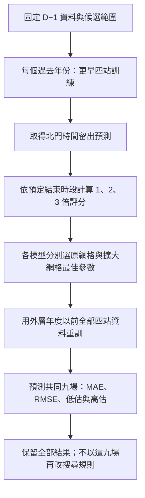

# 人流分析：資料、實作與驗證流程

目前版本對應 `src/run_analysis_v7.py` 與 `src/analysis_v7/`；**第 18 節修正 GAM 低支持度與無懲罰外插問題，重新比較 Ridge／GAM／XGBoost 等權及學權重融合**。新結果見 [第七版報告](result/analysis_v7/report.md)，設定與來源雜湊見 [執行紀錄](result/analysis_v7/both/run_manifest.json)。第 1–17 節保留各版方法與當時結果；第五、六版八種既有方法作逐筆不變的對照，舊版 Forward Selection 不能當作本版的完整設計 OLS。

北門原版診斷見 [第 12 節](#12-北門尖峰診斷與改善順序)；其中 Ridge 交互與 XGBoost 調參已於 [第 13 節](#13-第二版實作與實際改善結果) 執行，其他建議仍待驗證。

**本版完成歷史資料的向前驗證，尚未證明資料在當年活動前一天已經可取得。** 列車部分是明示假設下的容量情境，尚未建立可直接採用的營運班表。

## 1. 研究單位與目標

- 一列為「活動日期 × 車站 × 小時」，目標 `y` 是來源資料該小時的起站人次 `origin_count`。
- `origin_count` 是同來源時段按起站加總，暫作進站需求代理；[前處理規格](docs/data_preprocessing.md#2-時間站名與資料品質) 尚未核實原始時段以進站或出站刷卡時間分箱。接排隊前須先取得官方定義，不能直接宣稱是月台到達時間。
- 車站為北門、大橋頭站、雙連、民權西路；時段為 18、19、20、21、22、23 時，共 6 個小時區間。
- 2017–2026 年原清單有 26 個日期；21 場已辦活動（held）納入，每場 4 × 6 = 24 列，共 504 列；4 場取消（cancelled）與 1 場延期（postponed）排除，也不作比較日。
- 本版估計的是「條件於活動有舉辦」的人流，不是預測活動取消與否，也不涵蓋所有原定活動日。
- 年度場數依序為：2017–2022 年各 1 場、2023 年 6 場、2024–2026 年各 3 場。
- **504 列不等於 504 個獨立活動。** 同場不同站與時段、同年度活動可能相依，因此時間切分保留整場及整年。
- 起站人次尚不能直接解釋成月台到達、特定方向候車或煙火觀眾實際移動軌跡。

## 2. 必需資料與讀取方式

隊員需私下取得以下三檔，依相同相對路徑放在專案內；本版不用連線 MySQL，也不寫回 SQL。

| 私有輸入 | 主要用途與必要欄位 |
|---|---|
| `data/processed/event_station_hourly_context.csv` | 活動狀態與目標：`event_date`、`station`、`hour_start`、`event_status`、`origin_count`；核對 `baseline_window_mean_56d`、`baseline_dates_56d`、`baseline_n_days_56d` |
| `data/processed/calendar_baseline/candidate_audit.csv` | 比較日稽核：`event_date`、`station`、`candidate_date`、`lag_days`、`selected`；若有 `candidate_origin_total` 也核對 |
| `data/processed/station_hourly.parquet` | 重新讀取逐時數量：`service_date`、`station`、`source_hour`、`origin_count`、`origin_complete` |

可選輸入為 `.local/research_review/2026-10-07-refresh/statistics_snapshot.json`。只讀活動日期、無人機實況與實際煙火秒數，增加 EDA 欄位；不存在時仍能跑相同預測，缺值圖會反映未知，不能冒填「無」。

`data.py` 以 DuckDB 限定所需日期、四站及 18–23 時讀取已彙整的 Parquet，不重新掃描全部原始 OD。三個必需檔與實際讀取的可選檔均計算 SHA-256。

### 2.1 不符合即停止的條件

1. 必需檔或必要欄位缺少；日期缺失、帶時區或不是日期午夜；`hour_start` 不為同一天整點。
2. 同日期活動狀態矛盾，或活動／車站／小時主鍵重複；任一已辦活動缺少四站六時段完整格子。
3. 目標或歷史人次不是有限、非負整數，或 `origin_complete` 不為真；不把缺測當成零。
4. 已選比較日重複、不是活動前 7–56 天的整週間隔、包含清單中的活動日期，或每場每站不足 2 日／超過 4 日。
5. 比較日對活動與車站的涵蓋不一致，或任一比較日缺少 18–23 時的 6 筆完整資料。
6. context 目標與 Parquet 不符；選定日期／日數與 context 記錄不符；比較日總量或重建逐時基準的六小時加總不符。
7. 核心輸入出現 NaN、無限值或負基準；可選快照若存在卻有必要欄位缺漏／重複日期，也會停止。

本程式沿用既有日曆選日稽核的 `selected` 結果，再做上述檢查；不宣稱重新驗證了所有歷史日曆公告版本。

## 3. 56 天基準如何重建

令 $C_{e,s}$ 為活動 $e$、車站 $s$ 的已選比較日期集合。每個比較日早於活動日 7–56 天、同星期幾，排除活動清單日期；由既有稽核保留 2–4 個可用日期。

同站同時段的基準為：

$$
B_{e,s,h}=\frac{1}{|C_{e,s}|}\sum_{d\in C_{e,s}}Y_{d,s,h}.
$$

- 基準從 Parquet 的各小時人次重新計算，沒有把六小時總量直接貼到每一小時。
- 驗證 $\sum_{h=18}^{23}B_{e,s,h}$ 等於 context 的 `baseline_window_mean_56d`。
- 這個基準本身也是比較方法：$\widehat Y^{base}_{e,s,h}=B_{e,s,h}$。
- 使用 56 天窗口可涵蓋 21 場；較早的 28 天主要樣本只有 19 場，本版沒有混用兩種樣本評分。
- 比較日期早於活動只證明「觀測時間在過去」，**不證明該 OD 已在 D−1 發布**。同年較早的一般日可作後續活動輸入，但仍缺發布時間證據。

## 4. 變數種類與事前可用性

程式使用明確白名單，不會把所有數值欄自動投入模型。

| 變數 | 型別／層次 | 本版用法與限制 |
|---|---|---|
| `baseline_hourly_56d` | 非負連續；站 × 小時 | 固定核心；由過去日期重建，但發布時間未核實 |
| `station` | 名目類別；站 | 固定核心；以訓練類別建立虛擬變數並保留參考站 |
| `hour` | 類別；小時 | 固定核心；以時段虛擬變數建模，不強迫單一直線趨勢 |
| `is_weekend` | 0／1；活動 | 額外候選；依日期計算週六／週日，不等同國定假日 |
| `day_of_year` | 整數；活動 | 額外候選；年內日序，不代表已辨識季節因果效果 |
| `year_index` | 整數；年度 | 額外候選；年份減 2017，描述年度趨勢 |
| 實測氣溫、風、雨、雲量 | 時間點或時段；氣象站 | 僅 EDA；不是活動前一天的歷史預報版本 |
| 無人機實況、實際煙火秒數 | 0／1／未知、連續；活動 | 僅 EDA；不是已核實公告時間的預定節目 |
| 活動預算、宣導經費 | 金額；年度 | 不進模型；年度一筆，不能展開後當成多場獨立資訊，且可用年份與發布時間不足 |
| 社群聲量、Google Trends | 計數或相對指標；日期／活動 | 不進模型；尚無完整可比的歷史 D−1 版本 |

`event_date`、`year` 用於索引與切分，不會當成額外自由特徵。未來若加入天氣、無人機或預算，需先記錄 `available_at`；天氣另存 `forecast_issued_at` 與預報有效時間。預測截止後才知道的值不能回填歷史訓練輸入。

### 4.1 缺值與氣象口徑

- 核心／目標 504 列完整；缺失會停止，沒有全資料補值或以測試資料估補值參數。
- 21 場 × 6 氣象時點共 126 個唯一時點，四站共用氣象不能算成 504 份獨立觀測。
- 氣溫為報時點值、風速為報時前 10 分鐘平均；不能任意改稱同一種整點一小時平均。
- 雨量為以報時點結束的一小時雨量。119 筆可量化、7 筆微量雨 `T`，涉及 3 場；`T` 保留狀態，不改成 0，也不自行指定 0.05 mm。
- 雲量為報時點十分量，不是衛星雲覆蓋率；90 個值、36 個缺值，15 場六點完整。保留測量型態與核實狀態，不把方法未核實當成已完全可比。
- 氣溫／風速 21 場完整、雨量 18 場完整、雲量 15 場完整；活動平均要求六點都可量化，不能用較少時點冒充完整平均。
- 可選快照中的無人機只有 3 場已知、18 場未知；實際煙火秒數 21 場有值。缺值率按各欄實際資料層次呈現。

### 4.2 先做哪些變數檢查

`eda.py` 產生年度場數、缺值概況、活動層次 Spearman 相關及描述統計。

- 活動層次資料把四站六時段人次／基準加總，每場只保留一筆週末、日序、年度及共享天氣平均。
- 相關矩陣用成對完整資料，另輸出每對有效場數；不提供假定 504 列獨立的相關 p 值，也不解釋為因果。
- 訓練內 VIF 定義 $\mathrm{VIF}_j=1/(1-R_j^2)$，用於辨認設計矩陣冗餘；不是「超過 5 或 10 就自動刪掉」的規則。
- VIF、係數與 OLS 留出殘差都另存圖／表。係數是訓練內標準化尺度，不是已校正選模不確定性的效果估計。
- 本版沒有用 AIC 選變數、沒有選後普通 p 值或 F 檢定宣稱入選因子顯著。目的先是預測，選擇準則為訓練內時間驗證 MAE。

## 5. 三層年度向前驗證

**2017–2023 年作初始累積訓練，2024–2026 年作外層評估；不隨機拆散同場的小時或車站。** 此資料先前已被探索，因此也不宣稱是完全未接觸資料的確認性實驗。

| 外層測試年 | 可用訓練年 | 訓練場數／列數 | 測試場數／列數 | 學權重的中層 OOF 場數 |
|---|---|---:|---:|---:|
| 2024 | 2017–2023 | 12／288 | 3／72 | 8 |
| 2025 | 2017–2024 | 15／360 | 3／72 | 11 |
| 2026 | 2017–2025 | 18／432 | 3／72 | 14 |

1. **內層：選變數／調參。** 在當次訓練集內以更早年訓練、下一驗證年評分。最少 2 場起始訓練、至少 2 個有效內層年度折。
2. **中層：建立權重訓練資料。** 最少 4 場訓練起步，每次重新完成內層選模，再預測較晚年度。這些未參與該次基模型訓練的預測稱 OOF 預測。
3. **外層：共同評分。** 只使用外層訓練年度的中層 OOF 學權重，再用全部外層訓練資料擬合基模型，預測該測試年全部活動。

例如評估 2024：中層依序用截至 2020、2021、2022 年的資料預測 2021、2022、2023 年；權重沒有使用 2024 真值。內層又在各中層訓練期內切分，避免用同一驗證年同時調基模型與產生用來學權重的留出預測。

連續特徵的均值／標準差僅由當次訓練資料估計；週末與類別虛擬變數保留 0／1。常數欄移除；未見過的站別／時段不默認為參考類別。所有最終預測取 $\max(0,\widehat Y)$，避免負人次。

## 6. 三個基礎模型

### 6.1 Forward OLS

固定核心為逐時基準、站別及時段。以最小平方擬合：

$$
\min_{\beta_0,\boldsymbol\beta}\sum_{i\in\mathcal T}
\left(y_i-\beta_0-\boldsymbol x_i^\top\boldsymbol\beta\right)^2.
$$

額外候選為週末、年內日序、年度序號。每次試加一組，選內層「活動平衡 MAE」最小者；只有嚴格改善才加入，最多增加 2 組。這是貪婪選擇，不保證找遍所有子集合的全域最佳模型。

完整訓練設計若不滿秩，該候選不加入；個別 OLS 擬合遇不滿秩時回退至歷史基準並記錄，避免輸出不可辨識係數。實際外層 2024 不加額外項，2025、2026 選入週末。

### 6.2 Ridge

使用核心與全部三個候選，截距不懲罰：

$$
\min_{\beta_0,\boldsymbol\beta}\;
\frac1n\sum_{i\in\mathcal T}
\left(y_i-\beta_0-\boldsymbol x_i^\top\boldsymbol\beta\right)^2
+\lambda\|\boldsymbol\beta\|_2^2.
$$

`sklearn.Ridge` 的目標為 SSE + `alpha` × 懲罰，所以程式設定 **`alpha = n × lambda`**，讓不同訓練大小的候選懲罰可比較。候選 λ 為 0.001、0.01、0.1、1、10，依內層 MAE 選取；外層選為 1、0.1、0.1。

Ridge 縮小相關特徵係數以取捨偏差與變異，不會自動變成因果模型，也不保證一定勝 OLS。

### 6.3 XGBoost

使用相同合格特徵、平方誤差回歸與正則化加法樹；本版不是 Poisson objective。

- 小型 grid：`max_depth ∈ {1, 2}` × `n_estimators ∈ {100, 250}`，共 4 組。
- 固定 `learning_rate=0.05`、`min_child_weight=24`、`reg_lambda=10`、`subsample=1`、`colsample_bytree=1`。
- `tree_method=hist`、單執行緒、種子 20261010；以內層 MAE 選參數。
- 外層 2024 選深度 1／250 棵，2025、2026 選深度 2／100 棵。限制樹深及搜尋範圍是小樣本研究設定，不是原文指定的最佳參數。

## 7. 等權平均與 MAE Stacking

等權平均直接為三模型非負預測之平均，不另學參數。

Stacking 的 $P_{im}$ 是中層 OOF 對第 $i$ 列、模型 $m$ 的預測。令 OOF 有 $E$ 場、活動 $e$ 有 $n_e$ 列，定義每列權重 $a_i=1/(E n_{e(i)})$。求解：

$$
\begin{aligned}
\min_{\boldsymbol w,\boldsymbol u}\quad&\sum_i a_i u_i\\
\text{使得}\quad
&u_i\ge y_i-\sum_{m=1}^3w_mP_{im},\\
&u_i\ge \sum_{m=1}^3w_mP_{im}-y_i,\\
&u_i\ge0,\quad w_m\ge0,\quad \sum_{m=1}^3w_m=1.
\end{aligned}
$$

使用 `scipy.optimize.linprog(method="highs")`。非負且總和為 1 的權重形成三模型預測的凸組合，沒有額外截距；限制可減少極端外推，但不能消除小樣本不確定性。

| 外層測試年 | OLS 權重 | Ridge 權重 | XGBoost 權重 |
|---|---:|---:|---:|
| 2024 | 0.7235 | 0.0000 | 0.2765 |
| 2025 | 0.6747 | 0.2672 | 0.0581 |
| 2026 | 0.6255 | 0.2015 | 0.1729 |

單一模型頂點與等權平均都是可行權重，因此最優解在**同一份中層 OOF 訓練損失**不會較差（容許數值誤差）；這不是外層／未來一定更好的保證。本次外層等權平均反而有更小 MAE。

## 8. 指標與本次結果

外層共 9 場、216 列。若 $r_i=\widehat y_i-y_i$，則：

$$
\mathrm{MAE}=\frac1E\sum_e\frac1{n_e}\sum_{i\in e}|r_i|,
\qquad
\mathrm{RMSE}=\sqrt{\frac1E\sum_e\frac1{n_e}\sum_{i\in e}r_i^2}.
$$

| 方法 | MAE | RMSE | 實際尖峰時平均正向低估 |
|---|---:|---:|---:|
| 等權平均 | **611.72** | 1,222.62 | 1,469.51 |
| MAE Stacking | 633.75 | 1,171.31 | 1,299.66 |
| XGBoost | 646.30 | 1,264.98 | 1,548.18 |
| Forward OLS | 680.60 | **1,152.28** | **1,190.25** |
| Ridge | 691.34 | 1,372.60 | 1,722.28 |
| 一般日基準 | 871.48 | 1,791.08 | 2,379.03 |

- MAE 表示每站每小時平均絕對誤差；RMSE 對大誤差較敏感。等權平均 MAE 比基準低約 29.8%，OLS 的 RMSE 最低。
- 偏差為預測減實際，負值代表平均低估；不能以正負誤差抵消後的偏差取代 MAE。
- 尖峰低估：對每場每站的實際最高小時，計 $\max(0,y-\widehat y)$，再平均 36 個場站組合；它不是全站安全容量指標。
- 尖峰時刻 MAE：比較預測與實際最大值所在小時，並列時取較早時段；不是逐分鐘疏散結束誤差。
- **北門大型尖峰仍嚴重低估，不能直接拿本版點預測決定列車調度。** 要同時閱讀逐年、逐場、逐站指標及 2026 全部場次的時序圖。
- 外層只有 3 年，不用 216 列偽裝獨立樣本做模型優劣顯著性檢定，也不提供過度精確的信賴區間。看過結果後繼續調法，需另保留未來新場次做最終驗證。

### 8.1 為何沒有直接改做複雜計數模型

人次是非負計數，但 Poisson 的條件均值等於變異數假設、負二項的離散度、跨站／跨時段相依都需另驗證。增加站時列數不能增加獨立活動數；無人機只有 3 場已知，更不足以穩健估計交互作用或分群效果。

本版先比較 OLS、Ridge、淺層 XGBoost 的非負點預測，沒有把連續回歸描述成完整計數分布。未來可比較 Poisson／負二項或分位數模型，但應沿用年度外層驗證，並另驗證不確定區間與極端需求，不以新增方法數量代替驗證。

## 9. 如何接排隊與列車容量

`queue_report.py` 使用 **2026-08-15 北門的外層 Stacking 預測**，沒有拿實際目標當預測輸入。以下全部是情境參數：方向 A／B 比例 0.6／0.4、小時內均勻到達、固定步行 5 分鐘、初始隊列 0、每班剩餘容量 300 人；比較班距 6、4、3 分鐘，另延伸服務 120 分鐘。此處暫把起站時段量視為進站量；須先確認來源為進站刷卡分箱，才可將這段延遲解釋為閘門至月台時間，且不能再加入活動場地至車站時間。

列車用批次服務：列車 $k$ 到站前後隊列為 $Q_k^-$、$Q_k^+$，兩班間新到達量為 $A_k$，剩餘容量為 $C_k$：

$$
Q_k^-=Q_{k-1}^+ + A_k,\qquad
b_k=\min(Q_k^-,C_k),\qquad
Q_k^+=Q_k^- - b_k.
$$

程式在分鐘區間內採均勻連續流入、列車時刻瞬間登車，精確積分此流體假設下的 $\int Q(t)\,dt$ 作等待人分鐘，檢查到達＝登車＋殘留。只有初始隊列為零且全部清空時，才用等待人分鐘／全部到達數表示完整平均等待。

- 各班剩餘容量不是整列車額定容量；沒有推估上游載客、轉乘、放棄排隊或改道。
- 這次情境都沒有跨班積壓，平均等待分別約 3、2、1.5 分鐘，是均勻到達且容量充足時的半班距結果，**不證明真實煙火散場不擁擠**。
- 點預測人流的流體試算不是隨機佇列期望等待時間；需求尖峰低估還會使候車情境過於樂觀。
- `queueing.py` 另有 M/M/c 工具，適用 Poisson 到達、指數服務、平行服務台等假設，且需 $\rho<1$ 才有穩態有限等待；**列車不是 c 個連續獨立服務台，不能直接套 M/M/c 取代批次服務。**
- 真正調度前需補：方向分流、分鐘到達曲線、列車實際時刻與剩餘容量、初始隊列、月台等待可用空間、車隊、折返時間、最小安全班距及營運成本。
- 本版沒有成本目標求解、沒有車隊與折返限制，也沒有營運安全可行性認證；尚未完成列車調度最佳化。

## 10. 執行與輸出

在專案根目錄執行：

```powershell
uv sync --group analysis
uv run --group analysis python -X utf8 src/run_analysis.py --validate-only
uv run --group analysis python -X utf8 src/run_analysis.py
uv run --group analysis python -X utf8 -m unittest discover -s tests -p 'test_analysis_v*.py'
```

第二版完成時分析測試共 59 項；第三版目前共 **84 項**。除原有資料、時間切分、交互編碼、融合與隊列測試，新增截止後資訊拒絕、預報有效時間／單位、306 筆數值重算、訓練內補值、全未知欄與基準排除測試。它們檢查程式行為，不代表已驗證營運適用性。中文圖需 Microsoft JhengHei 或 Noto Sans CJK 等中文字型。

以下指令**目前會拒絕並以結束碼 2 停止**，因為發布時間與日曆版本尚未核實；不應為了通過而任意改掉稽核旗標：

```powershell
uv run --group analysis python -X utf8 src/run_analysis.py --require-d1
```

可用 `--config` 指定設定、`--output` 指定公開結果位置、`--private-output` 指定私有輸出位置。預設輸出分為：

| 位置 | 內容 |
|---|---|
| `result/analysis_v1/report.md` | 實際中文分析結果；圖片採相對路徑，與資料夾一起分享即可 |
| `result/analysis_v1/figures/` | 模型比較、逐場誤差、完整留出曲線、權重、VIF、殘差、EDA、排隊情境 PNG |
| `result/analysis_v1/tables/` | 模型／年度／活動／車站指標、變數資格、係數、VIF、相關配對數、時間切分、內層選模及情境 CSV；UTF-8 BOM |
| `result/analysis_v1/folds.json` | 各外層訓練截止、選模、權重及中層損失 |
| `result/analysis_v1/run_manifest.json` | 來源／程式／uv.lock 雜湊、設定、套件版本、資料資格與限制 |
| `.local/analysis_v1/` | 不提交的逐筆資料 `analysis_input.csv`、`outer_predictions.csv`、`meta_predictions.csv`；外層模型及全資料研究模型 |

本版目錄為單數 **`result/`**；舊研究與文字雲仍在 `results/`。Git 分享報告圖表不需要公開 SQL。重跑要有上述三檔；只看報告和 PNG 則不需要資料庫。

全 21 場另擬合的 `research_models.joblib` 是研究物件，標記 `research_only_not_verified_d1`；其最終權重沒有拿來重新評分較早的外層測試，也不代表已上線的事前預測服務。

## 11. 文獻與本專案延伸的界線

| 原始文獻 | 可支持的做法 | 本專案自行設定／尚未驗證 |
|---|---|---|
| [Hyndman & Athanasopoulos，FPP3 §5.10](https://otexts.com/fpp3/tscv.html) | 以過去資料預測之後時點，使用時間序列交叉驗證 | 整年度／活動分組、2024–2026 外層年與發布時間稽核 |
| [Heinze、Wallisch & Dunkler（2018）](https://doi.org/10.1002/bimj.201700067)，§2.2、2.4 | 變數選擇與選後推論的限制 | 本版依時間 MAE 做最多兩步 Forward Selection，不提供選後普通 p 值 |
| [Hoerl & Kennard（1970）](https://doi.org/10.1080/00401706.1970.10488634)，§0–2 | Ridge 的正則化與偏差／變異取捨 | λ grid、平均 SSE 尺度與 `alpha=nλ` 換算 |
| [Chen & Guestrin（2016）](https://arxiv.org/abs/1603.02754)，§2 | 正則化加法樹及 XGBoost 方法 | 四組淺樹 grid、活動資料特徵及本次預測表現 |
| [Breiman（1996），Stacked Regressions](https://statistics.berkeley.edu/sites/default/files/tech-reports/367.pdf)，§1、2、5、7 | 用留出預測學融合係數；原文主要採非負最小平方 | 本版改為活動平衡 MAE、總和為 1 的 LP 及年度向前 OOF，不將此完整方案冒稱原文定理 |
| [Varma & Simon（2006）](https://pmc.ncbi.nlm.nih.gov/articles/PMC1397873/) | 調參與最後評分應分開，避免選模造成樂觀評估 | 本版三層時序設計；原文不能保證克服場次少、資料版本未知與既有探索 |
| [Santanam 等，特殊活動需求預測與列車調度](https://arxiv.org/abs/2106.05359) | 需求預測銜接運輸排程的研究方向 | 本版僅完成假設批次容量比較，沒有重現其最佳化模型 |

上述文獻不是這份資料上的成功保證；表格中的 9 場結果才是本次實際執行證據。完整專案資料來源及既有參考文章見 [README：詳細說明與參考資料](README.md#詳細說明與參考資料)。

## 12. 北門尖峰診斷與改善順序

2026-10-11 核對第一版逐筆留出預測、外層模型與設計矩陣。以下保留當時診斷及改善規劃；原版成績不改寫。本日後續執行的改版比較另列第 13 節。

### 12.1 低估有多大

每場只取北門「來源時段起站人次最多的小時」，在同一小時比較預測；不是拿預測最高值與實際最高值錯時比較。單位為人次，表中人次四捨五入，百分比用未四捨五入數值計算。

| 活動日期 | 實際尖峰小時 | 實際 | Forward OLS | Ridge | XGBoost | Stacking | Stacking 低估率 |
|---|---:|---:|---:|---:|---:|---:|---:|
| 2024-07-17 | 20 | 3,608 | 2,014 | 1,435 | 1,353 | 1,831 | 49.24% |
| 2024-07-31 | 20 | 4,093 | 2,014 | 1,409 | 1,353 | 1,831 | 55.25% |
| 2024-08-10 | 21 | 11,101 | 3,897 | 1,695 | 2,685 | 3,562 | 67.91% |
| 2025-08-06 | 21 | 4,229 | 3,385 | 2,444 | 3,314 | 3,129 | 26.00% |
| 2025-08-20 | 21 | 4,321 | 3,385 | 2,383 | 3,314 | 3,113 | 27.96% |
| 2025-08-30 | 21 | 10,251 | 4,480 | 2,880 | 3,048 | 3,969 | 61.28% |
| 2026-07-25 | 21 | 9,893 | 4,146 | 2,997 | 3,899 | 3,872 | 60.87% |
| 2026-08-05 | 21 | 4,642 | 3,429 | 2,578 | 3,447 | 3,261 | 29.76% |
| 2026-08-15 | 21 | 10,904 | 4,166 | 2,951 | 3,899 | 3,875 | 64.46% |

九場全數低估，逐場低估率平均 **49.19%**；把九場尖峰人次加總後計算的低估比例為 **54.88%**。兩者加權方式不同，不能混稱同一指標。來源為私有 `.local/analysis_v1/outer_predictions.csv`；另可查看公開的 [2026 年三場留出曲線](result/analysis_v1/figures/heldout_profiles_latest.png)。

### 12.2 為什麼低估：已確認什麼、還需驗證什麼

1. **已見過大流量，卻連訓練尖峰也擬合不足。** 2024／2025／2026 外層模型的訓練資料分別有 12／15／18 場活動，北門歷史尖峰最大值為 9,826／11,101／11,101。2026 模型在自己的訓練資料上，仍把 2024-08-10 的 11,101 預測成約 4,420（OLS）、3,033（Ridge）、3,899（XGBoost）。這是欠擬合證據，不能只說未來人流超出歷史範圍；訓練擬合值不納入外層成績。
2. **OLS／Ridge 沒有「車站 × 小時」交互作用。** `models.py` 的 `Encoder` 只有站別與小時主效果；2026 OLS 的 21 時係數約 +2,541，所有站共用。九場測試的 21 時，Stacking 在北門平均低估 3,329，民權西路卻平均高估 1,253。這與共享時段效果無法表達不同站的尖峰形狀一致；需要加入交互作用的對照實驗，才能量化它造成多少誤差。
3. **XGBoost 的複雜度限制可能過強。** 實際選出的樹深為 1／2／2，`min_child_weight=24`；平方誤差、等列權重下，實際葉片 cover 最少為 24。訓練中「北門 21 時」只有 12／15／18 列，單一葉片無法只涵蓋這組列。這會限制局部區分，但不代表整個加法樹集合數學上不能表達尖峰；應用內層驗證比較較小葉片門檻與樹深，不能直接認定放寬必然變好。
4. **活動差異與散場時刻尚未成為輸入。** 本版沒有 D−1 公告的預定結束時間、展演類型／長度及歷史天氣預報。2026 三場實際尖峰約 9,893、4,642、10,904，Stacking 卻只在約 3,261–3,875 之間。2024 兩場 7 月活動實際在 20 時達峰，Stacking 則在 21 時達峰；高度與時間都需改善。這些結果不證明無人機或天氣具有因果效果。
5. **選模目標與容量需求不同。** 目前以四站六時段的活動平衡 MAE 選模；每場北門單一尖峰只占 24 列中的 1 列，並未另加容量損失權重。這不是說它只占損失的 1/24，而是整體平均誤差最小不等於北門最危險時段低估最少。
6. **只改融合權重救不了共同低估。** 本版非負權重總和為 1，因此

   $$
   \min_m\widehat y_m\leq\sum_m w_m\widehat y_m\leq\max_m\widehat y_m.
   $$

   2026-08-15 的三模型最高只到約 4,166，任何這類權重都無法變成實際的 10,904。應先改善基模型，不能期待 Stacking 自動補出沒有任何基模型預測到的尖峰。

結論是：**先修正欠擬合與活動／時段資訊，再處理容量風險；重做 VIF 或換融合權重本身不夠。** 各項改善的幅度尚未驗證。

### 12.3 下一版依序做什麼

| 順序 | 具體改動 | 驗收方式 |
|---|---|---|
| 1. 先改形狀 | 同一批資料增加「車站 × 小時」，優先比較有／無交互作用的 Ridge；再單獨試「車站 × 週末」 | 同樣年度向前切分；比較北門各場曲線、尖峰低估及峰值時間，同時檢查其他站有沒有變差 |
| 2. 再調 XGBoost | 在內層比較葉片門檻及樹深；限制搜尋範圍，不能用外層真值選參數 | 調參及權重訓練都重新執行；21 場仍是 21 場，不能把 504 列當獨立樣本 |
| 3. 補事前資訊 | 公告開始／預定結束、預定煙火或無人機、預定長度；另補歷史天氣預報的發布及有效時間 | 每欄通過 D−1 可得時間核對；未知無人機不能填 0，實測天氣不能冒充預報 |
| 4. 比較總量與形狀分開 | 比較直接逐時預測、一般日基準＋活動增量、站點總量搭配相對散場曲線 | 曲線、標準化與選模只用訓練期；不能依測試場實際尖峰移動散場時間 |
| 5. 加入容量風險預測 | 在點預測以外，比較事先指定的 P50／P80／P90 或低估成本損失 | 看 pinball loss、涵蓋率、北門尖峰低估、隊列敏感度；不只看全站 MAE |
| 6. 重做融合與最終驗證 | 基模型改好後重新產生時間 OOF，再學權重並與等權比較 | 舊外層作回顧比較；因已用其結果診斷，需另留未來新活動確認改善 |

第一步先檢驗一組交互作用，避免同時換資料、損失及模型後無法知道改善來源。只有 21 場活動，暫不為每個車站各建一套高自由度模型；先共用資訊並用正則化控制差異。

**總量與形狀分開的候選設計（尚未實作）：**

$$
\widehat Y_{e,s,h}=B_{e,s,h}
 +\widehat N^{\mathrm{extra}}_{e,s}\,
 p_{s,h}(t^{\mathrm{planned}}_{\mathrm{end},e}),
\qquad p_{s,h}\geq0,\quad\sum_{h\in\mathcal H}p_{s,h}=1.
$$

$B$ 為一般日基準，$N^{\mathrm{extra}}$ 是指定觀測窗口 $\mathcal H$ 內的額外需求量，$p$ 為依事前預定散場時間對齊的時段比例。$p$ 只用過去活動估計；若以非負額外需求建模，須先檢查與處理負差額，不能把所有負差額默默刪除。差額也不等同逐人辨認出的活動觀眾。若有明顯的時段移轉或整體減少，應另比較容許正負差額的增量回歸，不能強迫所有活動皆增加人流。

[Santanam 等（2021），§VI-A/B](https://arxiv.org/html/2106.05359v1) 將站點活動總人次搭配相對結束時間的歷史到達比例，以 5 分鐘建立需求；上式再加一般日基準是本案候選延伸，不是該文原式的重現。該文部分結束偏移曾依事後曲線調整，本案 D−1 流程不能照搬這種事後對齊。

**容量決策用的分位數：**若少估一人的成本為 $c_u$、多估一人的成本為 $c_o$，在分段線性損失

$$
L(y,q)=c_u(y-q)_+ + c_o(q-y)_+
$$

下，最適點預測對應條件分位數 $\tau=c_u/(c_u+c_o)$。這支持按決策成本選擇分位數，而非任意把目前點預測乘上安全係數；見 [Gneiting（2011）](https://doi.org/10.1016/j.ijforecast.2009.12.015)。列車成本通常不是簡單線性，這只是第一層需求決策近似，後續仍須模擬容量與等待成本。P90 是預測需求分位數，不是參數的 90% 信賴區間，也未保證安全；逐時 P90 相加不等於整晚總量 P90。

### 12.4 怎樣才能接到排隊與列車調度

1. **先確認時間與需求位置。** 目前預測同來源時段的起站加總；必須先核實時段為進站刷卡分箱，才能以它估進站到達。確認後再估各方向比例、閘門至月台延遲，不再加活動場地至車站步行時間。若原始分箱依出站時間，就需另取進站時段資料或驗證重建方法。歷史 OD 搭配合理路徑可作方向分配起點，但仍須觀測驗證。若存在進站管制，閘門數量無法直接還原全部到站需求與場外隊列。
2. **補時間解析度。** 取得 5 分鐘閘門資料或現場計數，估計散場集中的到達曲線。逐小時總量無法唯一還原分鐘峰值；資料未取得前要比較均勻、集中等情境，清楚標示假設，不能把均分 60 分鐘當實測。
3. **使用逐班剩餘容量。** 由列車到站前載客、下車量與可用容量推算可登車人數，搭配實際到站時刻及初始隊列。依第 9 節批次遞推計算滯留、等待人分鐘與清空時間；候車隊列也不等於包括下車及通行乘客的全部月台人數。
4. **再比較可行班表。** 納入車隊數、折返、最小班距、原班表、月台限制及加班車成本，以多條需求情境比較班表，才有調度意義。批次服務與需求驅動排程可參考 [Santanam 等（2021），§V-C Algorithm 1](https://arxiv.org/html/2106.05359v1)。

本版 0.6／0.4 方向比例、均勻到達、5 分鐘延遲、每班 300 人剩餘容量，全部仍是假設。現有結果「沒有跨班積壓」同時受到這些假設及需求低估影響，不能作為實際煙火日列車足夠的證據。

**後續進度：Ridge 交互作用與 XGBoost 調參已執行，結果見第 13 節。** 需求曲線、事前節目／天氣、分位數及營運資料仍待擴充。

## 13. 第二版實作與實際改善結果

### 13.1 交互作用的意思與診斷

第一版線性結構可寫成

$$
\widehat y_{e,s,h}=\beta_0+\beta_B B_{e,s,h}+\alpha_s+\gamma_h+\boldsymbol z_e^\top\boldsymbol\eta.
$$

$B$ 是同站同時段基準，$\boldsymbol z$ 是合格的活動日期特徵。控制這些輸入後，19 時到 21 時的差異由共用的 $\gamma_{21}-\gamma_{19}$ 表示，各站相同。第二版 Ridge 增加 $\delta_{s,h}$，讓各站的時段增幅不同：

$$
\widehat y_{e,s,h}=\beta_0+\beta_B B_{e,s,h}+\alpha_s+\gamma_h
 +\delta_{s,h}+\boldsymbol z_e^\top\boldsymbol\eta.
$$

- 在第一版 2024 外層模型的 **2017–2023、12 場訓練資料**中，21 時平均 OLS 殘差（實際−預測）為北門 **+2,599.6**、民權西路 **−1,447.4**；19 時則為 **−778.2／+550.0**。控制原有主效果後，殘差仍呈站別與時段組合的差異，支持試驗交互項。這是描述診斷，不是獨立 F 檢定或因果證明。
- `Encoder` 對站別與小時做參考類別編碼；保留兩組主效果，再相乘非參考 0／1 欄。本資料參考類別為北門、18 時，因此新增 $(4-1)(6-1)=15$ 欄，並非把車站數字編號乘上小時。
- 新項與其他係數一起受 Ridge 懲罰；截距不懲罰。沿用原數值標準化、0／1 dummy 與 λ grid，仍使用 `alpha=nλ`。Ridge 的懲罰受編碼方式影響，本次固定原參考編碼供比較，不宣稱任意換參考類別都得到相同結果。
- 交互項只對 Ridge 開啟；OLS 保持原版對照，XGBoost 仍由樹分裂學習交互。**新 Ridge 對舊 OLS 的差距同時涉及設計矩陣與懲罰，不能說完全是 Ridge 演算法本身造成。**

### 13.2 XGBoost 調參如何避免偷看當年真值

在第一次重跑前固定 [第二版設定](configs/analysis_v2.json)，不依這次外層結果追加搜尋。保留原內層年度向前切分及活動平衡 MAE：

| 參數 | 原版 | 第二版候選 | 用意 |
|---|---|---|---|
| `max_depth` | 1、2 | 1、2、3 | 容許較多條件組合，但仍限制樹深 |
| `n_estimators` | 100、250 | 100、250 | 比較加法樹數量 |
| `min_child_weight` | 固定 24 | 1、6、24 | 比較較小分群能否表達局部尖峰 |
| `reg_lambda` | 固定 10 | 1、10 | 比較葉節點權重收縮強度 |
| `learning_rate` | 0.05 | 固定 0.05 | 不增加另一個搜尋維度 |

共 $3\times2\times3\times2=36$ 組，包含原版四組；`subsample`、`colsample_bytree` 仍固定 1，平方誤差 objective、種子與執行緒不變。依 [官方定義](https://xgboost.readthedocs.io/en/stable/parameter.html)，`min_child_weight` 是 Hessian 和門檻；本案等列權重平方誤差下才對應約最少列數，**不是最少活動數**。較小門檻也增加過擬合風險。

各中層 OOF 都重新調參、訓練，之後重新學 Stacking；未沿用舊權重。三個外層年度最終均選到樹深 3、100 棵、`min_child_weight=1`、`reg_lambda=10`，各自為其內層 MAE 最小者。

| 外層年 | Ridge λ 原版 → 第二版 | 訓練場數 | OLS／Ridge／XGB 新融合權重 |
|---|---|---:|---|
| 2024 | 1 → 1 | 12 | 0.573／0.162／0.265 |
| 2025 | 0.1 → 0.001 | 15 | 0.403／0.099／0.498 |
| 2026 | 0.1 → 0.001 | 18 | 0.360／0.153／0.487 |

新舊來源 SHA-256、外層 216 列主鍵與真值一致；基準及 OLS 的預測不變。完整參數、訓練時間與候選分數見 [folds.json](result/analysis_v2/folds.json) 與 [inner_selection.csv](result/analysis_v2/tables/inner_selection.csv)。

### 13.3 改善多少，哪些場次仍不好

以下尖峰指標只針對北門 9 場，各場取實際最高小時，再比較同一小時的預測；與第 8 節平均四站尖峰不同。

| 指標 | Ridge 原版 → 第二版 | XGBoost 原版 → 第二版 |
|---|---|---|
| 全站逐時 MAE | 691.34 → 582.87（降 15.7%） | 646.30 → 523.05（降 19.1%） |
| 北門逐時 MAE | 1,532.55 → 1,177.78（降 23.1%） | 1,334.62 → 1,181.36（降 11.5%） |
| 北門尖峰平均正向低估 | 4,696.84 → 2,826.99（降 39.8%） | 4,080.99 → 3,236.04（降 20.7%） |
| 北門尖峰平均絕對誤差 | 4,696.84 → 3,192.95（降 32.0%） | 4,080.99 → 3,236.04（降 20.7%） |
| 北門峰值時間 MAE | 1.44 → 0.44 小時 | 0.22 → 0.22 小時 |

- **Ridge 9／9 場尖峰絕對誤差減少，但 2024 三場僅改善約 5–8 人次。** 當年內層仍選 λ=1，收縮後曲線幾乎不變；不能只憑「9／9」宣稱每場都有實質改善。
- 2025-08-06、2025-08-20、2026-08-05 的 Ridge 尖峰改成高估約 1,267、1,095、932 人次。因此同時報正向低估與絕對誤差，不能把高估視為零誤差。
- XGBoost 7／9 場尖峰改善，2024 兩場 20 時的尖峰預測由 1,353 降至 1,217，反而更差。散場時間移動尚未被解決。
- 2026-08-15 真值 10,904：Ridge 2,950.83 → 6,516.53，仍低估約 40.2%；XGB 3,899.47 → 5,616.40，仍低估約 48.5%。不能直接拿此結果指定營運安全容量。
- Ridge 大橋頭 MAE 422.03 → 423.43、雙連 312.20 → 318.61，略退步；XGBoost 四站 MAE 均改善。民權西路的一般日基準 MAE 156.59 仍優於所有新模型。
- 新版等權平均全站 MAE **517.85**、Stacking **538.60**；改善基模型後，學權重仍未勝簡單平均。這次不因其排名而另外調整權重或參數。

完整九場數值、曲線及有符號誤差見 [改版比較報告](result/analysis_v2/comparison/report.md)。這些歷史年度已用於第一版診斷，故本次屬探索性回顧修訂，不是新留出的確認性測試；選模偏誤的相關討論見 [Cawley & Talbot（2010）](https://jmlr.org/papers/v11/cawley10a.html)。

### 13.4 如何重現與接下去

```powershell
# 保有第一版私有預測及執行紀錄後，重跑第二版
uv run --group analysis python -X utf8 src/run_analysis.py --config configs/analysis_v2.json
```

設定自動分流至 `result/analysis_v2/` 與 `.local/analysis_v2/`；若指定覆蓋比較用的第一版輸出位置，程式拒絕執行。比較前核對輸入雜湊，比較時核對主鍵、真值與未改動的基準／OLS。兩版輸入不同時先停止，不把資料變更歸因給模型。

第二版輸出 10 張分析圖、4 張前後比較圖、指標表、候選參數分數、VIF／係數、時間切分及執行紀錄；逐筆資料與模型物件留在本機。模組仍共用 `src/analysis_v1/`，版本由設定及輸出資料夾區分，避免複製整套程式。

排隊情境亦以新 Stacking 重算。在同樣假設下，每 6 分鐘一班的方向 A 開始出現跨班滯留，表示提高需求預測會改變容量判讀；這不是觀測到真實候車。下一步仍需 D−1 公告的節目／散場、歷史預報、來源時段定義、分鐘與方向到達、剩餘容量及營運限制；增量曲線、分位數與真實調度最佳化尚未實作。


## 14. 第三版：活動前一天的節目、天氣與調參

### 14.1 預測截止與資料資格

截止固定為活動前一天 **18:00，Asia/Taipei**。這是本次的研究設計；若改為其他時間，必須重新審查來源，不能只改畫面標籤。

`d1_features.py` 逐筆檢查：來源欄位白名單、數值範圍／單位、具時區的公開時間不晚於截止、原頁更新時間；天氣另核對模式初始化與有效時間。已公布但活動當天改變的節目仍使用截止前的計畫，不以實際結果修正輸入。未知、只給區間、晚於截止或無證據的資訊均保留 NaN。

| 新欄位 | 定義 | 截止前可核對場次 |
|---|---|---:|
| planned_fireworks_minutes | 公告的純煙火分鐘，不含水幕或無人機分鐘 | 19/21 |
| planned_fireworks_start_hour | 真正煙火段預定開始，20:10 編為 20+10/60 | 16/21 |
| planned_drone | 公告有／無無人機；未提到不等於無 | 2/21，僅有已知 1 |
| planned_program_minutes | 公告整套天空展演長度；不把早年純煙火長度自動代入 | 2/21，均為 20 分鐘 |
| forecast_temperature_c | GFS 2 公尺氣溫的瞬時預報，°C | 17/21，各有 6 時點 |
| forecast_wind_speed_m_s | GFS 10 公尺風向量內插後取長度，m/s | 17/21，各有 6 時點 |
| forecast_cloud_cover_pct | GFS 全大氣瞬時總雲量，% | 17/21，各有 6 時點 |

公告來源與逐欄證據見 [d1_program_sources.json](docs/d1_program_sources.json)。使用文章發布／更新欄中較晚時間；只給日期時保守取當日末秒。這是官方頁面 metadata 的查核，不冒充持有當年網頁快照。例：2023/8/9 的可查公告於前一天 18:04 更新，超過截止，故不填入；2026 兩場 20:00 是整套無人機與煙火開始，不冒充煙火點火時間。

無人機、整套展演長度在 2026 前訓練年度均為未知，本次外層模型把它們視為全缺常數並移除。**本次接好這兩欄，但沒有可辨識的無人機效果，不能宣稱尖峰改善是無人機解釋的。** 煙火時長在 2023–2025 同年不同場次已有變化，但與壓軸／活動型態混雜，係數不能解釋為因果增量。

### 14.2 天氣真的取活動前一天的預報

程式 [collect_d1_gfs.py](scripts/collect_d1_gfs.py) 只下載 [NCAR GFS 0.25° 歷史操作型預報](https://gdex.ucar.edu/datasets/d084001/)的點位 CSV，以及 [NOAA AWS 公開存檔](https://registry.opendata.aws/noaa-gfs-bdp-pds/)物件 metadata。不是氣象站實測、ERA5 重分析或用新版模式重做的 hindcast。

- 固定 D−1 00 UTC 初始化，讀 f033／f036／f039，對應活動日 17／20／23 時；18／19／21／22 時在同一個已公開預報場內線性內插。
- 每個被使用的端點檔案都須有 AWS `LastModified ≤ D−1 10 UTC`。這證明檔案最遲於截止前已公開；初始化時間本身不代表可取得時間。
- 點位要求 25.056°N、121.510°E，最近網格 25.0°N、121.5°E，四站共用；不能解讀成站口微氣候。預報是整點瞬時值，不是來源人流小時的精確平均。
- 氣溫由 K 減 273.15；先內插 10 m 風 u、v，再計算 `sqrt(u²+v²)`；總雲量使用瞬時欄，排除六小時平均。
- NCAR 與 NOAA 以模式、初始化和 lead 對應，未宣稱兩個存檔逐位元組相同。17 場共 306 筆可用預報；四個早年場次的 72 格保留未知。
- 這次沒有合格的降雨機率歷史系列，故未加入，不能把實測雨量替代。

詳細說明、資料版本與內插權重見 [天氣查核](docs/d1_weather_audit.md)及 [預報輸入](docs/d1_weather_sources.json)。原始回應留在 `.local/d1_weather/`，JSON 同時記錄來源回應 SHA-256。

### 14.3 缺值、共線性與無歷史訓練資訊

補值在**每一內層、中層與外層訓練折**重新學習：連續欄取訓練中位數，無人機取訓練眾數，並加該欄的缺值指標。訓練全缺欄以常數占位後整欄剔除，不准使用驗證／測試年的分布補值；舊基準等核心欄仍不允許缺值。這是計算補值，不把未知宣稱為真實 0。方法背景見 [scikit-learn 缺值處理說明](https://scikit-learn.org/stable/modules/impute.html)。

所有訓練補值、已知／未知列數與被移除欄位寫入各版 `folds.json`。相同早年氣象缺口會使三個天氣 missing 指標共線，不能把無限 VIF 誤讀成資料錯誤；Ridge 能正則化，OLS 在選變數時拒絕秩不足的設計。VIF 仍只作診斷。

只含同一已知值但缺測狀態不同時，缺值旗標可能提供資訊，Forward Selection 可將整個候選組納入；其效果可能反映年代與資料取得狀況，不是該特徵本體的效果。OLS 仍最多加入兩組候選，與原版一致；Ridge／XGBoost 使用全部合格候選，不沿用 OLS 選完的集合。

### 14.4 XGBoost 參數如何調

上一版的深度 3、樹數 100 都碰到候選邊界，因此在看本次新結果以前先固定 90 組搜尋：

| 參數 | 候選 | 意義 |
|---|---|---|
| max_depth | 1、2、3、4、5 | 一棵樹最多分裂幾層；增加可能學到更細的關係，也可能過擬合 |
| n_estimators | 50、100、250 | boosting 樹數；不是越多一定越好 |
| min_child_weight | 1、6、24 | 子節點 Hessian 總和門檻；本案等權平方誤差對應列數，但不是獨立活動數 |
| reg_lambda | 1、10 | 葉節點權重的 L2 懲罰 |
| learning_rate | 固定 0.05 | 每一棵新增樹的步幅；本次未調整，避免擴張太多自由度 |

5×3×3×2=90，包含上一版全部 36 組。三個重跑版本使用相同網格、seed、活動與評分規則。2024 模型只在 2023 以前的資料做完整年度向前驗證，2025／2026 依此類推；每組將內層預測誤差先按活動等權平均，取 MAE 最低者，再以所有該外層訓練資料重估。不是先看 2024 真值，再挑最像該年峰值的參數。

[`configs/analysis_v3.json`](configs/analysis_v3.json) 的 `xgb_grid` 保存全部候選，`xgb_fixed` 保存固定參數；改候選後須完整重跑，不能只改 `folds.json`。熱圖每個「深度×樹數」格子顯示該格其他兩參數的內層最低 MAE，紅框為實際選中設定。更大網格只是擴大搜尋，不是全域最優證明；若最佳仍在邊界，先記錄而不依外測結果無限制追調。參數定義見 [XGBoost 官方文件](https://xgboost.readthedocs.io/en/stable/parameter.html)。

### 14.5 四版本比較與事前可用性的界線

| 版本 | 新公告／預報 | 56 天人流基準進模型 | XGB 組數 | 用途 |
|---|---|---|---:|---|
| analysis_v2 | 無 | 有，發布時間未核實 | 36 | 原版對照 |
| analysis_v3_tuning | 無 | 有，發布時間未核實 | 90 | 單獨看擴大調參影響 |
| analysis_v3_with_baseline | 有 | 有，發布時間未核實 | 90 | 與 tuning 比較補入新變數的影響；屬回顧敏感度 |
| analysis_v3 | 有 | **無** | 90 | 主要版本：排除發布時間未核實的基準輸入 |

四版原有來源 SHA-256、216 列外層主鍵／真值與一般日對照完全一致；新來源另外記雜湊，不能因新增檔案就聲稱所有輸入仍相同。調參對照的 OLS、Ridge、一般日基準須保持不變；新特徵版只要求一般日對照不變。

主要版的三模型、等權與 Stacking 都不使用 `baseline_hourly_56d`。OLS 若設計秩不足，備援改成訓練平均，不能偷偷用被排除的人流基準。表中的一般日基準僅為回顧式比較列，不是合格事前模型。

**這仍不是已驗證的完整上線回測。** 新模型預測欄位逐筆通過公告／預報可得性審核，但較早年度訓練標籤的當時發布時間仍未全部核實，且樣本事後篩為已舉辦活動，舊日曆版本亦有限制。`d1_deployable=False` 與 `--require-d1` 的停止條件維持；不能因新欄位已核實就解除。外層九場已用於前版診斷，本次同樣是探索式修訂比較。

完整實際數值與圖見 [四版本報告](result/analysis_v3/version_report.md)和 [主要版本完整結果](result/analysis_v3/report.md)。尖峰正向低估不允許與高估互相抵銷，另列有符號誤差與絕對誤差；不以單一活動改善替代九場結果。

本次全站／北門 MAE 結果：只擴大調參的 XGBoost 為 450.12／964.38；保留基準再加新欄為 533.17／1,216.42；排除基準的主要版為 643.12／1,236.10。**新欄未在這次整體比較中帶來增益。** 主要版北門尖峰絕對誤差 3,069.41，略低於第二版 3,236.04，但整段 MAE 反而提高，兩種指標不能混為一談。

Ridge 保留基準再加新欄後，2025／2026 的 λ 從第二版 0.001 變成 1。2026 內層 MAE 隨 λ=0.001／0.01／0.1／1／10 為 1,272.06／1,069.07／909.13／834.18／902.75，確實是依事先規則選 λ=1。21 時主效果係數從 4,978.05 縮為 198.03，與外層尖峰被壓低的現象一致；但設計矩陣、缺值模式與 λ 同時改變，未做固定 λ 的消融，不能斷言單一原因。不能為改善已看過的外層結果直接指定小 λ。

主要版 XGBoost 於 2026/8/15 21 時由第二版 5,616.40 提高至 7,355.47（實際 10,904），但 2026/8/5 同時段估約 7,410、實際 4,642，反而高估。九場圖與完整尖峰絕對誤差一併保留。

### 14.6 重現

```powershell
# 先保有 analysis_v1 / analysis_v2 的私有預測；新環境依 README 重建
uv run --group analysis python -X utf8 src/run_analysis.py --config configs/analysis_v3_tuning.json
uv run --group analysis python -X utf8 src/run_analysis.py --config configs/analysis_v3_with_baseline.json
uv run --group analysis python -X utf8 src/run_analysis.py --config configs/analysis_v3.json
uv run --group analysis python -X utf8 src/compare_analysis_v3.py
```

已提交兩份公開來源 JSON，可直接重現本次特徵，不需每次重新下載。需要更新天氣來源才執行 `scripts/collect_d1_gfs.py`；若來源變更應另開版本並重跑。原有捷運三檔與可選 EDA 快照仍需私下共享，模型／逐筆預測留 `.local/`。輸出在根目錄 `result/` 三個新版資料夾，不覆蓋 v1/v2；README 以主要版及四版比較為入口。

## 15. 第四版：煙火與天氣分開比較

### 15.1 實驗問題與固定條件

問題是「加入哪組事前候選變數後，整套建模流程的外層誤差改變」，不是估計天氣或煙火的因果效果。第三版同時更換節目、天氣與基準，不足以單獨歸因；本次建立四組消融對照：

| 設定後綴 | 新增候選 | 共同條件 |
|---|---|---|
| core | 無 | 車站、時段、日期三欄；Ridge 有站別 × 時段 |
| fireworks | 預定煙火開始時間、純煙火分鐘 | 同 core |
| weather | 事前預報氣溫、風速、雲量 | 同 core |
| both | 以上五欄 | 同 core |

四組 `include_historical_baseline=false`，**一律排除近 56 天人流基準**。每組沿用相同 21 場、504 列、外層 2024／2025／2026 各三場，共九場 216 列；各年度訓練為較早的 12／15／18 場。seed、Ridge λ 網格、90 組 XGBoost 網格、Forward 最多兩組與 Stacking LP 目標相同。只換特徵集合，不為某組另改搜尋範圍。

新輸入仍逐筆通過 §14 的 **D−1 18:00** 時間閘門；天氣用當年已公開預報，不能補入活動當天實測。訓練內補值與標準化不變。無人機、整套節目時長在所有外層訓練期均無已知資料，因此本次移除這兩個不可辨識候選。`both` 四模型逐筆外層預測與 `analysis_v3` 的最大差異為 **0**，確認未改變第三版有效設計。

這仍是探索性回顧比較：早年訓練標籤的可得時間、日曆歷史版本與已辦活動篩選限制未消失；`d1_deployable` 仍為 false。不能把五個新欄位符合 D−1，擴大宣稱整套歷史回測完全重現上線條件。

### 15.2 90 組網格內的最佳化

令候選超參數為

$$
\theta=(d,T,m,\lambda_X)\in
\{1,2,3,4,5\}\times\{50,100,250\}\times\{1,6,24\}\times\{1,10\}=\Theta,
\qquad |\Theta|=90.
$$

依序是樹深、樹數、子節點 Hessian 門檻、葉權重 L2 懲罰；學習率固定 0.05。對每個外層年度與每個變數組，先用較早年度的內層時間驗證，選

$$
\widehat\theta=\arg\min_{\theta\in\Theta}
\frac{1}{|\mathcal E_{\mathrm{inner}}|}
\sum_{e\in\mathcal E_{\mathrm{inner}}}
\frac{1}{n_e}\sum_{i\in e}|y_i-\widehat y_i^{\mathrm{inner}}(\theta)|.
$$

`n_e` 是活動 e 的驗證列數，先算每場 MAE 再對活動等權平均。每個預測均由該驗證年度之前的資料訓練；最後以選中參數重新擬合外層年度之前全部訓練資料。相同分數依固定網格順序取第一組。這是**有限網格上的最小化**，不是所有參數空間的全域最佳，也不會融合 90 組。模型內訓練使用平方誤差，而網格外評分使用 MAE，兩層目標須分清楚。

Stacking 仍另以三個基模型的時間留出預測，學非負、總和為 1 的 MAE 最小權重（§7）；不使用當年外層真值。`min_child_weight=24` 在本案等權平方誤差可對應至少 24 列，但不能當成至少 24 場獨立活動。

程式的候選及分數見各組 `tables/inner_selection.csv`、選中設定見 `tables/xgb_selected_params.csv`，`folds.json` 另記錄 OLS 候選、Ridge λ、缺值處理與 Stacking 權重。參數定義依 [XGBoost 官方文件](https://xgboost.readthedocs.io/en/stable/parameter.html)；看過外層再反覆修訂仍有選模偏差，依 [Cawley & Talbot（2010）](https://jmlr.org/papers/v11/cawley10a.html)保留探索性定位。

### 15.3 實際結果與能回答的問題

北門逐時 MAE／實際尖峰絕對誤差，均以共同九場活動平均：

| 模型 | core | fireworks | weather | both |
|---|---:|---:|---:|---:|
| OLS MAE | 1353.06 | 1353.06 | 1353.06 | 1353.06 |
| Ridge MAE | 1486.04 | 1700.03 | 1624.77 | 1687.99 |
| XGB MAE | 1053.03 | 897.88 | 1131.91 | 1236.10 |
| Stacking MAE | 1198.43 | 945.69 | 1245.96 | 1245.50 |
| XGB 尖峰絕對誤差 | 2375.88 | 2138.75 | 2524.10 | 3069.41 |
| Stacking 尖峰絕對誤差 | 3264.87 | 2293.53 | 3246.61 | 3168.21 |

- XGB 單加煙火：四站 MAE 575.87 → 479.70，北門改善 14.7%；單加天氣北門退步 7.5%。合併組較單煙火更差。本資料支持「目前天氣編碼與重新選參未提供穩定增益」，不能推論真實天氣沒有影響。
- OLS 未選中新增欄位，四組預測完全相同。Ridge 加任何一組都差於 core，不能把它的退步全怪天氣。
- Ridge 的 λ：core 三年皆 0.1；fireworks／both 三年皆 1；weather 為 1、1、0.1。變數和懲罰同時改變，尚未執行固定 λ 的機制實驗，所以更強收縮只是支持的可能原因。
- 三個天氣缺值旗標完全相同（早四年共同缺值），可能承載年代訊息；重複旗標也改變 Ridge 懲罰配置。本次沿用既有編碼以保持可比性，沒有看到外測退步後刪旗標重挑結果。
- 平均改善不代表每年／每場改善：北門 XGB 在 2026 年 core MAE 676.85、fireworks 819.59。單煙火版 8/5 尖峰預測 7692.7、實際 4642；8/15 預測 8637.3、實際 10904，仍低估。

外層九場已被多次檢視，不以這次平均最低者宣稱確認性優勝或自動部署。可以把精簡煙火版登記為後續候選，對尚未看過的新活動評估。完整結果含逐年、逐站與高低估，見 [本次報告](result/analysis_v4/report.md)。

### 15.4 平均活動人次圖如何計算

先固定圖示版本為 `both`，避免用這次外層表現挑圖。使用每年度訓練截止後的留出預測；不能用全部 21 場的擬合值冒充測試。對模型 m 及站群 S：

$$
\overline{N}_m(S)=\frac{1}{9}\sum_{e=1}^{9}
\sum_{s\in S}\sum_{h=18}^{23}\widehat y_{e,s,h}^{(m)}.
$$

實際值以 y 代替預測；S 分別取四站或只取北門。圖比較實際、一般回歸、Ridge、XGBoost、Stacking 的平均值，故畫**長條圖**，不是分布直方圖。四站平均依序為 **45,842.44／38,912.03／39,576.87／39,047.71／38,990.10 人次**；北門為 **17,527.67／14,130.42／10,200.49／12,946.37／13,193.91**。

單位是來源時段起站人次／場，不能叫作活動獨立參加人數或當成分鐘月台到達率；跨站和時段加總亦不做個人去重。高估、低估會在總量平均抵銷，所以平均圖必須搭配逐時 MAE 與實際尖峰誤差。四組完整平均值另外存表，沒有只保留某組。

### 15.5 重現與驗證

```powershell
foreach ($variant in @('core', 'fireworks', 'weather', 'both')) {
    uv run --group analysis python -X utf8 src/run_analysis.py --config "configs/analysis_v4_$variant.json"
    if ($LASTEXITCODE -ne 0) { throw "分析失敗：$variant" }
}
uv run --group analysis python -X utf8 src/compare_analysis_v4.py
uv run --group analysis python -X utf8 -m unittest discover -s tests -p 'test_analysis_v*.py'
```

原有 `run_analysis.py` 與模型演算法未修改，新增四份設定與結果彙整程式。`compare_analysis_v4.py` 核對共同主鍵、真值、訓練截止、完整四站六小時、來源與模型程式雜湊、候選與評估規則；差異超出預定變數集合即拒絕比較。完整面板檢查能阻止少抓某小時卻照算平均的錯誤，測試另以人工已知總數驗證平均公式。

本次四組完整分析均執行成功，94 項分析測試通過（原有 84 項＋新增 10 項）；另核對四份執行紀錄的程式雜湊、文件連結、兩張總覽圖的中文與標籤。這些是實作檢查，不等於證明模型能預測未來活動。

輸出在 `result/analysis_v4/`：總覽報告、分組 MAE 圖、平均人次圖、彙整 CSV 與四組完整分析。逐列資料與模型留 `.local/analysis_v4/`，不提交。圖由實際 CSV 計算，重新執行彙整不會重新選模型或改動輸入。

## 16. 第五版：共同設計、Lasso 與先選模型再融合

### 16.1 研究問題與公平比較

本版回答兩個問題：（一）在相同候選資訊下，無懲罰、L2 收縮、L1 稀疏收縮與非線性樹模型的外層預測有何差別？（二）先依過去預測表現選模型，再學融合權重，是否優於固定融合四模型或只選一個？這是預測研究，沒有以本次係數或權重識別因果效果。

新增 `src/analysis_v5/models.py`、`reporting.py` 與獨立入口 `src/run_analysis_v5.py`，保留第一至四版程式與輸出。**本版 OLS 改為完整共同設計，沒有 Forward Selection**；否則不同結果會同時混入懲罰方式及候選矩陣的差異。舊版 Forward OLS 仍可重現，但不能直接將改版差異歸因於 Lasso。

資料仍為 21 場、504 列；四站 × 18–23 時，每場 24 列。外層 2024／2025／2026 年各三場，共九場 216 列；之前分別有 12／15／18 場訓練活動。`core`、`fireworks`、`weather`、`both` 四組和 §15 的分組相同。候選來源、90 組 XGBoost 網格及活動等權 MAE 準則不變。每一組內，四個基模型接收**同一個訓練折所學的 Encoder，以及完全相同的矩陣**。

### 16.2 共同矩陣與 D−1 輸入規則

1. 一律排除發布時間未核實的 `baseline_hourly_56d`，包括模型備援與融合。新節目／天氣值須通過 D−1 18:00 的來源、時間、單位閘門。缺值不使用事後實測補齊。
2. 基本候選為車站、六個時段、週末、年內日期及年度趨勢；以北門和 18 時為參照，3 個站別虛擬變數、5 個時段虛擬變數，再加入 3 × 5 = **15 個交互項**。煙火／天氣組另加入各自候選和訓練期必要的缺值旗標。
3. 連續變數只以訓練期平均及標準差轉換；0/1 欄位不再標準化。缺值中位數、缺值旗標、常數欄位與全部未知欄位的處理都在訓練內決定。編碼尺度會影響 Ridge／Lasso 懲罰，係數不能跨不同編碼直接比較。
4. 為使 OLS 可辨識，所有模型共同移除**訓練矩陣的精確線性相依欄位**：固定先保護截距、站別與時段主效果，再放交互項、數值候選、缺值旗標。欄向量先縮至單位長度，再用機器精度尺度的 rank tolerance 檢查。這不是依 y 或 p 值選變數，也不因 VIF 高就刪除僅相關的欄位。
5. 例如三個天氣變數在早年共同缺值，會形成相同的旗標；本版只保留可辨識的共同設計。刪除紀錄與優先順序在 `folds.json` 的 `column_selection`。這也改變舊版重複旗標的懲罰配置，不能將 v4／v5 差異全當成新增 Lasso 的效果。

合併組各外層共有 34 個非截距候選欄位；四模型都取得相同候選，不表示懲罰後仍保留全部非零係數。**普通 Lasso 沒有強階層限制**，可能保留交互項卻把某主效果縮為零；本版未實作 group Lasso 或 hierarchical Lasso。新站或新時段不在訓練類別中會停止，不能靜默外插未知類別。

早年訓練標籤的當時發布時間、日曆歷史版本及只納入事後已辦活動等限制仍在；`d1_deployable=False`。新欄位通過閘門，不能提升成整個歷史流程已完整驗證當年可上線。

### 16.3 四個基模型與數值驗證

令 n 為當次訓練列數、X 為共同編碼矩陣、b 為不受懲罰的截距，β 為非截距係數。

$$
\begin{aligned}
\text{OLS: }&\quad\min_{b,\beta}\ \frac{1}{n}\|y-b\mathbf1-X\beta\|_2^2,\\
\text{Ridge: }&\quad\min_{b,\beta}\ \frac{1}{n}\|y-b\mathbf1-X\beta\|_2^2+\lambda_R\|\beta\|_2^2,\\
\text{Lasso: }&\quad\min_{b,\beta}\ \frac{1}{2n}\|y-b\mathbf1-X\beta\|_2^2+\alpha_L\|\beta\|_1.
\end{aligned}
$$

Ridge 對應 sklearn 的 `alpha=n×λ_R`，λ_R 候選為 0.001、0.01、0.1、1、10。Lasso α_L 為 0.1、1、5、10、25、50、100、250。兩個目標的尺度、懲罰形式不同，不能直接說 α_L=100 比 λ_R=1 強一百倍。OLS 使用完整秩矩陣的最小平方解。XGBoost 沿用 §15.2 的 90 組網格及固定學習率 0.05，也取得共同交互項；雖然樹能自行形成交互規則，本版仍明確保持共同矩陣。

四者預測都採 `max(0, 原始預測)`，避免負人次；這是預先固定的輸出處理。收斂檢查及係數解釋則針對**尚未截零**的原始線性模型，不能拿截零預測代替最佳化殘差。使用平方損失訓練不要求預測資料一定常態；但重複活動列、有偏收縮及選模存在時，不直接套一般獨立常態誤差的 p 值作效果推論。

Lasso 依 [Tibshirani（1996）](https://doi.org/10.1111/j.2517-6161.1996.tb02080.x) 的 L1 形式；[sklearn Lasso](https://scikit-learn.org/stable/modules/generated/sklearn.linear_model.Lasso.html) 提供本版使用的數值尺度。早期真實訓練折在預設十萬次上限未收斂，因此統一增加至 `max_iter=1,000,000`、`tol=1e-10`，仍用同一 coordinate descent、同一候選格與同一統計目標，沒有根據外層成績更改參數。

每個候選、每個內折額外獨立檢查最適條件。令 r=y−b1−Xβ、g=Xᵀr/n：

$$
\overline r=0,\qquad
g_j=\alpha_L\operatorname{sign}(\beta_j)\ (\beta_j\ne0),\qquad
|g_j|\leq\alpha_L\ (\beta_j=0).
$$

另將 r/n 中心化並縮放為 θ，使 1ᵀθ=0、‖Xᵀθ‖∞≤α_L，得到 dual 下界 D=yᵀθ−n‖θ‖²/2。以 primal P=SSE/(2n)+α_L‖β‖₁ 與 D 的差、KKT 違反量及可行性共同驗證。容忍值依 α_L、var(y) 等問題尺度決定，不能隨違反量本身放大；不通過即報錯，不接受未收斂的低誤差結果。

每組 7 個訓練截止 × 8 個 α，共 **56 筆候選摘要**，每筆涵蓋其全部內折：均 `numerical_all_verified=True`。本次最大迭代數 356,959；外層完整 certificate、截距、係數、零欄位存 `folds.json`，逐候選最大 gap／KKT 相對容忍值存 `tables/inner_selection.csv`。共同設計的 VIF 與三個線性模型係數另外輸出；**VIF 是設計診斷，不是證明已沒有共線性風險**。

### 16.4 先選模型，再融合：三層時間順序

以外層預測 2026 年為例：

1. **內層調參：** 對任一較早訓練截止，按年度向前驗證選 Ridge、Lasso、XGBoost 參數。OLS 不選變數。每折補值、編碼及 rank 篩除只看該折訓練資料。
2. **中層產生 OOF：** 例如產生 2024 年預測時，只用 2023 年以前資料，超參數也只能以更早內折選；不能先用截至 2025 的最佳參數回頭產生 2024 年 OOF。
3. **中層訓練選擇與權重：** 收集截至 2025 年可用 OOF，依四站全部時段的活動等權 MAE 排名。候選為 OLS、Ridge、Lasso、XGBoost，預先固定 k=2，取前二。相同分數按固定模型順序破同分。
4. **外層評估：** 用截至 2025 年的全部訓練資料重新擬合基模型，套用中層已決定的模型及權重，預測 2026 年。2026 的 y 只計分，不參與選參、選模型或選權重。

對過去 OOF 活動 e、列 i、基模型 m 的預測 p_im，先計

$$
R_m=\frac{1}{E}\sum_{e=1}^{E}\frac{1}{n_e}\sum_{i\in e}|y_i-p_{im}|,
\qquad S=\operatorname{Top2Smallest}_{m} R_m.
$$

然後學習

$$
\widehat w=\arg\min_w\frac1E\sum_e\frac1{n_e}
\sum_{i\in e}\left|y_i-\sum_{m\in S}w_mp_{im}\right|,
\quad w_m\ge0,\quad\sum_{m\in S}w_m=1,\quad w_m=0\ (m\notin S).
$$

這是 MAE 的線性規劃：引入每列 t_i≥0，加入 −t_i≤y_i−∑w_mp_im≤t_i，最小化 ∑_e∑_(i∈e)t_i/(En_e)，用 `scipy.optimize.linprog(method='highs')` 解。**在固定 S 和既有 OOF 預測下**可求此凸問題的最小值；不代表模型集合 S、所有超參數或未來預測的全域最佳。入選模型仍可有零權重。

同時保存四種規則：四模型等權、四模型學權重、只取 R_m 最小的一個、前二再學權重。完整四模型融合只把 S 換成全部四個；「選一」與「等權」也必須以同一外層資料評估。

排名和權重使用同批 OOF 是合法的**meta-training**，整套程序靠更外層未參與的年份評估；其 OOF 誤差不是無偏效果估計。前二規則可能丟掉單獨不佳卻互補的模型，未必優於四模型融合。非負且權重和為 1 時，‖w‖₁恆為 1，另加 L1 權重懲罰不會再產生選模效果；若改作所有子集合搜尋，需另行預定規則及外層評估，本版未做。

文獻基礎為 [Breiman（1996）](https://statistics.berkeley.edu/sites/default/files/tech-reports/367.pdf) 的留出預測融合；其主要目標為非負最小平方。本版活動平衡 MAE、總和限制、時間巢狀切分與前二規則是**自行明示的實作延伸**，不能寫成原文證明這套選擇最優。[Cawley & Talbot（2010）](https://jmlr.org/papers/v11/cawley10a.html) 支持將選模本身納入評估流程，也提醒過度嘗試驗證準則的風險。

### 16.5 實際結果與解釋

同九場外層活動的北門 MAE（人次／小時）：

| 模型 | core | fireworks | weather | both |
|---|---:|---:|---:|---:|
| 完整 OLS | 1265.01 | 1266.52 | 1220.58 | 1301.11 |
| Ridge | 1486.04 | 1700.03 | 1622.12 | 1686.22 |
| Lasso | 1349.65 | 1329.60 | 1572.73 | 1570.68 |
| XGBoost | 962.42 | 901.07 | 1130.83 | 1216.43 |
| 等權 | 1192.78 | 1190.95 | 1273.85 | 1295.27 |
| 四模型 Stacking | 1138.18 | 1062.28 | 1312.11 | 1263.43 |
| 過去 OOF 選一 | 1074.90 | 901.07 | 1130.83 | 1216.43 |
| 前二融合 | 1032.45 | 989.44 | 1312.11 | 1263.43 |

- Lasso 核心／煙火組各年均選 α=25，天氣／合併組均為 α=100。合併組 34 個候選的非零係數依年為 4、5、7 個（不含截距）；**15 個站別 × 時段交互係數均被壓成零**。這是強收縮後的結構簡化，不能說未提供交互作用，也不能說真實天氣或站別差異不存在。
- 合併組 Lasso 北門尖峰絕對誤差平均 4,824.88，比 OLS 3,127.36、XGBoost 3,103.92 大；Lasso 此次不是改善尖峰的方法。調參優化的是四站全部時段的 MAE，並沒有特別優化北門尖峰或營運低估成本。
- 全四模型 Stacking 的 12 個外層設定都給 Lasso 零權重；前二規則在煙火組 2025／2026 選入 Lasso，權重為 13.1%／5.9%。個別 OOF 排名與在多模型中增加互補資訊，是不同問題。
- 合併組三年均先選 XGBoost、Ridge；XGBoost 權重為 74.87%、74.87%、83.48%，餘下給 Ridge。全四模型融合原本也只使用這兩個，所以兩種融合**逐筆完全相同**，並非報表漏算。
- 煙火版 XGBoost 全站 MAE 475.45、北門 901.07，優於前二融合 519.43／989.44，也優於全四融合 549.54／1062.28。因此不應強迫融合。合併組 XGBoost 全站 620.97、北門 1216.43，也優於兩融合 649.95／1263.43。
- 但不是所有年份都改善：2026 北門 XGBoost MAE 基本組 727.83、煙火組 734.23；該年尖峰絕對誤差 2012.80 → 2411.60。煙火版 8/15、21 時實際 10,904，估 8,515；8/5 同時刻實際 4,642，估 7,876，仍有高低估。合併版 8/15 Lasso 只估 2,438，不能直接銜接安全容量決策。

平均人次圖仍固定展示 `both`，不依本次成績挑圖：同九場各自加總 18–23 時，再平均。四站實際 45,842.44；OLS／Ridge／Lasso／XGBoost／全四融合／前二融合依序 40,365.99／39,671.15／38,680.29／38,762.63／39,030.92／39,030.92。北門實際 17,527.67；依序 14,473.66／10,224.06／9,713.58／12,817.96／12,314.60／12,314.60。單位仍是起站人次，不是獨立活動參加人數。

這批外層九場已用於多次探索與改版；不能把最低誤差當作確認性選模證明。建議保留目前煙火版 XGBoost 為待確認候選，固定規格後用新的活動檢查，沒有在本次自動提升正式模型。若目標轉為避免北門尖峰低估，應另預定非對稱成本或分位數目標並驗證，而不是根據已看過的尖峰手動增加預測。

### 16.6 重現、檢核與交付位置

```powershell
uv sync --group analysis
foreach ($variant in @('core', 'fireworks', 'weather', 'both')) {
    uv run --group analysis python -X utf8 src/run_analysis_v5.py --config "configs/analysis_v5_$variant.json"
    if ($LASTEXITCODE -ne 0) { throw "分析失敗：$variant" }
}
uv run --group analysis python -X utf8 src/compare_analysis_v5.py
uv run --group analysis python -X utf8 -m unittest discover -s tests -p 'test_analysis_v*.py'
```

四組均已成功完整執行，**125 項分析測試通過**。新模型測試覆蓋相同矩陣、交互作用、訓練內 rank 篩除、未來真值更動不影響較早預測與選模、Lasso 目標及 KKT／dual gap、不收斂硬失敗、融合非負／總和／排除成員等。報表測試覆蓋完整面板、共同真值／來源／程式、過去排名、權重與平均總量。

另由獨立審查重載私有模型重算所有外層逐筆預測，與保存值最大差小於 9.1×10⁻¹³；四模型每折矩陣逐值一致，OOF 時間先後、公開 MAE、平均人次與權重均核對。五張總覽圖已逐張檢查文字、標籤與裁切。這些檢核確認實作吻合規格，不是未來預測準確的保證。

- 公開：`result/analysis_v5/` 內報告、五張總覽圖、彙整表及各組選參／係數／VIF／來源稽核；`comparison_audit.json` 記錄共同樣本與模型來源雜湊。報表呈現後續修訂另記現行報表程式雜湊，原執行 manifest 保留當時版本。
- 私有：`.local/analysis_v5/<variant>/` 保存逐筆輸入、外層與 OOF 預測、外層模型及全資料研究擬合，不提交 Git。
- 全資料 `research_models.joblib` 不用於外層計分，亦未宣告可部署；不能把其擬合值替換留出預測。
- 本次沒有重跑列車排程。舊版批次登車情境仍需方向、分鐘到達、剩餘容量及營運限制；四模型點預測不等於已驗證可調度班表。

## 17. 第六版：GAM 與三模型融合

> 本節保留第六版結果。後續發現：低支持度欄位退回無懲罰線性項，造成早期天氣外插失穩，且原外插稽核只涵蓋平滑項。數值收斂不代表預測穩定；第 18 節記錄修正與重新比較，不能只憑此節的 GAM 零權重認定它沒有互補性。

### 17.1 本次問題與比較原則

本版問的是：在 Ridge 的線性收縮與 XGBoost 的條件切分之外，增加可畫曲線的 GAM，能否提供互補的預測？預先固定新融合成員為 **Ridge、GAM、XGBoost**，比較每個模型、三模型等權、三模型學權重；第五版 OLS、Lasso 及四種舊融合／選擇規則全部保留。不是看外層成績才決定要不要放 GAM。

- 21 場、504 列及外層 2024–2026 年 9 場、216 列不變。每列仍為來源時段起站人次，並非獨立參加人數或分鐘月台到達人數。
- 四組輸入與第五版完全相同：基本、煙火、天氣、兩組都加。新公告／預報只用 D−1 18:00 前已發布版本；無人機資料仍不足，不因新增模型就填成 0。近 56 天人流基準仍全部排除。
- 相同的是原始候選資訊、補值與編碼規則、15 個站別 × 時段交互項；**GAM 的 spline 展開矩陣與其他模型不同**。不能用「所有五模型矩陣完全相同」描述本版。
- 早年標籤發布時間、歷史預定活動日期及事後只納入已舉辦活動等問題未解決；這是有新變數事前閘門的回顧式向前驗證，尚非完整可部署的 D−1 驗證。

模型理由是函數結構的差異，而非假定某模型優勝：Ridge 縮小線性係數；GAM 描述連續變數的平滑彎曲；XGBoost 描述門檻及多變數條件規則。保留 OLS／Lasso 可檢查不收縮或稀疏線性模型是否足夠。結構不同不保證預測誤差互補，也不保證融合會更準。

### 17.2 GAM 的模型、懲罰與資料性質

使用 pyGAM 0.11.0 的 Gaussian identity `LinearGAM`，作為與原有平方損失模型可比較的工作模型。這不是已驗證起站人次服從常態分布，也不作獨立常態誤差下的 p 值或信賴區間推論。預測與既有模型一致截為非負值；訓練目標在未截斷的加法預測上計算。

令 z_i 為線性項、B_j(x_ij) 為第 j 個平滑項的 B-spline 向量，模型為

$$
\eta_i=\beta_0+z_i^T\beta+\sum_{j\in S}B_j(x_{ij})^T\theta_j,
\qquad \widehat y_i=\max(0,\widehat\eta_i).
$$

每次訓練解

$$
\min_{\beta_0,\beta,\theta}\ \sum_i(y_i-\eta_i)^2
+\lambda_G\sum_{j\in S}\|D_2\theta_j\|_2^2,
\qquad (D_2\theta)_k=\theta_{k+2}-2\theta_{k+1}+\theta_k.
$$

- 每個平滑項固定 **5 個 cubic P-spline 基底（order=3）**，二階係數差分懲罰促使相鄰係數變化平順。這不是直接積分曲率平方，也不是普通 spline basis 係數的 L2 懲罰。
- 線性項與截距**不懲罰**；此 GAM 不能稱為「Ridge 加曲線」。平滑項共同使用一個 λ，減少小樣本下需選的超參數。
- λ 候選固定為 **0.1、1、10、100、1000**。目標採未除 n 的 SSE，不能和 Ridge 的平均 SSE 尺度直接比較 λ 大小。
- 參數化關聯及平滑分量會受到其他輸入與共線性影響；VIF 只是診斷。加法天氣項不會自動產生「天氣 × 北門 × 散場時段」非線性交互作用。

每個訓練折重新決定項的形式，**不查看驗證或測試年**：

| 項目 | 固定規則 |
|---|---|
| 可考慮平滑的欄位 | 年內日期、預定煙火分鐘／開始時間、預報氣溫／風速／雲量 |
| 平滑最低支持 | 訓練資料至少 6 場活動具有已知值，且至少 8 個不同已知值；重複四站不能增加已知活動數 |
| 支持不足 | 保留線性項；若共同 Encoder 已因全缺／常數／精確相依移除則不強行補回 |
| 永遠保留線性形式 | 年度趨勢、車站、小時、車站 × 小時、週末、缺值旗標及其他二元欄位 |
| 補值／縮放／節點 | 均由該折訓練資料估計，節點邊界固定於訓練範圍 |
| 範圍外 | 沿 pyGAM 的邊界線性外插，記錄每欄超出範圍的列數及活動數，不用測試資料重設節點 |

本次外層基本／煙火組只有「年內日期」平滑；天氣／合併組另外平滑三個預報欄位。煙火分鐘與開始時間的不同值不足 8 個，故保留線性；這項限制是事前固定規格，不是看結果後刪掉煙火變數。

### 17.3 時間調參、數值檢核與融合

保持第 16 節的三層順序：內層較早年份選超參數 → 過去年份 OOF 訓練權重 → 外層整年才計分。GAM 每個 OOF 年的 λ 也只能由當時更早的資料選；不用 pyGAM 預設 GCV 或全資料 gridsearch 替代。

各 λ 以內層四站全部時段的活動等權 MAE 比較；該目標沒有特別增加北門尖峰權重。每個候選先檢查有限值、迭代停止條件、EDF 範圍及下式的相對殘差，通過才計分：

$$
M^T(M\widehat\gamma-y)+P_\lambda\widehat\gamma\approx0.
$$

其中 M 包含全部線性與 spline 欄位，P 是對應的二階差分懲罰矩陣；相對殘差以 max(1,‖Mᵀy‖∞) 正規化，容忍度 10⁻⁶。pyGAM 會加入機器精度尺度的對角穩定項，另以宣告的目標檢查。數值不合格即停止，不能直接忽略未收斂候選。本次檢核及 EDF 隨每折保存於 `folds.json`，逐候選摘要在 `tables/inner_selection.csv`。

三模型等權：

$$
\widehat y^{equal}=\frac{\widehat y^{Ridge}+\widehat y^{GAM}+\widehat y^{XGB}}3.
$$

學權重使用固定三模型的過去 OOF 預測 p_im，解

$$
\widehat w=\arg\min_{w\ge0,\ \mathbf1^Tw=1}
\frac1E\sum_{e=1}^E\frac1{n_e}\sum_{i\in e}
\left|y_i-\sum_{m\in\{R,G,X\}}w_m p_{im}\right|.
$$

引入每列絕對偏差上界 t_i，以 `scipy.optimize.linprog(method="highs")` 解線性規劃，詳細等價限制見第 16.4 節。每個外層年各學一組全站、全時段共用權重；非負且和為 1，允許成員權重為零。它只在固定 OOF 預測與限制下求此凸問題最優，不保證未來最佳。OOF 分數是權重訓練成績，不能當作最終測試成績。

舊模型直接重用第五版模組，保留舊四模型等權、舊四模型學權重、過去 OOF 選一及前二融合規則。新的 triplet 不在外層評分後再次挑前二；GAM 權重可以為零，是受限制最適化的結果。

### 17.4 實際結果與取捨

同九場北門逐時 MAE（人次／小時）：

| 模型 | 基本 | 煙火 | 天氣 | 煙火＋天氣 |
|---|---:|---:|---:|---:|
| 舊 OLS | 1265.01 | 1266.52 | 1220.58 | 1301.11 |
| Ridge | 1486.04 | 1700.03 | 1622.12 | 1686.22 |
| GAM | 1227.20 | 1206.25 | 1254.88 | 1355.52 |
| XGBoost | 962.42 | 901.07 | 1130.83 | 1216.43 |
| 新三模型等權 | 1139.10 | 1135.43 | 1213.10 | 1270.94 |
| 新三模型學權重 | 1134.10 | 1062.28 | 1312.11 | 1263.43 |
| 舊四模型學權重 | 1138.18 | 1062.28 | 1312.11 | 1263.43 |
| 舊前二融合 | 1032.45 | 989.44 | 1312.11 | 1263.43 |

完整 11 方法、全站及逐年成績見 [第六版報告](result/analysis_v6/report.md) 與 [指標表](result/analysis_v6/tables/metrics_by_variant.csv)。

- GAM 對基本／煙火組的北門 MAE 相較 OLS 降約 38／60，但天氣／合併組反而高約 34／54；不能說加入平滑就一定改善。
- 新學權重在基本組北門只比舊四模型融合低 4.08；煙火、天氣、合併組三年 GAM 權重全為零，實際退回 Ridge＋XGBoost，與舊四模型融合逐筆相同。這不代表 GAM 在任何資料都無用，只表示本次歷史 OOF 最適組合未分配非零權重。
- 學權重未必勝過等權：天氣組新等權北門 1213.10，學權重 1312.11；過去年份學到的權重未必適合下一年。
- 每一組 XGBoost 單模型的全站與北門總體 MAE 均低於新融合。煙火組 XGBoost 仍是本批探索性資料中較好的候選，不是已確認的未來最佳模型。
- 合併組全站 MAE：XGBoost 620.97、新等權 675.36、新學權重 649.95＝舊學權重；北門實際尖峰時刻絕對誤差則為 XGBoost 3103.92、GAM 3220.15、新等權 3403.05、新學權重 3431.45。**GAM 沒有解決北門尖峰低估問題。**
- 2026 合併組北門 MAE 也維持同一結論：XGBoost 986.70、GAM 1154.52、新等權 1153.26、新學權重 1073.72；舊學權重同為 1073.72。

合併組逐年 λ、EDF 與新融合權重：

| 外層年 | GAM λ | 全模型 EDF | Ridge | GAM | XGBoost |
|---|---:|---:|---:|---:|---:|
| 2024 | 0.1 | 38.9233 | 25.13% | 0% | 74.87% |
| 2025 | 1000 | 35.0045 | 25.13% | 0% | 74.87% |
| 2026 | 1000 | 35.0063 | 16.52% | 0% | 83.48% |

EDF 包括全部線性與平滑項，不是只有某一條天氣曲線；高 λ 將 spline 朝低彎曲形式收縮，並不強迫整個函數或係數為零。合併組 2025／2026 選到網格上界，只能說在此預定網格內較佳，不能說已找到所有可能 λ 的最佳值；本次沒有看外層後擴網格追逐改善。

平均人次與六張總覽圖固定展示合併組，避免依外層最小誤差選好看的圖。GAM 效果圖固定使用 2026 外層模型、訓練止於 2025，僅畫訓練範圍，每項減去該項在訓練資料上的平均值。它是**未做非負截斷前的加法預測分量**，不是完整人流預測、平均處理效果或因果曲線，也沒有推論用信賴區間。相關特徵之間如何分配曲線可能不穩定。

這些九場外層活動已被多版反覆檢查，全部屬探索結果。下一步應先固定新的活動評估規格，補真實方向與分鐘到達／容量資訊；若要降低尖峰低估風險，另預定非對稱成本或分位數模型再驗證。本次不手動抬高預測，也不把點預測直接當列車調度指令。

### 17.5 重現與檔案位置

本版新增 pyGAM；其餘舊模型核心套件版本不變。先 `uv sync --group analysis`。比較程式需要第五版的私有外測預測與公開 manifest，才能逐筆核對「舊模型沒有變」；若尚未持有 `.local/analysis_v5/`，先依第 16.6 節重跑第五版四組。三份私有輸入沿用第 2 節。

```powershell
foreach ($variant in @('core', 'fireworks', 'weather', 'both')) {
    uv run --group analysis python -X utf8 src/run_analysis_v6.py --config "configs/analysis_v6_$variant.json"
    if ($LASTEXITCODE -ne 0) { throw "分析失敗：$variant" }
}
uv run --group analysis python -X utf8 src/compare_analysis_v6.py
uv run --group analysis python -X utf8 -m unittest discover -s tests -p 'test_analysis_v*.py'
```

- 公開：根目錄 `result/analysis_v6/` 保存四組結果、六張總覽圖、彙整指標及每折選參／來源稽核。`comparison_audit.json` 核對共同 216 列真值、日期／車站／小時、D−1 閘門設定、舊程式與來源雜湊、舊套件版本，以及第五版八方法逐值重現；本次最大差皆為 0。獨立從 joblib 重算新增三方法的預測，最大差小於 9.1×10⁻¹³；從歷史 OOF 重估 12 組權重也全部一致。
- `tables/gam_effect_curves.csv`／`gam_extrapolation.csv` 在各組目錄；`folds.json` 含每折 support、節點、項形式、EDF、數值證書及融合權重。
- 私有：`.local/analysis_v6/<variant>/` 保存輸入、外測／OOF 預測與模型，不提交。全資料 `research_models.joblib` 只供研究，不參與外層計分，不能冒充已驗證部署模型。
- 不更改第五版程式或結果，不連線或寫回 MySQL；只看 README、報告與 PNG 不需取得私有資料。
- 四組完整執行成功，146 項分析測試通過；涵蓋外層真值變動不影響當年預測／融合、訓練期平滑支持與節點、正規方程數值證書、外插、舊八方法不變、共同面板及私有輸出邊界。六張總覽圖已檢查中文、標籤與裁切。

### 17.6 方法文獻與實作界線

- [Hastie & Tibshirani（1986），Generalized Additive Models](https://doi.org/10.1214/ss/1177013604)：加法平滑模型的原始方法依據；本文具體支持門檻、5 基底與共同 λ 是本案保守設計，不是原文規定。
- [pyGAM LinearGAM](https://pygam.readthedocs.io/en/latest/reference/_autosummary/pygam.pygam.LinearGAM.html) 與 [二階係數差分 penalty](https://pygam.readthedocs.io/en/latest/reference/_autosummary/pygam.penalties.derivative.html)：實際軟體規格；本案自行以時間 MAE 選 λ，沒有使用預設 GCV 選參。
- Ridge、Lasso、XGBoost 的原始文獻及選模限制見 README 與第 16 節。[Breiman（1996）](https://statistics.berkeley.edu/sites/default/files/tech-reports/367.pdf) 支持以留出預測學融合；本案活動等權 MAE、simplex 限制與向前 OOF 是明示延伸，非原文保證未來最優。
- [Cawley & Talbot（2010）](https://jmlr.org/papers/v11/cawley10a.html) 與 [時間序列驗證](https://otexts.com/fpp3/tscv.html)：調參與選模必須置於評估內，時間預測用較早資料驗證較晚資料。無法因此消除重複檢視同一外層測試集的探索偏差。

## 18. 第七版：修正 GAM 失穩後重跑融合

### 18.1 修的是什麼？

第六版「無法做平滑就保留無懲罰線性項」的回退設計有問題。預測 2022 年時，只有 5 場過去活動，其中天氣已知的只有 2021 年 10 月一場。六小時重複到四站，仍然只有一場天氣資訊，不能當成 24 場。

當時訓練氣溫範圍約 20.79–23.43°C，2022 年待預測值約 27.99–31.03°C，風速與雲量也超出訓練範圍。無懲罰的天氣線性係數很大，且 GAM 的平滑 λ 管不到這些線性項，因此即使數值收斂，仍能產生失控外插：

- 煙火＋天氣組：2022 年 GAM 驗證 MAE **101,324.82**，最高單筆預測 **363,991.94**；該年四站六時段實際最高只有 **9,291**。
- 最高預測出現在民權西路 18 時，該列實際 **1,107**，不是北門尖峰預測 36 萬。
- 原本只查平滑項是否外插，漏掉了當時全部退回線性的天氣欄位。巨大早期 OOF 誤差進入融合權重訓練，不能只用零權重判斷 GAM 的結構沒有價值。

本次保留 2022 年驗證，不刪壞資料、不手動提高 GAM 權重，也不設人次上限來掩蓋失控。修正规格固定後才跑新的外層結果；這仍是對已反覆檢視資料的探索性修復，不是新取得的獨立確認性驗證。

### 18.2 資料支持、編碼與兩種懲罰

**先檢查訓練支持，再編碼。** 每個訓練折重新計算連續候選欄位有多少「不同活動」具有已知值：

| 情況 | 第七版 GAM 的處理 |
|---|---|
| 已知活動少於 6 場 | 整個連續欄位及其缺值旗標一起省略；不能以補值創造支持 |
| 至少 6 場，但已知不同值少於 8 個 | 通過常數／精確相依檢查後，採有 L2 懲罰的線性項 |
| 至少 6 場、至少 8 個不同值，且為預定可平滑欄位 | 5 個 cubic P-spline 基底，二階差分懲罰加上基底係數 L2 |
| 年度趨勢 | 同樣要通過 6 場門檻，形式固定為有懲罰線性項 |
| 車站、小時、車站 × 小時、週末 | 保留既有結構編碼，所有非截距係數均受 L2 懲罰 |

GAM 有自己的 Encoder：先移除低支持度欄位，再用該折訓練資料做補值、標準化及精確相依篩除，避免先套舊矩陣後刪欄造成錯誤的相依關係。與其他方法相同的是原始 D−1 候選資訊與時間切分，**不宣稱最終有效欄位或設計矩陣完全一致**。原八方法的編碼及估計不變。

沿用第 17 節的加法形式，改解：

$$
\min_{\beta_0,\beta,\theta}\ \sum_i(y_i-\eta_i)^2
+\lambda_s\sum_j\|D_2\theta_j\|_2^2
+n\alpha\left(\|\beta\|_2^2+\sum_j\|\theta_j\|_2^2\right).
$$

- **λₛ 控制曲線彎曲；α 控制係數大小。** 單靠二階差分懲罰，某些低彎曲方向仍可有很大斜率；新增 L2 也約束這些方向與原本線性項。截距不懲罰。
- `n` 是該次擬合列數。沒有平滑項時，在相同有效矩陣上等價於 sklearn `Ridge(alpha=n*α)`，已用測試核對；不能直接把兩套軟體的 α 數字當成同尺度。
- 仍採 Gaussian identity 工作模型，不宣稱人次常態或資料獨立，也不使用 pyGAM 的預設 p 值作效果推論。
- 6 場／8 個值／5 個基底是本專案保守規格，不是統計定理或足夠樣本量的保證。L2 能減少失穩，但不保證任意遙遠外插都有有限的預設人次上限。

### 18.3 調參、融合與完整外插檢查

固定 λₛ = `0.1、1、10、100、1000`，α = `0.001、0.01、0.1、1`，**共 20 組聯合候選**。每個時間切分內只用較早年度訓練、較晚年度驗證，以活動等權 MAE 選參；保留原有內層選參 → 過去 OOF 學融合 → 外層整年計分。

若某一選參截止點的內層訓練均無平滑項，五個 λₛ 可能完全同分，依預先固定的網格順序選第一個；**這代表平滑強度未被內層資料辨識，不是證明 0.1 最好**。之後較大訓練集首次產生平滑項時仍有 L2 保護，不根據外層成績臨時改參數。

三模型等權仍各 1/3；學權重仍對原始人次尺度的過去 OOF 預測，最小化活動等權 MAE，權重非負且總和為 1。**允許 GAM 權重為零，修復目的不是強迫它入選。** 原 OLS、Ridge、Lasso、XGBoost、四模型等權／學權重、OOF 選一／前二融合共八方法，維持原程式與參數作對照。

新增兩類公開稽核，各覆蓋全部 inner 候選、middle OOF、outer：

1. `gam_validation_diagnostics.csv`：訓練／驗證日期、參數、MAE、截斷前後最高預測、收斂與正規方程證書。獨立重建 D2 與 L2 懲罰矩陣，核對兩者之和、非截距 L2 正值、半正定性與截距不受罰。
2. `gam_all_extrapolation.csv`：逐一列出**所有原始連續候選欄位**，包含年趨勢、線性／平滑／被省略／全缺／常數／精確相依欄位；記錄已知活動數、訓練範圍、驗證缺值與超界數、是否有效及省略原因。省略欄位的超界只作資料稽核，不表示模型仍使用它。

驗證資料的範圍檢查在擬合後進行，不回頭改節點、支持門檻或係數。所有舊 OOF 年份均保留，跨外層重複的同次歷史預測要一致後才能在健康度摘要中去重。

### 18.4 實際結果：修好失穩，不等於融合勝出

四組均已完整重跑。固定煙火＋天氣組，2022 年 GAM 的 OOF MAE **101,324.82 → 341.94**，最大單列預測 **363,991.94 → 6,644.98**。當時連續候選全部未達 6 場門檻，先由有收縮的車站／時段結構預測，因此四組在該年得到相同 GAM 預測；不是複製結果或刪掉該年。

這不是每年都進步：合併組 2021 年 GAM OOF MAE **815.45 → 1,066.06**，2023 年則 **1,607.33 → 763.15**。全年度健康度見 [OOF 表](result/analysis_v7/tables/oof_health.csv)；不能只報改善最大的 2022 年。

相同九場外層活動，北門逐時 MAE（人次／小時，**修前 → 修後**）：

| 輸入組 | GAM | 三模型等權 | 三模型學權重 |
|---|---:|---:|---:|
| 基本 | 1227.20 → 1210.15 | 1139.10 → 1144.15 | 1134.10 → 1162.48 |
| 煙火 | 1206.25 → 1201.64 | 1135.43 → 1142.49 | 1062.28 → 1127.75 |
| 天氣 | 1254.88 → 1233.80 | 1213.10 → 1220.85 | 1312.11 → 1228.61 |
| 煙火＋天氣 | 1355.52 → 1275.14 | 1270.94 → 1266.76 | 1263.43 → 1271.13 |


- 合併組 GAM 全站 MAE **803.89 → 725.10**，北門也改善；但三模型學權重全站 **649.95 → 702.32**，北門 **1263.43 → 1271.13**，都略至明顯變差。等權全站 **675.36 → 675.63**，大致持平。
- 同組 XGBoost 未改，仍為全站 **620.97**、北門 **1216.43**；四組修後融合的全站與北門總體 MAE 仍都未勝過各組 XGBoost。不能把「GAM 有權重」當成融合成功。
- 修後 GAM 的早期 OOF 更好，權重訓練自然願意給它更多比重；但較早場次與後來場次的型態不同，過去 OOF 最佳組合未必適合下一年。融合目標是全站全時段 MAE，亦非專門優化北門散場尖峰。

合併組外層選參與三模型學權重：

| 測試年度 | λₛ | α | EDF | Ridge | GAM | XGBoost |
|---|---:|---:|---:|---:|---:|---:|
| 2024 | 0.1 | 0.001 | 35.406 | 14.19% | 85.81% | 0% |
| 2025 | 1000 | 0.001 | 32.519 | 26.37% | 73.63% | 0% |
| 2026 | 1000 | 0.001 | 32.690 | 22.83% | 69.30% | 7.87% |

原合併組 GAM 三年權重均為零；修後恢復非零是歷史 OOF 最適化的結果，沒有設定最低權重。2024 選參時的內層都沒有平滑項，λₛ=0.1 是固定順序的同分選擇。α 三年都選網格下界 0.001，只能說它在預定候選中較好，不能說找到連續參數空間的全域最佳值。本次不根據已看過的外層再擴網格。

### 18.5 北門尖峰與接下來的界線

固定合併組，在每場**實際最高人流所在小時**評分：

| 指標 | GAM 修前 → 修後 | 學權重融合修前 → 修後 |
|---|---:|---:|
| 尖峰絕對誤差平均 | 3220.15 → 3175.04 | 3431.45 → 3201.66 |
| 尖峰正向低估平均（高估記 0） | 2584.80 → 2623.76 | 3241.51 → 2988.39 |

GAM 尖峰絕對誤差略改善，但低估指標略差；學權重的平均尖峰指標改善，仍不能說每一場都變好。2026/8/15 北門 21 時實際 **10,904**：修後 GAM 估 **5,833**、等權 **4,949**、學權重 **5,035**，後者比修前 **6,258** 更低。XGBoost 仍估 **7,122**。完整九場曲線見 [北門修復圖](result/analysis_v7/figures/beimen_repair_profiles.png)。

非負且和為 1 的融合無法超過當筆最高基模型預測；三模型都低估時，調權重不能補出沒有模型預測到的高峰。因此目前完成的是 **GAM 穩定性修復與公平重跑**，尚未解決尖峰容量風險，也沒有把 GEV 或新目標函數混進本次比較。

下一步若專門處理調度風險，應另固定尖峰／低估損失或分位數預測評估規格，再於未見活動驗證；GEV／POT 是否有足夠獨立極值另行判斷。排隊與列車調度仍須核實來源時段定義、方向分流、分鐘到達及列車剩餘容量，不能用本次小時點預測直接排營運班表。

### 18.6 重現、檢核與檔案位置

使用第 2 節的相同私有輸入及現有 `analysis` 套件環境，本版沒有新增套件。前後比較還需要既有 `.local/analysis_v5/`、`.local/analysis_v6/` 與對應公開結果；若尚未持有，先照第 16.6、17.5 節重建，不能只跑比較程式就得到原始資料。

```powershell
uv sync --group analysis
foreach ($variant in @('core', 'fireworks', 'weather', 'both')) {
    uv run --group analysis python -X utf8 src/run_analysis_v7.py --config "configs/analysis_v7_$variant.json"
    if ($LASTEXITCODE -ne 0) { throw "分析失敗：$variant" }
}
uv run --group analysis python -X utf8 src/compare_analysis_v7.py
uv run --group analysis python -X utf8 -m unittest discover -s tests -p 'test_analysis_v*.py'
```

- **171 項分析測試通過**，新增涵蓋單場天氣失控的回歸測試、支持門檻在編碼前、無平滑時 Ridge 等價、雙重懲罰與未來標籤隔離，以及報表共同樣本／來源／各層稽核。合成測試不是實際改善數據；實際結果在第 18.4 節。
- 前後比較已確認來源、套件版本、時間切分一致，舊八方法所有外層預測最大差為 **0**，舊四基模型的 OOF 逐筆不變。每組 721 次 GAM 驗證診斷全部通過，最大正規方程相對殘差小於 **9.35 × 10⁻¹⁰**。這些是實作與數值檢核，不代表未來預測必然準確。
- 獨立審查另從原始快照重算所有欄位支持數與外插筆數；重載 12 個外層模型重算預測／融合，最大差小於 10⁻¹²，再獨立建立 simplex MAE 線性規劃核對 12 組權重目標值，皆與最優值一致至數值精度。
- 公開：`result/analysis_v7/` 保存 [報告](result/analysis_v7/report.md)、四張總覽圖、六張比較表、各組來源／選參／全層外插稽核。四張總覽圖已逐張檢查中文、圖例、標籤與裁切。
- 私有：`.local/analysis_v7/<variant>/` 保存逐筆輸入、外層／OOF 預測、模型及全資料研究擬合，不提交 Git。研究擬合不參與外層計分。
- 第六版原程式與結果保留，不覆蓋。既有 D−1 節目／天氣發布閘門不變；歷史標籤發布時間與預定日期版本仍未全核實，`--require-d1` 仍會阻止把研究結果當成完整可部署驗證。

### 18.7 修復依據與本案自訂部分

- [Hastie & Tibshirani（1986）](https://doi.org/10.1214/ss/1177013604)：GAM 的加法平滑結構；[Eilers & Marx（1996）](https://doi.org/10.1214/ss/1038425655)：B-spline 配合差分懲罰的 P-spline 方法。
- [mgcv 官方 `gam.selection` 說明](https://stat.ethz.ch/R-manual/R-devel/library/mgcv/html/gam.selection.html)：通常的平滑懲罰存在不受罰的零空間，可另加入收縮；也提醒資料少時平滑選擇困難。**本版使用全非截距係數 L2，不等同於 mgcv `select=TRUE` 僅對原零空間另加懲罰的具體實作。**
- [pyGAM spline terms](https://pygam.readthedocs.io/en/latest/reference/_autosummary/pygam.terms.s.html) 與 [L2 penalty](https://pygam.readthedocs.io/en/latest/reference/_autosummary/pygam.penalties.l2.html)：同一平滑項可指定多個懲罰，本版明確使用二階差分與係數 L2；沒有只提高 λ 卻繼續漏罰線性項。
- [Breiman（1996）](https://statistics.berkeley.edu/sites/default/files/tech-reports/367.pdf) 支持使用留出預測學融合；本案使用時間 OOF、活動等權 MAE、非負和為 1 的權重，是明示設計，沒有任何文獻保證它在此小樣本一定勝過 XGBoost。
- [Cawley & Talbot（2010）](https://jmlr.org/papers/v11/cawley10a.html) 說明選模可能過度適合評估準則。支持門檻、20 組網格與修復後流程是本案規格；同九場被多次查看的探索限制仍然存在。

## 19. 第八版：事前展演結束訊號與 Canva 簡報稿

### 19.1 本次要回答的問題

第七版修好 GAM 數值失穩，並沒有解決北門高峰低估。本版檢查：**加入「事前預定展演結束後的時窗 × 車站」，能否改善逐時預測與尖峰誤差？** 保留原 21 場、504 列、四站、18–23 時；外層仍為 2024–2026 年九場、216 列。四組舊輸入各自加相同八欄，與封存的第七版逐一配對。

模型、損失、選參網格、隨機種子、內中外層年度切分均不改。OLS、Ridge、Lasso、XGBoost、GAM 及六種選擇／融合方式全部重新擬合。**本版有新輸入，所以不要求舊八方法預測不變**；原始標籤、既有候選值與共同測試場次必須逐值一致。主展示組事先固定「煙火＋天氣」，不能看完哪組改善最大才選它報告。

### 19.2 預定結束時間的來源與口徑

新證據表為 [d1_show_end_sources.json](docs/d1_show_end_sources.json)。它保留父來源 [d1_program_sources.json](docs/d1_program_sources.json) 的 SHA-256、逐筆來源摘要、公告／更新時間、網址與推導方式；載入時重算雜湊與數值，禁止將未知或過晚公告升格為已知。

| 類型 | 場數 | 如何取得預定結束 |
|---|---:|---|
| 純煙火 | 16 | 已核實的預定煙火開始＋煙火分鐘 |
| 整套天空展演 | 2 | 2026/7/25、8/15 官方公告的 20:00 開始＋20 分鐘整套展演 |
| 未知 | 3 | 2018/8/18、2023/7/5、2023/8/9；維持缺值、不刪場、不假設 20:00 |

例：[2022 官方公告](https://www.travel.taipei/zh-tw/news/details/37338) 的 20:10–20:18 可得到 20:18；[2026 官方公告](https://www.gov.taipei/News_Content.aspx?n=F0DDAF49B89E9413&s=FF7935502CB3CC88) 的兩場無人機＋煙火是整套至 20:20，不能改寫成純煙火在 20:00 開始。兩種 `scope` 留在稽核表，不另外用僅兩場的類型估計係數。

所有新欄位要求該版本資料在活動前一天 18:00（臺北時間）以前可取得。只標日期的更新時間按當日 23:59:59 保守處理；2023/8/9 的可見版本更新於前一天 18:04，仍不能放入 18:00 截止模型。頁面時間與引文不等同已取得當年完整網頁存檔，證據強度限制仍記錄。既有歷史 OD 標籤發布時間、預定日期版本的缺口也不因新增欄位消失，`--require-d1` 繼續阻止宣稱完整 D−1 可部署驗證。

這是**預定展演結束**，不是舞台閉幕、實際散場、觀眾步行到站或列車抵達時間。本版沒有把事後實際尖峰時刻當成特徵，也沒有根據測試人流反推延遲。

### 19.3 八個欄位如何建構

設第 e 場的預定結束為 \(t_e\)（以小時表示），第 h 筆對應 \([h,h+1)\)。先計算兩個時窗與它的重疊長度，再乘上站別指標：

$$
x_{e,s,h,k,j}=\mathbf1(s=j)\,
\max\{0,\min(h+1,t_e+k+1)-\max(h,t_e+k)\},
\quad k\in\{0,1\}.
$$

- `k=0`：結束後 0–60 分鐘；`k=1`：60–120 分鐘。四個車站各兩欄，共八欄。
- **欄位單位為小時，值介於 0 和 1**，不是 0–60 的分鐘數。20:18 結束時，第一窗與 20 時重疊 0.7、21 時重疊 0.3；第二窗與 21 時重疊 0.7、22 時重疊 0.3。已知時間下，非該車站的欄位為 0。
- 未知場次八欄全部 NaN；各訓練折用自身中位數與缺值指標處理，全未知／常數／精確相依欄位依原規則去除。共用編碼器僅新增八個明確白名單及 [0,1] 檢查，未放寬任意事後欄位。
- GAM 仍要求連續候選至少六場已知訓練活動；新八欄不在平滑白名單，只用 L2 線性項。所有處理只由當次訓練資料決定，沒有特別豁免新欄位。
- 時窗是本案**預先指定的特徵工程**，不是估計出的步行時間，也沒有假定人群在一小時內均勻到達。它能區分不同分鐘的展演結束，不保證一定產生有效預測資訊。

基本組、天氣組原本沒有展演時間，這次同時增加資訊與編碼；煙火組、合併組多數是既有開始／時長的轉換，另增加兩場整套展演結束。四組都不能概括成「資訊完全相同、只換寫法」。加入的欄位可能與既有車站 × 小時設計相依，保留訓練內識別稽核，不能把八個候選都說成八個獨立效果。

### 19.4 實際結果：人次預測改善，融合仍未勝過 XGBoost

固定煙火＋天氣組，北門九場、54 個站時觀測，單位為人次／小時（第七版 → 第八版）：

| 方法 | 北門逐時 MAE | 實際尖峰時刻的平均絕對誤差 |
|---|---:|---:|
| GAM | 1275.14 → 1108.64 | 3175.04 → 2652.86 |
| XGBoost | 1216.43 → 642.59 | 3103.92 → 1037.16 |
| Ridge＋GAM＋XGBoost 等權 | 1266.76 → 875.62 | 3411.40 → 2103.30 |
| Ridge＋GAM＋XGBoost 學權重 | 1271.13 → 787.27 | 3201.66 → 1485.88 |

XGBoost 北門逐時 MAE 約降低 47.2%，學權重約降低 38.1%；兩者全站 MAE 也分別由 620.97 → 460.96、702.32 → 529.28。這次確實改善了既有測試場次的預測，不只是修改文件或調整圖形。


其他三組同樣報告，不能只保留漂亮的組合：

| 輸入組（均新增結束訊號） | 北門 XGBoost MAE：原 → 新 | 北門學權重 MAE：原 → 新 |
|---|---:|---:|
| 基本 | 962.42 → 504.20 | 1162.48 → 609.26 |
| 煙火 | 901.07 → 553.75 | 1127.75 → 611.70 |
| 天氣 | 1130.83 → 690.79 | 1228.61 → 761.22 |
| 煙火＋天氣 | 1216.43 → 642.59 | 1271.13 → 787.27 |

四組 XGBoost 都優於各自的三模型融合；基本組加結束訊號的北門 MAE 最低。這表示較多候選或融合並不必然有利，**沒有據此自動替換部署模型**。候選特徵已由多次檢視相同九場的結果啟發，本版不再是完全未被使用的獨立測試，需要以後續未見活動確認。

### 19.5 北門尖峰案例與尚未解決的問題

固定 2026/8/15 北門 21 時，真值 **10,904** 人次。這一場只作清楚例子，完整九場都在圖中：

| 方法 | 第七版 | 第八版 |
|---|---:|---:|
| XGBoost | 7121.75 | 10632.18 |
| GAM | 5833.44 | 6774.31 |
| 三模型等權 | 4949.33 | 7108.62 |
| 三模型學權重 | 5035.08 | 9398.09 |


學權重仍受較低基模型預測拉低。其權重是全站全時段過去 OOF 的 MAE 最適解，不是專為這一場的 21 時設計；不能看真值後再強迫提高 XGBoost 權重。實際尖峰時刻的正向低估（高估記 0）平均，XGBoost 為 889.81、學權重為 1338.54，人次風險仍存在。

另外，合併組 XGBoost 的**預測最高小時與實際最高小時之間平均絕對差**由 0.222 → 0.333 小時，反而變差。這是九場整點差的平均，不表示能預測到分鐘，也不等於上表「實際尖峰時刻的人次誤差」。因此不能宣稱所有尖峰問題都已解決。

銜接排隊仍須依序補：確認 OD 時段定義 → 往兩方向的比例 → 活動場地到閘門／月台延遲 → 分鐘到達形狀 → 實際班距與各班剩餘容量。將小時人次直接除以 60 當作穩定到達率，會抹掉散場聚集；M/M/c 的獨立逐客服務也不直接代表列車批次載客。可先建立明確標為假設的非定態批次服務情境，再用實際資料校準，不能直接把本次點預測當作可營運的調度表。本次沒有新增 GEV、排隊估計或最佳班表結果。

### 19.6 重跑與檔案

沿用第 18 節環境及私有來源。要做 v7／v8 配對比較，必須保留兩版 `.local/` 的輸入、OOF、外層預測與公開 manifest；僅 clone 公開結果不等於持有私有原始資料。

```powershell
uv sync --group analysis
foreach ($variant in @('core', 'fireworks', 'weather', 'both')) {
    uv run --group analysis python -X utf8 src/run_analysis_v8.py --config "configs/analysis_v8_$variant.json"
    if ($LASTEXITCODE -ne 0) { throw "分析失敗：$variant" }
}
uv run --group analysis python -X utf8 src/compare_analysis_v8.py
uv run --group analysis python -X utf8 -m unittest discover -s tests -p 'test_analysis_v*.py'
```

- 入口：[run_analysis_v8.py](src/run_analysis_v8.py)；新增欄位：[features.py](src/analysis_v8/features.py)；四組規格在 `configs/analysis_v8_*.json`。
- 公開結果：[完整報告](result/analysis_v8/report.md)、四張比較圖、六張彙整表與各組數值／來源稽核，全部放根目錄 `result/analysis_v8/`。
- 私有逐筆輸入、預測、模型放 `.local/analysis_v8/<variant>/`，不提交 Git。全資料研究擬合與外層成績分開。
- 獨立重載 12 組外層模型並重算五基模型、六種融合，四組共 864 列的最大預測差 **1.82×10⁻¹²**；另以獨立建立的 12 次 MAE simplex 線性規劃驗證存檔權重的最適目標，差異小於 `1e-7`。這是實作檢核，不是未來準確性的保證。
- **207 項分析測試通過**，新增 36 項涵蓋來源／截止／單位／標籤隔離、真實編碼器整合、設定邊界與報告配對檢查。四張比較圖已檢查中文、圖例與裁切。獨立檢核紀錄見 [independent_validation.json](result/analysis_v8/independent_validation.json)。

### 19.7 Canva prompt 如何使用

已製作可直接貼上的 [16 頁 Canva prompt](docs/canva_project_prompt.txt)。在 Canva 同時上傳使用者提供的「北捷大稻埕人流攻防提案簡報.pdf」作設計參考，再貼入 prompt。若一次生成篇幅受限，可依原頁碼分段輸入，不改掉數值與左下角引用。

風格參照附件：暖米白背景、深炭黑大標、鼠尾草綠流程節點、少量杏色、細線與留白。**只參考視覺設計**；不把附件尚未核實的成本節省、額外班次或最大班次數當成已驗證成果。這次交付是文字 prompt，尚未生成或檢查 Canva 實際簡報。

內容包含一頁七類資料總覽，並區分「持有資料、目前模型使用、描述用途、仍缺資料」。方法頁左下角放作者／年份／短題名，最後一頁列完整文獻與連結，講者備註保留推導與限制。研究完成與後續工作分開，排隊、最佳化及列車調度標為後續驗證。

### 19.8 文獻與本案自訂部分

模型理論沿用第 18.7 節的 GAM／P-spline／融合文獻，以及 [Hoerl & Kennard（1970）](https://doi.org/10.1080/00401706.1970.10488634)、[Tibshirani（1996）](https://doi.org/10.1111/j.2517-6161.1996.tb02080.x)、[Chen & Guestrin（2016）](https://doi.org/10.1145/2939672.2939785)。[FPP3 第 5.10 節](https://otexts.com/fpp3/tscv.html) 說明時間向前交叉驗證；本案把整場與整年度一起留出，避免站時列隨機混入過去。

**0–60／60–120 分鐘、四站交互項、D−1 18:00、六場支持門檻及 MAE simplex 融合，是本案明示規格。** 不能說某篇文獻證明這些設定適合大稻埕、保證改善 47.2%，或證明觀眾離場服從特定分布。公告支持的是預定節目時間；模型效果來自本次探索性比較；排隊與調度還需要獨立資料與驗證。

## 20. 第九版：固定基模型比較 MAE 與 MSE 融合

### 20.1 問題與比較範圍

問題是「用 MAE 還是 MSE 學融合權重，對較晚活動預測較好？」不是比較 MAE 的數值是否小於 MSE；兩個指標原本就不同單位。這次固定第八版 Ridge、GAM、XGBoost 的訓練、候選變數、前處理、超參數與預測，只更換最後三個融合權重的目標。

- 主要組維持 `both`（煙火＋天氣），同時公布 `core`、`fireworks`、`weather`；不能看到本次測試後改選某個輸入組並宣稱獨立驗證。
- 基模型調參仍沿用第八版的 MAE；**本次結論只適用於這套既有基模型的融合層**，不表示完整 MSE 調參流程必定較差。
- 保留 XGBoost、Ridge、GAM、三模型等權作對照。兩種學權重融合都使用相同 OOF 列、同一組三模型及相同限制。
- 同 2024–2026 年九場外層活動、216 列；北門 54 列。每年度只學一組共同權重，不為每站、每小時或已知尖峰另外選權重。

### 20.2 目標函數與活動等權

令 $e=1,\ldots,E$ 是某外層年度之前的 OOF 活動，$n_e$ 是該場站時列數，$y_{ei}$ 為真實起站人次，$p_{eim}$ 為第 $m$ 個模型在未訓練過該場時產生的 OOF 預測。權重 $w$ 滿足 $w_m\geq0$ 且 $\sum_{m=1}^{3}w_m=1$。

$$
\widehat y_{ei}(w)=\sum_{m=1}^{3}w_m p_{eim},\qquad
a_{ei}=\frac{1}{E n_e}.
$$

$$
\widehat w_{\mathrm{MAE}}
=\arg\min_{w\geq0,\,\mathbf 1^Tw=1}
\sum_{e=1}^{E}\sum_{i=1}^{n_e}a_{ei}\left|y_{ei}-\widehat y_{ei}(w)\right|,
$$

$$
\widehat w_{\mathrm{MSE}}
=\arg\min_{w\geq0,\,\mathbf 1^Tw=1}
\sum_{e=1}^{E}\sum_{i=1}^{n_e}a_{ei}\left(y_{ei}-\widehat y_{ei}(w)\right)^2.
$$

兩種方法都是每場等權，再於場內平均；目前每場完整 24 列，數值恰好等於逐列等權，但程式明確保留活動層權重。外層評估另用測試活動依相同規則計算；訓練 OOF 成績與外層成績分開。

$$
\mathrm{RMSE}=\sqrt{\frac{1}{E}\sum_{e=1}^{E}\mathrm{MSE}_e}.
$$

因平方根單調遞增，**相同樣本及權重下，最小化 MSE 與 RMSE 的解相同**。不能把「各活動 RMSE 的平均」混為上式。表格用 RMSE，單位回到人次／站／小時；精確 MSE 另存在 CSV。MSE 會同時重罰大幅高估和低估，並非只處罰低估。

### 20.3 求解與避免時間洩漏

實作在 [fusion.py](src/analysis_v9/fusion.py)，入口為 [compare_fusion_losses.py](src/compare_fusion_losses.py)。

1. **讀既有快照**：四組第八版 `analysis_input.csv`、`meta_predictions.csv`、`outer_predictions.csv`、`folds.json`、`run_manifest.json`，逐一核對原獨立驗證的 SHA-256。資料變動或缺檔時停止，不把不同版本拼在一起。
2. **檢查配對與時間**：四組共用同一真值／站時／截止；每場四站六小時完整，沒有重複列。OOF 基模型訓練截止必須早於該驗證年度；供外層年度 $Y$ 學權重的 OOF 活動均在 $Y$ 之前，且不晚於該折訓練截止。逐列真值另與原分析快照核對。
3. **年度別擬合**：2024、2025、2026 年分別使用過去 8、11、14 場 OOF。2024 年外層結果可在較晚的 2025 年訓練中出現，前提是屬過去資料；仍受歷史發布時間未核實的既有限制。
4. **MAE**：重用既有 HiGHS 線性規劃，重算後核對第八版權重及全部融合預測。未直接拿舊結果當新解。
5. **MSE**：三模型的可行域是三角形。枚舉三頂點、三條邊與內部共七個面，以加權最小平方求各面的候選，選取可行且目標最小者。共同縮放人次改善數值條件，不改最適權重。最後以凸二次目標的 simplex KKT 對偶差驗證最適性；失敗即停止。
6. **凍結後評分**：擬合函式只收過去 OOF，不接收當年度真值。得到權重後才套外層基模型預測，並計算 MAE、RMSE、偏差、尖峰人次誤差與尖峰小時差。沒有用測試標籤學權重。

一般的三角形邊界解可讓某個模型權重為零；不為了湊齊三模型強迫非零。權重也不是因果解釋或各模型正確的機率。

### 20.4 實際結果與解釋

主要「煙火＋天氣」組，九場活動等權：

| 範圍 | 方法 | MAE | RMSE | 實際尖峰時刻平均正向低估 |
|---|---|---:|---:|---:|
| 四站 | XGBoost | 460.96 | 707.19 | 830.11 |
| 四站 | MAE 融合 | 529.28 | 792.60 | 917.27 |
| 四站 | MSE 融合 | 553.04 | 838.29 | 964.52 |
| 北門 | XGBoost | 642.59 | 982.09 | 889.81 |
| 北門 | MAE 融合 | 787.27 | 1168.11 | 1338.54 |
| 北門 | MSE 融合 | 842.53 | 1261.08 | 1484.04 |

MSE 融合相對 MAE 融合，北門 MAE 增加約 7.0%、RMSE 增加約 8.0%。其他三組九場合併的 MAE／RMSE 也是 MAE 融合較低。這不是 MSE 求解失敗：**每年度過去 OOF 的 RMSE 都確實下降，但較晚活動的合併成績沒有跟著改善。**

| 測試年度 | 目標 | Ridge | GAM | XGBoost | 訓練 OOF RMSE |
|---|---|---:|---:|---:|---:|
| 2024 | MAE | 0.00% | 51.29% | 48.71% | 1105.93 |
| 2024 | MSE | 6.39% | 69.06% | 24.55% | 1093.11 |
| 2025 | MAE | 0.00% | 4.60% | 95.40% | 1111.36 |
| 2025 | MSE | 2.31% | 43.31% | 54.37% | 1071.60 |
| 2026 | MAE | 0.00% | 31.99% | 68.01% | 1019.08 |
| 2026 | MSE | 0.56% | 44.30% | 55.14% | 1015.20 |

MSE 的大誤差懲罰改變了過去資料的折衷，三年度都把較多權重移向 GAM。這可以解釋兩個融合預測為何改變；**僅憑這些結果，還不能把泛化變差歸因於某個唯一原因或證明模型失配。** 較少活動、跨年人流型態及基模型誤差關係變化都可能影響權重移轉。

也不是每年都較差：2025 年北門 RMSE，MSE 融合 **1178.56** 優於 MAE 融合 **1241.72**；2024、2026 年則較差。各年都只有三場，不做事後逐年選模型。2026/8/15 北門 21 時實際 10,904，XGBoost 10,632.18、MAE 融合 9,398.09、MSE 融合 8,885.48，只作例子，完整九場一併展示。

尖峰正向低估定義為「每站每場實際最高人次時刻的 $\max(y-\widehat y,0)$」，先站內找時刻，再站間／活動間平均；不是兩條曲線各自最大值的差。另報尖峰絕對誤差，避免把高估記 0 誤解為準確。並列最高小時時固定取較早小時。

**目前保留 MAE 融合作對照、XGBoost 作主要候選，沒有自動部署新模型。** 所有判斷都是已多次查看九場測試的探索性結果，不能當成新未見測試或普遍優越性的證明。要比較整套 MAE／MSE 調參策略，應另預先固定新方案並使用未見活動評估。

### 20.5 檔案、重現與驗證

```powershell
.\.venv\Scripts\python.exe -X utf8 src/compare_fusion_losses.py
.\.venv\Scripts\python.exe -X utf8 -m unittest discover -s tests -p test_fusion_loss_comparison.py -v
```

- 公開：[報告](result/analysis_v9/report.md)、[彙整表](result/analysis_v9/tables/summary.csv)、逐場／逐年度誤差、[融合權重](result/analysis_v9/tables/weights.csv)、三張圖，都在根目錄 `result/analysis_v9/`。
- 私有：四組配對逐筆預測存在 `.local/analysis_v9/`，沿用 ignore。必須有第八版私有快照才能重跑；公開圖表可以直接開啟。
- [run_manifest.json](result/analysis_v9/run_manifest.json) 保留來源與程式雜湊、比較範圍及既有 D−1 限制。基模型沒有重訓，所以保留來源模型版本與原始參數紀錄。
- **15 項新增測試通過**：解析已知解、邊界與秩不足、與獨立 SLSQP 求解器的 20 組合成案例比較、活動複製不改場權重、時間洩漏拒絕、缺列／標籤不同拒絕、外層真值不影響權重、RMSE 聚合及尖峰同時刻定義。
- 另於真實四組 × 三年度共 12 個 MSE 問題用獨立 SLSQP 重算，縮放後目標最大差 **2.49×10⁻¹⁶ 以下**；逐筆融合重算最大差 **1.82×10⁻¹²**，48 列彙整指標重算最大差 **4.55×10⁻¹³**。[數值檢核紀錄](result/analysis_v9/independent_validation.json)。這是實作驗證，不是新資料的成效驗證；三張圖已檢視文字、圖例及裁切。

### 20.6 文獻及銜接排隊的界線

- **Breiman（1996）, Stacked Regressions**：[原文](https://statistics.berkeley.edu/sites/default/files/tech-reports/367.pdf)。支持交叉驗證預測的非負最小平方融合；本案活動等權、總和為 1、向前切分是另外明定的設計，不能全部歸為原論文規定。
- **Ersoy、Li、Schaffer、Szendrei，Stacking Regression for Time-Series, with an Application to Forecasting Quarterly US GDP Growth**：[2024 章節 DOI](https://doi.org/10.1007/978-3-031-35763-3_7)、[2023 作者稿](https://pure.hw.ac.uk/ws/portalfiles/portal/91472074/Schaffer_Stacking_paper_ECONVN2023.pdf)。作者稿第 3 節式 (2) 是非負、總和為 1 的 L1 stacking；可作比較 L1／L2 的方法依據，不能推論其 GDP 結果適用北門。
- **Gneiting（2011）, Making and Evaluating Point Forecasts**：[原文](https://arxiv.org/abs/0912.0902)。說明損失函數與預測目標必須相配；理想母體下平方損失針對平均數、絕對損失針對中位數，本案受限融合及有限樣本不保證恰為兩者。

需求預測進入排隊與列車調度前，仍需方向分配、分鐘到達型態、場地至月台延遲、班距與剩餘容量。RMSE 是人次預測誤差，不能代替候車時間、滯留人數或調度成本；也不能直接當成某個信賴水準的容量安全餘裕。本次只完成預測融合比較，尚未估計排隊與調度效果。D−1 18:00 規則沿用；歷史 OD 發布時間及日曆版本未完全核實，仍標記 `retrospective_non_deployable`。

## 21. 第十版：誤差互補、融合採用與北門專用重訓

### 21.1 問題、資料與公平比較

使用者同意同時比較「四站訓練，只用北門學融合權重」與「連基模型都只用北門重新訓練」。主要輸入固定第八版 **煙火＋天氣＋事前展演結束訊號**，沒有因新結果重新挑特徵組。基本／煙火／天氣三組另用原四站預測重估權重及採用機制，作補充分析；完整北門重訓只做主分析。

- 四站輸入 21 場、504 列；北門輸入同 21 場、126 列。外層測試固定 2024–2026 年各三場，共九場北門、54 列，全部方法用完全相同真值與小時。
- 每次只用過去年份訓練及調參。2021–2026 六個年度的北門基模型分別用 4、5、6、12、15、18 場訓練，產生 17 場時間 OOF／外層預測。外層 2024、2025、2026 可供學權重的過去 OOF 分別為 8、11、14 場。
- 沿用 D−1 18:00 可用性篩選、訓練期補值與變數支持門檻，不增加當日實測天氣、實際散場時間、事後聲量或年度實支。仍保留歷史 OD 標籤發布與日曆版本未核實的限制，標記 `retrospective_non_deployable`。
- 站時列相依、同年活動也可能相依，126 列不是 126 場；相關圖只描述，不對逐列獨立性作假設。外層九場已多次檢視，本版不是新的確認性測試。

### 21.2 北門重訓的實作

入口 [run_analysis_v10.py](src/run_analysis_v10.py)，訓練 [training.py](src/analysis_v10/training.py)，設定 [analysis_v10.json](configs/analysis_v10.json)。

1. 先經第九版來源檢核器比對第八版快照雜湊及真值、年度截止、完整面板。北門再以 `station == 北門` 篩出同 21 場。
2. 使用原第七／八版 `Trainer`，保留同候選資訊與 Ridge／GAM 調參網格、90 組 XGBoost 設定；依年度用更早年份作內層選參，之後重估當折模型。不是把四站最適參數直接複製給北門。
3. 單站不再有站別差異，站別 × 時段退化為小時結構。原編碼器依訓練期移除常數及線性相依項，保留小時、北門預定結束訊號等合格欄位；GAM 的全係數懲罰和活動支持門檻沿用修復版。
4. Ridge 的懲罰仍依訓練列數規格處理；相同 XGBoost 葉節點門檻，在單站／四站可能對應不同活動支持。這是固定網格下的訓練範圍比較，不能解讀為已找出北門所有可能模型的最佳上限。
5. Trainer 內部也計算 OLS／Lasso，但本版只保留指定的 Ridge、GAM、XGBoost 作融合比較。年度模型、內層參數與 GAM 數值檢核都有保存。

### 21.3 誤差互補性怎麼檢查

令誤差 $e_{eim}=\widehat y_{eim}-y_{ei}$，活動內平均、活動間等權，列權重 $a_{ei}=1/(E n_e)$。每個外層截止分別檢查過去 OOF，不把跨截止重複的活動加總成更多樣本。

1. **誤差相關**：以 $a_{ei}$ 計算 Pearson 相關。另將各模型誤差減去該場平均後再算相關，區別共同整場偏差與場內型態。
2. **方向相反**：計算 $\sum a_{ei}1(e_{eiA}e_{eiB}<0)$。誤差為零不算一高一低。
3. **幅度與補救**：在 XGBoost 低估的列上，檢查另一模型是否更準、兩者各半是否更準；先給活動等權，再以低估列的總權重條件化。另報全部 OOF 的各半融合 MAE 減 XGBoost MAE，正數表示變差。

2026 年之前的 14 場、84 列北門 OOF：四站 Ridge／XGBoost 誤差相關 **0.706**，GAM／XGBoost **0.692**；方向相反比例 **22.6%、20.2%**。GAM／XGBoost 各半時，全 OOF MAE 反而比 XGBoost 高 **52.37**；Ridge／XGBoost 各半高 **176.61**。因此不能只因模型名稱或函數形式不同，就預設融合會改善。

北門重訓後 GAM／XGBoost 誤差相關升至 **0.817**；各半的過去 OOF MAE 小幅改善 **16.12**，但沒有在九場外層泛化為更好的整體結果。上述是描述與有限樣本證據，不能單用相關性斷言變差的因果。

### 21.4 額外的時間驗證：決定要不要融合

融合權重沿用第 20.2 節的 MAE 線性規劃，非負且總和為 1。**權重擬合樣本的好成績，不能直接拿來決定融合值得採用**；新增 [experiment.py](src/analysis_v10/experiment.py) 的下一層驗證：

1. 預測外層年度 $Y$ 時，僅取 $Y$ 前的基模型時間 OOF。
2. 在這些 OOF 中逐年向前切，若年份 $v$ 前至少有四場 OOF，使用那些較早場次學權重 $w_{<v}$；再計算第 $v$ 年的融合預測。這一層的驗證標籤沒有進入自己的權重訓練。
3. 聚合合格驗證年的北門誤差，每場六小時平均、活動等權。至少三場且涵蓋一年度才判斷；融合 MAE 嚴格小於 XGBoost（數值容忍 $10^{-8}$）才採用。
4. 不足、平手或 XGBoost 較準，都選 XGBoost。選定方法後，才以全部過去 OOF 重估最終融合權重並套用外層。沒有用外層標籤挑年度、時段或模型。

四場／三場／一年度是本次固定的工程規則，**沒有文獻保證這些門檻足夠，也沒有搜尋門檻來配合外層結果**。2024 年在驗證 2023 前只有 2021、2022 兩場 OOF，無合格驗證，故回退。2025 年可驗證 2024 三場；2026 年可驗證 2024–2025 六場。三種規則都只以北門評採用優劣；「四站權重」與「北門權重」差別在權重訓練列。

| 基模型與權重 | 預測年度 | 過去驗證場數 | 驗證 XGBoost MAE | 驗證融合 MAE | 採用 |
|---|---:|---:|---:|---:|---|
| 四站模型＋四站權重 | 2024 | 0 | — | — | XGBoost |
| 四站模型＋四站權重 | 2025 | 3 | 800.19 | 1135.39 | XGBoost |
| 四站模型＋四站權重 | 2026 | 6 | 779.03 | 939.74 | XGBoost |
| 四站模型＋北門權重 | 2024 | 0 | — | — | XGBoost |
| 四站模型＋北門權重 | 2025 | 3 | 800.19 | 1053.40 | XGBoost |
| 四站模型＋北門權重 | 2026 | 6 | 779.03 | 900.91 | XGBoost |
| 北門模型＋北門權重 | 2024 | 0 | — | — | XGBoost |
| 北門模型＋北門權重 | 2025 | 3 | 1205.74 | 1122.17 | 融合 |
| 北門模型＋北門權重 | 2026 | 6 | 920.53 | 893.24 | 融合 |

這張表是**採用驗證**，不是外層成績。完整最終權重在 [gate_decisions.json](result/analysis_v10/gate_decisions.json)，包含每個權重訓練截止、驗證年度與場數。

### 21.5 外層實測結果與採用建議

同九場北門，單位人次／小時，完整十四方法、年度與逐場比較見 [報告](result/analysis_v10/report.md)。

| 方法 | MAE | RMSE | 尖峰正向低估 |
|---|---:|---:|---:|
| 四站 XGBoost | **642.59** | **982.09** | **889.81** |
| 四站模型＋四站融合權重 | 787.27 | 1168.11 | 1338.54 |
| 四站模型＋北門融合權重 | 724.65 | 1103.49 | 1094.52 |
| 四站模型＋北門權重採用機制 | **642.59** | **982.09** | **889.81** |
| 北門重訓 XGBoost | 813.60 | 1288.15 | 952.94 |
| 北門重訓三模型融合 | 876.12 | 1277.55 | 1396.62 |
| 北門重訓＋採用機制 | 903.98 | 1328.37 | 1226.61 |

- 只用北門學融合權重，MAE 改善 **8.0%**；仍未超越四站 XGBoost。四站模型的兩種採用機制都選 XGBoost，因此避免了強制融合的損失，不能宣稱融合贏過單模型。
- 北門專用 XGBoost 比四站版 MAE 高 **26.6%**；相同 21 場卻少了其他站的訊息，設計、參數也改變，只能說此固定流程沒有從專用重訓獲益，不能唯一歸因於哪個原因。
- 北門專用的採用機制在過去驗證選融合，外層整體卻較差。這正是選擇機制仍可能泛化失敗的反例，不事後改門檻、改某年選擇或隱藏結果。
- 保留四站 XGBoost 為當前主要候選，北門權重融合留作研究對照，下一次用真正未見活動驗證。沒有自動改動網站上線模型。
- 仍為逐時起站人次，不足以直接得到候車時間／最佳班距。銜接排隊還需方向、分鐘到達形狀、步行延遲、列車剩餘容量等；本次沒有以人次誤差代替排隊成效。

### 21.6 重現、檔案與實作驗證

```powershell
.\.venv\Scripts\python.exe -X utf8 src/run_analysis_v10.py
# 只在先前北門重訓來源及程式雜湊相同時，允許沿用模型
.\.venv\Scripts\python.exe -X utf8 src/run_analysis_v10.py --reuse-local
.\.venv\Scripts\python.exe -X utf8 src/verify_analysis_v10.py
.\.venv\Scripts\python.exe -X utf8 -m unittest discover -s tests -p test_analysis_v10.py -v
```

- 公開輸出：根目錄 `result/analysis_v10/` 的 Markdown、三張 PNG、整體／年度／逐場誤差、互補性、採用驗證與權重、來源／程式雜湊。既有第八／九版結果保留。
- 私有輸出：`.local/analysis_v10/` 的逐筆預測及年度模型；仍受 ignore 保護。重跑需第八版私有快照；公開 PNG 可直接讀取。
- **22 項新增測試、全專案 316 項測試通過**，包括未來標籤／同年訓練／缺列拒絕、已知成功與失敗採用例、外層真值不影響預測、只用北門權重不受其他站標籤影響、相關與條件補救率、尖峰同時刻定義及 RMSE 聚合。
- [獨立驗證程式](src/verify_analysis_v10.py) 重新載入六組年度模型核對輸出與 54 筆基模型內層折截止；以另一套殘差正負分解等式重建 **54 個線性規劃**，重算 **27 個採用決策、38 列摘要**。權重目標最大差小於 $3\times10^{-13}$，採用驗證 MAE 差小於 $5\times10^{-13}$，逐筆融合差小於 $2\times10^{-12}$，摘要指標差小於 $10^{-9}$。[數值與雜湊紀錄](result/analysis_v10/independent_validation.json)。這是實作核對，不是新資料的泛化驗證。
- 三張圖已檢視中文、座標、圖例、數值及裁切；九場曲線完整保留，不只展示改善場次。

### 21.7 文獻支持與自行設計的界線

- [Breiman（1996）, Stacked Regressions](https://statistics.berkeley.edu/sites/default/files/tech-reports/367.pdf)：OOF 預測的非負融合；本案 MAE、活動等權、時間切分、總和為 1 的限制另行明定。MAE 的直接方法依據另見第 20.6 節的 Ersoy 等研究。
- [Cawley & Talbot（2010）, JMLR 11:2079–2107](https://jmlr.org/papers/v11/cawley10a.html)：選模型的準則本身也可能過度擬合、導致成效估計偏誤；本案因此把學權重、採用判斷與外層評分分開。這篇不保證特定採用門檻最適。
- [Hyndman & Athanasopoulos, Forecasting: Principles and Practice, §5.10](https://otexts.com/fpp3/toolbox.html#time-series-cross-validation)：向前驗證使用過去預測未來。北門單站／四站比較以及四場、三場、一年度的門檻是本專案的實驗設計。

## 22. 第十一版：散場優先調參與分鐘資料依據

### 22.1 已實作範圍與資料單位

2026-10-13，依使用者選定「低估損失為高估 2 倍」作主設定，1 倍與 3 倍作敏感度。執行入口 [run_analysis_v11.py](src/run_analysis_v11.py)，固定候選設定 [analysis_v11.json](configs/analysis_v11.json)，[完整報告](result/analysis_v11/report.md)。本輪調三個基模型，沒有重學融合權重或更換網站模型。

- 延用第八版通過查核的 21 場、四站、18–23 時共 504 列。北門評估是起站人次；不是活動出席人數、獨立個人數、方向月台人數或分鐘到站人數。
- 兩個輸入版本獨立比較：`both` 主分析（煙火＋天氣＋既有預定展演結束訊號）；`core` 核心對照（既有基本／日曆／結束訊號）。不使用外層結果挑版本。
- 時間留出從 2019 年開始，每折至少有兩場更早活動可訓練。共同外層 2024／2025／2026 每年三場，北門共九場、54 列。2017、2018 等較早年份仍有參與後續年度訓練；不是只取 2021 年以後資料。
- 訓練四站，調參評分聚焦北門。整年度留出，沒有把同一場、同一年拆到兩側；填補、標準化、設計矩陣與 GAM 支持度及節點只從該折訓練取得。
- 無新增事後資訊；天氣仍只取符合原 D−1 截止的預報，預定結束時間用事前公告。既有 OD 發布日期／日曆版本未完全核實，`d1_deployable=false` 保留。九場已多次檢視，所以不能把本輪叫新的未見樣本驗證。

### 22.2 低估 2 倍如何計算

令 $y_{eh}$ 為活動 $e$、北門來源小時 $h$ 的實際起站人次；$\hat y_{eh}(\theta)$ 為參數 $\theta$ 的時間留出預測；$s_e$ 為 D−1 已知的預定展演結束時間。先定義小時與散場關注區間的重疊：

$$
q_{eh}=\frac{|[h,h+1\text{ 小時})\cap[s_e,s_e+120\text{ 分鐘})|}{60\text{ 分鐘}},
\qquad a_{eh}=\frac{q_{eh}}{\sum_{j=18}^{23}q_{ej}}.
$$

程式使用既有 `planned_end_0_60_beimen + planned_end_60_120_beimen`，其單位是來源小時覆蓋比例。範例：預定 20:10 結束，20、21、22 時的 $q$ 為 $5/6,1,1/6$；場內權重為 $5/12,1/2,1/12$。此處是**用比例對整小時誤差加權**；沒有證明 20 時的 5/6 旅客在 20:10 之後到站。

以 $r\in\{1,2,3\}$ 表示低估相對高估的懲罰：

$$
L_r(\theta)=\frac1E\sum_{e=1}^E\sum_{h=18}^{23}a_{eh}
\left[r\max\{y_{eh}-\hat y_{eh}(\theta),0\}
+\max\{\hat y_{eh}(\theta)-y_{eh},0\}\right].
$$

- 同樣少估 100 人次，主評分罰 200；多估 100，罰 100；再依上式時段與活動權重平均。每場等權，不因大活動有更多人就再乘其人次權重。
- 高估也有懲罰，**不是高估硬上限**，也尚未換算加班車成本；未來列車調度的車輛、班距、容量限制須另外設定。
- 三場結束未知：2018-08-18、2023-07-05、2023-08-09，明確備援為六小時等權；不丟掉缺資料場次。2018 不在參數驗證折，故實際過去評分含兩場備援。九場外層沒有備援。部分缺漏或非法覆蓋比例直接拒絕；若已知關注區間完全超出觀測時段，另標示整六小時備援。
- MAE／RMSE 仍以完整 18–23 時、活動等權計算。另報散場低估及高估、真實尖峰同小時的低估與絕對誤差、尖峰時刻偏差。所有懲罰版本都用固定 2:1 尺度比較，不能用 $L_1$ 和 $L_3$ 數值直接判輸贏。

### 22.3 三模型完整搜尋範圍

**Ridge：25 組。** 保留原 $\lambda=0.001,0.01,0.1,1,10$，加入對數等距細格，整體涵蓋 $10^{-4}$ 至 $10^2$。擬合目標沿用 $n^{-1}\sum_i(y_i-x_i^\top\beta)^2+\lambda\|\beta\|_2^2$，所以 sklearn 的 `alpha=n_train*lambda`；截距不罰。較小收縮可能保留尖峰幅度，也可能提高不穩定，不能預先認定愈小愈好。

**GAM：60 組。** `n_splines=5,4,7`，平滑 $\lambda=0.1,1,10,100,1000$，全係數 `ridge_alpha=0.001,0.01,0.1,1`，全部交叉比較。沿用第七版的平方損失、二階係數差分平滑罰及 $n\times\text{ridge_alpha}$ 全係數 L2 罰；截距不罰。基底是三次樣條，不是 4／5／7 次多項式。

- [v11 GAM](src/analysis_v11/models.py) 實際建置可變基底，不修改已存檔第七／八版來源。
- 可平滑欄位至少有六個已知訓練活動、八個不同已知值才建曲線；不足時沿用原保護的線性／排除規則，不靠重複時段列湊樣本數。
- 保留訓練內節點、完整係數懲罰與正規方程殘差證書；`n_splines=5` 已測試與第七版相同參數預測一致。

**XGBoost：180 組。** 保留原 90 組：深度 1–5 × 樹數 50／100／250 × `min_child_weight=1,6,24` × `reg_lambda=1,10`，原學習率 .05、列抽樣及特徵抽樣 1、L1=0。

再從以下有限組合一次不重複抽取 90 組（種子 `20261013`），在看本輪外層結果之前固定並存入設定檔：

| 參數 | 新增候選範圍 | 直觀作用 |
|---|---|---|
| `max_depth` | 1、2、3、4、5 | 每棵樹能使用多少層條件組合 |
| `n_estimators` | 100、250、500 | 逐步修正的次數 |
| `learning_rate` | .01、.03、.1 | 每次修正步幅，須與樹數共同看 |
| `min_child_weight` | 1、6、24 | 葉節點的最小 Hessian 權重；本次平方損失無樣本權重時對應樣本數 |
| `reg_lambda`／`reg_alpha` | 1、10、50／0、1 | 葉輸出 L2／L1 懲罰 |
| `subsample`／`colsample_bytree` | .8、1／.8、1 | 每輪資料與每樹特徵抽樣比例 |

模型本身的亂數種子仍沿用原 `20261010`；新種子只用來抽候選。這 180 組是有限搜尋，不是保證全域最優；沒有本輪結果不好就再追加更多候選。固定樹數，不用外層早停；也沒有把同一驗證集同時拿來挑停止輪數再冒充全新驗證。

**三模型的訓練損失仍是原平方誤差及懲罰；2:1 用在超參數驗證選擇。** 未改寫為非對稱損失擬合／分量迴歸，也沒有把預測乘 2，因此不能宣稱新模型已直接估出條件 $2/3$ 分位數。

### 22.4 兩層時間程序與對照



2024、2025、2026 外層選參數時，可用的過去驗證場次依序 10、13、16；驗證起點2019。所有參數使用相同驗證場次與欄位。三個對照依序為：

1. `old_*`：第八版原模型、原選參數結果。
2. `original_r*_*`：保留原網格，改用北門散場非對稱評分。與第 1 項相比同時改了評分範圍、時段權重及懲罰，不能只歸因於某一項。
3. `expanded_r*_*`：在第 2 項基礎擴網格；兩者差異才是本次擴大搜尋的額外效果。各網格內可再比 1:1／2:1／3:1。

相同候選只擬合一次，各懲罰比共用其預測後各自選參數。平手優先固定清單較前者（原網格排前），不使用外層真值打破平手。兩輸入版本合計 4,240 次候選擬合；56 個不同選中模型另外重訓、存檔並比對快取預測。

### 22.5 已跑出的結論

主分析 both、2:1 擴大網格、同九場：

| 模型 | 原 MAE | 新 MAE | 原散場 $L_2$ | 新散場 $L_2$ | 原尖峰正向低估 | 新尖峰正向低估 |
|---|---:|---:|---:|---:|---:|---:|
| Ridge | 1117.39 | 1000.13 | 4112.39 | 3386.89 | 3147.70 | 2463.94 |
| GAM | 1108.64 | 1116.66 | 3341.43 | 3306.29 | 2006.01 | 1980.38 |
| XGBoost | 642.59 | 666.07 | 1595.61 | 1639.36 | 889.81 | 910.34 |

- Ridge 主設定三年都選 $\lambda=0.316227766017$；整體 MAE 下降 10.5%、散場 $L_2$ 下降 17.6%。但原網格只改評分已達 MAE 982.30，擴網格並未額外進步。
- GAM 三年依序選 `(平滑λ, 全係數α, 基底數)=(.1,.001,5)、(1000,.001,4)、(1000,.001,4)`。曲線仍受較強平滑懲罰；數值穩定不等於預測已準確，也不能據此斷言資料完全沒有非線性。
- XGBoost 三年選深度 4／5／5、樹數均 250、學習率 .05、葉門檻 1、L2=1、L1=0、不抽樣。新增 90 組於主設定未勝出。惡化集中在 2024，2025／2026 與原模型相同；不把 2024 較差者事後換回再報較好分數。
- 3:1 沒有穩定勝出：both XGBoost MAE 828.67、$L_2$ 2182.83，反而較 2:1 差。核心輸入也保留完整結果；其原網格新評分 MAE 485.43 雖低於原 504.20，$L_2$ 卻由 1027.67 升到 1042.57。**平均預測誤差改善不等於調度目標改善。**
- 本次仍保留原四站 XGBoost 作主要候選；沒有充分證據支持新調參版更適合上線。需新的活動與細時間資料驗證，不再利用這九場無限制挑法。

### 22.6 分鐘到達與排隊的資料問題

[專用文件](docs/minute_arrivals_evidence.md)已列官方網址與資料需求。核實：Santanam 等文獻以五分鐘 AFC 曲線接需求預測及列車模擬；運研所容量手冊有淡水站十五分鐘實測圖。尚未找到可直接下載的北門活動日歷史一／五分鐘進站計數。

逐時總量無法判斷分鐘均勻或集中；不同分鐘曲線可有相同逐時總量。優先申請匿名五分鐘北門進站量、進站管制、列車到站與剩餘容量；有資料才校準曲線、方向及延遲。取得前做守住小時總量的均勻／寬峰／集中峰情境，報候車結果對假設的敏感程度。使用列車批次服務模擬，不能把假設曲線當實測或把逐時預測當 M/M/c 的充分資料。

### 22.7 重現與驗證

```powershell
.\.venv\Scripts\python.exe -X utf8 src/run_analysis_v11.py
# 只有來源、程式與設定雜湊相同才能用候選快取：
.\.venv\Scripts\python.exe -X utf8 src/run_analysis_v11.py --reuse-candidates
.\.venv\Scripts\python.exe -X utf8 src/verify_analysis_v11.py
.\.venv\Scripts\python.exe -X utf8 src/report_analysis_v11.py
.\.venv\Scripts\python.exe -X utf8 -m unittest discover -s tests -p test_analysis_v11.py -v
```

- 必須先有原第八版私有快照；`load_verified` 拒絕更動來源。`.local/analysis_v11/` 放各折候選預測、逐筆人次、選中模型與下載參考資料，受 ignore 保護；公開圖表與指標放根目錄 `result/analysis_v11/`。
- [獨立核對](result/analysis_v11/independent_validation.json)：48 個年度折、108 次參數選擇、56 個已存模型、546 列整體／年度／逐場指標全部重算通過；候選目標值最大差 $3.64\times10^{-12}$，重載預測差 $9.10\times10^{-13}$，指標差 $1.82\times10^{-12}$。
- 全候選 GAM 正規方程相對殘差最大 $9.35\times10^{-10}$。全專案 **332 項測試通過**；其中新增 16 項針對非對稱成本、過去截止、場次權重、未知備援、尖峰定義、基底變動與原 GAM 一致性的測試通過。三張結果圖已檢查文字與裁切。
- 以上是程式與數值核對；不等同新的活動預測驗證或排隊模擬驗證。

### 22.8 文獻支持與自行設定

- [Gneiting（2011）, Making and Evaluating Point Forecasts](https://arxiv.org/abs/0912.0902)：損失函數應與預測決策目標一致；2:1、3:1 及時段權重由本案設定，文獻不保證此數值適合北門。
- [Bergstra & Bengio（2012）, Random Search for Hyper-Parameter Optimization](https://jmlr.org/papers/v13/bergstra12a.html)：支持有限預算的隨機超參數搜尋；不是越搜越準的保證。
- [Cawley & Talbot（2010）](https://jmlr.org/papers/v11/cawley10a.html)：模型選擇準則也可能過擬合。外層反而變差，須保留結果而非只展示內層最小誤差。
- [Ridge 參數](https://scikit-learn.org/stable/modules/generated/sklearn.linear_model.Ridge.html)、[XGBoost 參數](https://xgboost.readthedocs.io/en/stable/parameter.html)：參數作用；本案的範圍、樣本限制及 GAM 全係數懲罰另由程式明定。
- [Santanam 等（2021）](https://arxiv.org/html/2106.05359) 與臺灣官方容量手冊的可用證據、章節及不可直接移植的設定，見 [分鐘到站依據](docs/minute_arrivals_evidence.md)。


## 23. 第十二版：壓軸、Google 熱度、一般日與天氣拆分

### 23.1 先固定問題，再比較

本輪承接使用者指定的四項：補場次定位、檢查現有 Google 指數、加入一般日背景、將天氣拆開。設定在 `configs/analysis_v12.json`，結果在 [第十二版報告](result/analysis_v12/report.md)。沒有修改第八至十一版的來源、模型與輸出，也沒有改 SQL 或自動部署模型。

固定 21 場、四站、18–23 時；共同外層是 2024–2026 九場北門。11 組依序為核心、核心＋壓軸、＋壓軸與非壓軸特別場、＋溫度、＋風速、＋雲量、＋三項天氣、＋煙火與三項天氣、＋場次與三項天氣、＋一般日、＋前月 Google。最後兩組明確限回顧性敏感度。

- 同場所有小時與車站一律在同一年度折；沒有隨機拆列。
- 外層評估之前，先對 2019–2026 逐年產生「僅用更早年份訓練」的候選預測；至少兩個更早活動才訓練。
- 對外層年 $Y$，只以年份小於 $Y$ 的候選 OOF 選參數；內層活動數仍為 10／13／16。
- 目標維持第十一版 $L_2=2\,\mathrm{Under}+\mathrm{Over}$，各場等權，場內按已公告展演結束後兩小時與來源小時的重疊加權。未知結束的早期場次沿用六小時均權備援；這不是推估分鐘人流。
- 訓練仍以平方誤差及既有正則化擬合；「低估兩倍」用來選超參數，不是改成非對稱訓練損失。

### 23.2 兩種控制：新增輸入與重新調參分開

每組、每個模型都保存兩種結果。

1. `fixed_core`：固定 V11 核心輸入、擴展網格、2:1 規則原本選中的各年度參數，只換輸入再訓練。這組用來觀察新增資訊本身的影響。
2. `retuned`：同一組候選網格，依這組輸入的過去 OOF 重選參數。這組反映新增資訊加上重新選參數的總效果。

沿用 Ridge 25、GAM 60、XGBoost 180 組，共 23,320 次候選擬合、264 個模型／年度／輸入組合。Ridge 的 sklearn alpha 為 $n\lambda$；GAM 維持全非截距 L2、至少六場已知資料、至少八個不同值才平滑，基底 4／5／7；XGBoost 使用原 90 加固定抽樣 90 組。沒有看到新結果後擴大搜尋。

所有原欄位沿用 V8 `both` 的固定順序，依組別篩出需要者；新旗標在後。這避免欄位排序改變精確秩篩選或樹分裂同分決勝，混入額外因素。核心與煙火＋天氣兩控制組須逐筆重現 V11 對應組的三模型預測，檢核不只比四捨五入後的 MAE。

編碼實作在 `src/analysis_v12/models.py`，不修改舊模型模組：仍在每個訓練折決定補值、標準化、類別參照、常數與精確秩依賴。兩個場次旗標維持 0/1，未知依訓練眾數補值且保留缺值指標；GAM 若已知場次不足六場，整個欄位與缺值指標先排除。不能利用未來非缺值增加早期訓練支持數。

### 23.3 場次定位的來源及可識別性

[官方來源帳本](docs/d1_event_type_sources.json)逐場保留日期、旗標、網址、保守可得時間、來源摘要及文字雜湊。程式拒絕截止後公告、重複場次、非 0/1 編碼或假冒已核實狀態。

- `planned_finale`：系列最終／壓軸煙火場；歌手演出壓軸不算，不能從實際資料最後日期倒推。
- `planned_enhanced_nonfinale`：非壓軸但公告加碼／升級展演；與壓軸互斥，區分例如 2026/7/25 開幕特別場。
- 壓軸有 16/21 場核實，5 場值為 1；非壓軸加碼有 15/21 場核實，3 場值為 1。未核實不是一般場。
- 2023/8/9 加碼來源目前版本於 D−1 18:04 更新，因此未知；同場是否壓軸可由較早完整排程判斷。
- 在 2024／2025／2026 訓練前的已核實場次，壓軸與週末完全相同（7／10／13 場）。早期缺少「平日壓軸」或「週末普通場」的反例，無法分清獨立作用。資料矩陣經補值滿秩，不等於科學上已能識別。

來源根據現在仍可讀取的官方發布／更新欄及內容核對，不冒稱有當年封存網頁。首要比較是是否有助於下一年度預測，不是推論壓軸對人流的因果效果。

### 23.4 Google：原來是月份資料，先保留尺度與時間限制

原檔 `data/original_data/google_網路聲量.csv` 為 CP950。略過單位說明列後，共 117 個連續月份（2017/1–2026/9），只有年月及相對指數。程式檢查月份缺漏、重複、值域及 `<1` 截尾記號；不把 `<1` 當缺值或絕對零。

描述統計採 `<1` 的 [0,1) 取值界，中點 0.5 只供展示。完整年度計算 12 個月指數的算術平均，並對照該年納入樣本之北門每場 18–24 時人次平均；不是活動總人數，也不是 Google 另發的年度指標。2017–2025 為九個年度樣本；2026 只有九個月，保留於表但不納入全年相關。報 Pearson／Spearman 描述值，不做以 504 列假充獨立樣本的顯著性檢定。

敏感度變數為活動日期所在月的**前一個完整曆月**：

$$G^{\mathrm{lag}}_e=G_{m(e)-1}.$$

每場核對該月結束早於 D−1 18:00。不能使用含活動當天與之後的當月指數，更不能使用當年全年平均預測年中活動。21 場的前月值都不是 `<1`，不受 0.5 繪圖取值影響。2025 八月三場前月值同為 15，無法區分同月一般場與壓軸。

原檔未附 query、geo、category、search property、query window、retrieved_at、歷史版本及是否跨窗校準；**滯後月份不會自動修復跨窗標準化與事後修訂問題**。目前只列為敏感度，等待原查詢條件。正式增加七日熱度時，需按截止保存原查詢與校準記錄。

依據：[Google 官方標準化說明](https://support.google.com/trends/answer/4365533?hl=zh-Hant)。0–100 是相對指數，不能換算搜尋人數；0 亦不表示真實搜尋量必然為零。

### 23.5 一般日基準：數值重建與可得性是兩件事

再次呼叫舊資料檢核器，從 `station_hourly.parquet` 與已選候選日重建每站、每來源小時的平均：

$$B_{e,s,h}=\frac{1}{|\mathcal D_{e,s}|}\sum_{d\in\mathcal D_{e,s}}y_{d,s,h}.$$

$\mathcal D_{e,s}$ 為活動前 56 天內相同星期、既有日曆分類相符且排除活動的最近最多四天，至少兩天。保留逐時形狀，不能將六小時總量平均分配回每小時。504 筆結果均與既有快照一致。

21 場都有基準值，280 組站日配對有 120 組在活動同月。公開 OD 按月更新，不能把「已觀測」推定成「已公布」。歷史逐檔發布時間與日曆版本未核實，因此欄位刻意命名為 `retrospective_baseline_56d`，且主比較的欄位防護拒絕它。回顧性試验若改善，也不代表能即時取得。

轉為正式輸入的條件：取得歷史 OD 發布／版本記錄或捷運內部 D−1 可用 AFC；再依 `available_at <= cutoff` 重新選比較日，不是直接替舊數值貼上合格標籤。

### 23.6 天氣拆分與解讀

仍使用 [已核實時效的 GFS 預報](docs/d1_weather_audit.md)，21 場中 17 場有溫度、風速、雲量，其餘缺值保持未知。沒有新增活動當天 CODiS 實測、事後雨量、未公告的實際無人機或人數。

先比較單獨加入溫度、風速、雲量，再比較三者一起及與場次、煙火的組合。所有結果以相同九場計算，單項效果不可相加。報告單列 2025/8/30 21 時（真值 10,251）檢查尖峰，同時保留九場合併、逐年及逐場，不用這一場選最佳模型。

若溫度／風速組較差，表示這份預報和有限歷史在目前建模方法下未改善泛化；不能解釋成天氣不影響實際人流。粗網格、有限獨立活動、跨年變動、相關變數與參數選擇都可能影響結果。

### 23.7 重現與核對

```powershell
.\.venv\Scripts\python.exe -X utf8 src/run_analysis_v12.py
# 檔案、設定與程式完全相同時才可復用候選預測：
.\.venv\Scripts\python.exe -X utf8 src/run_analysis_v12.py --reuse
.\.venv\Scripts\python.exe -X utf8 src/verify_analysis_v12.py
.\.venv\Scripts\python.exe -X utf8 src/report_analysis_v12.py
.\.venv\Scripts\python.exe -X utf8 -m unittest discover -s tests -p test_analysis_v12.py -v
```

- 私有模型輸入、候選預測、逐筆結果與官網文字快取在 `.local/analysis_v12/`；根目錄 `result/analysis_v12/` 放 5 張圖、彙總表、年度參數、來源雜湊與報告。
- `verify_analysis_v12.py` 不呼叫正式計分函數，另按每場公式重算 99 次參數選擇、264 折與 858 列評估，核對核心及煙火＋天氣控制組完整重現 V11。結果記錄於 [獨立檢核](result/analysis_v12/independent_validation.json)。
- 新增 13 項行為測試，包括公告超時、未知與零、重複／非法旗標、Google 截尾／不完整年度、敏感度欄位不能進主組、補值不看留出資料、GAM 支持不足與三模型舊設計相容。分析系列共 258 項測試通過。
- 最終數值與圖以 [第十二版報告](result/analysis_v12/report.md)為準；這輪沒有新獨立活動、沒有重新融合，也沒有取得分鐘計數或執行真實列車調度。

文獻／方法界線：[FPP3 §5.10](https://otexts.com/fpp3/toolbox.html#time-series-cross-validation)支持時間向前驗證；[Santanam 等（2021）](https://arxiv.org/html/2106.05359)提供特殊活動需求至列車模擬路線。本案的旗標定義、候選組與 2:1 偏好是研究設計，文獻不保證新欄位提升精度。

## 24. 第十三版：一般日基準＋活動增量與非對稱融合

### 24.1 比較問題與固定條件

使用者指定把一般日背景與活動增量拆開，對照 V12 固定參數 MAE 473.91，並用低估 2 倍重算 Ridge、GAM、XGBoost 融合。設定先寫入 `configs/analysis_v13.json`；本版結果在 [V13 報告](result/analysis_v13/report.md)。

- 舊版 `sensitivity_baseline / xgboost / fixed_core` 的 54 筆預測原樣保留，重現 MAE 473.909517。它缺少當時可得性證據，因此只列回顧性參考，沒有改名成合格的 D−1 控制組。
- 新版核心、直接預測與增量預測共用同一批版本篩選資料。每個年度先用更早核心 OOF 選參數，再把**同一組參數**套用直接／增量組；加入基準後不再另行搜尋。因合格歷史減少，這是相同固定參數比較程序，並非照搬 V12 每一個參數值。
- 四站共同訓練，北門 18–23 時評估；每場六小時一起進同一年份折。外層保持 2024–2026 九場、54 列，沒有隨機拆列，沒有從當年真值選權重。

### 24.2 官方資料與 D−1 版本篩選

`scripts/collect_d1_baseline.py` 從 [臺北市 OD 資料目錄](https://data.taipei/dataset/detail?id=63f31c7e-7fc3-418b-bd82-b95158755b4d) 的逐月索引取官方 Azure CSV。每次收集重新讀目錄和 HEAD，保存 URL、ETag、Last-Modified、大小、SHA256、取得時間。

1. 對活動日 $d$，截止為 $t_d=d-1\text{ 日}+18:00$（Asia/Taipei）。同星期配對候選為 $d-7,d-14,\ldots,d-56$，排除既有活動登錄日期。
2. 只保留**該日所屬月份目前官方版本**的 Last-Modified 不晚於 $t_d$ 的日期，選最近最多四日、至少兩日。不是把「觀測日早於活動」直接視為已可下載。
3. 以相同車站 $s$、時段 $h$ 加總所有目的站起站人次，得到 $Y_{jsh}$，基準為

   $$B_{dsh}=\frac{1}{|\mathcal J_d|}\sum_{j\in\mathcal J_d}Y_{jsh},\qquad 2\le |\mathcal J_d|\le4.$$

4. 2017–2020 四場的目前官方檔案版本在 2021 年，無法證實早期版本內容，故本版排除；餘 17 場、408 個四站逐時列。2025/8/6 不能使用 8/14 才更新的 2025/7 版本；實際選入日期與最晚版本時間全部輸出 `tables/availability.csv`。
5. 不使用事後更新的補班／節日日曆來挑基準，也不額外加入該日曆變數；週末僅由日期的星期六日決定。因此稱「同星期一般日代理基準」，可能仍含補班／其他特殊日。活動日期排除也依回顧整理的事件登錄，不能當作完整歷史公告復原。
6. 標籤可得時間也篩選：預測年度 $Y$ 的模型只用更早年度活動，且這些活動的目標 OD 版本時間不晚於 $Y$ 年 1/1。活動當天真值只作事後評估，不是當場輸入。

**證據界線：**[Azure 文件](https://learn.microsoft.com/en-us/rest/api/storageservices/get-blob)指出 Last-Modified 包含內容或屬性修改；它不是首次公開時間。此次核實目前版本時間與位元內容，不代表已證實歷史公開權限，也無法排除還有可用的更早版本；不宣稱完整 D−1 部署驗證。

完整性檢查使用 If-Match 固定 ETag，逐 4 MiB 要求 Azure 計算交易 MD5，同時檢查 Content-Range、長度、最後整檔 SHA256。部分整檔 Content-MD5 屬性與現取位元不符，帳本如實保存該差異，改由**全部分段的即時計算 MD5**驗證內容，沒有跳過校驗。2023/5 目的站集合在月內改變，完整性按同日各起站／小時的目的站集合一致性檢查，不假設整個月站數相同。每日站數保留於私有逐時面板；跨年路網口徑變化仍是限制。

### 24.3 增量模型如何實作

對每筆活動 × 車站 × 小時，定義有號偏差：

$$D_{dsh}=Y_{dsh}-B_{dsh}.$$

三模型各自學習 $\widehat D^{(m)}=f_m(X,B)$，最後預測

$$\widehat Y^{(m)}=\max\{0,B+\widehat D^{(m)}\}.$$

- **增量可以是負數**，不能先把 $D$ 或預測增量截為零；否則所有活動被強迫高於基準。只對最後總預測做非負限制。
- 直接控制組為 $\widehat Y^{(m)}_{\rm direct}=\max\{0,g_m(X,B)\}$，用完全相同候選資訊學總人流。核心對照不含 $B$。
- $X$ 包含車站、時段、車站 × 時段、週末、年內日、年度趨勢，以及來源截止合格的事前預定結束後兩小時與車站的交互項。未知公告保留缺值；補值、標準化、常數／完全線性相依欄位刪除，只由訓練資料學得。
- Ridge 仍最小化均方誤差加 $\lambda\|\beta\|_2^2$，程式 `alpha=n*lambda`；截距不懲罰。從總人流改學增量，相當於以已知 $B$ 為 offset，再學對 offset 的修正；係數收縮目標與直接回歸不同。
- GAM 保留 V7 六場已知支持門檻、訓練範圍 spline、平滑與全非截距 L2 懲罰及正規方程殘差證明。$B$ 為線性項，只有既有合格連續變數採 spline；不能把 GAM 說成每個欄位都自動變曲線。早期少於六場時，有些候選會被支持門檻省略。
- XGBoost 仍用 `reg:squarederror`、固定種子及單執行緒；有號增量適用此回歸目標。這次改的是預測目標與融合評分，**沒有把三個基模型的訓練損失改為 2:1**。
- $B$ 是預測背景，並未用因果識別取得無活動反事實；$D$ 因而稱增量／偏差，不能直接宣稱活動造成的人次。

### 24.4 向前參數選擇與融合 OOF

- 2023 年首批 OOF 只用 2021、2022 兩場訓練，使用預先指定預設：Ridge $\lambda=0.1$；GAM 平滑 10、L2 0.1、五基底；XGBoost 深度 3、100 樹、學習率 0.05、葉門檻 6、L2 10、抽樣率 1。不是事後挑最好的早期 OOF。
- 自 2024 年起，使用更早年度的核心候選預測比較 V11 的 Ridge 25、GAM 60、XGBoost 180 組，以散場 2:1 誤差選核心參數。較早活動的 OOF 必須來自該活動以前的訓練；再加 $B$／改目標時固定核心參數。
- 融合用**每個過去年份當時所選參數**產生的增量模型 OOF，不拿本年度選中的參數回頭產生一組較有利的舊 OOF。2024／2025／2026 學融合權重分別用 6／9／12 個過去活動。標籤也須在年度起點前可得。
- 不足四場過去 OOF 時使用事先規定的 XGBoost 單模型備援；外層三年度都有足夠資料。未根據外層結果重新選評分方式或導入採用閘門。

### 24.5 低估罰 2 倍的權重與線性規劃

令 $p_{ik}$ 為三個增量模型回到總人流後的過去 OOF 預測，$k\in\{\text{Ridge,GAM,XGBoost}\}$；$r_i=y_i-\sum_k w_kp_{ik}$。低估時 $r_i>0$，目標為：

$$\min_{w_k\ge0,\;\sum_k w_k=1}
\sum_i a_i\{2(r_i)_+ + (-r_i)_+\}.$$

這是 $3\rho_{2/3}(r)$ 的非對稱絕對損失，但因預測受限於既有三模型凸組合，**不等於已校準的條件 2/3 分位數預測**。

線性規劃引入 $u_i,v_i\ge0$：

$$\min_{w,u,v}\sum_i a_i(2u_i+v_i),\qquad
\sum_k p_{ik}w_k+u_i-v_i=y_i,\quad \sum_kw_k=1,\quad w,u,v\ge0.$$

用 SciPy HiGHS 求解；另核對解在單純形內，目標值不大於任何單模型頂點，且與原始非對稱公式一致。只保證這組過去 OOF 的最佳權重，不保證未來勝過單一模型。

每場活動等權。若有合格預定結束時間 $T_e$，用小時 $[h,h+1)$ 與 $[T_e,T_e+2)$ 的重疊長度 $q_{eh}$，設定

$$a_{eh}=\frac{1}{E}\frac{q_{eh}}{\sum_{h=18}^{23}q_{eh}}.$$

結束時間未知或窗口不在觀測時段則退回六小時等權。這是整小時誤差的重要性權重，**不是把小時人次拆成均勻分鐘到達率**。

同時保存四組：等權、全六小時 MAE、相同散場窗口 1:1、相同散場窗口 2:1。後兩組差異只在低估倍率；不能將全六小時 MAE 與散場 2:1 的變化全部歸因於倍率。融合的是三模型總預測，因權重和為 1，未截斷時背景 $B$ 只計入一次；有截斷時按各模型總人流凸組合執行。

### 24.6 指標、程式與重現

報告 MAE、RMSE、散場低估／高估、1:1／2:1／3:1 成本、實際尖峰時刻的正向低估與絕對誤差，以及尖峰時差。所有彙總先活動等權；正向低估高估時為零，所以一定搭配絕對誤差，高估不能被解讀為完美預測。**3:1 此處只作評估，不重新學第三組權重。**

```powershell
# 首次需要官方月份來源；快取已校驗且 ETag 不變時可直接使用
.\.venv\Scripts\python.exe -X utf8 scripts/collect_d1_baseline.py
.\.venv\Scripts\python.exe -X utf8 src/run_analysis_v13.py
# 程式、來源、設定完全相同時才可重用候選預測
.\.venv\Scripts\python.exe -X utf8 src/run_analysis_v13.py --reuse
.\.venv\Scripts\python.exe -X utf8 src/verify_analysis_v13.py
.\.venv\Scripts\python.exe -X utf8 src/report_analysis_v13.py
.\.venv\Scripts\python.exe -X utf8 -m unittest discover -s tests -p test_analysis_v13.py -v
```

仍依賴 `.local/analysis_v8/both/analysis_input.csv` 的活動鍵與原真值、`.local/analysis_v12/predictions.csv` 的 474 參考及既有 `data/processed/event_station_hourly_context.csv`；因此從 Git 全新複製不能只執行上述命令就復原全部私有快照。官方新面板會逐列核對活動真值與原快照一致。原始 OD、候選預測、模型與逐筆推論都存忽略追蹤的 `.local/analysis_v13/`；根目錄 `result/analysis_v13/` 只放圖、彙總表、參數、權重與檢核。

`verify_analysis_v13.py` 另外重建每場基準、檢查版本時鐘、重載模型，並用獨立 epigraph 形式 $t_i\ge2(y_i-P_iw),\ t_i\ge P_iw-y_i$ 再求一次權重，不重用正式融合的 $u-v$ 寫法。另獨立重算選參數目標、所有報表指標與舊版 473.909517。實際檢核數值見 [獨立檢核紀錄](result/analysis_v13/independent_validation.json)。

### 24.7 文獻與應用界線

- [Breiman（1996），Stacked Regressions，§1–2](https://statistics.berkeley.edu/sites/default/files/tech-reports/367.pdf)：使用留出預測估組合係數，探討非負及和為 1 的組合。本文用時間 OOF 與非對稱 L1，並非重現原文平方誤差實驗；凸融合不能超出基模型最大／最小值。
- [Gneiting（2011），Making and Evaluating Point Forecasts](https://arxiv.org/abs/0912.0902)：預測損失應配合決策目標。2 倍是研究假設，沒有估成捷運真實成本。
- [FPP3，Time series cross-validation](https://otexts.com/fpp3/toolbox.html#time-series-cross-validation)：每個預測只使用更早觀測。本文另加資料版本時間約束。
- 同星期前 56 天、最多四日均值、增量模型與各種閾值是本案設計；文獻不保證它們勝過直接模型。九場已反覆檢視，本次仍為探索性回測。
- 未實作新的排隊或列車調度。逐時人次仍需分鐘到達假設／資料、方向與行走延遲、班次到站與剩餘容量，才能銜接候車模擬；不能從較低 MAE 直接宣稱調度已有效。

### 24.8 本次執行結果與檢核

- 同一批合格資料與核心參數：直接 XGBoost MAE 830.44、增量 XGBoost 770.69，下降 7.2%；同時 RMSE 1493.42 → 1390.12，散場 2:1 誤差 3154.92 → 2978.86。三年度的增量 XGBoost MAE 都低於新版直接模型。
- 散場 1:1 → 2:1 學權重：低估量 1277.61 → 1231.66，高估量 390.12 → 418.17；2:1 誤差 2945.34 → 2881.48，MAE 卻 804.55 → 878.74。等權融合 MAE 809.27、2:1 誤差 2854.91 也都比 2:1 學權重低，不建議直接以此融合替換上線候選。
- 2024 年 2:1 權重為 Ridge 63.67%、GAM 36.33%、XGBoost 0%；2025、2026 都是 Ridge 100%。這是只看過去 OOF 的最優解，不是當年實際最佳模型；舊版 473.91 仍保留，未掩蓋新版更保守資料條件下的大幅落差。
- 270 項分析系列測試通過（新增 12 項）。獨立核對 17 個官方月份、17 場基準、36 個已存模型、9 次選參數、9 次融合 LP、195 列指標；預測及指標最大差約 $1.82\times10^{-12}$。四張圖已渲染檢查中文、圖例與裁切。

## 25. 第十四版：原資料的早停與北門散場訓練加權

### 25.1 研究問題與對照

本次回答兩件事：原版 474 是否受限於學習率與樹數搭配；保留四站、提高北門散場訓練的重要性是否有用。**只改 XGBoost，沒有改 Ridge、GAM 或重學融合權重。**

- 固定 V12 原 21 場 × 四站 × 六小時，共 504 列，評估同樣 2024–2026 九場北門 54 列。
- 輸入為既有站／時段編碼、週末、年內日期、年度索引、事前預定結束後 0–60／60–120 分鐘與各站的交互項，再加 retrospective_baseline_56d。未新增事後天氣、Google 熱度或當日已發生人流。
- **原歷史 OD／日曆版本可得時間未完全核實**；這是回到原資料的回顧敏感度分析，不是 D−1 可部署結果。V13 17 場版本篩選分析保留，本輪不可與它直接排名。
- 原固定參數：2024 深度 3、250 棵、學習率 0.1；2025／2026 深度 4、250 棵、學習率 0.05。葉門檻與 L2 均為 1、L1=0、列與特徵抽樣率均為 1。這些是 V12 由當年過去資料選定的核心參數，加一般日基準後固定。
- 控制組以本版程式重訓，逐列對上 V12 原預測，MAE 重現 473.909516。2、4 倍固定組只改訓練權重。
- V10 北門專用會移除其他三站；其「煙火＋天氣」輸入不同，四站 642.59／北門 813.60 只說明舊實驗，不和本版 474／440 公平比較。

### 25.2 事前散場訓練權重

令 $e$ 為活動、$s$ 為站、$h$ 為小時，$T_e$ 為既有 D−1 公告帳本中已知的預定結束時間。定義小時重疊比例：

$$
q_{esh}=\mathbf{1}(s=\text{北門})
\frac{|[h,h+1)\cap[T_e,T_e+2)|}{1\text{ 小時}},
\qquad 0\le q_{esh}\le1 .
$$

直接使用已存的 planned_end_0_60_beimen + planned_end_60_120_beimen。整場未知 $T_e$ 時設定 $q=0$，不額外加權；局部缺值或重疊超過 1 視為錯誤，不補成實際峰值。

對事先設定倍率 $m\in\{1,2,4\}$：

$$
r_{esh}=1+(m-1)q_{esh},\qquad
w_{esh}=24\frac{r_{esh}}{\sum_{s,h}r_{esh}} .
$$

每場四站 × 六小時，因此 $\sum_{s,h}w_{esh}=24$，活動總重要性相同；其他三站仍保有正權重。例如北門兩個完整小時 $q=1$、$m=4$，原總權重為 $22+2\times4=30$，正規化後其他列 $w=0.8$、北門兩列各 $w=3.2$，相對仍是 4 倍。半小時重疊的原相對權重為 $1+3(0.5)=2.5$，不是硬切成 4 倍。

XGBoost 使用 reg:squarederror 與 sample_weight，資料擬合部分相當於：

$$
\frac12\sum_{e,s,h}w_{esh}\{y_{esh}-f(x_{esh})\}^2
$$

另加樹的既定正則化。總權重不變，避免整體權重放大改變正則化相對尺度；局部 Hessian 與分裂仍隨權重變化，這正是調整訓練重點的一部分。

**這不是非對稱 2:1 訓練損失，也不是融合係數。** 同大小的高估和低估受相同平方懲罰；2:1 只作結果評估。訓練窗口只用預定公告，不查 y 峰值。重疊比例是小時誤差的重要性，不把逐時人流拆成已知均勻分鐘到達率。

### 25.3 局部格點與停止點

固定種子 20261010、tree_method=hist、每模型單執行緒；固定 L2=1、L1=0、subsample=colsample_bytree=1。本輪檢查指定局部形狀與停止問題，不稱全域最佳化。

| 項目 | 候選 |
| --- | --- |
| 樹深 max_depth | 2、3、4 |
| 學習率 learning_rate | 0.01、0.03、0.05、0.1 |
| 葉門檻 min_child_weight | 1、6 |
| 不早停樹數 | 100、250、500、1000 |
| 早停 | 最多 1000 棵、50 輪未改善即停 |
| 訓練倍率 | 1、2、4 |

每倍率 $3\times4\times2=24$ 種形狀；不早停比較 $24\times4=96$ 個候選，早停比較 24 種形狀各自在合法過去驗證選出的樹數。每個可評估歷史年共三倍率 × (96+24)=360 組候選預測，不是 360 個獨立樣本。

停止評分為北門全六小時 mean(abs(y − max(pred,0)))，不加訓練倍率到驗證評分。每場均六列，等同活動等權。取 best_iteration+1，不拿最後執行到的樹數當最佳。若歷史不足以再分出至少兩場內層訓練，使用事先指定 250 棵；本次為 2019 年 72 條形狀／倍率路徑。

為減少重複訓練，各形狀在全部合法訓練資料擬合至 1000 棵，按 iteration_range 取得各樹數前綴預測；每個最終入選模型另外按選中樹數重新擬合並逐列核對。

### 25.4 三層時間隔離與參數選擇

以外層預測 2026 為例：

1. **停止層：**截至 2024 的四站擬合、2025 全年北門活動驗證選停止點。不將同年活動拆到訓練與停止集。
2. **過去 OOF 選形狀／倍率：**對 2019–2025 逐年重做同樣流程，每年只用其以前的年份產生北門預測。用這 16 場的全六小時 MAE 選形狀；自動倍率組也只在這些 OOF 比較。2024／2025 分別有 10／13 場過去 OOF。
3. **正式重訓：**截至 2025 全部四站資料，按步驟 1 的樹數、步驟 2 的形狀與倍率擬合，最後才預測並評估 2026。

編碼、缺值補法與尺度均各自在對應訓練集擬合。2026 真值不參與前三步；測試把目標年度 y 全改成極大值，確認預測與停止點不變。這證明標籤隔離，不代表原輸入發布時間合格。

對候選 $c$、過去活動集合 $\mathcal E_{<Y}$，選擇準則為：

$$
\widehat R_Y(c)=\frac{1}{|\mathcal E_{<Y}|}
\sum_{e\in\mathcal E_{<Y}}\frac16\sum_{h=18}^{23}
|y_{e,\text{北門},h}-\widehat y^{\,\mathrm{OOF},c}_{e,\text{北門},h}|,
\qquad c_Y^*=\arg\min_c\widehat R_Y(c).
$$

固定倍率組的 $c$ 不含倍率；自動倍率組包含 $m$。平手按候選固定順序第一個，不查外層結果。本次選參數用全六小時 MAE，與原 569 版散場 2:1 不同，因此另保留「舊 180 組改按 MAE」537.79 對照。

不加權早停三年均選深度 4、學習率 0.1、葉門檻 1，樹數 186／818／63；4 倍早停為 260／107／53。參數在 [selected_parameters.csv](result/analysis_v14/tables/selected_parameters.csv)。504 條有效曲線中 43 條執行到 1000 上限，屬可能尚未停止的路徑；外層選中的上述設定未碰上限，不因看過測試結果追加搜尋。

### 25.5 本次結果

| 方法 | 北門 MAE | RMSE | 散場 2:1 誤差 | 實際尖峰絕對誤差 |
| --- | ---: | ---: | ---: | ---: |
| 原版 | 473.91 | 766.90 | 1231.28 | 749.02 |
| 原參數＋訓練 2 倍 | 461.71 | 711.66 | 1137.02 | 758.41 |
| 原參數＋訓練 4 倍 | 440.28 | 690.91 | 1202.98 | 747.14 |
| 新格點不早停、不加權 | 606.71 | 1186.37 | 1615.79 | 756.12 |
| 新格點早停、不加權 | 450.55 | 691.74 | 1237.56 | 796.06 |
| 新格點早停、訓練 4 倍 | 451.71 | 669.27 | 1182.51 | 736.00 |
| 新格點早停、過去 OOF 選倍率 | 592.92 | 1137.75 | 1639.89 | 814.05 |

- 原參數 4 倍 MAE 改善 7.1%，6/9 場較好；主要來自 2024，2025／2026 年度 MAE 略差。尖峰正向低估 556.60 → 658.01，不能說尖峰已修好。
- 新學習率格點＋早停、不加權 MAE 改善 4.9%；同一新格點不早停卻變 606.71。原參數在先前 180 組內，不能只怪漏搜。
- 2024/8/10 實際尖峰 11101，原版 8413.09、原參數 4 倍 8359.09、早停 4 倍 9165.85；仍少約 1935。
- 2026/8/15 實際 10904，原版 10101.25、早停 4 倍 9821.45；不是所有大型場改善。
- 自動倍率組 2024 選 2 倍、2025／2026 選 1 倍，MAE 592.92。過去評分微小優勢不保證未來較好；不可用當年結果選 4 倍再宣稱事前效能。
- 全時段 MAE 原參數 4 倍較好；大誤差早停 4 倍 RMSE 較低；散場 2:1 原參數 2 倍較低。沒有唯一全面贏家。
- 未實作新排隊／列車調度。仍需分鐘到達形狀、方向、行走延遲及剩餘容量；先凍結候選規則，在更嚴格版本可得資料另作比較，再用未參與開發活動驗證。

### 25.6 執行、檔案與驗證

~~~powershell
.\.venv\Scripts\python.exe -X utf8 src/run_analysis_v14.py
# 只有設定、來源、程式與套件版本均相同時重用快取
.\.venv\Scripts\python.exe -X utf8 src/run_analysis_v14.py --reuse
.\.venv\Scripts\python.exe -X utf8 src/verify_analysis_v14.py
.\.venv\Scripts\python.exe -X utf8 src/report_analysis_v14.py
.\.venv\Scripts\python.exe -X utf8 -m unittest discover -s tests -p 'test_analysis_v*.py'
~~~

- 程式：src/analysis_v14/experiment.py、src/run_analysis_v14.py、src/verify_analysis_v14.py、src/report_analysis_v14.py；設定 configs/analysis_v14.json。
- 依賴 .local/analysis_v12/analysis_input.csv、原 V12 預測及候選快取、V12 來源校驗清單；全新 clone 不能只跑一個指令即重現，須先取得私有快照與來源檔並確認雜湊。
- 候選、逐列預測與 33 個 joblib 模型放忽略追蹤的 .local/analysis_v14/；公開彙總、參數、曲線稽核、四圖與報告在根目錄 result/analysis_v14/。
- 快取包含來源、程式、設定、輸入 SHA-256 與 Python／XGBoost／NumPy／Pandas 版本，變更即拒絕重用。正式 CSV 以 float64 序列化原 float32 預測，保存精確值，避免輸出捨入造成假差異。
- 獨立檢核 26 個來源雜湊、24 個候選快取、504 條曲線、72 次備援；重算 27 次選擇、重載 33 模型、獨立重算 169 列指標，確認年份隔離、最小停止點、前綴與重訓一致、原 474 重現及每場權重總量。
- **285 項分析系列測試通過（本版新增 15 項）**，含未來標籤擾動、同年隔離、未知／部分缺值窗口、重複／不完整面板、權重總量、過去 OOF 選擇與前綴重訓一致。既有 GAM 常數標籤測試有 explained deviance 除零警告，不影響通過。
- 預測最大差 $2.27\times10^{-13}$，指標最大差 $4.55\times10^{-13}$。見 [獨立檢核](result/analysis_v14/independent_validation.json)。四圖已渲染檢查中文、圖例、標示。

### 25.7 文獻與證據界線

- [XGBoost 官方 sklearn／Early Stopping](https://xgboost.readthedocs.io/en/stable/python/sklearn_estimator.html)：驗證集監控停止；本版另加整年度向前切分與重訓。
- [XGBoost 官方 XGBRegressor.fit](https://xgboost.readthedocs.io/en/stable/python/python_api.html#xgboost.XGBRegressor.fit)：逐樣本訓練權重；1／2／4 倍、兩小時、活動正規化是本案設計，非官方最佳值。
- [Cawley & Talbot（2010），JMLR 11:2079–2107](https://jmlr.org/papers/v11/cawley10a.html)：有限驗證資料也可被模型選擇過度配合，格點更大不保證泛化改善。
- 沒有宣稱統計顯著或容量保證。程式隔離當年標籤，但研究者已多次查看九場結果，原資料發布證據仍不足；保留探索性標記，未改上線服務或 SQL。

## 26. 第十五版：活動當日前段人流更新

### 26.1 研究問題、可得性與比較設計

檢驗「若活動當天名義 18:00 已收到前段資料，能否改善後續北門進站需求預測」。這是使用原 V12 資料的 **D0 條件式回顧實驗**；不是原 D−1 實驗，也不是已連上即時 API。

- 原資料 21 場 × 四站 × 來源時段 18–23＝504 列。四站各用自己的前段人流，非把北門數量複製給其他站。
- 同樣以 2024／2025／2026 各三場共九場北門、54 列作回顧測試；訓練只用更早年份的 12／15／18 場。同年較早活動也不拿進該年的訓練。
- 比較原輸入、進站前 1／3／5 時段、進站＋目的站前 1／3／5 時段。Ridge、XGBoost 各七種，共 42 個擬合模型。
- 各年度沿用 V12 fixed_core 的已選參數；**所有窗口在該年度同模型使用完全相同參數**，不重新調參、不 early stopping、不改訓練權重。目的為隔離加特徵效果，不宣稱是新特徵的最適模型。
- config 在跑結果前明定 18–23 主比較與 19–23 敏感度比較，未按外層誤差選窗口；本輪沒有新融合或替換 app 模型。

### 26.2 OD 時間定義與來源

原 CSV 欄位為日期、時段、進站、出站、人次。src/aggregate_flows.py 以同一來源時段分別對 origin_station 與 destination_station 求和：

- origin_count：從該站刷卡搭車的人次，作本案目標。
- destination_count_same_source_bin：目的站為該站的旅次人次，確實有每個來源時段統計；**不可直接說成已核實的該鐘點實際刷卡出站量**。
- 所查官方公開說明未明示時段按進站或出站歸類、標示區間起點或終點。既有程式加到日期上的 hour_start 不是官方時間語意證明。本輪圖表統一稱「來源時段」。
- 固定取來源時段 13–17；1／3／5 窗口分別為 {17}、{15,16,17}、{13,14,15,16,17}。若標示區間起點，才可換成 17:00–18:00 等鐘點範圍；這項映射仍是待核假設。
- 來源時段 18 若標示區間終點，可能是 17:00–18:00。因此保留原 54 列比較之外，另評估來源時段 19–23 共 45 列。在「起點／終點」兩種常見解讀下，後者均在名義截止後；不能藉此宣稱實際傳輸延遲已查核。
- 公開 OD 每月更新；本案尚無同日到手時間。原 V12 一般日／歷史訓練資料的發布限制一併保留。結論僅是條件式回顧效能。

來源：data/processed/station_hourly.parquet、data/processed/calendar_baseline/candidate_audit.csv、.local/analysis_v14/analysis_input.csv。確認所有 84 個活動車站組合的前五個來源時段與其選定一般日都有雙方向完整數值；目標 y 另與 parquet 的 origin_count 逐列核對。

### 26.3 新增輸入的公式

令 $x^{(d)}_{e,s,b}$ 為活動 $e$、車站 $s$、來源時段 $b$ 的數量；方向 $d$ 分別為起站進站、目的站旅次。固定來源截止索引 $c=18$，$w\in\{1,3,5\}$。

$$
L^{(d)}_{e,s}=x^{(d)}_{e,s,17},\qquad
S^{(d,w)}_{e,s}=\sum_{b=18-w}^{17}x^{(d)}_{e,s,b}.
$$

$L$ 是最近一格，$S$ 是前 $w$ 格累積。$w>1$ 時增加首尾平均斜率：

$$
T^{(d,w)}_{e,s}=
\frac{x^{(d)}_{e,s,17}-x^{(d)}_{e,s,18-w}}{w-1}.
$$

令 $\mathcal D_{e,s}$ 為既有候選清單 selected=True 的一般日（每組 2–4 天，日期全部早於活動）。前段一般日累積均值與超額量：

$$
B^{(d,w)}_{e,s}=
\frac{1}{|\mathcal D_{e,s}|}
\sum_{j\in\mathcal D_{e,s}}\sum_{b=18-w}^{17}x^{(d)}_{j,s,b},
\qquad
E^{(d,w)}_{e,s}=S^{(d,w)}_{e,s}-B^{(d,w)}_{e,s}.
$$

- $w=1$ 只加 $L,E$，避免 $L=S$ 重複；$w=3,5$ 加 $L,S,T,E$。
- 起站單向為 2／4 個新增特徵，雙方向為 4／8 個；前段快照在同活動同車站的所有未來小時不變。
- 這次新 lag 特徵為直接主效應；Ridge 原有「車站 × 目標時段」交互作用保留，未新增「lag × 車站／時段」交互項。XGBoost 可透過樹分裂組合這些輸入。
- 缺任一來源時段、完整性為假、重複日期時段、負值或非有限數字就停止，不補 0。前段超額量可負，表示少於一般日，不能先截斷。
- 一般日清單沿用既有回顧基準選法；不能聲稱已完整排除所有特殊日或已證明其歷史發布時間。基準不是活動因果反事實。
- 未來 18–23 真值只作目標／評估，不進特徵；未來 19／20 的值也不會出現在對 21 的輸入。日後若改成逐小時更新，要另建立各截止快照，本版未實作。

模型：
$$
\widehat y_{e,s,h\mid c}
=\max\{0,f_{\theta_Y}(z_{e,s,h},L,S,T,E)\},
\quad h\in\{18,\dots,23\},
\quad \operatorname{year}(\text{training})<Y.
$$

$z$ 保留原核心資料、事前預定結束訊號與原一般日基準。目標 hour 保留為類別，前段向量在固定 $c$ 時不隨 $h$ 更新。標準化只用當折訓練均值／標準差，當折常數 lag 欄移除；不依 y 選欄。原 Encoder 完整保留，新增欄使用外包裝而不修改封存版本。

### 26.4 模型參數與控制組

| 年度 | Ridge λ（α=nλ） | XGBoost 樹深 | 樹數 | 學習率 |
| --- | ---: | ---: | ---: | ---: |
| 2024 | 0.000177827941004 | 3 | 250 | 0.10 |
| 2025 | 0.177827941004 | 4 | 250 | 0.05 |
| 2026 | 0.177827941004 | 4 | 250 | 0.05 |

XGBoost 葉門檻 1、L2=1、L1=0、列／欄抽樣=1、平方誤差訓練、hist、seed=20261010、n_jobs=1。Ridge 使用含截距的 SVD solver、對標準化設計最小化 $\mathrm{SSE}+n\lambda\|\beta\|_2^2$，截距不罰；與舊版一致。額外欄即使有共線性，正 λ 的 Ridge 仍可擬合，不能據此把回歸係數當因果效果。

參數來源為 result/analysis_v12/selections.json 的 fixed_candidate_id 對 configs/analysis_v11.json。none 控制逐列重現原 Ridge 與 XGBoost 預測，XGBoost MAE=473.90951651114005。本輪未重新選最佳參數，也未用外層結果挑窗口。

### 26.5 結果與限制

| XGBoost | MAE | RMSE | 散場 2:1 | 尖峰絕對誤差 |
| --- | ---: | ---: | ---: | ---: |
| 原版 | 473.91 | 766.90 | 1231.28 | 749.02 |
| 進站 1 時段 | 481.77 | 758.90 | 1130.13 | 707.42 |
| 進站 3 時段 | 581.55 | 879.43 | 1465.85 | 848.10 |
| 進站 5 時段 | 619.53 | 1052.53 | 1907.01 | 1311.65 |
| 雙向 1 時段 | 643.45 | 1105.38 | 1586.89 | 1042.65 |
| 雙向 3 時段 | 689.61 | 1194.52 | 1688.85 | 1176.06 |
| 雙向 5 時段 | 650.58 | 1047.36 | 1694.14 | 1373.58 |

- 1 時段全窗 MAE 惡化 1.7%，但散場成本降低 8.2%、尖峰絕對誤差降低 5.6%；尖峰正向低估卻由 556.60 增至 596.33。
- 較晚來源 19–23，同樣 45 列的原版 MAE=532.96、1 時段=513.46，改善 3.7%。主比較和敏感度範圍不同，不交叉拿基準比較。
- 1 時段 2024／2025 年 MAE 較好，2026 較差；2024/8/10、2026/8/15 大型尖峰更低估。
- Ridge 原 MAE=845.44；單向 1／3／5 為 850.44／863.65／877.76；雙向為 962.09／982.79／1006.23。雖 RMSE 與尖峰誤差下降，MAE 沒有改善。
- 固定參數下新增資訊沒有全面改善，不代表所有新參數設定都無效；前段混有通勤、出站不等於活動參與、場次少等解釋仍是待驗假設，沒有做因果歸因。
- 不將504列當504場；九場已反覆開發，未宣稱顯著勝出或獨立未見測試。下一輪如調窗口／模型，須只在過去年份內選，之後再找新活動驗證。排隊／調度仍需分鐘到達、方向及容量資料，本輪未更新排隊模型。

### 26.6 重現、檔案與驗證

~~~powershell
.\.venv\Scripts\python.exe -X utf8 src/run_analysis_v15.py
.\.venv\Scripts\python.exe -X utf8 src/verify_analysis_v15.py
.\.venv\Scripts\python.exe -X utf8 src/report_analysis_v15.py
.\.venv\Scripts\python.exe -X utf8 -m unittest discover -s tests -p 'test_analysis_v*.py'
~~~

- 程式為 src/analysis_v15/experiment.py、src/run_analysis_v15.py、src/verify_analysis_v15.py、src/report_analysis_v15.py，設定 configs/analysis_v15.json。
- 需先具備 V12／V14 私有快照及其封存來源、處理後小時表、一般日候選表；缺檔或舊來源雜湊不同即停止，不暗中替換資料。完整重跑不使用舊 V15 快取。
- .local/analysis_v15/ 保存輸入、快照、逐列預測、參考日稽核及 42 個模型，延續原忽略追蹤政策。根目錄 result/analysis_v15/ 保存四圖、四份指標表、參數清單、報告及檢核。
- 獨立檢核重新 pivot 原小時表、按來源區間加總，核對 84 組快照、1680 個特徵值；重載42模型、重算196列指標，確認固定參數、年度隔離、訓練標準化、舊控制重現。
- 最大特徵差 $4.55\times10^{-13}$、預測差 $1.82\times10^{-12}$、指標差 $2.73\times10^{-12}$，36個來源／程式雜湊通過。見 [檢核結果](result/analysis_v15/independent_validation.json)。
- 新增18項測試：窗口手算、未來來源值／目標標籤擾動不影響特徵、快照不隨目標時段變更、完整性／非負／重複檢查、參考日不穿越、訓練年隔離、只用訓練標準化、共線性下Ridge有效等。
- 全分析系列 **303 項測試通過**。既有 GAM 常數標籤測試產生 explained deviance 除零警告，不影響通過。

### 26.7 參考依據

- [臺北市分時 OD 官方目錄](https://data.taipei/dataset/detail?id=63f31c7e-7fc3-418b-bd82-b95158755b4d)：逐時起迄站資料、每月更新；不推論為即時供應。
- [scikit-learn lagged features 範例](https://scikit-learn.org/stable/auto_examples/applications/plot_time_series_lagged_features.html)：落後值與移動統計可作回歸輸入，需時間切分；18:00、1／3／5 是本案設計。
- [Hyndman & Athanasopoulos，FPP3 §5.10](https://otexts.com/fpp3/toolbox.html#time-series-cross-validation)：向前驗證；整年隔離是本案對同年相依性的保守選擇。
- [Cawley & Talbot（2010），JMLR 11:2079–2107](https://jmlr.org/papers/v11/cawley10a.html)：模型選擇也可能過擬合；本輪完整報告窗口，不事後挑最好一組宣稱事前最佳。

## 27. 第十六版：三站與四站訓練的配對比較

### 27.1 問題與固定比較方式

使用者確認以北門、大橋頭、雙連三站分析，檢查原四站是否混入太多不同型態的車站。三站排除民權西路；來源正式名稱「大橋頭站」在程式保留，圖中簡稱大橋頭。

- 四站與三站使用相同 V15 輸入快照、活動日期、目標時段、候選特徵群組與各年度固定參數。
- 只跑上一輪 Ridge／XGBoost 的七種輸入（none、origin_w1/w3/w5、both_w1/w3/w5）；不另重跑 GAM、OLS、Lasso 或融合。此次未加入 V14 early stopping／訓練加權，避免同時改動多個因素。
- 先移除訓練資料的民權西路，再訓練 Encoder、標準化及模型。不是先用四站估好均值或編碼，最後只把評估列刪掉。
- 主要評估同樣九場北門 18–23，共 54 列。次要評估同樣九場共同三站，共 162 列；兩組的測試日期、站、時段、真值逐鍵相同。
- 21 場完整面板：四站 504 列、三站 378 列；這些不是 504／378 場獨立活動。

| 外層預測年 | 較早訓練場數 | 四站訓練列 | 三站訓練列 | 當年測試場數 |
| --- | ---: | ---: | ---: | ---: |
| 2024 | 12 | 288 | 216 | 3 |
| 2025 | 15 | 360 | 270 | 3 |
| 2026 | 18 | 432 | 324 | 3 |

資料不只 2021 年後；使用凍結原快照中所有早於各預測年度的場次。目標 y 是起站人次，七種候選輸入的定義見第 26 節；前段人流在六個待預測時段維持相同快照，不隨未來真值更新。

### 27.2 模型與懲罰強度

沿用第 26.4 節的各年度參數。三站與四站固定同一組 XGBoost 深度、樹數、學習率、正則化、抽樣與隨機種子，不重新挑最好的設定；全部 2 範圍 × 2 模型 × 7 輸入 × 3 年＝84 個最終模型。

Ridge 保持同一平均損失定義：

$$
(\widehat\beta_0,\widehat\beta)
=\arg\min_{\beta_0,\beta}
\left[
\frac{1}{n}\sum_{i=1}^{n}(y_i-\beta_0-z_i^\top\beta)^2
+\lambda\|\beta\|_2^2
\right].
$$

$z_i$ 由該訓練範圍的均值／標準差轉換；截距不罰。sklearn 的損失為 SSE 加 alpha 乘係數平方，所以設定 $\alpha=n\lambda$。少一站時 n 下降，alpha 自然下降，但平均損失中的 λ 不變；固定 alpha 反而會改變相對收縮強度。

車站與時段的虛擬變數及原交互項依該組訓練資料建立。三站不保留民權西路類別；候選群組相同，但各折常數欄會自動去除，最終設計矩陣欄數可以不同。這是少一站後自然的模型變化，不是依測試 y 挑欄。XGBoost 依舊使用平方誤差訓練，未加入新的非對稱目標。

### 27.3 指標與結果

主要 MAE、RMSE、實際尖峰絕對誤差及散場 2:1 誤差沿用 analysis_v11.evaluation。每場六列且場次等權；尖峰只在評估時定位，不進入特徵或模型選擇。2:1 使用公告預定結束後兩小時的來源區間重疊權重，未知時沿原規則改用全六時段。

配對改善率：

$$
\mathrm{improvement}\%=
100\left(1-\frac{\mathrm{score}_{three}}{\mathrm{score}_{four}}\right).
$$

正值改善、負值惡化。原模型（不加當天前段人流）的北門結果：

| 模型 | 訓練範圍 | MAE | RMSE | 尖峰絕對誤差 | 散場 2:1 |
| --- | --- | ---: | ---: | ---: | ---: |
| XGBoost | 四站 | 473.91 | 766.90 | 749.02 | 1231.28 |
| XGBoost | 三站 | 491.32 | 760.23 | 641.23 | 1184.98 |
| Ridge | 四站 | 845.44 | 1547.49 | 2681.26 | 3376.59 |
| Ridge | 三站 | 854.66 | 1518.92 | 2637.12 | 3354.17 |

- 原 XGBoost 三站 MAE 惡化 3.7%，尖峰絕對誤差改善 14.4%；2024／2025 尖峰較好，2026 較差，不能推論未來每場都改善。
- 共同三站的原 XGBoost 總 MAE 295.51 → 308.98；大橋頭 MAE 降低，北門與雙連增加。
- 七種輸入完整列在 report.md。雙方向前段三種窗口的北門 XGBoost MAE 改善，但單向前段三種窗口惡化，且均未低於原四站 473.91。
- 移除一站會同時減少資料與改變站別設計；不能用本輪結果斷言民權西路是雜訊來源。沒有把三站當新最佳、沒有更換部署模型。
- 除主要六時段，另列 19–23 共 45 筆的同範圍敏感度結果；不能和全六時段數字混用基準。

### 27.4 資料可得性與範圍

此輪是 V12／V15 原快照的回顧比較。歷史 OD 發布與一般日可得時點尚未完全核實，未因此升級成已驗證 D−1 模型。含 lag 的版本另需假設當天名義 18:00 拿得到來源時段 13–17；不是公開即時資料已串接完成。

仍不將目的站來源時段直接解讀成實際出站鐘點，時段起點／終點也待核實。三站各使用自己的當天前段值，不用另外兩站的未來真值預測北門。本輪沒有新天氣特徵、沒有改排隊模型或把小時量換成已驗證分鐘到達。

九場已反覆用於研究開發，全部七種版本公開，不依這九場事後挑站、挑窗口或調參部署；若日後建立選擇機制，需只用較早年度選範圍與參數，再以未見活動驗證。

### 27.5 重現與檢核

~~~powershell
.\.venv\Scripts\python.exe -X utf8 src/run_analysis_v16.py
.\.venv\Scripts\python.exe -X utf8 src/verify_analysis_v16.py
.\.venv\Scripts\python.exe -X utf8 src/report_analysis_v16.py
.\.venv\Scripts\python.exe -X utf8 -m unittest discover -s tests -p 'test_analysis_v*.py'
~~~

- 需先有 V15 及其前代輸入快照、參數清單、原始小時表與參考日稽核；封存來源雜湊不同即停止，不修改舊版本來湊結果。
- 新程式：src/analysis_v16/experiment.py、run_analysis_v16.py、verify_analysis_v16.py、report_analysis_v16.py；設定 configs/analysis_v16.json。
- 本機 .local/analysis_v16/ 保留共同三站逐列預測與 84 個模型；root result/analysis_v16/ 保存報告、四圖、七份指標表、模型設定與檢核，沿用忽略原始快照政策。
- 獨立檢核重新載入 84 模型並預測、重算 504 列摘要指標，核對 43 個來源雜湊、42 組原四站控制。最大模型重載差 $1.82\times10^{-12}$、控制差 $3.37\times10^{-11}$、指標差 $2.73\times10^{-12}$。
- 同時檢查每年只用過去訓練、兩組參數相同、民權西路未進三站編碼、訓練標準化與 Ridge nλ 正確。
- 新增 12 項測試：面板完整、重複時段與非法站別、日期年分不符、被移除站的值大幅擾動不影響三站模型、當年／未來標籤擾動不影響訓練、Ridge nλ 及手算共同母體指標。
- 全分析系列 **315 項測試通過**；既有 GAM 常數標籤測試有 explained deviance 除零警告，測試仍通過。

## 28. 第十七版：整場活動學習曲線

### 28.1 目的與協定

檢查「實際可供訓練的活動場次少」是否限制北門預測。以三站原模型作固定條件的學習曲線，不在同一輪改車站、加入新變數、調參或另切尖峰專家。

- 車站：北門、大橋頭站、雙連；模型：Ridge、XGBoost；輸入版本：V16 none，沒有當日前段 lag。
- 每個外層年度固定同年三場北門、每場 18–23 六個來源時段，18 列驗證；各場等權。
- 訓練只用早於外層年度的活動，沿用 V15 快照。2024／2025／2026 有 12／15／18 場可用，擬合列數每場為三站乘六時段＝18。
- 訓練場數格點為 6、9、12、15、18，各年度只取不超過可用場數的點；全資料終點一定保留。
- 用於抽取子集的種子為 20261014；模型種子沿用 20261010。超參數凍結為 V16 none 各年度設定，不在任何子集或驗證結果上重新選。
- 全資料終點重現三站 Ridge／XGBoost，共 6 個年度模型控制；三年合併 MAE 854.66／491.32。

本輪抽樣只縮減模型擬合所用的活動列，未將背景基準、既有超參數的所有歷史資訊也縮減到同樣六場。因此正式名稱是「固定既有特徵與參數下的活動場數學習曲線／敏感度」，不是完整資料蒐集成本或最佳小樣本演算法的無偏估計。

### 28.2 抽樣與時間切分

令 $\mathcal E_Y$ 為預測年 $Y$ 之前可用活動日期集合，$N_Y=|\mathcal E_Y|$。第 $r$ 次抽樣產生僅依日期與固定種子的隨機排列 $\pi_{Y,r}$；取前 $n$ 場：

$$
\mathcal E_{Y,n,r}=\{\pi_{Y,r}(1),\ldots,\pi_{Y,r}(n)\},
\qquad
\mathcal D_{Y,n,r}
=\{(e,s,h):e\in\mathcal E_{Y,n,r},
\,s\in\{\text{北門、大橋頭、雙連}\},\,h=18,\ldots,23\}.
$$

- 每個排列的 6 場包含於 9 場，依序包含於更大的子集；同一子集供兩模型共用，不能讓兩模型抽到不同活動。
- 不依人流大小、實際峰值或驗證誤差挑活動；不抽單一列。抽樣 seed 由 [20261014, 年度, 重複索引] 的 NumPy SeedSequence 決定。
- $n<N_Y$ 時重複 10 次；$n=N_Y$ 時只擬合唯一全資料一次，作所有曲線的共用終點。
- 另比較日期升序的前 n 場與日期降序的前 n 場，分別表示從最早／最近活動開始增加。兩種方法仍只用預測年度之前資料。
- 每個子集選好後，保留原來源列順序，重新估計類別編碼、缺值填補、平均、標準差、常數與精確相依欄；所有前處理只使用該子集。
- Ridge 固定平均損失懲罰 λ，實際 alpha=18nλ；未固定 alpha 而無意改變樣本量相對懲罰。
- 2024／2025／2026 分別 50／74／98 個模型，總共 222。驗證資料始終固定，不隨抽樣改變。

### 28.3 指標與抽樣範圍

令 $\mathcal V_Y$ 為同年固定三場北門的 18 列。對模型 $m$：

$$
L^{val}_{Y,n,r,m}
=\frac{1}{18}\sum_{(e,h)\in\mathcal V_Y}
|y_{e,h}-\widehat f_{Y,n,r,m}(x_{e,h})|.
$$

訓練曲線也只評估北門，分母為 $6n$，以便與北門驗證人口一致；模型本身仍用三站 $18n$ 列擬合。訓練分數屬樣本內擬合，不是時間留出預測。

$$
\overline L_{Y,n,m}
=\frac1{R_n}\sum_{r=1}^{R_n}L_{Y,n,r,m},
\qquad
R_n=\begin{cases}10,&n<N_Y,\\1,&n=N_Y.\end{cases}
$$

每個子集先算 MAE、RMSE、實際尖峰時段絕對誤差、尖峰正向低估及預定散場 2:1 誤差，再對子集平均；平均 RMSE 不是把所有抽樣列混在一起重算的 RMSE。第 10／90 百分位直接取逐次指標，使用 NumPy 預設線性百分位法。

- 陰影只描述既有子集組成的變動，不作信賴區間或未來預測區間。子集彼此重疊，同年活動也可能相依，不能當十次獨立新實驗。
- 全資料終點只有一組，陰影自然收斂為一點，不能解讀為誤差或未來不確定性消失。
- 原尖峰／散場定義沿用第 27 節。當年實際尖峰只用於評估，沒有選訓練子集或輸入。
- 不將不同年度曲線首尾直接相接推論資料量效果：跨年度驗證活動與凍結參數也不同。

### 28.4 結果與解讀

| 固定驗證年 | XGBoost 擬合場數 | 6 場平均 MAE | 全資料 MAE | 相對 6 場改善 |
| --- | --- | ---: | ---: | ---: |
| 2024 | 6 → 12 | 1126.49 | 784.95 | 30.3% |
| 2025 | 6 → 15 | 746.65 | 246.20 | 67.0% |
| 2026 | 6 → 18 | 661.21 | 442.82 | 33.0% |

這支持資料量／活動涵蓋是限制之一，但不是單一因果證明。增加場數也增加年份與活動類型涵蓋；即使平均下降，特定子集的增加仍可能變差。

- 2026 抽樣平均 15 → 18 場 MAE 448.00 → 442.82，只改善約 1.2%；不能外推再增加固定幾場就能降低多少。
- 同樣 6 場預測 2025，從最早開始 MAE 1067.53、最近六場 289.72；日期與活動組合都會影響結果。近期場次並非在全部年度或指標必勝。
- 2026 最早 15 場 MAE 396.33、最近 15 場 395.67，都比全 18 場 442.82 低；本輪沒有依此挑十五場部署。
- XGBoost 全資料的北門訓練／驗證 MAE：2024 為 109.31／784.95、2025 為 103.03／246.20、2026 為 120.32／442.82。差距與過擬合、分布改變、遺漏訊號等因素相容，不能單憑此圖確診某一原因。
- Ridge 的全資料 MAE 為 1093.73／726.11／744.12，較早停滯；2026 尖峰誤差約 3400，不能認為增加活動就能解除模型／特徵限制。

全部細項在 [完整報告](result/analysis_v17/report.md)；三圖分別為學習曲線、尖峰曲線與加入順序。這一輪沒有新增一般日背景模型、尖峰專家、融合、排隊／調度或網站部署。

### 28.5 可得性與限制

沿用原快照的歷史 OD 發布尚未完全核實與來源時段鐘點定義限制；本輪不能升級成已驗證的 D−1 部署效果。沒有新增當日人流特徵或將同年真值放進訓練。

九場是反覆使用的開發驗證活動，不是未見測試。固定超參數仍帶有原先較廣過去資料的選參資訊；背景特徵也不是只用當前子集的活動計算。與常規「所有資訊都只限 n 筆」的學習曲線不可直接等同。本輪未挑最佳 n、種子、時間順序或模型。

### 28.6 重現與驗證

~~~powershell
.\.venv\Scripts\python.exe -X utf8 src/run_analysis_v17.py
.\.venv\Scripts\python.exe -X utf8 src/verify_analysis_v17.py
.\.venv\Scripts\python.exe -X utf8 src/report_analysis_v17.py
.\.venv\Scripts\python.exe -X utf8 -m unittest discover -s tests -p 'test_analysis_v*.py'
~~~

- 設定 configs/analysis_v17.json；程式 src/analysis_v17/experiment.py、run_analysis_v17.py、verify_analysis_v17.py、report_analysis_v17.py。
- .local/analysis_v17/predictions.csv 保留每個擬合的北門訓練／驗證逐列預測。result/analysis_v17/ 保存全部子集日期與參數、444 列逐次指標、144 列曲線摘要、端點比較、三圖、報告與檢核。
- 不保存 222 份模型二進位檔；以固定設定、來源雜湊、日期清單和種子重現。檔案／封存來源不同即停止。
- 獨立驗證重新產生日期選擇、重新擬合全部 222 模型、核對訓練標準化與缺值填補、重算 444 列指標和 144 列曲線摘要，50 個來源雜湊與 6 個全資料控制通過。
- 最大預測／指標差均 $1.82\times10^{-12}$，前處理差 0，全資料控制差 $4.55\times10^{-13}$。
- 新增 12 項測試：完整事件、巢狀子集、日期順序、選擇不依標籤、同年與未抽中事件擾動不影響擬合、非法／未來日期拒絕、全資料終點不重複及百分位手算。全系列 **327 項測試通過**；既有 GAM 常數標籤測試的 explained deviance 除零警告仍存在但通過。

### 28.7 文獻與本案延伸

- [scikit-learn Learning curves](https://scikit-learn.org/stable/modules/learning_curve.html)：樣本數對訓練／驗證誤差的比較。本案以整場為單位、固定驗證年份，避免直接逐列隨機切分。
- [FPP3 向前驗證](https://otexts.com/fpp3/toolbox.html#time-series-cross-validation)：使用較早資料預測較晚活動。年度隔離、場數格點與重複次數是本案設計。
- [Cawley & Talbot（2010）](https://jmlr.org/papers/v11/cawley10a.html)：選擇程序也可能過擬合，因此不從反覆檢視的九場挑最適 n 宣稱未來最佳。


## 29. 第十八版：共用模型＋少量散場修正

### 29.1 問題與固定比較範圍

目的：在活動場數有限時，保留三站共用規律，只加少量北門散場修正，不將實際尖峰切成另一個完全獨立模型。

- 三站為北門、大橋頭站、雙連；共用模型為 Ridge、XGBoost，沿用 V16 none 輸入與各年度參數政策，沒有新當日 lag。
- 預測目標仍為各站來源時段人次；比較固定 2024–2026 九場北門、18–23 時共 54 列。
- 本輪改動只有共用模型之後的兩係數修正層，原基本模型訓練損失不變；主要修正損失低估／高估比為 2:1，1:1 作敏感度。
- 最大比例 25%、L1 懲罰 0.1、至少六場有效留出活動在 configs/analysis_v18.json 固定，不從這九場挑選最佳設定。

### 29.2 共用模型與真正的歷史留出預測

令 $Y$ 為要預測的年度，$i=(e,s,h)$ 表示活動、車站、來源時段。

1. 對 $t=2021,\ldots,2026$，共用模型只用 $t$ 年以前的三站活動擬合；至少四場。每場完整包含三站×六時段，缺值填補、類別編碼與標準化僅在訓練資料估計。
2. 基本模型的參數也不能借用未來：重新從 V11 封存的四站核心候選驗證庫，選取驗證年度嚴格小於 $t$ 的部分，最小化原散場 2:1 損失，選 Ridge 的 25 個／XGBoost 的 180 個候選之一；並非重新訓練整個候選庫。
3. 候選庫自 2019 起有向前驗證預測；每個候選年度當時至少有兩場更早活動。核對各年度模型訓練截止、檔案雜湊、列順序與候選數，不能讀入 $t$ 年以後的候選誤差。
4. 以選得參數，在目前三站資料＋原一般日基準擬合 $f^{(<t)}$，預測 $t$ 年。記錄預測值 $b_i^{OOF}$、訓練截止、選參驗證截止與來源雜湊。
5. 2024–2026 的參數恰重現 V16 三站 none 設定，六個年度／模型基準預測差低於 $10^{-6}$。2021–2023 另向前重建，避免拿 2024 的參數回頭製造歷史殘差。

$$
b_i^{OOF}=\max\{0,f^{(<t_i)}(x_i)\},\qquad
r_i^{raw}=y_i-b_i^{OOF}.
$$

這輪是「繼承四站核心選參政策，再擬合三站模型」的條件比較，不能寫成全新三站搜尋已最適化。未把本輪修正層目標拿去重新調共用模型參數。

### 29.3 只用事前訊號決定修正窗口

沿用事前公告的預定結束時間特徵：$q_{i1}$ 為來源時段與預定結束後 $[0,60)$ 分鐘的重疊比例；$q_{i2}$ 對應 $[60,120)$ 分鐘。只有北門啟用。

$$
0\le q_{i1},q_{i2}\le1,\qquad q_{i1}+q_{i2}\le1.
$$

- 不看當場實際峰值、實際散場時間或當場預測誤差來選窗口。
- 時間已知時，兩段可以橫跨三個整點來源時段；例如 20:20 結束，第一段與來源小時重疊 40／20 分鐘。**這僅定義特徵；不等於認定那 40 分鐘含整小時人流的 2/3。**
- 預定結束時間整場未知、窗口不在目標範圍、或車站不是北門，令 $q_i=0$，保留共用模型。
- 部分缺值、負值、重疊和超過 1 一律拒絕，不靜默填值。
- 預定結束不等於真正散場、不含步行到站延遲。原 OD 時段的精確時鐘意義待核實，不能當分鐘到站真值。

### 29.4 兩個係數的受限殘差修正

對每個基本模型分開估計兩係數 $\theta_Y=(\theta_{Y1},\theta_{Y2})$：

$$
\widehat y_i^{corr}
=b_i^{base}+\underbrace{b_i^{base}
(q_{i1}\theta_{Y1}+q_{i2}\theta_{Y2})}_{\text{小幅散場殘差修正}}
=b_i^{base}(1+q_i^\mathsf T\theta_Y).
$$

這是乘比例形式的加性殘差修正；它可調低原來高估的時段，也可調高原來低估的時段，不強迫所有活動上調。沒有額外截距，因此窗口外恰等於原模型。

$$
-0.25\le\theta_{Yk}\le0.25
\quad\Longrightarrow\quad
0.75\,b_i^{base}\le\widehat y_i^{corr}\le1.25\,b_i^{base}.
$$

上述界限由 $q_{i1}+q_{i2}\le1$ 得到，並保證非負；不是補完修正後再任意截尾。原預測為零時修正仍為零，這是此簡化比例模型的限制。

令 $\mathcal C_Y$ 為年度 $Y$ 之前有向前預測且已知窗口的北門活動集合，$E_Y=|\mathcal C_Y|$。窗口權重按活動等權：

$$
a_i=
\frac{1}{E_Y}
\frac{q_{i1}+q_{i2}}
{\sum_{j\in e_i}(q_{j1}+q_{j2})},
\qquad \sum_i a_i=1.
$$

窗口外 $a_i=0$，未知時間活動不參與校準。2024／2025／2026 分別有 6／9／12 場：
2021 一場、2022 一場、2023 六場中已知四場，再按年度加入 2024、2025 的三場。低於六場直接回退 $\theta=0$，不硬擬合。

以過去留出預測的平均量級正規化：

$$
S_Y=\max\left(1,\sum_i a_i b_i^{OOF}\right),\qquad
r_i=\frac{y_i-b_i^{OOF}}{S_Y},\qquad
X_{ik}=\frac{b_i^{OOF}q_{ik}}{S_Y}.
$$

主要最佳化為

$$
\min_{|\theta_k|\le0.25}
\sum_i a_i
\left\{\rho[r_i-X_i\theta]_+
+[-r_i+X_i\theta]_+\right\}
+0.1\left(|\theta_1|+|\theta_2|\right),
\qquad \rho=2.
$$

- $[z]_+=\max(z,0)$；正殘差表示低估。$\rho=1$ 是額外的等價誤差敏感度。
- 整體量級除以 $S_Y$ 讓懲罰係數具可比較意義；不是對每列除以自己的真值，也不是 MAPE。
- L1 把沒足夠證據的修正往零收縮。這裡 L1 懲罰的是**兩個修正係數**，不是再做整個輸入變數的 Lasso 選擇。
- 未受限制、無正則的非對稱絕對損失對應 $\tau=\rho/(1+\rho)$ 的條件分位數；$\rho=2$ 為 $2/3$。本案有模型限制、正則與樣本量限制，不保證預測值恰好校準為 2/3 分位數。

以 $u_i,v_i,t_k\ge0$ 改寫成線性規劃：

$$
\begin{aligned}
\min_{\theta,u,v,t}\quad&
\sum_i a_i(\rho u_i+v_i)+0.1\sum_{k=1}^2t_k,\\
\text{s.t.}\quad&
X_i\theta+u_i-v_i=r_i,\\
&-t_k\le\theta_k\le t_k,\qquad -0.25\le\theta_k\le0.25.
\end{aligned}
$$

主程式用 SciPy HiGHS 解此式；驗證程式另用 epigraph 形式
$z_i\ge\rho(r_i-X_i\theta)$、$z_i\ge X_i\theta-r_i$
重解最小目標值。遇到多個同樣最優解時核對目標值與實際已存係數的可行性，不要求解算器任意選到的係數逐位相同。

### 29.5 評估與主要結果

基準及兩種修正都評估同樣九場，不以當年結果選是否套用。全部指標越低越好；保留所有版本。

| XGBoost 指標 | 原三站共用 | 2:1 修正 | 相對變化 |
| --- | ---: | ---: | ---: |
| 全六時段 MAE | 491.32 | 492.99 | +0.34% |
| 全六時段 RMSE | 760.23 | 735.10 | −3.31% |
| 實際尖峰時段絕對誤差 | 641.23 | 834.83 | +30.19% |
| 尖峰正向低估 | 469.07 | 461.52 | −1.61% |
| 預定窗口正向低估 | 384.61 | 301.12 | −21.71% |
| 預定窗口高估 | 415.75 | 506.91 | +21.93% |
| 預定窗口 2:1 損失 | 1184.98 | 1109.15 | −6.40% |

- 實際峰值只在評估使用：各場取真值最高的時段，若同值取最早時段，計算該時段預測絕對誤差，再對活動平均。
- 預定散場損失按 $q_1+q_2$ 對每場時段加權，再對活動等權；與只取實際最高小時的尖峰指標不同。
- 所有外層活動窗口均已知，因此外層評分不需要未知時間回退。原 V11 候選選參仍沿用其既有未知時間「全六時段等權」政策；本輪修正層則直接不使用未知活動。
- Ridge 的 2:1 MAE 854.66 → 854.17、尖峰誤差 2637.12 → 2612.64，改善有限。
- 1:1 修正的 XGBoost MAE 545.62、尖峰絕對誤差 1259.22，亦未勝出。

2024 的 XGBoost 修正係數為第一段 +25%、第二段 −14.09%；2025 為 +13.47%、0；2026 為 +9.68%、0。

- 2024/8/10 最高小時實際 11101，人流估計 9273.80 → 8450.39，負修正使低估更大。
- 2026/8/15 實際 10904，預測 10038.63 → 10362.57，低估縮小 865.37 → 541.43。
- 因此結論是：目前修正降低預定窗口的非對稱損失，但未改善整體 MAE 或實際尖峰精度。不能將「散場低估平均減少」寫成「尖峰已解決」。

### 29.6 實作、重現與檢核

~~~powershell
.\.venv\Scripts\python.exe -X utf8 src/run_analysis_v18.py
.\.venv\Scripts\python.exe -X utf8 src/verify_analysis_v18.py
.\.venv\Scripts\python.exe -X utf8 src/report_analysis_v18.py
.\.venv\Scripts\python.exe -X utf8 -m unittest discover -s tests -p 'test_analysis_v*.py'
~~~

- 設定 configs/analysis_v18.json；實作 src/analysis_v18/experiment.py；執行、驗證、報告入口如上。
- .local/analysis_v18/temporal_oof.csv 保存 2021–2026 北門留出預測、訓練與選參截止；predictions.csv 保存九場原始與兩種修正預測。
- result/analysis_v18/ 保存參數、兩係數、來源／輸出雜湊、摘要／年度／逐場 CSV、三張圖與完整中文報告。不另存十二份模型二進位檔。
- 獨立重算 12 個共用模型、12 次參數選擇、12 個修正 LP、78 列指標；80 個來源與 7 個輸出雜湊符合。
- 最大預測差 $1.82\times10^{-12}$、指標差 $2.73\times10^{-12}$、LP 目標差 $2.22\times10^{-16}$。
- 新增 20 項測試，全部 **347 項分析測試通過**：時間與參數洩漏拒絕、完整場次、未知／非法窗口、車站路由不讀真值、等活動權重、手算係數、低估倍率、收縮、上下界、窗口外不變等。既有 GAM 常數目標測試仍產生 explained deviance 除零警告，但通過。
- 報告與三圖已實際產生並檢查中文字、圖例、軸與資料標籤。

### 29.7 限制、採用與文獻

1. 原快照的歷史 OD 發布尚未完全核實，公告缺完整當時網頁快照；仍是回顧性研究，不升級為已驗證 D−1 部署。這輪沒有新增同日人流／事後天氣作輸入。
2. 九場是反覆使用的開發驗證資料，年度只有三個、修正有效過去活動僅 6–12 場；不做列級獨立性假設，不宣稱統計顯著或無偏測試績效。
3. 修正參數碰上限不代表應放寬上限。若改上限、加大型場特徵、縮近期範圍，均為另一輪待事先設計與向前驗證的實驗；不能看見這九場後自由挑最好版本。
4. 保留原三站 XGBoost 作主要基準；2:1 修正為調度風險比較的候選情境，未替換網站模型。尚未用分鐘到站分布、方向比例、列車剩餘容量及班距限制驗證候車與調度結果。
5. [Montero-Manso & Hyndman（2021）](https://arxiv.org/abs/2008.00444) 支持跨序列共用模型方向；本案兩係數殘差層與效果需自行驗證。
6. [Breiman（1996），Stacked Regressions](https://statistics.berkeley.edu/sites/default/files/tech-reports/367.pdf) 支持以留出預測訓練第二層的思路；原文是非負最小平方組合，本案不是該原式的重現。
7. [Gneiting（2011）](https://arxiv.org/abs/0912.0902) 支持讓損失與預測決策目標一致；2:1 成本比和正則限制是本案假設，不是經營者核實的金額損失。

完整數值見 [V18 報告](result/analysis_v18/report.md)、[逐場曲線](result/analysis_v18/figures/beimen_profiles.png) 與 [獨立驗證](result/analysis_v18/independent_validation.json)。

## 30. 目前模型與實際人流的圖表核對

本輪是既有結果的診斷，不新增模型訓練。入口：

```powershell
.\.venv\Scripts\python.exe -X utf8 src/plot_best_model_actual.py
```

1. 讀取 V14、V16 的 `.local` 預測檔，先以各版本 manifest 核對 SHA-256，再匹配北門 `event_date × station × hour` 的相同 54 筆真值。
2. 在 V14、V15、V16、V18 已保存的完整模型方案中比較 MAE，標示四站 `frozen_w4`（440.28）；另保留目前三站 `three_xgboost_none`（491.32）。V17 是縮減資料的診斷，不納入完整資料模型排名。這是事後比較，不能解讀為新的未見測試選模。
3. 每場長條圖上半部為六時段平均；下半部取實際峰值所在時段的預測，不各自取最大。另輸出九場逐時長條圖及共同刻度、500 人次一格的誤差直方圖。差值定義為預測減實際。
4. GEV 支持量按過去活動數計算；GPD 支持量則用 V18 三站過去年份留出殘差的第 90 百分位作示例，同時列出超標筆數與活動數。這不是已選定門檻或已擬合的極值模型，也不是用九場驗證誤差估尾端。
5. 輸出至 `result/model_diagnostics_20261014/`，保存表格、來源雜湊、核對結果及 PNG。圖可直接開啟；重畫需本機原快照。公開資料來源與待補欄位見 [診斷報告](result/model_diagnostics_20261014/report.md)，新增欄位尚未進模型。

## 31. 官方班表入庫與分鐘候車情境

### 31.1 保留模型及輸入時間界線

- 設定：`configs/queue_dispatch_v1.json`；入口：`src/import_metro_operations.py`、`src/run_queue_scenarios.py`。
- 封存 V14 `frozen_w4`，只讀 `event_date, station, hour, frozen_w4`，不讀 `y` 或真值峰值。先核對原預測 SHA-256，限定九場北門各六個時段 18–23。這次沒有訓練、調參、更新融合權重或改網站模型。
- 官方來源是本次下載的一般營運表。北門及另外六份表自 2026/8/30 生效；大橋頭、民權西路往南勢角自 10/1 生效。以對應星期的現行表做**需求情境重播**，不回填成舊活動的已知班表，不宣稱完整 D−1 歷史可部署。
- 九場恰為週三或週六；目前只接受這兩個星期，其他日期必須先處理國定假日與特別營運日，不能只由星期推定服務日型。

### 31.2 官方來源解析與 MySQL

1. 收集四站官網列出的 10 份 PDF，從每份頁尾取民國生效日期。用 `pdfplumber` 的文字座標切三個日型欄，以 Hour 標頭找到小時欄，辨識換行分鐘，不把三欄相互串接。
2. 以細矩形底線辨識區間車／蘆洲分支：有底線和無底線的目的地不同。逐日驗證 06–23、00 共 19 小時、分鐘嚴格遞增、全部數字消耗完畢。00:13 寫成服務日起算 1453 分，防止與當日凌晨混在一起。
3. 站間 CSV 是 cp950，兩個 `SeqNo` 按位置解析為全檔序號及營運區間內序號；檢查路徑連續。停靠欄以首列為 0 的排列解讀為 A 站停靠、數值以秒解讀；這項對應尚需營運端確認。反向沿用對稱時間並明記假設。
4. 七表關係見 [營運資料文件](docs/metro_operations.md#5-資料庫結構及重跑)，以及全庫中／英文 DBML。來源主鍵為官方 URL 與內容 SHA-256 的組合雜湊，保留內容版本與 UTC 下載時間，其他時刻是臺北時間。
5. DDL 與資料 transaction 分開；用臨時 incoming 表先檢查衝突，同 PK、不同內容直接拒絕。只新增缺少列、不刪除既有列。第一次新增 16 來源、5 站線、10 班表、7,118 時刻、187 路段、20 推算路徑、1 容量參考。第二次 0 新增，逐欄從 DB 讀回比對；舊活動逐時分析表仍 74,880 列。
6. 原始檔留 `.local/transit_reference/20261015/`；正規化公開表格、匯入核對在 `result/queue_dispatch_v1/`。更換來源版本請用新快照名稱，不能覆蓋舊原始檔。

### 31.3 分鐘化與方向拆分

令 $\hat y_{eh}$ 是活動 $e$、來源小時 $h$ 的封存預測。先選 $h^*_e=\arg\max_h\hat y_{eh}$；相同最大值取最早小時。均勻情境各小時權重皆為 $1/60$。寬峰／集中峰只修改 $h^*_e$：

$$w_m(\sigma,c)=\frac{\exp[-(m+0.5-c)^2/(2\sigma^2)]}{\sum_{j=0}^{59}\exp[-(j+0.5-c)^2/(2\sigma^2)]},\qquad m=0,\ldots,59.$$

- 寬峰 $\sigma=20$ 分、集中峰 $\sigma=5$ 分；峰中心 $c\in\{15,30,45\}$。這是自行指定的截斷常態形狀，不是用小時資料估得的分布參數或信賴區間。
- 每個小時先乘 $\hat y_{eh}w_m$，維持逐小時總量。往松山份額 $p\in\{0.4,0.5,0.6\}$、往新店 $1-p$；這些份額也是假設。
- 往月台延遲先固定 5 分鐘並保留尾端，所以 23 時的最後旅客可在 24:05 前抵達月台。這是閘門→月台時間，沒有再重複加一次活動會場到車站的步行。
- 3 種形狀中均勻不重複測峰中心，所以是 $9\times(1+3+3)\times3\times3\times2=1,134$ 組單方向計算。

### 31.4 列車批次服務

沿用已測試的 `analysis_v1.queueing.simulate_bulk_queue`，不改動舊版模型。每分鐘內以均勻流體抵達，列車離站瞬間完成上車；在這個近似下，列車 $k$：

$$C_k=\max(0,K_k-L_k^-+A_k),\quad B_k=\min(Q_k^-,C_k),\quad Q_k^+=Q_k^- - B_k.$$

其中 $L_k^-$ 為到站前車上人數、$A_k$ 是本站下車人數、$Q_k^-$ 為上車前候車人數。**本版沒有觀測 $L_k^-$ 與 $A_k$，因此直接以 $C_k=2220\times\{0.25,0.5,0.75\}$ 指定情境**，不可說已用 OD 推估載客。2,220 是官方六節上限；不表示每列到站仍空車。

在兩個服務事件之間，若長度 $\Delta$、抵達率 $r$、開始候車 $q$，候車面積為 $q\Delta+r\Delta^2/2$。加總得到人分鐘；初始隊伍為 0 且全員上車時，平均候車等於總人分鐘除以該群體總人數。若終班仍滯留，保留殘餘且完整平均為 NULL，不額外造出清空列車。

限制：只追蹤預測六小時進站群體，不含轉乘、新的午夜人流、棄隊、車門吞吐與停站延長。最大隊伍記錄上車前尖峰。這不是把列車當作 M/M/c 的平行服務員。北門目前晚間南向班表都是新店終點；若新版出現區間車，程式拒絕直接混算，要求先處理乘客目的地相容性。

### 31.5 彙總、結果與調度時間

- 每場雙向候車按人數合計分母，再對九場等權平均。圖中 2024/8/10 是事先固定的展示例，不用真值選新的修正參數。
- 剩餘 555／1,110／1,665 人時，均勻平均候車 3.39／3.12／3.12 分；寬峰 4.10／3.12／3.12 分；集中峰 7.94／4.22／3.52 分。完整結果含方向和峰相位敏感度；不能由預設中心這一張圖斷言集中一定比寬峰差。
- 20 條調度候選按同一營運區間切路徑。只累加起站離站後的區間行駛與中間站停靠，反向資料採明示對稱假設；不跨線走乘客轉乘。
- 完整調度時間還缺整備、司機、出庫接軌、等待插車與必要折返。四個未知時間欄留 NULL，不把候選起站當成已有可用備車。
- 年度成本另從 114 年審定決算書 PDF 第 51 頁抽錄並視覺核對，保存於 `cost_reference.csv`；年度會計固定／變動成本不等於加班車邊際成本，沒有套用到假最佳化。

### 31.6 驗證與輸出

```powershell
.\.venv\Scripts\python.exe -X utf8 -m unittest discover -s tests -p 'test_metro_queue_scenarios.py' -v
.\.venv\Scripts\python.exe -X utf8 -m unittest discover -s tests -p 'test_analysis_v1_queueing.py' -v
```

新增 13 項測試及既有排隊核心 11 項測試共 **24 項通過**，包含每小時守恆及步行尾端、只改預測峰值小時、容量扣除下車、午夜轉服務日、官方分鐘／底線核對、錯誤輸入／修改封存檔拒絕、反向路徑假設、容量增加不惡化候車，以及獨立逐分鐘積分對照服務事件核心。全部情境最大守恆誤差約 $1.1\times10^{-11}$ 人；已渲染檢視來源班表與兩張結果圖。另外實測同 PK 衝突資料觸發 CHECK 拒絕，原來源保持不變；中英文 DBML 各解析成功，共 31 個方框（25 實體表＋6 檢視表）。

輸出：[完整結果](result/queue_dispatch_v1/report.md)、[逐組情境](result/queue_dispatch_v1/scenarios.csv)、[匯入核對](result/queue_dispatch_v1/import_audit.json)、[執行與雜湊核對](result/queue_dispatch_v1/scenario_audit.json)。官方來源、擁擠度 API 及後續校準流程整理在 [營運資料文件](docs/metro_operations.md)，README 最下方另列官方連結。

## 32. 公開成果網站與 GitHub Pages

### 32.1 資料流與發布邊界

`MySQL 唯讀查詢＋封存模型結果＋官方營運 CSV → app/export_snapshot.py → public/data 快照 → React → GitHub Pages`。

1. 使用既有 `Repository` 的固定查詢，以 `codex-local` 登入路徑讀取 26 個活動、四站 18–23 時觀測。只挑指定欄位，保留缺值與完整性旗標，不匯出帳密、原始 OD、個人資料或資料庫 dump。
2. 核對 `.local/analysis_v14/predictions.csv` 的既定 SHA256，只發布 54 個北門小時的實際／預測；實際值用於比較，沒有餵進候車模擬。模型沒有重訓。
3. 官方班表、調度路徑、1,134 組候車情境由上一節已核對的公開 CSV 匯出。`research.json` 與 `observations.json` 分離，初次開地圖不必載入全部班表。
4. `manifest.json` 記錄匯出時間、封存模型雜湊與公開檔案 SHA256。`.gitattributes` 保留快照原始位元組，避免 Windows/Linux 換行轉換造成雜湊失配。

### 32.2 前端行為

- 公開建置設定 `VITE_DATA_MODE=snapshot`，舊 `/api/events`、`/api/flows` 介面由快照篩選提供，頁首標示「公開快照已載入」。本機預設仍使用 FastAPI/MySQL。
- 新增「模型與候車」頁，包含預測結果、候車情境、班表與調度三分頁。其九場日期選單與原觀測頁的活動日期獨立，避免顯示資料與日期不一致。
- 候車每次按場次、方向、方向比例、峰位置與剩餘空間選取已算好的結果；均勻形狀不受峰位置影響，固定對應 center=30。未清空或缺資料時不顯示完整平均候車。
- 表格與圖使用同一組資料。容量敏感度圖保持場次／方向／峰位置／方向比例不變，只切換 555／1,110／1,665 人。固定分鐘示例圖明示不隨選項更新。
- 官方時刻可切站、路線、方向與日型，保留不同終點與午夜服務日（例如次日 00:44）。民權西路紅／橘線分開，不以乘客轉乘當成列車可跨線調度。
- 調度只呈現已發車後區間時間；未知整備、出庫、插車時間仍明示未知。北門明確標為高運量六節編組。

### 32.3 部署與驗證

GitHub Pages 使用專案子路徑 `/Statistical-Practice-final/` 與 HashRouter。每次相關檔案 push 到 main，自動跑快照契約、前端選擇器測試、lint、TypeScript 與 Vite 建置，再部署 dist。沒有把原始資料、`.local`、SQL 或資料庫憑證交給 CI。既有本機/Tailscale 模式保留。

驗證包括快照逐欄對照官方來源／結果 CSV、54 筆 MAE 重算、檔案雜湊、日期與車站唯一性、所有候車選項組合、未清空顯示、跨午夜時刻，以及桌面／窄螢幕的實際瀏覽操作。舊的 `web/meta-review` 是獨立 Sites 倉庫，保留本機內容並忽略，移除暫存區中的 gitlink；不推送沒有 `.gitmodules` 的指標。

本次本機驗證：相關後端、V15–V18 與候車測試 85 項、公開快照 5 項、前端選擇器 3 項，共 93 項通過。瀏覽器實測 30 組班表方向／日型篩選、單站六列 CSV 下載、手機 390 px 無水平溢出、子頁重新整理與五個地圖標記；公開模式未發出私人 API 請求。

## 33. 列車載客與候車人數回放

### 33.1 從既有情境輸出軌跡

`research.json → app/export_rail_replay.py → rail-replay.json → RailSimulation`。

- 使用既有 V14 北門逐時預測及官方班表，沿用 `shaped_arrivals` 和 `simulate_bulk_queue`，不重訓、不用實際人流驅動回放。
- 九場 × 三形狀 × 三剩餘容量 × 雙方向，共 162 條軌跡。方向各 50%、峰中心半點、站內步行 5 分鐘；形狀只改最高預測小時，總人數守恆。
- 匯出前逐條比對原情境的總需求、平均候車、最大隊伍與殘餘，誤差超過 1e-6 即拒絕；保存來源 research.json 的 SHA256，manifest 也納入回放檔雜湊。
- 保存每分鐘上車後隊伍、每分鐘到達量，以及每班上車前／上車數／剩餘隊伍。小數時間只依當分鐘到達率增加隊伍，到列車離站時才瞬間扣除上車人數；不把服務瞬間的落差平滑掉。

### 33.2 顏色與載量公式

令最大列車容量 K=2,220、本站下客後剩餘空間 R∈{555,1110,1665}，離站前候車 Q⁻，則本站上車 B=min(Q⁻,R)。

- 列車上車前顯示的既有載量假設：L₀=K−R。
- 離站後顯示：L₁=K−R+B，載客率 u=L₁/K；離站前則 u=L₀/K。這是每列車獨立設定的背景載量，未推估跨站旅客傳遞、沒有實測下車人數。
- 北門站顏色使用 u=(Q往松山+Q往新店)/T；T 預設 1,000，可選 500／1,000／2,000／3,000。只改顏色門檻，沒有改到達量、候車計算或容量。
- 色相 H=120×[1−min(1,max(0,u))]，採 HSL 72% 飽和度、52% 亮度；0 綠、0.5 黃、1 以上紅。附人數、百分比、滿載文字及圖例，不只用顏色傳遞資訊。
- 未知資料灰色。大橋頭、雙連、民權西路未建候車模型，保持灰色「待建模」；不以觀測逐時人流冒充當下排隊數。站點門檻只供視覺比較，不是月台安全容量。

### 33.3 播放與適用界線

首頁可切換「列車與候車」「步行流向」，預設列車回放；未知日期提示改選已完成的九場。每位使用者獨立控制日期、時間、形狀、容量與速度。支援播放／暫停、拖曳、跳至雙向候車尖峰、午夜時刻及列車明細。其他頁面的觀測與封存分析保持原本定義。

列車離站前後各兩分鐘在圖上移動，車身中心在離站瞬間經過北門位置；這只是示意，不是 GPS、實際靠站時間或從起站調度所需時間。站內上車瞬間沿用原流體模型近似。班表仍為 2026/8/30 起一般班表，歷史需求配現行班表屬情境比較；兩方向之外未建立全線路網模擬。

### 33.4 驗證

前端測試涵蓋顏色邊界／未知值、上車瞬間隊伍落差、總載量與本站上車人數的區別、午夜與動畫位置；全部 162 條軌跡與原報告比對，檢查逐分鐘守恆、每班容量及總上車數。前端共 8 項測試、公開快照 5 項通過，TypeScript 建置與 lint 無錯誤（保留既有警告）；瀏覽器確認滿載紅色、門檻只改顏色、其他三站灰色、播放／暫停、未支援日期及 390 px 窄螢幕無頁面水平溢出。另回歸檢查 30 組班表選項、單站六列 CSV 下載及步行地圖五個標記；沒有瀏覽器例外、資源失敗或私人 API 請求。

## 34. 第十九版：兩站預測比較與列車載量釐清

### 34.1 比較範圍與資料性質

設定為 `configs/analysis_v19.json`，結果在 `result/analysis_v19/`，逐列快照與模型留 `.local/analysis_v19/`。承接 V14 加權 XGBoost `frozen_w4`，另以 V16 原未加權 XGBoost、Ridge 作對照；沒有改寫網站的封存預測或候車快照。

- 四站為北門、大橋頭、雙連、民權西路；三站移除民權西路；兩站只留北門、大橋頭。**先刪除不屬於該組的訓練列，才擬合編碼、缺值處理及標準化。**模型仍共用各站的歷史列，不輸入其他站同場未來真實人數。
- 全資料為 21 場 × 六個來源時段，各組分別 504／378／252 列。獨立活動仍都是 21 場，不把逐站逐時列當獨立活動。
- 外層 2024／2025／2026 各使用過去 12／15／18 場，目標年不進訓練。主要評估固定同九場北門 54 列；次要評估固定共同兩站 108 列，不比較不同車站集合的平均誤差。
- 各年度參數、特徵群及種子沿用原版本，不再調參、early stopping、融合、加入 lag 或實測天氣。凍結參數可隔離車站範圍的影響，但不代表兩站已調到最佳。
- 歷史基準及日曆的原始發布時點尚未完全核實，因此仍是回顧敏感度實驗；九場被反覆檢視，不能稱為新未見測試或新增證明嚴格 D−1 可部署。

### 34.2 加權與懲罰保持一致

令 $o_{eh}$ 為事前預定結束後兩個小時與來源時段的重疊比例之和；北門原始權重為 $1+3o_{eh}$，其他站為 1。結束時間全未知則整場皆為 1；部分未知或非法重疊直接拒絕。

選定車站組內，每場活動 $e$ 有 $n_e$ 列，使用

$$r_i=1+3\,\mathbf{1}(s_i=\text{北門})o_{eh},\qquad w_i=\frac{n_e r_i}{\sum_{j\in e}r_j}.$$

因此每場平均權重為 1，四站時精確重現 V14。XGBoost 使用原平方誤差目標；`w4` 指訓練樣本的相對權重，不是將低估損失乘四。散場 2:1 是另一個事後評估指標。Ridge 固定原 $\lambda$ 並使用 `alpha=n×λ`，保持平均損失下的懲罰強度。

### 34.3 指標、診斷及結果

北門各時段以預測減實際計誤差；MAE、RMSE 在同 54 列上計算。每場取**實際最高人流的來源時段**算絕對誤差再平均，此操作只供評估，不決定模型輸入。散場指標依事前公告窗口計算正向低估／高估，各場等權合併。

現行加權 XGBoost 的四／三／兩站 MAE 為 440.28／473.68／575.95，尖峰平均絕對誤差為 747.14／713.61／653.65。兩站的尖峰誤差下降，但散場高估增多，2:1 指標由 1202.98 增至 1352.01。三年度 MAE 都劣於四站，因此保留網站的四站版本；未加權 XGBoost 與 Ridge 的完整比較一併公開。

車站關係僅以每個外層截止年前的訓練活動，分別加總六小時原人流及「人流−56 日一般日基準」，與北門計算 Spearman 相關。2026 前 18 場的增量相關，大橋頭／雙連／民權西路為 0.94／0.92／0.75。這是同場描述性診斷，受年份、活動規模等共同因素影響，不表示因果或保證預測增益，也未用來重新選站。

### 34.4 列車畫面與可用容量檢核

沿用第 33 節公式：假設最大容量 $K=2220$、下客後可再載 $R$，上車前背景為 $K-R$；本站上車 $B=\min(Q^-,R)$，離站載量 $K-R+B$。

**目前在接近車站時畫出的「既有載量」其實是下客後背景假設，並沒有實際模擬下客。**離站時間瞬間完成全部上車，沒有停站、車門吞吐或車廂不均的過程。若同方向 $Q^->R$，離站必滿載；車站顏色另採雙向隊伍合計，不能拿另一方向排隊或離站後新到達人數推定這班應滿載。

檢核所有公開回放 10,575 筆班次情境：247 筆離站仍有滯留，全部已用滿可再載空間，沒有容量規則違反。例：2026/8/15 寬峰、往松山 21:02，在 R=1110 時約 153 人上車，因此約 1263／2220＝56.9%，未滿載符合此情境假設；不等於當天實際觀測。

前端增加「上車前假設／離站後」文字與計算時點說明，數值及模型不變。更貼近現實需另外校準班次既有載量、下客量、方向比例、分鐘到達與活動實際班表，來源及缺口沿用 `docs/metro_operations.md`。本輪未新增 M/M/c 或全線調度最佳化。

### 34.5 重現與驗證

```powershell
.\.venv\Scripts\python.exe -X utf8 src/run_analysis_v19.py
.\.venv\Scripts\python.exe -X utf8 src/verify_analysis_v19.py
.\.venv\Scripts\python.exe -X utf8 src/report_analysis_v19.py
.\.venv\Scripts\python.exe -X utf8 -m unittest discover -s tests -p test_analysis_v19.py -v
```

需原 V14／V16 本機快照，來源雜湊不合即停止。完成 27 次擬合，15 組原控制預測均重現；另一支檢核程式核對 53 個來源雜湊、重載 27 個模型、重算 144 列指標，最大重載誤差 4.55e-13、指標誤差 1.82e-12。這是獨立程式檢核，不宣稱另一代理審查。

新增五項測試涵蓋四站原權重重現、兩站權重正規化、移除站／未來標籤擾動不影響訓練、Ridge 懲罰與訓練期轉換，以及部分未知公告拒絕。三張 PNG 已逐張檢查中文字、刻度及圖例。

本輪另回歸 V14／V16 共 27 項、公開快照 5 項及前端 8 項，連同新增測試共 45 項通過。TypeScript／Vite 建置通過，lint 無錯誤（仍有既有警告）。瀏覽器核對上車前與離站後標示、滿載紅色、雙向候車、灰色未建模站、播放暫停、門檻只改顏色、未知日期、五個步行地圖標記及 390 px 無水平溢出；未出現瀏覽器例外或私人 API 請求。
