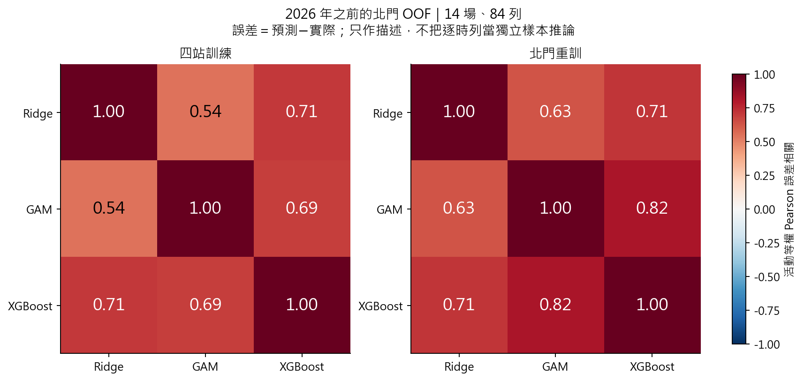
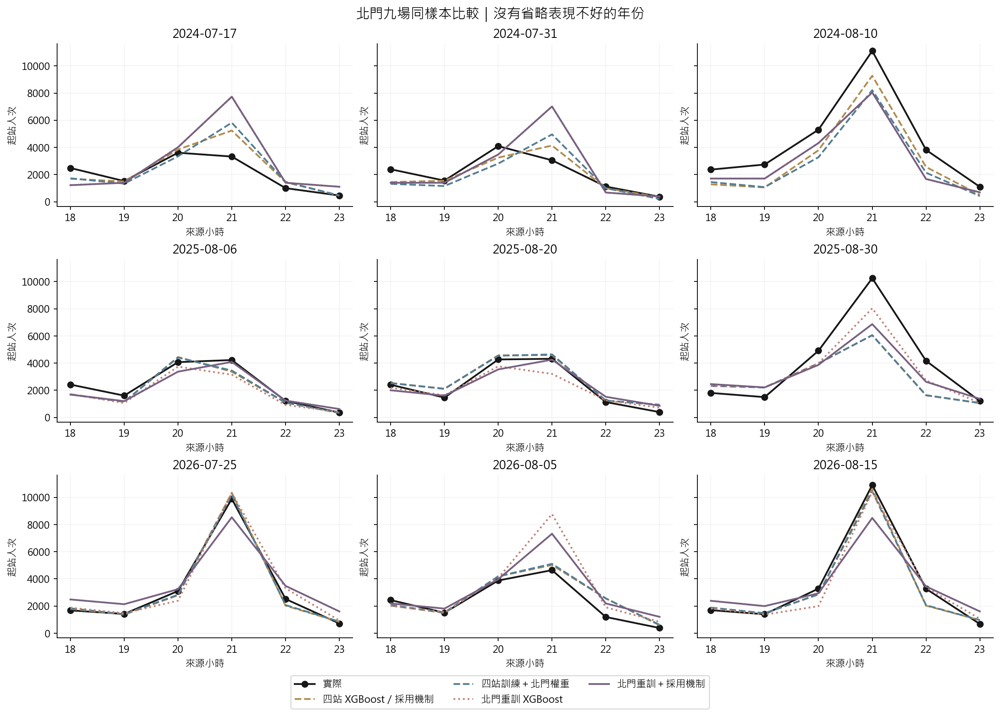

# 第十版：誤差互補、融合採用機制與北門專用模型

**只用北門學權重，融合 MAE 由 787.27 降至 724.65（改善 8.0%）。北門重訓 XGBoost 為 813.60，四站訓練 XGBoost 為 642.59。**

研究分成兩個實驗：①固定四站基模型，只改融合權重的學習對象；②連基模型都只用北門重新訓練。兩者再各加入由過去驗證決定是否採用融合的機制。主要輸入維持煙火＋天氣。

## 1. 比較條件

- 同 21 場可用活動；四站基模型輸入 504 列，北門專用模型 126 列。活動數沒有增加，站時列不是獨立場次。
- 同一批 2024–2026 年九場測試，全部方法只評北門 18–23 時的 54 列。目標為起站人次，不是月台瞬間人數。
- 北門模型沿用相同候選資訊、90 組 XGBoost 網格、Ridge/GAM 網格、訓練期補值與支持門檻，各自在過去年度內重新調參。原 Trainer 也計算 OLS/Lasso，但本版僅比較指定三模型。
- 單站資料的站別常數、站別×時段退化項與其他站的結束訊號常數，由原訓練期編碼器移除；保留小時及北門的預定展演結束訊號。不是硬塞全零交互項。
- 新增輸入仍限 D−1 18:00 可核對的公告／預報；歷史 OD 標籤發布時間及日曆版本未完全核實，仍屬 retrospective_non_deployable。

## 2. 同九場北門結果

| 方法 | MAE | RMSE | 尖峰正向低估 | 尖峰絕對誤差 | 尖峰小時差 |
|---|---|---|---|---|---|
| 四站訓練 Ridge | 1,117.39 | 1,966.79 | 3,147.70 | 3,147.70 | 0.22 |
| 四站訓練 GAM | 1,108.64 | 1,557.02 | 2,006.01 | 2,652.86 | 0.22 |
| 四站訓練 XGBoost | 642.59 | 982.09 | 889.81 | 1,037.16 | 0.33 |
| 四站訓練＋等權融合 | 875.62 | 1,363.62 | 1,926.54 | 2,103.30 | 0.22 |
| 四站訓練＋四站學權重 | 787.27 | 1,168.11 | 1,338.54 | 1,485.88 | 0.33 |
| 四站訓練＋北門學權重 | 724.65 | 1,103.49 | 1,094.52 | 1,214.31 | 0.33 |
| 四站權重＋採用機制 | 642.59 | 982.09 | 889.81 | 1,037.16 | 0.33 |
| 北門權重＋採用機制 | 642.59 | 982.09 | 889.81 | 1,037.16 | 0.33 |
| 北門重訓 Ridge | 1,117.97 | 1,839.16 | 2,790.91 | 2,816.54 | 0.22 |
| 北門重訓 GAM | 1,190.57 | 1,507.04 | 1,468.92 | 2,063.30 | 0.22 |
| 北門重訓 XGBoost | 813.60 | 1,288.15 | 952.94 | 1,505.83 | 0.44 |
| 北門重訓＋等權融合 | 941.23 | 1,338.19 | 1,624.99 | 1,903.35 | 0.22 |
| 北門重訓＋北門融合 | 876.12 | 1,277.55 | 1,396.62 | 1,694.45 | 0.22 |
| 北門重訓＋採用機制 | 903.98 | 1,328.37 | 1,226.61 | 1,569.26 | 0.22 |

尖峰正向低估是在每場實際最高小時算 max(實際−同小時預測,0)，高估記 0；因此另報絕對誤差。RMSE 是活動 MSE 平均後開根號。各場先平均六小時，再活動等權。

## 3. 模型錯誤有沒有互補？

下面固定展示 2026 年之前的 14 場、84 列北門 OOF；每個基模型預測該年時都只使用更早資料。2024／2025 年截止及外層事後描述另外存表；不把不同外層中重複的 OOF 活動混合計算。

| 訓練範圍 | 模型 A | 模型 B | 誤差相關 | 去除場均誤差後相關 | 一高估一低估比例 |
|---|---|---|---|---|---|
| 北門重訓 | ridge | gam | 0.63 | 0.57 | 20.2% |
| 北門重訓 | ridge | xgboost | 0.71 | 0.65 | 25.0% |
| 北門重訓 | gam | xgboost | 0.82 | 0.81 | 23.8% |
| 四站訓練 | ridge | gam | 0.54 | 0.61 | 23.8% |
| 四站訓練 | ridge | xgboost | 0.71 | 0.77 | 22.6% |
| 四站訓練 | gam | xgboost | 0.69 | 0.62 | 20.2% |

相關不等於融合效益。除了方向，還要看誤差幅度。下表額外檢查 XGBoost 低估時，其他模型是否更接近真值，以及兩模型各半是否改善；這是過去誤差診斷，不以每列真值挑未來模型。

| 訓練範圍 | 搭配模型 | XGB 低估列數 | 搭配模型更準比例 | 各半混合更準比例 | 全 OOF 各半 MAE−XGB |
|---|---|---|---|---|---|
| 北門重訓 | ridge | 39 | 43.6% | 64.1% | 1.55 |
| 北門重訓 | gam | 39 | 41.0% | 51.3% | -16.12 |
| 四站訓練 | ridge | 41 | 46.3% | 51.2% | 176.61 |
| 四站訓練 | gam | 41 | 43.9% | 53.7% | 52.37 |

上述條件比例先給活動等權，再條件化於 XGBoost 低估列；正負誤差乘積小於 0 才算方向相反，誤差為 0 不算。最後一欄正數代表各半混合較差。沒有假定 84 列獨立，也未提供不適當的相關顯著性檢定。

## 4. 融合採用機制怎麼決定？

1. 對外層年度 Y，只收 Y 以前的時間 OOF。
2. 再按 OOF 年度向前切：至少四場更早 OOF 才能學權重，預測較晚完整年度。
3. 僅用北門比較這些較晚年度的活動等權 MAE；至少三場、涵蓋一個年度才作採用判斷。融合嚴格較低才採用，平手或不足時選 XGBoost。沒有搜尋門檻。
4. 決策固定後，以全部過去 OOF 重估最終權重，再預測外層年度。權重擬合成績沒有拿來代替融合採用的驗證成績。

四場／三場／一年度是本次事前固定的實作門檻，並非文獻保證足夠的樣本量。2024 年只有 2021、2022 年共兩場 OOF 可用於驗證 2023，未達四場，所以沒有合格的額外驗證，沿用 XGBoost。2025 年採用判斷有三場，2026 年有六場，證據仍少。

| 版本 | 預測年度 | 採用 | 驗證場數 | 驗證 XGB MAE | 驗證融合 MAE |
|---|---|---|---|---|---|
| 四站權重 | 2024 | xgboost | 0 | 不足 | 不足 |
| 北門權重 | 2024 | xgboost | 0 | 不足 | 不足 |
| 北門重訓 | 2024 | xgboost | 0 | 不足 | 不足 |
| 四站權重 | 2025 | xgboost | 3 | 800.19 | 1,135.39 |
| 北門權重 | 2025 | xgboost | 3 | 800.19 | 1,053.40 |
| 北門重訓 | 2025 | fusion | 3 | 1,205.74 | 1,122.17 |
| 四站權重 | 2026 | xgboost | 6 | 779.03 | 939.74 |
| 北門權重 | 2026 | xgboost | 6 | 779.03 | 900.91 |
| 北門重訓 | 2026 | fusion | 6 | 920.53 | 893.24 |

這張表為過去的採用驗證成績，不是第 2 節外層成績。原四站模型的兩個機制都採 XGBoost，所以最後成績等於 XGBoost，不能說是『融合超越 XGBoost』。北門重訓的機制在 2025、2026 年採融合，但九場合併 MAE 反而高於該版單獨 XGBoost；選擇機制也可能泛化失敗，保留這個反例。

### 最終過去 OOF 權重（若採融合時使用）

| 版本 | 年度 | ridge | gam | xgboost |
|---|---|---|---|---|
| 四站權重 | 2024 | 0.00% | 51.29% | 48.71% |
| 北門權重 | 2024 | 0.00% | 39.68% | 60.32% |
| 北門重訓 | 2024 | 27.69% | 23.72% | 48.59% |
| 四站權重 | 2025 | 0.00% | 4.60% | 95.40% |
| 北門權重 | 2025 | 0.00% | 3.15% | 96.85% |
| 北門重訓 | 2025 | 28.24% | 24.54% | 47.22% |
| 四站權重 | 2026 | 0.00% | 31.99% | 68.01% |
| 北門權重 | 2026 | 0.00% | 4.60% | 95.40% |
| 北門重訓 | 2026 | 23.28% | 25.54% | 51.18% |

## 5. 年度與逐場比較

| 年度 | 方法 | MAE | RMSE |
|---|---|---|---|
| 2024 | 四站訓練 XGBoost | 800.19 | 1,025.19 |
| 2024 | 四站訓練＋四站學權重 | 1,135.39 | 1,461.64 |
| 2024 | 四站訓練＋北門學權重 | 1,053.40 | 1,355.58 |
| 2024 | 北門權重＋採用機制 | 800.19 | 1,025.19 |
| 2024 | 北門重訓 XGBoost | 1,205.74 | 1,757.70 |
| 2024 | 北門重訓＋北門融合 | 1,122.17 | 1,640.81 |
| 2024 | 北門重訓＋採用機制 | 1,205.74 | 1,757.70 |
| 2025 | 四站訓練 XGBoost | 757.87 | 1,255.82 |
| 2025 | 四站訓練＋四站學權重 | 744.09 | 1,241.72 |
| 2025 | 四站訓練＋北門學權重 | 748.43 | 1,246.05 |
| 2025 | 北門權重＋採用機制 | 757.87 | 1,255.82 |
| 2025 | 北門重訓 XGBoost | 635.32 | 834.05 |
| 2025 | 北門重訓＋北門融合 | 664.30 | 1,006.43 |
| 2025 | 北門重訓＋採用機制 | 664.30 | 1,006.43 |
| 2026 | 四站訓練 XGBoost | 369.71 | 515.15 |
| 2026 | 四站訓練＋四站學權重 | 482.33 | 644.32 |
| 2026 | 四站訓練＋北門學權重 | 372.12 | 512.65 |
| 2026 | 北門權重＋採用機制 | 369.71 | 515.15 |
| 2026 | 北門重訓 XGBoost | 599.75 | 1,092.18 |
| 2026 | 北門重訓＋北門融合 | 841.89 | 1,091.44 |
| 2026 | 北門重訓＋採用機制 | 841.89 | 1,091.44 |

### 其他輸入組的補充檢查

| 輸入 | 四站 XGBoost | 四站權重 | 北門權重 | 北門權重＋採用機制 |
|---|---|---|---|---|
| 基本 | 504.20 | 609.26 | 503.38 | 504.20 |
| 煙火 | 553.75 | 611.70 | 594.03 | 553.75 |
| 天氣 | 690.79 | 761.22 | 706.47 | 690.79 |
| 煙火＋天氣 | 642.59 | 787.27 | 724.65 | 642.59 |

上表均為同九場北門 MAE，只重估四站基模型的權重及採用機制；完整北門重訓限於主要煙火＋天氣組。沒有按這張外層表重新挑特徵組合。

## 6. 建議與限制

- 目前保留四站訓練的 XGBoost 為主要候選。只聚焦北門學融合權重，能降低原融合的誤差，但仍未優於此基準。
- 僅用北門重訓沒有更準。資料列變少、失去跨站資訊及訓練後的設計／最佳參數改變，都是可能原因；這次實驗不能把差異唯一歸因於某一項。相同 XGBoost 葉節點列數門檻，在單站資料下也可能對應不同的活動支持。
- 採用機制是可重現的事前程序，不保證每次不輸。不要看外層結果後改門檻或指定某年採融合。
- 九場測試已反覆檢視，本版為探索性方法比較；需要新的活動作最後驗證，沒有重新宣稱獨立的泛化保證。
- 現在仍是逐時起站人次預測；排隊／調度須另補方向、分鐘到達形狀、步行延遲、班距與剩餘容量。

## 7. 文獻與重現

- [Breiman（1996）, Stacked Regressions](https://statistics.berkeley.edu/sites/default/files/tech-reports/367.pdf)：OOF 預測的非負融合；本次 MAE、活動等權及北門採用門檻是另外明定的設計。
- [Cawley & Talbot（2010）, On Over-fitting in Model Selection and Subsequent Selection Bias in Performance Evaluation](https://jmlr.org/papers/v11/cawley10a.html)：模型選擇準則也可能過度擬合，因此採用決策與外層評分分開。
- [Hyndman & Athanasopoulos, FPP3 §5.10](https://otexts.com/fpp3/toolbox.html#time-series-cross-validation)：時間向前驗證只能使用過去資料。沒有文獻保證本案的三模型、四場或三場門檻最適。

重跑：`python -X utf8 src/run_analysis_v10.py`；若北門專用模型已完成且來源／程式雜湊相同，可加 `--reuse-local`。需要第八版私有快照。公開表格在 `tables/`，私有逐筆預測與模型在根目錄 `.local/analysis_v10/`。詳細方法見 [process.md 第 21 節](../../process.md#21-第十版誤差互補融合採用與北門專用重訓)。

驗證：`python -X utf8 src/verify_analysis_v10.py`，重新載入六個年度模型組核對預測，獨立建立 54 個線性規劃、重算 27 個採用決策與 38 列摘要；[檢核紀錄](independent_validation.json) 記錄差值及雜湊。22 項新增單元測試涵蓋時間洩漏、採用機制失敗案例、條件互補率及尖峰定義。
