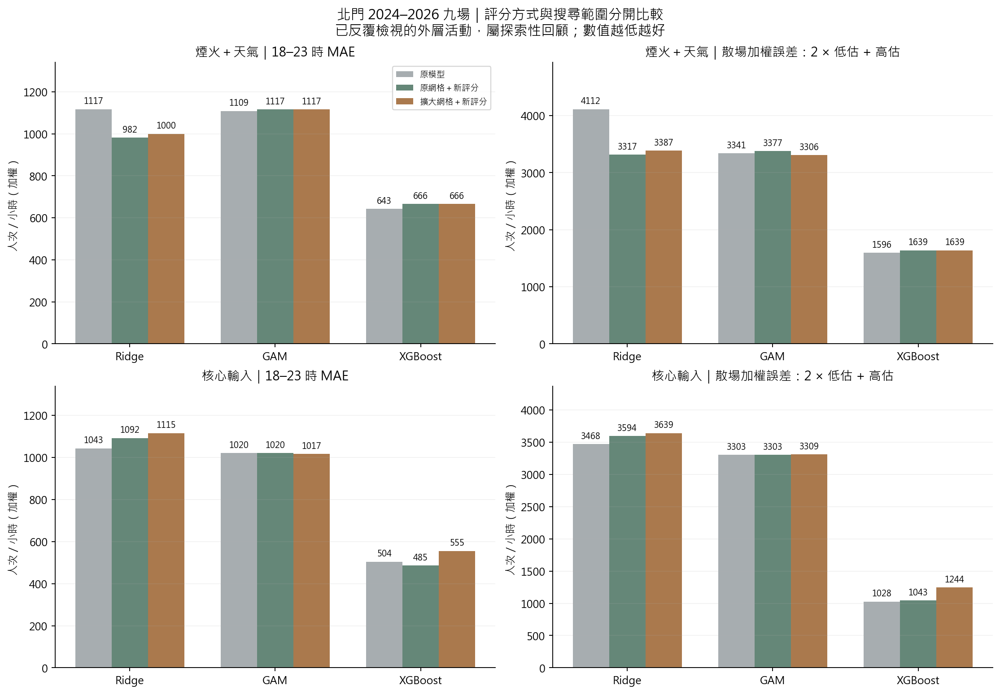
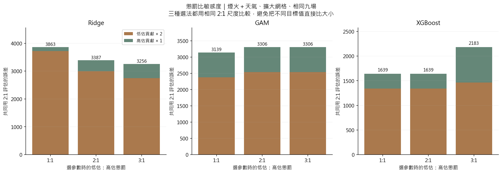
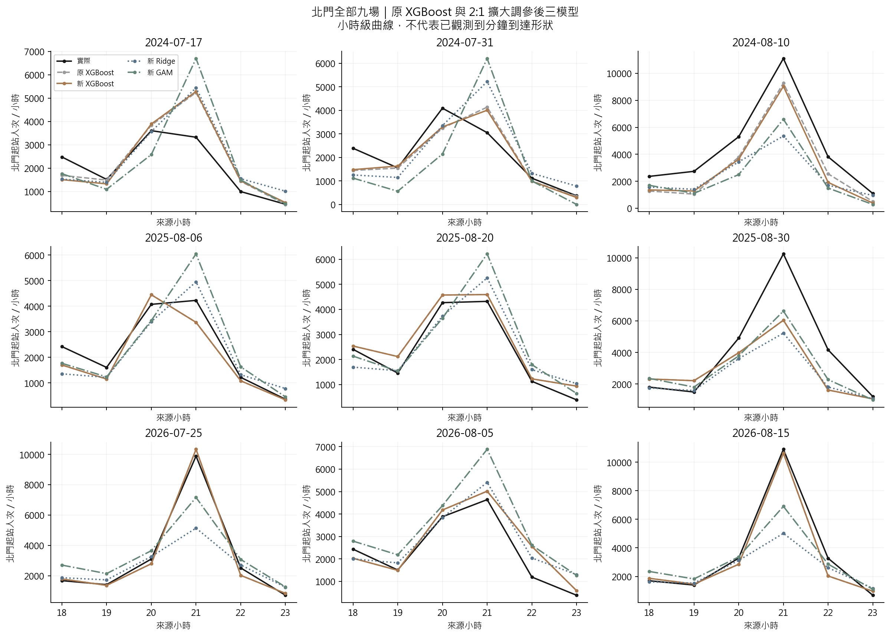

# 第十一版：散場優先調參與分鐘到站資料依據

日期：2026-10-13。研究比較已完成；本報告的改善只指同一批回顧式九場，不是新活動驗證。

## 1. 先看結果

**Ridge 的低估下降，但 XGBoost 未改善；GAM 改變很小。擴大搜尋不是這次 Ridge 進步的主要原因。**

主分析固定「煙火＋天氣」，仍使用四站訓練，只用北門預定展演結束後兩小時的加權誤差挑參數。下表 old 為舊模型；original 為原網格、新評分；expanded 為擴大網格、新評分。

| method | mae | rmse | cost_2 | window_under | window_over | peak_under | peak_abs |
|---|---|---|---|---|---|---|---|
| old_ridge | 1,117.39 | 1,966.79 | 4,112.39 | 1,993.02 | 126.36 | 3,147.70 | 3,147.70 |
| original_r2_ridge | 982.30 | 1,647.52 | 3,317.20 | 1,463.01 | 391.18 | 2,446.51 | 2,911.30 |
| expanded_r2_ridge | 1,000.13 | 1,690.66 | 3,386.89 | 1,495.71 | 395.46 | 2,463.94 | 2,734.22 |
| old_gam | 1,108.64 | 1,557.02 | 3,341.43 | 1,293.57 | 754.29 | 2,006.01 | 2,652.86 |
| original_r2_gam | 1,116.78 | 1,565.37 | 3,376.79 | 1,309.21 | 758.37 | 2,053.86 | 2,667.22 |
| expanded_r2_gam | 1,116.66 | 1,551.78 | 3,306.29 | 1,268.86 | 768.56 | 1,980.38 | 2,641.73 |
| old_xgboost | 642.59 | 982.09 | 1,595.61 | 647.37 | 300.88 | 889.81 | 1,037.16 |
| original_r2_xgboost | 666.07 | 1,008.72 | 1,639.36 | 670.18 | 299.01 | 910.34 | 1,063.58 |
| expanded_r2_xgboost | 666.07 | 1,008.72 | 1,639.36 | 670.18 | 299.01 | 910.34 | 1,063.58 |

- Ridge：MAE 1117.39 → 1000.13（下降 10.5%），散場 2:1 誤差 4112.39 → 3386.89（下降 17.6%）。散場低估由 1993.02 降至 1495.71，但高估由 126.36 增至 395.46。

- 原網格只改評分的 Ridge 已達 MAE 982.30、2:1 誤差 3317.20；擴大網格反而略退步，不能把改善歸功於搜尋更多參數。

- GAM：MAE 1108.64 → 1116.66；2:1 誤差 3341.43 → 3306.29（下降約 1.1%），沒有實質解決尖峰問題。

- XGBoost：MAE 642.59 → 666.07；2:1 誤差 1595.61 → 1639.36（增加約 2.7%）。原網格與擴大網格在 2:1 選到相同設定，新增 90 組沒有勝出。

- 因此保留原四站 XGBoost 作主要候選；本次結果不支持用新調參版取代它。沒有重新估融合權重，也沒有修改網站使用的模型。

## 2. 怎麼調參

1. 固定 D−1 候選資訊、四站訓練與時間切分；core／both 分開報告，不用外層真值選輸入版本。
2. 每個驗證年度只用更早年度訓練；整場活動、同年所有活動留在同一側。
3. 每組參數產生過去北門的時間留出預測。依預定展演結束後 0–120 分鐘與來源小時的重疊比例評分，先場內加權再活動等權。
4. 主評分為 2×低估＋1×高估；另以 1:1、3:1 各自重新選參數。
5. 每個外層年度只用該年以前的留出誤差選參數，再用該年前全部四站資料重訓，預測該年。
6. 三種懲罰比都報 MAE、RMSE、相同 2:1 尺度、低估／高估及實際尖峰同時刻誤差。

| 模型 | 搜尋範圍 | 用途 |
|---|---|---|
| Ridge | 25 個 λ，10⁻⁴ 至 10² | 控制係數收縮；過小可能不穩定，過大可能欠擬合 |
| GAM | 基底 4／5／7 × 平滑懲罰 5 組 × 全係數懲罰 4 組，共 60 組 | 同時調曲線彈性與穩定性；保留原訓練支持度檢查 |
| XGBoost | 原 90 組＋固定種子抽取 90 組，共 180 組 | 聯合比較深度、樹數、學習率、葉門檻、抽樣與正則化 |

**這次改的是驗證選參數的目標。** 三模型訓練仍用原本平方損失與正則化，沒有改成分量迴歸、沒有直接把預測乘 2。故 2:1 不保證每一場的預測都上升，也不能宣稱已估出 2/3 分位數。2 倍是使用者指定的研究偏好，還不是實測調度成本；高估的 1 倍懲罰也不是班次或高估的硬上限。

完整網格、公式、日期缺漏與重現見 [process.md 第 22 節](../../process.md#22-第十一版散場優先調參與分鐘資料依據)。設定清單：[config](../../configs/analysis_v11.json)。

## 3. 年度選出的參數（擴大網格、2:1）

### both

| 年度 | 模型 | 過去驗證場次 | 設定 |
|---|---|---|---|
| 2024 | GAM | 10 | lambda=0.1; ridge_alpha=0.001; n_splines=5 |
| 2024 | Ridge | 10 | lambda=0.316228 |
| 2024 | XGBoost | 10 | learning_rate=0.05; min_child_weight=1; reg_lambda=1; subsample=1; colsample_bytree=1; max_depth=4; n_estimators=250; reg_alpha=0 |
| 2025 | GAM | 13 | lambda=1000; ridge_alpha=0.001; n_splines=4 |
| 2025 | Ridge | 13 | lambda=0.316228 |
| 2025 | XGBoost | 13 | learning_rate=0.05; min_child_weight=1; reg_lambda=1; subsample=1; colsample_bytree=1; max_depth=5; n_estimators=250; reg_alpha=0 |
| 2026 | GAM | 16 | lambda=1000; ridge_alpha=0.001; n_splines=4 |
| 2026 | Ridge | 16 | lambda=0.316228 |
| 2026 | XGBoost | 16 | learning_rate=0.05; min_child_weight=1; reg_lambda=1; subsample=1; colsample_bytree=1; max_depth=5; n_estimators=250; reg_alpha=0 |

### core

| 年度 | 模型 | 過去驗證場次 | 設定 |
|---|---|---|---|
| 2024 | GAM | 10 | lambda=0.1; ridge_alpha=0.001; n_splines=5 |
| 2024 | Ridge | 10 | lambda=0.000177828 |
| 2024 | XGBoost | 10 | max_depth=3; n_estimators=250; learning_rate=0.1; min_child_weight=1; reg_lambda=1; subsample=1; colsample_bytree=1; reg_alpha=0 |
| 2025 | GAM | 13 | lambda=0.1; ridge_alpha=0.001; n_splines=5 |
| 2025 | Ridge | 13 | lambda=0.177828 |
| 2025 | XGBoost | 13 | learning_rate=0.05; min_child_weight=1; reg_lambda=1; subsample=1; colsample_bytree=1; max_depth=4; n_estimators=250; reg_alpha=0 |
| 2026 | GAM | 16 | lambda=0.1; ridge_alpha=0.001; n_splines=7 |
| 2026 | Ridge | 16 | lambda=0.177828 |
| 2026 | XGBoost | 16 | learning_rate=0.05; min_child_weight=1; reg_lambda=1; subsample=1; colsample_bytree=1; max_depth=4; n_estimators=250; reg_alpha=0 |

參數可以跨年不同，因為可用的過去驗證場次增加；不能從哪個年度剛好好看反向改選參數。

## 4. 1:1、2:1、3:1 敏感度

| method | mae | rmse | cost_2 | window_under | window_over | peak_under | peak_abs |
|---|---|---|---|---|---|---|---|
| expanded_r1_ridge | 1,067.53 | 1,888.47 | 3,863.47 | 1,861.48 | 140.51 | 2,967.25 | 2,993.18 |
| expanded_r2_ridge | 1,000.13 | 1,690.66 | 3,386.89 | 1,495.71 | 395.46 | 2,463.94 | 2,734.22 |
| expanded_r3_ridge | 984.28 | 1,621.86 | 3,256.23 | 1,374.30 | 507.62 | 2,280.33 | 2,667.81 |
| expanded_r1_gam | 1,016.42 | 1,529.79 | 3,138.57 | 1,189.36 | 759.85 | 1,951.26 | 2,598.29 |
| expanded_r2_gam | 1,116.66 | 1,551.78 | 3,306.29 | 1,268.86 | 768.56 | 1,980.38 | 2,641.73 |
| expanded_r3_gam | 1,116.66 | 1,551.78 | 3,306.29 | 1,268.86 | 768.56 | 1,980.38 | 2,641.73 |
| expanded_r1_xgboost | 666.07 | 1,008.72 | 1,639.36 | 670.18 | 299.01 | 910.34 | 1,063.58 |
| expanded_r2_xgboost | 666.07 | 1,008.72 | 1,639.36 | 670.18 | 299.01 | 910.34 | 1,063.58 |
| expanded_r3_xgboost | 828.67 | 1,341.29 | 2,182.83 | 731.98 | 718.87 | 1,012.59 | 1,459.47 |

GAM 的 2:1 與 3:1 結果相同；XGBoost 的 1:1 與 2:1 相同。3:1 的 XGBoost 在九場反而惡化，顯示加重懲罰並不等於跨年穩定改善，不能把主設定事後換成最好看的懲罰比。

## 5. 核心輸入對照與完整逐場曲線

| method | mae | rmse | cost_2 | window_under | window_over | peak_under | peak_abs |
|---|---|---|---|---|---|---|---|
| old_ridge | 1,042.77 | 1,706.47 | 3,467.54 | 1,624.08 | 219.38 | 2,500.19 | 2,664.05 |
| original_r2_ridge | 1,091.62 | 1,657.07 | 3,593.94 | 1,465.24 | 663.47 | 2,249.09 | 2,724.52 |
| expanded_r2_ridge | 1,114.92 | 1,723.37 | 3,638.63 | 1,523.04 | 592.56 | 2,440.87 | 2,790.80 |
| old_gam | 1,020.46 | 1,532.79 | 3,303.03 | 1,299.02 | 704.99 | 1,986.14 | 2,569.79 |
| original_r2_gam | 1,020.46 | 1,532.79 | 3,303.03 | 1,299.02 | 704.99 | 1,986.14 | 2,569.79 |
| expanded_r2_gam | 1,016.85 | 1,534.27 | 3,308.98 | 1,304.00 | 700.97 | 1,993.20 | 2,574.90 |
| old_xgboost | 504.20 | 696.87 | 1,027.67 | 371.40 | 284.88 | 479.12 | 660.57 |
| original_r2_xgboost | 485.43 | 663.78 | 1,042.57 | 413.51 | 215.56 | 513.24 | 572.34 |
| expanded_r2_xgboost | 555.12 | 840.27 | 1,244.25 | 438.93 | 366.40 | 577.74 | 635.44 |

核心輸入 XGBoost：原 MAE 504.20，原網格＋新評分 485.43，擴大網格＋新評分 555.12。較低 MAE 不一定有較小散場低估；三者 2:1 誤差依序為 1027.67、1042.57、1244.25。沒有用此外層結果自動切換輸入版本。

## 6. 排隊理論：分鐘型態不能從逐時人次直接辨認

現有資料可預測一小時有多少起站人次，但無法分辨這些人平均到站或集中在某十分鐘。已找到特殊活動的五分鐘實測研究、臺灣捷運十五分鐘實測圖，以及北捷 API 申請管道；尚未找到可直接下載的大稻埕活動日北門歷史一／五分鐘進站計數。

下一步優先取得北門彙總刷卡計數、管制時段、列車時刻與剩餘容量；在取得前只能比較均勻／寬峰／集中峰情境，不能標成已估計的真實到達分布。完整來源、資料需求與銜接公式見 [分鐘到站依據](../../docs/minute_arrivals_evidence.md)。

## 7. 資料性質與檢核

- 21 場、四站、18–23 時，共 504 列是整體來源；每折只訓練較早年份。共同外層為 2024–2026 各三場，九場、北門 54 列。不是 504 個獨立活動。

- 預定結束未知三場：2018-08-18、2023-07-05、2023-08-09，採六小時等權備援；2018 不進參數驗證，故各年度過去評分有兩場備援。九場外層都已知預定結束。

- 重疊比例只對整小時的預測誤差加權，沒有將觀測人次裁切成已知散場分鐘人數。若想要真正的兩小時散場人次，仍需要更細時間資料。

- 新增事後變數為零；D−1 發布時間限制仍沿用：OD 發布時間、日曆版本沒有完全核實，標記 retrospective_non_deployable。九場已被反覆查看，這輪屬探索性，不能聲稱是全新獨立測試。

- [獨立驗證](independent_validation.json)：4,240 次候選擬合、48 個年度折、108 次選參數、56 個不同模型重載、546 列指標重算，數值核對通過；全專案 332 項測試通過（新增 16 項）。這是程式正確性檢查，不是泛化保證。

完整數據：[整體](tables/summary.csv)／[年度](tables/annual.csv)／[逐場](tables/events.csv)／[參數與所有候選分數](selections.json)。

## 8. 參考依據

- [Gneiting（2011）, Making and Evaluating Point Forecasts](https://arxiv.org/abs/0912.0902)：損失函數應與預測目的相符；本案 2:1 數值與散場權重是研究設定。

- [Bergstra & Bengio（2012）, Random Search for Hyper-Parameter Optimization](https://jmlr.org/papers/v13/bergstra12a.html)：有限預算的隨機搜尋依據；本次固定抽取 90 組，不保證全域最優。

- [Cawley & Talbot（2010）](https://jmlr.org/papers/v11/cawley10a.html)：驗證準則本身也可能過擬合；擴大搜尋後外層惡化並不矛盾。

- [FPP3：時間序列交叉驗證](https://otexts.com/fpp3/toolbox.html#time-series-cross-validation)：以過去預測未來的評估方式。

- [Ridge 官方參數](https://scikit-learn.org/stable/modules/generated/sklearn.linear_model.Ridge.html)、[XGBoost 官方參數](https://xgboost.readthedocs.io/en/stable/parameter.html)。GAM 延續第七版經檢核的全係數懲罰設計，僅新增基底數候選。

- 分鐘到站的官方來源與 Santanam 等（2021）文獻另見 [資料依據文件](../../docs/minute_arrivals_evidence.md)。
