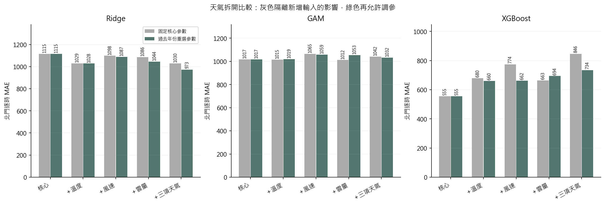
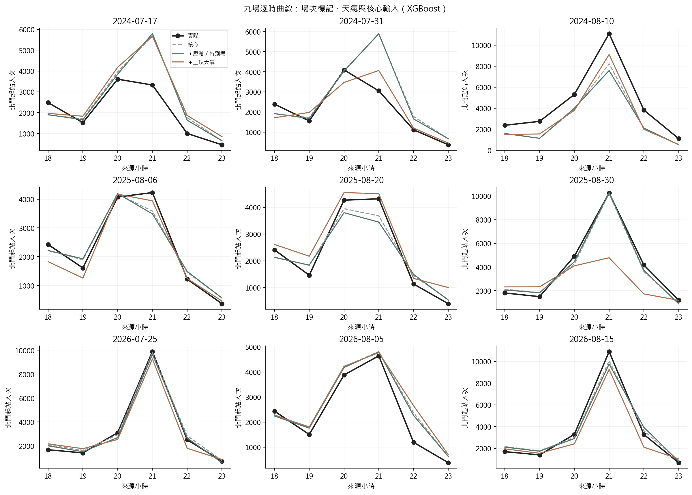
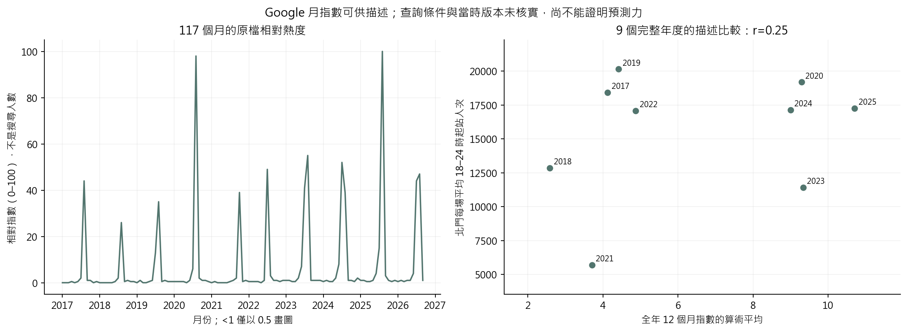
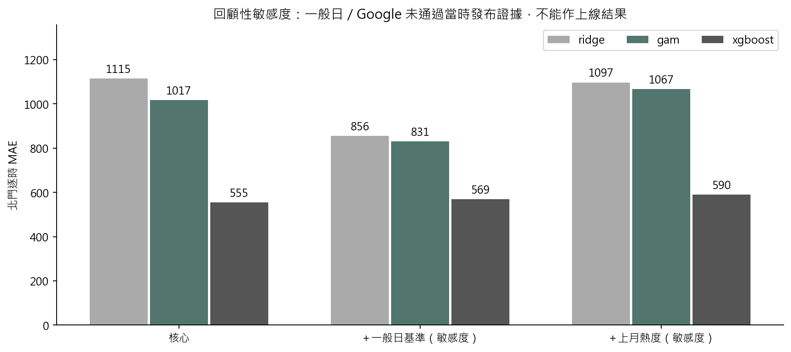

# 第十二版：場次定位、Google 熱度、一般日基準與天氣拆分

日期：2026-10-13。這一輪已實際重跑三個模型；不是只有列出建議。

**本輪判讀：**

1. 壓軸／特別場已補入，但 XGBoost MAE 由核心 555.12 變成 573.53，整體沒有改善。Ridge 有小幅改善，不能推論所有模型都無法利用場次資訊。
2. 三項天氣各自加入的 XGBoost MAE 為溫度 659.55、風速 661.76、雲量 693.86，一起為 734.01，均高於核心。2025/8/30 的尖峰低估在溫度與風速單項就出現，雲量單項沒有同樣大幅低估；仍須兼看其他八場。
3. 一般日基準固定參數時降至 473.91，重選參數卻為 568.98。有後續研究價值，但改善不穩定且歷史發布時間未核實。
4. 前月 Google 熱度敏感度為 589.81，沒有改善核心；年度資料可供描述，不能用同月／全年事後熱度預測當次活動。

目前保留較簡單的核心 XGBoost 作對照，優先補一般日的可得性證據、逐日事前熱度及不同日期／類型的活動樣本，再以新的未見活動驗證。這一輪未變更部署。

此處核心 555.12 是 V11 的 2:1 調參版；舊 V8 核心用 MAE 選參數的結果為 504.20。兩個數字對應不同調參規則，本輪以同規則控制做比較。

## 1. 一樣的資料與比較規則

- 21 場 × 四站 × 18–23 時，共 504 列。外層仍為 2024–2026 年九場北門、54 列，活動與年份不拆散。
- 核心輸入是車站、時段、車站×時段、週末、年內日序、年度趨勢、已公告結束後 0–60／60–120 分鐘×車站。
- 11 組輸入全部保留；前九組研究有事前來源的新增欄位，後兩組只作發布未核實的敏感度。沒有用外層最小 MAE 自動選變數或更換上線模型。
- 每組分「固定 V11 核心參數」與「重新選參數」。重選沿用 V11 的 Ridge 25、GAM 60、XGBoost 180 組；每年只看先前年份的北門時間留出預測，依散場低估 2 倍、高估 1 倍選擇。訓練損失仍是平方誤差與原懲罰。
- 這九場已反覆檢視，屬探索性回顧。歷史 OD 標籤發布時間與日曆版本仍有缺口，不能宣稱全流程已完成 D−1 上線驗證。

## 2. 重跑結果

單位：人次／小時，越小越好。下表是各組重新選參數的 MAE。

| 加入的資訊 | GAM MAE | Ridge MAE | XGBoost MAE |
|---|---|---|---|
| 核心 | 1,016.85 | 1,114.92 | 555.12 |
| ＋壓軸 | 1,007.99 | 1,058.83 | 576.71 |
| ＋壓軸／特別場 | 1,014.37 | 1,079.21 | 573.53 |
| ＋溫度 | 1,019.39 | 1,027.92 | 659.55 |
| ＋風速 | 1,058.55 | 1,087.47 | 661.76 |
| ＋雲量 | 1,053.48 | 1,043.92 | 693.86 |
| ＋三項天氣 | 1,031.77 | 973.22 | 734.01 |
| ＋煙火／三項天氣 | 1,116.66 | 1,000.13 | 666.07 |
| ＋場次／三項天氣 | 1,018.02 | 948.38 | 725.78 |
| ＋一般日基準（敏感度） | 830.71 | 856.22 | 568.98 |
| ＋上月熱度（敏感度） | 1,067.26 | 1,096.93 | 589.81 |




所有組別的 RMSE、正向低估、尖峰絕對誤差、時點誤差、散場 2:1 誤差，見 [總表](tables/summary.csv)、[逐年](tables/annual.csv)、[逐場](tables/events.csv)。[每年度選定參數](selections.json)保留全部內層候選分數。

## 3. 壓軸和特別場：有公告才編碼

- 新增 `planned_finale`：官方完整安排中的系列最終／壓軸煙火場。不是把資料中每年的最後一筆標 1，也不是把歌手壓軸當活動壓軸。
- 另加 `planned_enhanced_nonfinale`：非壓軸，但公告另加碼／升級的煙火場。2026/7/25 是開幕特別展演，與 8/15 壓軸分開；2023/8/16、2025/8/20 是公告併入取消場次的加碼場。
- 21 場中，壓軸旗標有 16 場可編碼（其中 5 場為 1）；非壓軸加碼旗標有 15 場可編碼（其中 3 場為 1）。舊年度未核實者保留未知，不能當普通場。
- 2023/8/9 的加碼公告目前版本於前一天 18:04 更新，晚於 18:00 截止，因此加碼旗標保持未知；壓軸定位可用更早完整排程判定。
- [來源帳本](../../docs/d1_event_type_sources.json)保存逐場網址、保守可得時間、理由與來源文字雜湊；[編碼表](tables/event_types.csv)可查每場。當前網頁發布／更新欄不是當年網頁封存；不能聲稱已驗證歷史版本完全一致。
- 類型僅有少數正例，且與週末、時長、年份相依。它提供活動定位，不是新增大量獨立樣本，也不能從係數推論壓軸的因果效果。
- 檢查 2024／2025／2026 外層訓練前的已核實場次，分別為 7／10／13 場，壓軸旗標都與週末完全相同。2026/7/25 才在外層出現「週末但非壓軸」的反例。因此過去資料幾乎無法分辨週末與壓軸的獨立作用；缺值補值後的矩陣即使滿秩，也不代表這個實質混淆已解決。

## 4. 2025/8/30 21 時：實際 10,251 人次

| 輸入 | 固定核心參數 | 過去年度重選參數 | 重選後誤差（預測−10,251） |
|---|---|---|---|
| 核心 | 10,202.63 | 10,202.63 | -48.37 |
| ＋壓軸 | 10,220.82 | 10,220.82 | -30.18 |
| ＋壓軸／特別場 | 10,293.49 | 10,293.49 | 42.49 |
| ＋溫度 | 7,145.79 | 7,145.79 | -3,105.21 |
| ＋風速 | 7,208.64 | 7,208.64 | -3,042.36 |
| ＋雲量 | 10,342.62 | 10,485.73 | 234.73 |
| ＋三項天氣 | 4,784.04 | 4,784.04 | -5,466.96 |
| ＋煙火／三項天氣 | 4,961.29 | 6,045.88 | -4,205.12 |
| ＋場次／三項天氣 | 4,995.18 | 4,995.18 | -5,255.82 |

這張表同時保留固定參數結果，避免把「加入風速」的影響和「改選另一套參數」混在一起。各單項變化不具可加性，三項天氣一起加入的結果不等於三個單項誤差加總。小樣本、特徵相關與 0.25° 預報網格都可能影響泛化；這不是天氣對人流的因果估計。



## 5. 你已有的 Google 資料可以怎麼分析

- 已讀取原 CSV：CP950、117 個月份，2017/1–2026/9，欄位是月份及 0–100 相對熱度；不是絕對搜尋次數。
- 檔案本身缺關鍵字、地區、查詢類別、查詢區間、下載時間與歷史版本，不能只因放在同一個 CSV 就視為已驗證同尺度。
- `<1` 保留區間 [0,1)，描述圖暫以 0.5 表示。下表「低／高值界」是這個截尾記號的取值界，不是信賴區間。零指數也不等於完全沒有人搜尋。
- 將每年 12 個月指數作算術平均，再對照該年已納入活動的北門六小時人次平均；不是把一年熱度複製成每一列獨立樣本。2026 只有九個月，另列且排除全年相關比較。
- 2017–2025 共 9 個完整年度，描述性 Pearson r=0.253、Spearman ρ=0.217。沒有把小樣本相關當預測驗證或因果證據；年度活動構成也不同，且查詢尺度尚待核實。

| 年度 | 月份數 | 月指數平均 | 低值界 | 高值界 | 已納入活動數 | 北門每場六小時平均人次 |
|---|---|---|---|---|---|---|
| 2017 | 12 | 4.12 | 4.00 | 4.25 | 1 | 18,420.00 |
| 2018 | 12 | 2.58 | 2.42 | 2.75 | 1 | 12,850.00 |
| 2019 | 12 | 4.42 | 4.25 | 4.58 | 1 | 20,137.00 |
| 2020 | 12 | 9.29 | 9.08 | 9.50 | 1 | 19,182.00 |
| 2021 | 12 | 3.71 | 3.58 | 3.83 | 1 | 5,702.00 |
| 2022 | 12 | 4.88 | 4.67 | 5.08 | 1 | 17,077.00 |
| 2023 | 12 | 9.33 | 9.25 | 9.42 | 6 | 11,423.50 |
| 2024 | 12 | 9.00 | 8.83 | 9.17 | 3 | 17,130.67 |
| 2025 | 12 | 10.71 | 10.58 | 10.83 | 3 | 17,251.00 |
| 2026 | 9 | 11.11 | 11.00 | 11.22 | 3 | 18,201.33 |



預測敏感度只使用「前一個完整曆月」指數：例如 2025 年八月三場都使用七月的 15，不能用八月的 100。這避免使用活動後月份內容，**但不能修復未知的查詢尺度／歷史版本**，所以仍不進主要事前輸入。需要逐場熱度時，應另保存截止前的逐日／七日查詢及尺度校準；目前的月份資料無法區分同月三場熱門程度。

本次 21 場的前月值均不是 `<1`，因此 0.5 的繪圖約定不影響前月熱度模型；它只影響年度描述平均。全年平均也不是 Google 官方另外提供的「年度指數」，而是本次對原月資料的描述性彙整。

## 6. 一般日背景已重建，但發布時間仍待補

- 由原始已彙整的人流 Parquet 及候選日帳本重新計算，與模型快照中的 504 個逐時基準全部一致。
- 同站、同時段，往前 56 天，匹配星期及既有日曆分類、排除活動日，取最近最多四天且至少兩天。用各來源小時的人次平均，不用活動當天真值，也不把六小時總量平均拆成每小時。
- 21 場均有數值；選中的站日配對共 280 組，其中 120 組屬活動同月。來源是按月公布的公開 OD；觀測已發生不代表該月 CSV 當時已發布。目前沒有逐檔歷史發布證據。
- 因此已做額外敏感度試驗，但仍標記 `retrospective_sensitivity_only`；不能靠改欄位名讓它通過 D−1。正式使用需保存發布版本，或取得捷運內部截止前可見的歷史 AFC。



## 7. 重現、檢核與來源

```powershell
.\.venv\Scripts\python.exe -X utf8 src/run_analysis_v12.py
.\.venv\Scripts\python.exe -X utf8 src/verify_analysis_v12.py
.\.venv\Scripts\python.exe -X utf8 src/report_analysis_v12.py
.\.venv\Scripts\python.exe -X utf8 -m unittest discover -s tests -p test_analysis_v12.py -v
```

如需候選快取，使用 `run_analysis_v12.py --reuse`，來源／程式／設定雜湊必須一致。私人逐筆數據與預測在 `.local/analysis_v12/`；公開圖與總表在根目錄 `result/analysis_v12/`。[獨立數值檢核](independent_validation.json)用不同公式重算選參數與各表格，不等同補齊資料發布證據。

- [Google Trends 官方資料說明](https://support.google.com/trends/answer/4365533?hl=zh-Hant)：指數標準化與樣本限制；不能解讀為搜尋人數。
- [Hyndman & Athanasopoulos，FPP3 §5.10](https://otexts.com/fpp3/toolbox.html#time-series-cross-validation)：時間向前驗證；本案年度切分與 2:1 偏好為研究設計。
- [Santanam 等，Public Transit for Special Events](https://arxiv.org/html/2106.05359)：特殊活動需求與列車模擬的研究路線；不保證本案任何新欄位必然提升精度。
- [官方 OD 資料說明](https://www.metro.taipei/cp.aspx?n=BDEB860F2BE3E249)與[政府開放資料目錄](https://data.nat.gov.tw/dataset/62261)：逐時 OD 不等於分鐘抵達月台。
- [預報時效證據與變數定義](../../docs/d1_weather_audit.md)：這次仍只用截止前 GFS 預報；不混入 CODiS 當天實測。
