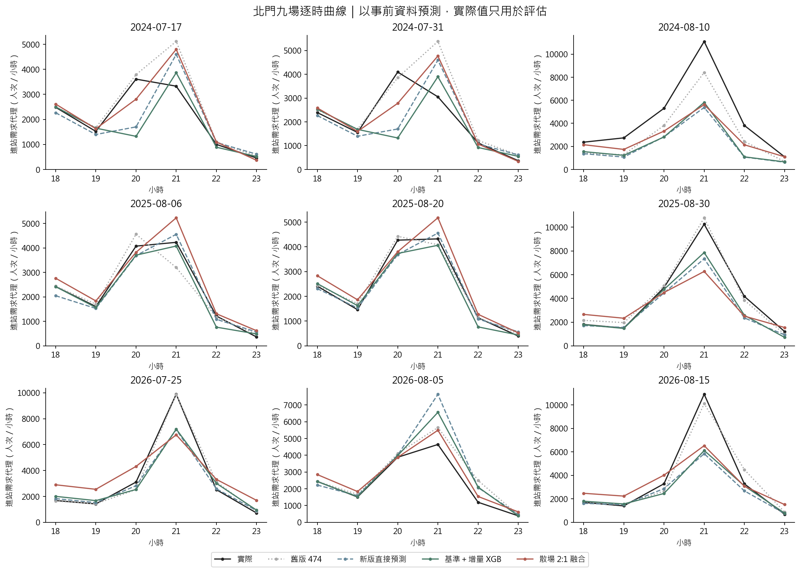
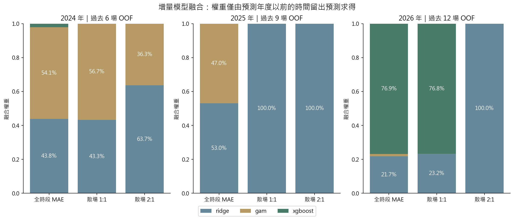
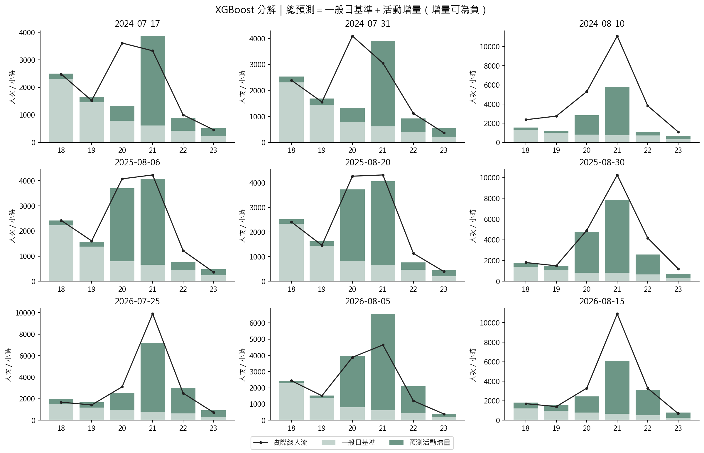

# 第十三版：一般日基準＋活動增量與低估 2 倍融合

## 1. 實際結果

相同資料與參數下，XGBoost 改成基準＋增量，MAE 830.44 → 770.69（降低 7.2%）。散場 2:1 融合 MAE 878.74，沒有勝過單一增量 XGBoost。

**本輪判斷：**保留增量 XGBoost 作新版主要比較候選；不因「罰低估」就採用融合。散場 2:1 融合相對同窗口 1:1，低估量 1277.61 → 1231.66、高估量 390.12 → 418.17；2:1 誤差 2945.34 → 2881.48，但全時段 MAE 804.55 → 878.74。等權融合的 MAE 809.27、2:1 誤差 2854.91 也都優於 2:1 學權重，因此本次沒有支持直接換上該組權重。

舊版固定參數 MAE **473.91** 已用原預測逐列重現，但不能作為相同 D−1 可得條件的控制組。新版的直接／增量模型共用相同資料、核心參數及輸入；兩者差別為學習總人流或學習偏離基準的量。

| 方法 | MAE | RMSE | 散場 2:1 誤差 | 實際尖峰正向低估 | 實際尖峰絕對誤差 |
| --- | --- | --- | --- | --- | --- |
| 舊版固定參數（僅參考） | 473.91 | 766.90 | 1,231.28 | 556.60 | 749.02 |
| 只用一般日基準 | 2,016.90 | 3,279.19 | 9,253.29 | 6,278.84 | 6,278.84 |
| 核心 Ridge | 1,014.22 | 1,513.36 | 2,951.10 | 2,088.65 | 2,534.01 |
| 核心 GAM | 1,080.35 | 1,575.67 | 3,167.71 | 2,273.26 | 2,728.42 |
| 核心 XGBoost | 942.52 | 1,553.37 | 2,958.05 | 1,988.22 | 2,516.89 |
| 直接預測 Ridge | 870.07 | 1,393.23 | 2,802.61 | 2,054.13 | 2,357.27 |
| 直接預測 GAM | 927.97 | 1,457.53 | 3,022.46 | 2,274.25 | 2,602.45 |
| 直接預測 XGBoost | 830.44 | 1,493.42 | 3,154.92 | 2,303.26 | 2,698.21 |
| 基準＋增量 Ridge | 868.24 | 1,391.45 | 2,800.53 | 2,053.50 | 2,353.91 |
| 基準＋增量 GAM | 925.04 | 1,455.81 | 3,019.79 | 2,273.07 | 2,597.36 |
| 基準＋增量 XGBoost | 770.69 | 1,390.12 | 2,978.86 | 2,290.89 | 2,503.84 |
| 增量模型等權融合 | 809.27 | 1,369.30 | 2,854.91 | 2,190.66 | 2,454.72 |
| 全時段 MAE 融合 | 808.93 | 1,393.31 | 2,927.75 | 2,158.93 | 2,560.56 |
| 散場 1:1 融合 | 804.55 | 1,392.11 | 2,945.34 | 2,156.46 | 2,547.92 |
| 散場 2:1 融合 | 878.74 | 1,406.80 | 2,881.48 | 2,121.24 | 2,421.65 |

單位人次／小時；全部以活動等權計算。正向低估在高估時記 0，必須連同絕對誤差及高估量判斷。散場指標依事前預定結束後兩小時與整小時的重疊加權，**沒有把小時資料當成分鐘觀測**。2 倍是研究假設，非貨幣成本。

## 2. 一般日資料何時能用

- D−1 截止為活動前一天 18:00（臺北）。同星期、前 7–56 天，保留目前官方檔案版本時間早於截止的最近四日，至少兩日，平均得到同站同時段基準。
- 排除既有活動登錄日期。未取得事前版本的補班／假日日曆，因此本次不用該日曆來挑配對日；這是「同星期一般日代理基準」，可能仍含補班或其他特殊日。資料排除登錄本身仍是回顧整理。
- 例如 2025 年 7 月資料的目前版本在 8/14 更新，預測 8/6 時不能使用。2017–2020 年現存 OD 版本於 2021 年更新，無法證實舊版本內容，因此四場排除。**21 場減為 17 場、408 個四站逐時列**；外層仍為相同的 2024–2026 九場北門、54 列。
- Last-Modified 是「目前物件版本時間」，不是首次公開日，也不是歷史存取權限的完整證明。已完成版本截止檢查；仍不能宣稱完整歷史公開可得性全部核實。
- 每年訓練僅用更早年度，且目標 OD 版本已在該年 1/1 前存在。公告沿用事前來源帳本；未知結束時間保留未知。沒有加入實測天氣、事後 Google 熱度或當場人流。
- 官方下載全部逐 4 MiB 核對交易 MD5、範圍、ETag；部分整檔 MD5 屬性與現取內容不一致，保留差異紀錄，不用該屬性取代逐段驗證。

詳見 [每場基準日期](tables/availability.csv)、[官方來源與版本帳本](../../docs/d1_od_version_sources.json)。本輪不變更 SQL 或上線模型。

## 3. 模型與權重

令 B 為事前一般日基準，D＝Y−B。Ridge、GAM、XGBoost 分別學 D，再用 max(0, B＋預測 D) 回到人次。**D 可以小於 0**，只有總預測才截為非負。直接控制組用相同設計矩陣學 Y，基準 B 在兩組都作輸入。

核心參數只在更早年份 OOF 用散場 2:1 選取；加 B 與改預測增量後都固定該組參數，不再調參。這沿用舊版「固定核心參數」的比較方式，但因可用訓練歷史改變，重新取得合格歷史的核心參數；**不是把舊版所有參數值照搬，故不把 474 與新版差異全歸因於增量模型。**

融合使用三個增量模型的總人流 OOF 預測，限制權重非負、總和為 1。最小化「2×低估量＋1×高估量」，以線性規劃求解；另保留全六小時 MAE 與相同散場窗口的 1:1 控制，分清換窗口與換低估懲罰。所有融合權重只用預測年度之前的 OOF。

| 年 | 方法 | ridge | gam | xgboost | 過去OOF場數 |
| --- | --- | --- | --- | --- | --- |
| 2024 | 全時段 MAE 融合 | 43.79% | 54.12% | 2.09% | 6 |
| 2024 | 散場 1:1 融合 | 43.29% | 56.71% | 0.00% | 6 |
| 2024 | 散場 2:1 融合 | 63.67% | 36.33% | 0.00% | 6 |
| 2025 | 全時段 MAE 融合 | 52.98% | 47.02% | 0.00% | 9 |
| 2025 | 散場 1:1 融合 | 100.00% | 0.00% | 0.00% | 9 |
| 2025 | 散場 2:1 融合 | 100.00% | 0.00% | 0.00% | 9 |
| 2026 | 全時段 MAE 融合 | 21.73% | 1.35% | 76.91% | 12 |
| 2026 | 散場 1:1 融合 | 23.22% | 0.00% | 76.78% | 12 |
| 2026 | 散場 2:1 融合 | 100.00% | 0.00% | 0.00% | 12 |

## 4. 判讀與限制

- 一般日基準是預測參考，不是經因果識別的「無活動人流」；增量也不能直接稱活動的因果效果。
- 凸融合無法超出三模型預測的範圍；若三者都低估同一尖峰，改權重也補不回超出最高基模型的部分。低估罰 2 倍不能保證測試期每場都減少低估。
- 2025、2026 年散場 2:1 權重均選 Ridge 100%；這是過去 OOF 目標的解，不代表 Ridge 在當年最準。2026 年因此失去 XGBoost 成分，MAE 比散場 1:1 融合差。權重本身也有估計誤差。
- 2024–2026 九場已反覆用於開發；本次是探索性回測，沒有未見活動驗證，不自動把最低 MAE 當成已證實的新部署模型。
- 候車與列車調度仍需分鐘到達曲線、行走延遲、方向分配、列車到站與剩餘容量。現在只提供逐時需求代理，不輸出真實等候分鐘或最適班表。

## 5. 檢核、檔案與文獻

[獨立檢核](independent_validation.json)：核對 17 個官方月份、重建 17 場基準、重載 36 個模型、獨立求解 9 次融合，以及重算 195 列指標。完整公式與執行步驟在 [process 第 24 節](../../process.md#24-第十三版一般日基準活動增量與非對稱融合)。

分析系列 270 項測試通過，含本版新增 12 項，涵蓋截止、未發布標籤、負增量、最後才截斷、時間 OOF 與非對稱融合。

[官方 OD 目錄](https://data.taipei/dataset/detail?id=63f31c7e-7fc3-418b-bd82-b95158755b4d)、[Azure 版本與分段校驗定義](https://learn.microsoft.com/en-us/rest/api/storageservices/get-blob)、[Breiman（1996）stacking](https://statistics.berkeley.edu/sites/default/files/tech-reports/367.pdf)、[Gneiting（2011）損失與決策目標](https://arxiv.org/abs/0912.0902)、[FPP3 時間向前驗證](https://otexts.com/fpp3/toolbox.html#time-series-cross-validation)。

Breiman 支持以留出預測建立組合；本文另採時間切分、和為 1 約束與非對稱絕對誤差，並非原文平方誤差的完全重現。一般日均值＋殘差預測、56 天與最多四日是本案事先設定，文獻不保證它一定勝過直接模型。
