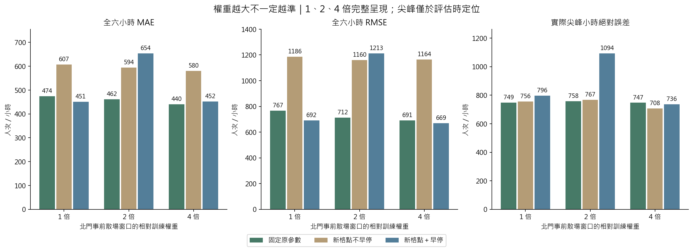
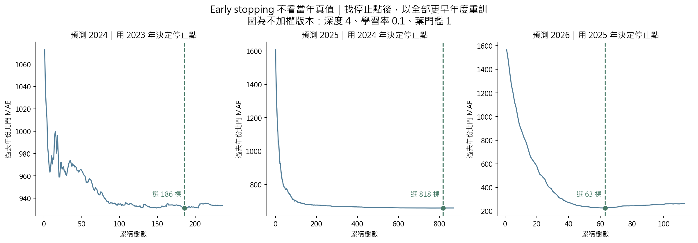
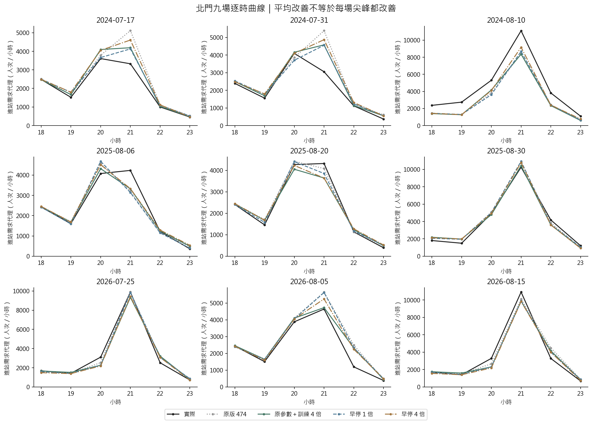

# 第十四版：原資料的 XGBoost 調參、early stopping 與北門散場訓練加權

## 1. 結論與適用範圍

原 MAE **473.91** 已逐列重現。只改北門散場訓練權重為 4 倍，MAE **440.28**，降低 **7.1%**；擴充學習率搭配 early stopping、不加權，MAE **450.55**，降低 **4.9%**。兩項都值得保留為下一輪候選。

**尚不能宣布尖峰問題解決，也沒有換上線模型。** 原參數 4 倍版在 6/9 場 MAE 較低，但平均實際尖峰正向低估量 **556.60 → 658.01** 反而增加；尖峰絕對誤差 **749.02 → 747.14** 幾乎不變。全六小時平均不能代表散場容量已足夠。

本次回到 V12 原 21 場、四站 504 列，並非 V13 版本篩選後的 17 場。一般日基準與部分歷史資料發布時間尚未核實，因此是**原資料回顧敏感度實驗**，不能稱為完整符合活動前一天可得條件的模型。沒有新加入事後天氣、Google 熱度或當場實測輸入。九場測試活動已反覆檢視，不是新的獨立測試。

## 2. 完整誤差比較

| 方法 | MAE | RMSE | 散場 2:1 誤差 | 尖峰正向低估 | 尖峰絕對誤差 |
| --- | --- | --- | --- | --- | --- |
| 原固定參數＋一般日基準 | 473.91 | 766.90 | 1,231.28 | 556.60 | 749.02 |
| 原參數＋散場訓練 2 倍 | 461.71 | 711.66 | 1,137.02 | 528.58 | 758.41 |
| 原參數＋散場訓練 4 倍 | 440.28 | 690.91 | 1,202.98 | 658.01 | 747.14 |
| 新學習率／樹數格點，不早停 | 606.71 | 1,186.37 | 1,615.79 | 584.04 | 756.12 |
| 新格點不早停＋訓練 2 倍 | 594.47 | 1,159.95 | 1,533.18 | 566.04 | 766.99 |
| 新格點不早停＋訓練 4 倍 | 579.99 | 1,163.92 | 1,539.94 | 551.21 | 708.12 |
| 新格點不早停＋歷史選倍率 | 581.94 | 1,144.58 | 1,584.43 | 614.89 | 749.69 |
| 新學習率格點＋early stopping | 450.55 | 691.74 | 1,237.56 | 605.35 | 796.06 |
| Early stopping＋訓練 2 倍 | 654.24 | 1,212.55 | 1,801.41 | 708.63 | 1,093.87 |
| Early stopping＋訓練 4 倍 | 451.71 | 669.27 | 1,182.51 | 561.01 | 736.00 |
| Early stopping＋歷史選倍率 | 592.92 | 1,137.75 | 1,639.89 | 626.92 | 814.05 |
| 舊 180 組依散場 2:1 調參 | 568.98 | 989.89 | 1,666.17 | 872.17 | 999.37 |
| 舊 180 組改依全時段 MAE 調參 | 537.79 | 972.43 | 1,556.67 | 744.72 | 885.20 |

單位人次／小時，越低越好；每場六小時，活動等權。尖峰按實際最大值定位，只用於評估。散場指標依預定結束後兩小時與整小時的重疊長度加權，2:1 是研究假設，不是貨幣成本。未知結束時間的評估退回六小時；本次九場皆有已知窗口。訓練未知窗口則不額外加權。

### 不是每年都改善

| 方法 | 2024 MAE | 2025 MAE | 2026 MAE |
| --- | --- | --- | --- |
| 原固定參數＋一般日基準 | 769.92 | 256.85 | 394.95 |
| 原參數＋散場訓練 4 倍 | 661.25 | 259.89 | 399.71 |
| 新學習率格點＋early stopping | 676.75 | 270.75 | 404.16 |
| Early stopping＋訓練 4 倍 | 663.35 | 286.55 | 405.23 |

改善主要集中於 2024；表中新方法在 2025、2026 的年度 MAE 均未勝過原版。原參數 2 倍的散場 2:1 誤差 **1137.02** 比原參數 4 倍 **1202.98** 低。早停 4 倍的 RMSE **669.27** 比原參數 4 倍 **690.91** 低，但 MAE 稍高。不同目的有取捨，不能只報一個數字。

## 3. 這次怎麼調參

- **原對照：**固定原版深度／學習率／樹數等參數，不加權重訓並重現 473.91；另只換 2、4 倍訓練權重，隔離加權效果。
- **新格點不早停：**深度 2、3、4 × 學習率 0.01、0.03、0.05、0.1 × 葉門檻 1、6 × 樹數 100、250、500、1000，共 96 組／倍率。
- **新格點加早停：**相同 24 種深度／學習率／葉門檻組合，最多 1000 棵；驗證 MAE 連續 50 輪未改善即停止，取已觀察曲線的最低點。固定 L2=1、L1=0、資料與特徵抽樣=1。本輪是局部比較，沒有宣稱找到全域最佳參數。
- **停止點只用過去：**預測 2026 時，先用截至 2024 的四站訓練、2025 北門驗證，決定樹數；再用截至 2025 的四站按該樹數重訓。2026 真值只用於最後評估；編碼器也只在各自訓練集擬合。
- **形狀參數只用過去 OOF：**逐年模擬上述流程，2024／2025／2026 各用過去 10／13／16 場的北門全六小時 MAE 選候選。早期 2019 停止層訓練不足兩場，依事前規則用 250 棵，不拿當年真值決定停止。
- **完整呈現倍率：**1、2、4 倍為事先列出的敏感度組，另實作只依過去 OOF 自動選倍率；沒有用當年結果挑倍率。

| 年 | 方法 | 倍率 | 深度 | 學習率 | 葉門檻 | 樹數 | 停止用年度 | 過去OOF場數 |
| --- | --- | --- | --- | --- | --- | --- | --- | --- |
| 2024 | 新學習率格點＋early stopping | 1 | 4 | 0.10 | 1 | 186 | 2023 | 10 |
| 2024 | Early stopping＋訓練 4 倍 | 4 | 4 | 0.10 | 1 | 260 | 2023 | 10 |
| 2024 | Early stopping＋歷史選倍率 | 2 | 2 | 0.05 | 1 | 164 | 2023 | 10 |
| 2025 | 新學習率格點＋early stopping | 1 | 4 | 0.10 | 1 | 818 | 2024 | 13 |
| 2025 | Early stopping＋訓練 4 倍 | 4 | 4 | 0.10 | 1 | 107 | 2024 | 13 |
| 2025 | Early stopping＋歷史選倍率 | 1 | 4 | 0.10 | 1 | 818 | 2024 | 13 |
| 2026 | 新學習率格點＋early stopping | 1 | 4 | 0.10 | 1 | 63 | 2025 | 16 |
| 2026 | Early stopping＋訓練 4 倍 | 4 | 4 | 0.10 | 1 | 53 | 2025 | 16 |
| 2026 | Early stopping＋歷史選倍率 | 1 | 4 | 0.10 | 1 | 63 | 2025 | 16 |

不加權早停版選 **186、818、63** 棵，不是每年一律 100 或 250。43/504 條有效停止曲線碰到 1000 棵上限，不能假定每組都自然停止；上表外層選中的早停設定皆未碰上限。曲線屬停止層，正式模型再以全部過去資料重訓。

新格點不早停 MAE **606.71**；舊 180 組改以 MAE 選也只有 **537.79**。原參數其實已包含於先前 180 組候選，不能說以前漏放原最佳參數。選擇由較早活動決定，其排名未必適用後來的大型活動；增加格點不保證進步。

## 4. 與以前只用北門訓練有何不同

以前 V10 把其他三站移除，504 列減為 126 列；當時四站 XGBoost MAE 642.59、北門專用 813.60，確實沒有改善。V10 用「煙火＋天氣」輸入，與本輪原基準版不同，這兩個數字只交代過去結論，不能和 474／440 直接作公平排名。

本輪保留四站全部資料，只改各列在訓練損失中的重要性。令 q 為北門該小時與事前預定結束後兩小時的重疊比例；其他站 q=0。原權重 r=1+(m−1)q，再將每場總權重正規化為 24。完整落在窗口內的北門小時，相對其他列為 m 倍。**沒有使用實際尖峰決定權重**；未知結束時間不額外加權。

sample_weight 讓同樣大小的高估和低估都更重要，XGBoost 仍學加權平方誤差。它**不是低估罰 2 倍的非對稱損失，也不是三模型融合權重**。本輪未重算融合。

### 為什麼不能看完結果就自動選 4 倍

只依過去 OOF 選倍率的早停版 MAE **592.92**，沒有改善。2024 過去資料選 2 倍（過去 MAE 1082.76 比 1 倍 1088.69 只好約 6），但當年結果很差；2025、2026 選 1 倍。「4 倍在這九場較好」與「能事先穩定選對倍率」是兩件事，不可用當年最小 MAE 回頭挑倍率。

## 5. 尖峰與下一步

- 2024/8/10 21 時實際 **11,101**：原版 **8,413**；原參數 4 倍 **8,359**，低估沒有改善；早停 4 倍 **9,166**，仍低估約 **1,935**。
- 2026/8/15 21 時實際 **10,904**：原版 **10,101**；早停 4 倍 **9,821**，反而更差。不能從一場改善推廣到所有大型場次。
- **保留不同角色：**原版作對照；原參數 4 倍作全時段 MAE 候選；早停 4 倍作大誤差／尖峰候選；原參數 2 倍保留作散場 2:1 決策目標對照。沒有證實唯一全面最佳模型。
- 下一步先固定規則，在 V13 已做版本截止篩選的資料上另作同條件比較，再用未參與開發的新活動驗證。調度端還要同時比較低估與過度加班成本，不能把最低 MAE 當容量保證。
- 現有逐時進站需求代理，仍需分鐘到達、方向比例、行走延遲與列車剩餘容量；不能直接換算真實候車分鐘或班表。

## 6. 重現與檢核

[process 第 25 節](../../process.md#25-第十四版原資料的早停與北門散場訓練加權)／[設定](../../configs/analysis_v14.json)／[年度表](tables/annual.csv)／[各場表](tables/events.csv)／[獨立檢核](independent_validation.json)。

獨立重算 27 次選擇，檢查 504 條停止曲線、72 次歷史不足備援與 24 個快取，重載 33 個正式模型、重算 169 列指標。預測最大差 2.27e-13，指標最大差 4.55e-13；原 473.909516 重現。來源與模型都有 SHA-256 紀錄，使用 XGBoost 3.1.3。分析系列 285 項測試通過，含本版新增 15 項；其中直接擾動目標年度真值，驗證停止點與預測完全不變。

## 7. 方法依據

- [XGBoost 官方：sklearn 介面與 Early Stopping](https://xgboost.readthedocs.io/en/stable/python/sklearn_estimator.html)：用驗證集監控停止點；本文另要求整年度向前切分及選定樹數後重訓。
- [XGBoost 官方：XGBRegressor.fit](https://xgboost.readthedocs.io/en/stable/python/python_api.html#xgboost.XGBRegressor.fit)：支援逐列 sample_weight。1、2、4 倍與每活動總權重固定，是本案實驗設計，不是文獻保證的最佳倍率。
- [Cawley & Talbot（2010），On Over-fitting in Model Selection and Subsequent Selection Bias in Performance Evaluation](https://jmlr.org/papers/v11/cawley10a.html)：選參數本身可能過度配合驗證資料，增加候選不保證泛化更好。
