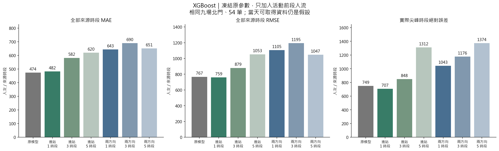
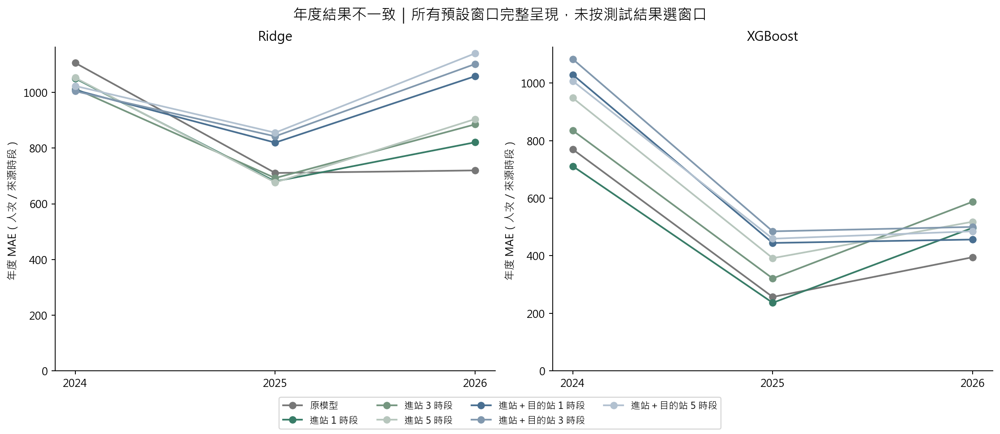
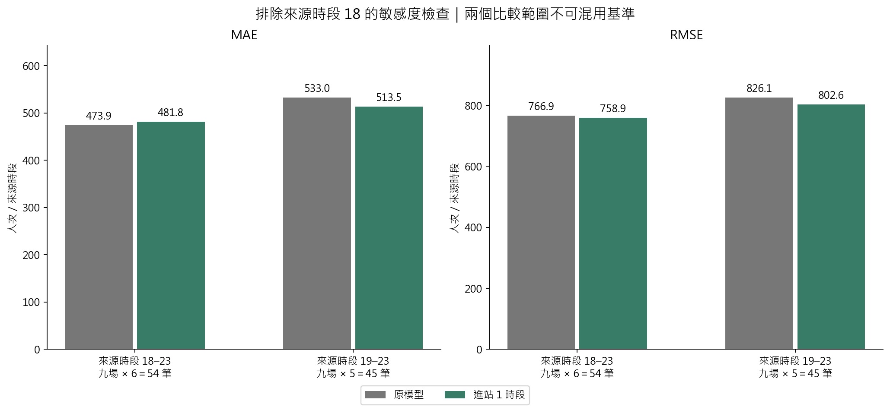
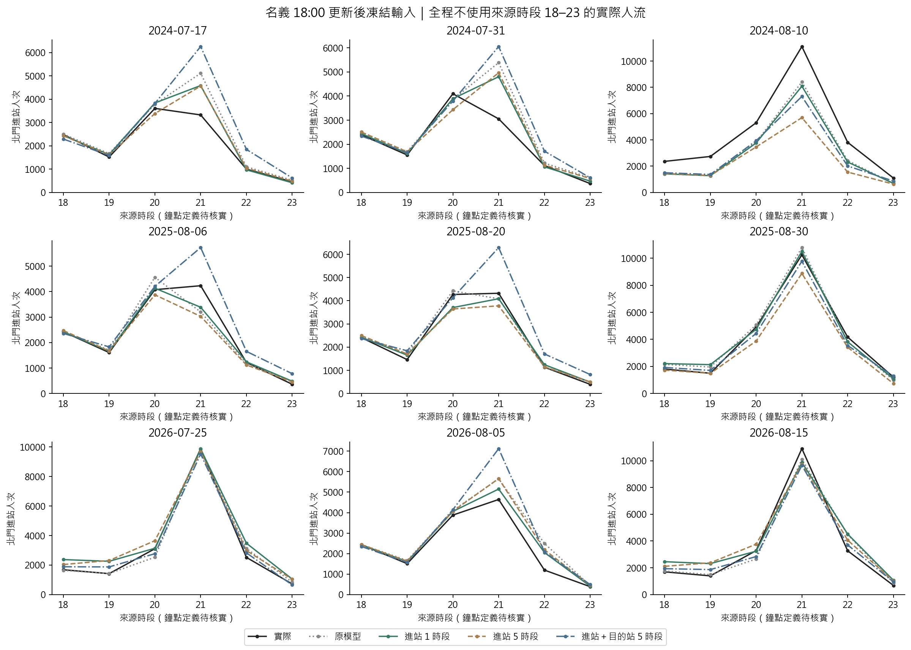

# 第十五版：活動當日前段人流是否改善北門預測

**結果：加入前段人流沒有全面改善。最近 1 個來源時段的進站量，MAE 473.91 → 481.77（惡化 1.7%），但 RMSE、散場 2:1 誤差與尖峰絕對誤差略有改善。3／5 個時段及加入目的站旅次量，XGBoost 的 MAE 都更差。**

## 1. 先釐清資料與時間

- **原始資料確實有「目的站北門」的逐來源時段旅次量。**它是把各起站、目的站為北門的 OD 人次加總；本次確實納入實驗。
- 北門「進站」表示從北門刷卡搭捷運；「目的站北門」表示搭捷運到北門的旅次。兩者不是同一方向，後者也不等於參加煙火的人數。
- 來源 CSV 是「日期、時段、進站、出站、人次」。既有程式在同一「時段」上分別彙總起站、迄站；本次查到的官方說明沒有交代時段按進站還是出站計時，也未確認它標示區間起點或終點。因此保留名稱 **destination_count_same_source_bin**，不寫成已核實的實際刷卡出站時刻。
- 原研究是 D−1 預測；本輪改為**假設當天拿得到前段人流的回顧更新實驗**。官方月更新 OD 並不是即時 API。原 V12 歷史資料發布證據也仍有缺口。
- 名義截止 18:00，固定只取來源時段 **13–17**，不使用 18–23 真值。若時段標示起點，它才對應 13:00–18:00；目前不能把這個對應說成已核實。
- 為處理來源時段 18 可能標示區間終點的問題，另完整報告 **19–23（45 筆）**，在「起點／終點」兩種常見解讀下都位於名義 18:00 之後；這仍不能取代資料實際到手時間的查核。

## 2. 怎麼做

1. 保留原 21 場 × 四站 × 六個目標來源時段，共 504 列。四站各自取得自己的前段人流，預測北門時使用北門的值。
2. 依年向前：2024 用更早 12 場訓練；2025 用更早 15 場；2026 用更早 18 場。相同九場北門 54 列作回顧比較。
3. **Ridge 與 XGBoost 都凍結 V12 各年度原固定參數。**原模型、進站 1／3／5 時段、進站＋目的站 1／3／5 時段，共七種版本；42 次最終擬合。本輪不增加搜尋、不早停、不改樣本權重、不新做融合。
4. 輸入為最近一時段數量、窗口累積量、首尾平均增量、較同站同來源時段一般日多出多少。1 時段不重複放相同累積量，也不定義趨勢。
5. 一般日沿用既有選定清單（每個活動車站 2–4 天），全部早於活動日；每一參考日要有完整前段來源時段，不用 0 填缺資料。
6. 前段快照在六個未來目標列保持不變。18:00 預測較晚時段，不填入 19／20 時的實際值。標準化只用當折訓練資料。
7. 所有窗口事先列定、完整公布，沒有用九場測試誤差選「最適窗口」。每場相同六列，所以全列 MAE 等於活動等權 MAE；尖峰只在評估時定位。

## 3. XGBoost 結果

| 輸入版本 | MAE | RMSE | 散場 2:1 誤差 | 尖峰絕對誤差 | 尖峰正向低估 |
| --- | --- | --- | --- | --- | --- |
| 原模型 | 473.91 | 766.90 | 1,231.28 | 749.02 | 556.60 |
| 進站 1 時段 | 481.77 | 758.90 | 1,130.13 | 707.42 | 596.33 |
| 進站 3 時段 | 581.55 | 879.43 | 1,465.85 | 848.10 | 660.92 |
| 進站 5 時段 | 619.53 | 1,052.53 | 1,907.01 | 1,311.65 | 1,198.29 |
| 進站＋目的站 1 時段 | 643.45 | 1,105.38 | 1,586.89 | 1,042.65 | 414.01 |
| 進站＋目的站 3 時段 | 689.61 | 1,194.52 | 1,688.85 | 1,176.06 | 489.47 |
| 進站＋目的站 5 時段 | 650.58 | 1,047.36 | 1,694.14 | 1,373.58 | 689.09 |

單位人次／來源時段。尖峰絕對誤差＝各場實際最高人流時段的預測絕對誤差再平均；尖峰正向低估＝max(實際−預測,0) 再平均。散場 2:1＝事前結束窗口加權的 2×低估＋高估，沿用原版定義。

- 最近 1 時段：散場 2:1 誤差 **1231.28 → 1130.13（降低 8.2%）**；尖峰絕對誤差 **749.02 → 707.42（降低 5.6%）**。
- 但尖峰正向低估 **556.60 → 596.33**，低估風險沒有隨平均絕對誤差一起降低。
- 2024/8/10 實際尖峰 11101，原版 8413.09，加入 1 時段變 **8085.17**；2026/8/15 實際 10904，原版 10101.25，變 **9872.16**。仍不能認為大型場尖峰已解決。

## 4. 不是每年都改善

| 輸入版本 | 2024 MAE | 2025 MAE | 2026 MAE |
| --- | --- | --- | --- |
| 原模型 | 769.92 | 256.85 | 394.95 |
| 進站 1 時段 | 711.48 | 236.60 | 497.23 |
| 進站 3 時段 | 835.46 | 321.21 | 587.97 |
| 進站 5 時段 | 948.54 | 391.71 | 518.33 |
| 進站＋目的站 1 時段 | 1,029.36 | 444.58 | 456.43 |
| 進站＋目的站 3 時段 | 1,083.62 | 484.96 | 500.25 |
| 進站＋目的站 5 時段 | 1,007.34 | 459.35 | 485.05 |

最近 1 時段在 2024／2025 的年度 MAE 改善，2026 變差，抵銷前兩年的好處。九場已被反覆檢視，這些是探索性結果，不是全新未見測試。

## 5. Ridge 對照

| 輸入版本 | MAE | RMSE | 散場 2:1 誤差 | 尖峰絕對誤差 | 尖峰正向低估 |
| --- | --- | --- | --- | --- | --- |
| 原模型 | 845.44 | 1,547.49 | 3,376.59 | 2,681.26 | 2,334.14 |
| 進站 1 時段 | 850.44 | 1,492.07 | 3,243.03 | 2,576.34 | 2,220.18 |
| 進站 3 時段 | 863.65 | 1,450.76 | 3,164.16 | 2,474.36 | 2,147.70 |
| 進站 5 時段 | 877.76 | 1,465.12 | 3,198.61 | 2,528.18 | 2,175.35 |
| 進站＋目的站 1 時段 | 962.09 | 1,405.81 | 2,815.45 | 2,396.75 | 2,061.75 |
| 進站＋目的站 3 時段 | 982.79 | 1,408.42 | 2,772.48 | 2,324.70 | 1,989.61 |
| 進站＋目的站 5 時段 | 1,006.23 | 1,411.62 | 2,698.71 | 2,250.66 | 1,909.69 |

Ridge 加入兩方向前段量後，RMSE、尖峰絕對誤差與散場成本降低，卻提高全時段 MAE；both_w5 的平均偏差由 −396.87 變成 +248.82。這是誤差分布改變，不能只挑較好的指標宣稱全面改善。

## 6. 只看較晚來源時段 19–23

| 輸入版本 | MAE（45 筆） | RMSE（45 筆） |
| --- | --- | --- |
| 原模型 | 532.96 | 826.12 |
| 進站 1 時段 | 513.46 | 802.61 |
| 進站 3 時段 | 650.70 | 946.44 |
| 進站 5 時段 | 697.38 | 1,141.61 |
| 進站＋目的站 1 時段 | 732.61 | 1,202.93 |
| 進站＋目的站 3 時段 | 784.07 | 1,299.99 |
| 進站＋目的站 5 時段 | 739.40 | 1,138.46 |

相同 45 筆上，最近 1 時段 MAE **532.96 → 513.46（改善 3.7%）**；不能拿 513.46 和全六時段的 473.91 直接比較。這個排除來源時段 18 的檢查在跑結果前就已寫入設定，目的是處理時間標示不明，並非看完結果再刪掉不好的時段。

## 7. 九場曲線與尖峰

| 活動日 | 實際尖峰來源時段 | 實際人次 | 原 XGBoost | 加入進站 1 時段 |
| --- | --- | --- | --- | --- |
| 2024-07-17 | 20 | 3,608.00 | 3,787.62 | 3,841.21 |
| 2024-07-31 | 20 | 4,093.00 | 3,856.32 | 3,888.51 |
| 2024-08-10 | 21 | 11,101.00 | 8,413.09 | 8,085.17 |
| 2025-08-06 | 21 | 4,229.00 | 3,200.06 | 3,384.19 |
| 2025-08-20 | 21 | 4,321.00 | 4,084.44 | 4,085.98 |
| 2025-08-30 | 21 | 10,251.00 | 10,790.87 | 10,508.76 |
| 2026-07-25 | 21 | 9,893.00 | 9,876.42 | 9,858.03 |
| 2026-08-05 | 21 | 4,642.00 | 5,654.23 | 5,150.85 |
| 2026-08-15 | 21 | 10,904.00 | 10,101.25 | 9,872.16 |

## 8. 目前能下的結論與下一步

- 已驗證：這份資料與原固定參數下，單純增加 3／5 個時段或目的站旅次量，沒有降低 XGBoost 的 MAE；短窗口有局部價值。
- **尚未證明變差原因。**新增特徵每場只增加一份前段訊號，不會把 21 場變成 504 個獨立活動。前段仍含一般通勤；搭到北門不代表一定去活動或同站離開。這些是合理解釋，尚非因果驗證。
- 固定參數能隔離「加輸入」的效果，但不代表已找到適合新特徵的最適模型；本輪沒有重新調參，不能據此宣稱前段資料永遠無用。
- 保留原模型，最近 1 時段版本列為候選；下一輪若要繼續，可在**過去年份內**選窗口、正則化及樹複雜度，或用前段超額人流校正原預測。須凍結規則後用新活動評估，不可直接用這九場挑最好結果。
- 尚不能接即時排隊部署：要取得有實際到手時間的進出站資料；還需確認分鐘到達形狀、行走延遲、搭乘方向與列車剩餘容量。目的站小時總量不能直接當分鐘到達率。

## 9. 檔案、重現與檢核

~~~powershell
.\.venv\Scripts\python.exe -X utf8 src/run_analysis_v15.py
.\.venv\Scripts\python.exe -X utf8 src/verify_analysis_v15.py
.\.venv\Scripts\python.exe -X utf8 src/report_analysis_v15.py
.\.venv\Scripts\python.exe -X utf8 -m unittest discover -s tests -p 'test_analysis_v*.py'
~~~

需先有原 V12／V14 私有快照與其校驗來源、station_hourly.parquet、一般日清單；全新 clone 不包含這些原始資料。輸入、1680 個特徵值、逐列預測及模型保存在忽略追蹤的 .local/analysis_v15/；本目錄保存四圖、表格、模型設定及報告。執行後不自動換上網站模型。

獨立檢核：36 個來源／程式雜湊、84 份活動車站快照、1680 個特徵值、42 個模型、196 列指標；原 XGBoost 473.9095 及原 Ridge 均重現。最大特徵差 4.55e-13，最大預測差 1.82e-12。細節見 [independent_validation.json](independent_validation.json)。

## 10. 方法依據與界線

- [臺北市官方分時 OD 資料目錄](https://data.taipei/dataset/detail?id=63f31c7e-7fc3-418b-bd82-b95158755b4d)：OD 逐時資料、每月更新。目的站統計存在，但本次查閱說明未明示時段刷卡基準。
- [scikit-learn：Lagged features for time series forecasting](https://scikit-learn.org/stable/auto_examples/applications/plot_time_series_lagged_features.html)：示範落後值、移動統計及依時間切分。**1／3／5 小時與 18:00 是本案實驗設定，不是文獻保證的最優值。**
- [Hyndman & Athanasopoulos，FPP3 §5.10](https://otexts.com/fpp3/toolbox.html#time-series-cross-validation)：向前回測以過去預測未來；本案按整年度隔離，同年其他活動不進訓練。
- [Cawley & Talbot（2010），JMLR](https://jmlr.org/papers/v11/cawley10a.html)：選模本身也有過擬合風險。本案反覆觀察九場，不將其標成獨立確認實驗。
