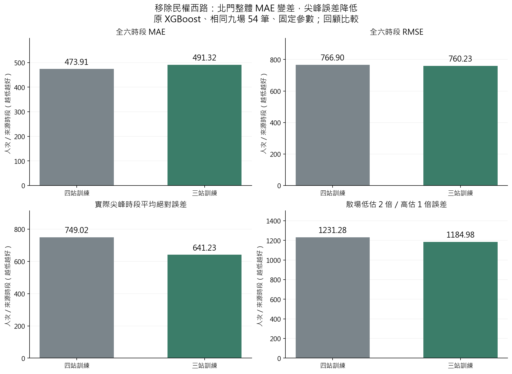
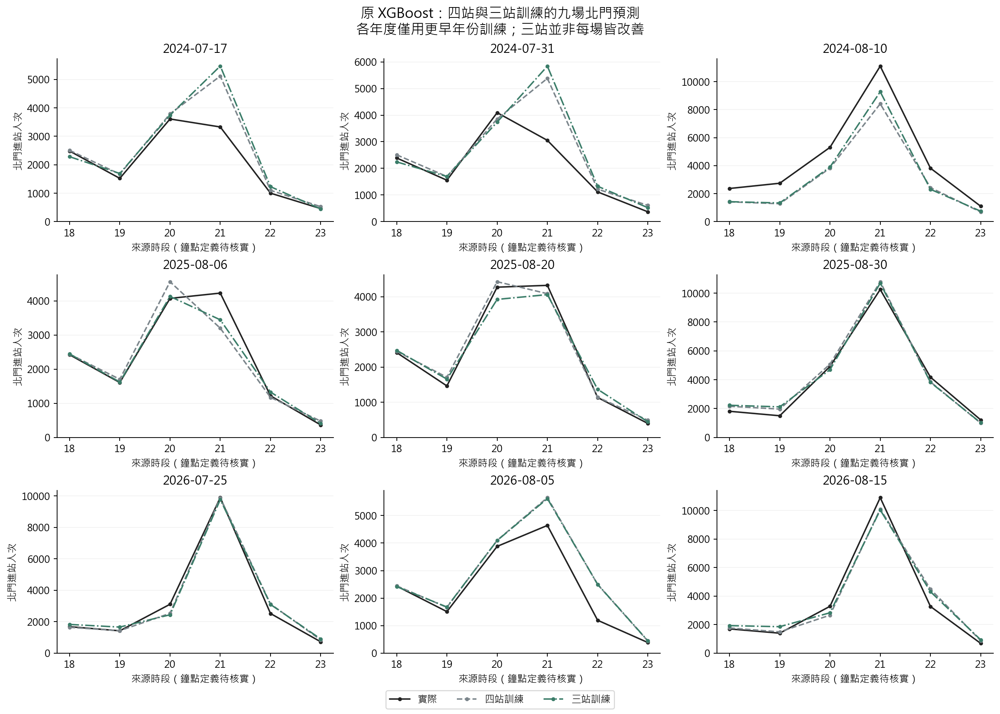
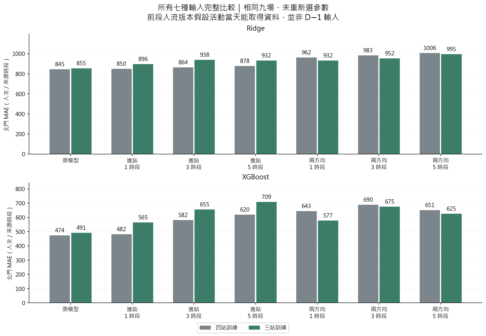
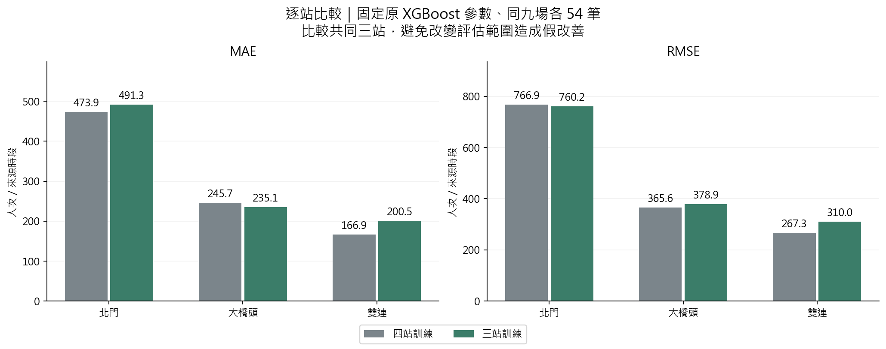

# 第十六版：減少訓練車站能否改善北門預測

**已完成北門、大橋頭、雙連三站訓練，與原四站訓練比較。原 XGBoost 的北門 MAE 473.91 → 491.32，惡化 3.7%；實際尖峰時段絕對誤差 749.02 → 641.23，降低 14.4%。沒有證據可直接說「站太多就是不準的原因」。**

本輪屬固定參數的探索性回顧比較；九場已反覆用於開發，不是全新未見測試，也未自動更換網站模型。

## 1. 只改什麼

- 四站：北門、大橋頭、雙連、民權西路；三站：**北門、大橋頭、雙連**。原始資料車站名稱是「大橋頭站」。
- 在標準化、車站編碼、建模之前就移除民權西路的訓練列；三站版不會保留該站虛擬變數。
- 沿用 V15 的同一資料快照、候選輸入與各年度固定參數。模型是 **Ridge、XGBoost**；各跑原模型、進站前 1／3／5 時段、再加目的站前 1／3／5 時段，共七種輸入。
- 沒有重新調參、early stopping、散場訓練加權或新增融合。這是接續上一輪的車站比較，不是將歷次所有方法重新比賽。
- 全資料 21 場：四站 504 列、三站 378 列。2024／2025／2026 分別以更早的 12／15／18 場訓練。
- 主要評估同樣九場北門、來源時段 18–23，共 54 列；次要評估同樣九場共同三站、162 列。不拿四站平均與三站平均直接比較。
- 四站控制的 42 組年度／模型／輸入預測全部重現 V15。兩組總共完成 **84 個擬合**。
- Ridge 固定的是平均平方損失的懲罰 λ；因三站樣本量減少，實際 sklearn alpha=n×λ 隨 n 改變。這讓每筆資料平均損失對懲罰的相對強度相同。

## 2. 北門原模型：整體與尖峰有取捨

| 模型 | 訓練範圍 | MAE | RMSE | 尖峰絕對誤差 | 尖峰正向低估 | 散場 2:1 誤差 |
| --- | --- | --- | --- | --- | --- | --- |
| Ridge | 四站訓練 | 845.44 | 1,547.49 | 2,681.26 | 2,334.14 | 3,376.59 |
| XGBoost | 四站訓練 | 473.91 | 766.90 | 749.02 | 556.60 | 1,231.28 |
| Ridge | 三站訓練 | 854.66 | 1,518.92 | 2,637.12 | 2,312.49 | 3,354.17 |
| XGBoost | 三站訓練 | 491.32 | 760.23 | 641.23 | 469.07 | 1,184.98 |

- XGBoost：全六時段 MAE 惡化 **3.7%**，RMSE 略降 **0.9%**；尖峰絕對誤差降低 **14.4%**，尖峰正向低估降低 **15.7%**，散場 2:1 誤差降低 **3.8%**。
- Ridge：MAE 845.44 → 854.66，也略差；這次沒有因少一站而全面改善。
- **尖峰絕對誤差**：先在每場實際人流找最高的來源時段，再計算該時段 |實際−預測|，最後九場平均；不是兩條曲線各自最高值之差。
- **尖峰正向低估**：同一實際尖峰時段的 max(實際−預測,0) 再平均；高估以 0 計，不與低估互相抵銷。
- **散場 2:1**：沿用事前預定結束後兩小時與來源時段的重疊權重，各場等權；計算 2×低估＋高估。若事前結束未知，按原協定改用全六時段。它是加權預測誤差，不是候車人數、分鐘或金錢。

## 3. 按年與逐場確認

| 年度 | 訓練範圍 | MAE | RMSE | 尖峰絕對誤差 |
| --- | --- | --- | --- | --- |
| 2024 | 四站訓練 | 769.92 | 1,140.56 | 1,034.74 |
| 2025 | 四站訓練 | 256.85 | 355.76 | 601.79 |
| 2026 | 四站訓練 | 394.95 | 580.47 | 610.52 |
| 2024 | 三站訓練 | 784.95 | 1,138.45 | 771.96 |
| 2025 | 三站訓練 | 246.20 | 323.52 | 495.01 |
| 2026 | 三站訓練 | 442.82 | 577.18 | 656.73 |

三站版只在 2025 年的年度 MAE 較好；2024、2026 較差。尖峰誤差在 2024／2025 改善，2026 反而增加，不能用整體平均推論每場皆改善。

| 活動日期 | 實際尖峰來源時段 | 實際 | 四站預測 | 三站預測 |
| --- | --- | --- | --- | --- |
| 2024-07-17 | 20 | 3,608.00 | 3,787.62 | 3,741.42 |
| 2024-07-31 | 20 | 4,093.00 | 3,856.32 | 3,737.74 |
| 2024-08-10 | 21 | 11,101.00 | 8,413.09 | 9,273.80 |
| 2025-08-06 | 21 | 4,229.00 | 3,200.06 | 3,445.66 |
| 2025-08-20 | 21 | 4,321.00 | 4,084.44 | 4,058.49 |
| 2025-08-30 | 21 | 10,251.00 | 10,790.87 | 10,690.18 |
| 2026-07-25 | 21 | 9,893.00 | 9,876.42 | 9,765.02 |
| 2026-08-05 | 21 | 4,642.00 | 5,654.23 | 5,618.85 |
| 2026-08-15 | 21 | 10,904.00 | 10,101.25 | 10,038.63 |

## 4. 前段人流版本也完整比較

以下改善率＝100×(1−三站 MAE／四站 MAE)；正值較好，負值較差。兩組每一列都使用同一輸入版本，沒有挑最好的窗口作結論。

### XGBoost

| 輸入 | 四站 MAE | 三站 MAE | 三站改善率 % |
| --- | --- | --- | --- |
| 原模型 | 473.91 | 491.32 | -3.67 |
| 進站 1 時段 | 481.77 | 564.74 | -17.22 |
| 進站 3 時段 | 581.55 | 655.38 | -12.70 |
| 進站 5 時段 | 619.53 | 708.97 | -14.44 |
| 進站＋目的站 1 時段 | 643.45 | 577.47 | 10.26 |
| 進站＋目的站 3 時段 | 689.61 | 674.96 | 2.12 |
| 進站＋目的站 5 時段 | 650.58 | 625.44 | 3.86 |

### Ridge

| 輸入 | 四站 MAE | 三站 MAE | 三站改善率 % |
| --- | --- | --- | --- |
| 原模型 | 845.44 | 854.66 | -1.09 |
| 進站 1 時段 | 850.44 | 896.34 | -5.40 |
| 進站 3 時段 | 863.65 | 938.06 | -8.62 |
| 進站 5 時段 | 877.76 | 931.85 | -6.16 |
| 進站＋目的站 1 時段 | 962.09 | 931.80 | 3.15 |
| 進站＋目的站 3 時段 | 982.79 | 951.75 | 3.16 |
| 進站＋目的站 5 時段 | 1,006.23 | 994.63 | 1.15 |

XGBoost 的「進站＋目的站」三種窗口在三站版都比各自四站版好；例如 1 時段 **643.45 → 577.47**，但仍比不加前段人流的四站 **473.91** 差。只加進站前段的三種窗口反而更差。新資訊與訓練範圍的組合有影響，但沒有穩定勝出的新版本。

## 5. 其他兩站

| 車站 | 訓練範圍 | MAE | RMSE |
| --- | --- | --- | --- |
| 北門 | 四站訓練 | 473.91 | 766.90 |
| 大橋頭站 | 四站訓練 | 245.69 | 365.57 |
| 雙連 | 四站訓練 | 166.93 | 267.32 |
| 北門 | 三站訓練 | 491.32 | 760.23 |
| 大橋頭站 | 三站訓練 | 235.07 | 378.92 |
| 雙連 | 三站訓練 | 200.54 | 309.98 |

大橋頭 MAE 降低，北門與雙連上升。共同三站同一批 162 列的總 MAE **295.51 → 308.98**，RMSE **514.21 → 522.05**。所以沒有「三站整體更準」的結果。

## 6. 來源時段 19–23 的敏感度檢查

| XGBoost 輸入 | 訓練範圍 | MAE | RMSE |
| --- | --- | --- | --- |
| 原模型 | 四站訓練 | 532.96 | 826.12 |
| 進站 1 時段 | 四站訓練 | 513.46 | 802.61 |
| 原模型 | 三站訓練 | 541.04 | 816.58 |
| 進站 1 時段 | 三站訓練 | 612.54 | 903.67 |

此處只看九場 × 五個來源時段＝45 列，兩組都同樣排除來源時段 18。不與主要六時段 MAE 直接排名；全部七種輸入保存在 tables/conservative.csv。

## 7. 可以如何解讀

1. **尚不能認定是車站太多造成誤差。**移除一站同時減少訓練列、改變車站與時段的設計矩陣、改變樹分裂；本輪無法把變化歸因於某一站「污染」。
2. **全時段與散場目標不同。**三站原 XGBoost 的尖峰與散場平均誤差有改善，但一般 MAE 變差，2026 尖峰也沒有改善；不據此宣布新最佳模型。
3. **這次固定參數是為了比較車站範圍。**不能因此認定三站已調到最佳，也沒有藉外層九場挑站、挑窗口、挑模型部署。
4. 若後續把車站範圍、窗口、調參加入模型選擇，必須在每次預測的較早年份內決定，之後仍需要未見活動檢驗；這九場的反覆比較只能作探索。
5. 排隊與調度尚需方向、分鐘到達分布、班距與剩餘容量；本輪的每來源時段誤差不能直接轉成已驗證候車分鐘。

## 8. 可得性界線

- 不新增事後天氣、聲量或預測目標時段真值；預定結束訊號沿用原來源稽核。
- 原 474 版的一般日與歷史 OD 發布時點尚未完全核實，因此 none 版本也仍是回顧分析，不能當成已驗證的 D−1 部署表現。
- 含前段人流的版本假設名義 18:00 能取得來源時段 13–17；這是活動當天更新，並非前一天預測。公開月更新 OD 未證明可即時供應。
- 原 OD 時段按進站或出站鐘點，以及區間起／終點尚待核實。目的站數量不直接寫成實際刷卡出站時刻。
- 三站各用自己的前段人流，預測北門時不把另外兩站同場未來真值當輸入。
- 列數不是獨立活動數；不作逐列獨立顯著性檢定。

## 9. 重現與檢核

~~~powershell
.\.venv\Scripts\python.exe -X utf8 src/run_analysis_v16.py
.\.venv\Scripts\python.exe -X utf8 src/verify_analysis_v16.py
.\.venv\Scripts\python.exe -X utf8 src/report_analysis_v16.py
.\.venv\Scripts\python.exe -X utf8 -m unittest discover -s tests -p 'test_analysis_v*.py'
~~~

需先具備 V15 及其前代本機快照、模型設定與封存來源；來源雜湊變更即停止，不下載或捏造替代資料。本機輸入、逐列預測與 84 個模型保留在 .local；公開結果在根目錄 result/analysis_v16。

- [獨立檢核](independent_validation.json)：43 個來源雜湊、84 模型重載、504 列指標、42 組四站控制重現全部通過。
- 最大重載預測差 1.82e-12；控制差 3.37e-11；指標差 2.73e-12。
- 檢查移除車站沒有進入編碼、每年只用過去訓練、固定參數相同，以及 Ridge 懲罰與訓練標準化正確。
- 新增 12 項單元測試涵蓋面板完整性、訓練年隔離、被排除站／未來標籤擾動不影響模型、只用訓練標準化、Ridge nλ 與手算指標。
- [設定](../../configs/analysis_v16.json)／[全部參數](fits.json)／[北門指標](tables/summary.csv)／[逐場指標](tables/events.csv)／[同範圍三站指標](tables/common_three.csv)／[配對差異](tables/paired_comparison.csv)。
- 資料與方法沿用[第十五版](../analysis_v15/report.md)，實作公式見 [process.md 第 27 節](../../process.md#27-第十六版三站與四站訓練的配對比較)。
