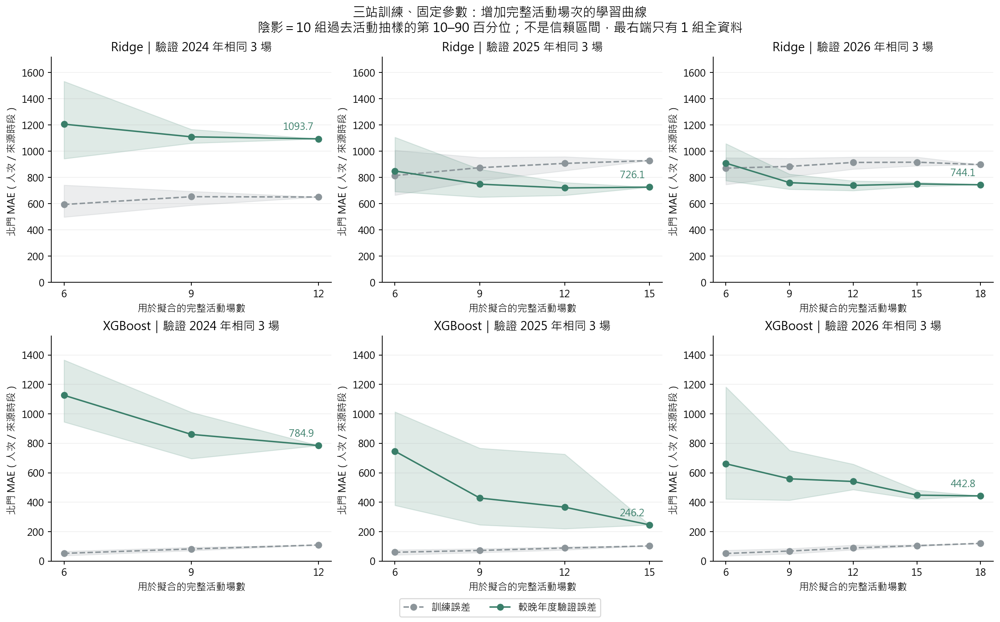
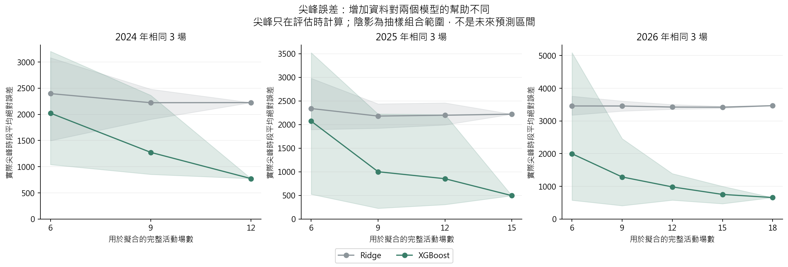
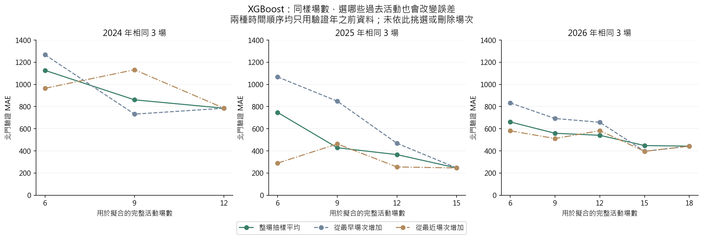

# 第十七版：資料少是否限制北門預測——整場活動學習曲線

**結果支持「可用活動少、活動組合不足是限制之一」，但不足以把全部誤差歸因於筆數。**固定相同較晚年度活動驗證，XGBoost 由 6 場子集擴大到全部可用場次，三年的平均 MAE 都下降；Ridge 則較早停滯。2026 年 XGBoost 從 15 場到 18 場的平均改善只剩約 1.2%，而特定 15 場組合也可能比全部 18 場好。

這次完成學習曲線診斷，沒有選新模型、最佳訓練場數或新增一般日訓練；不把重複使用的九場稱為全新測試。

## 1. 比較結果

以下是**三站訓練、北門評估**。6 場一欄是 10 組不同過去活動子集的平均；全資料只擬合一次。各年度用同樣三場驗證，表格不可解讀成換年度就只增加了訓練筆數。

| 驗證年 | 模型 | 全部可用場數 | 6 場平均 MAE | 全資料 MAE | MAE 改善 % | 6 場尖峰誤差 | 全資料尖峰誤差 |
| --- | --- | --- | --- | --- | --- | --- | --- |
| 2024 | Ridge | 12 | 1,205.77 | 1,093.73 | 9.29 | 2,396.34 | 2,224.48 |
| 2024 | XGBoost | 12 | 1,126.49 | 784.95 | 30.32 | 2,022.84 | 771.96 |
| 2025 | Ridge | 15 | 848.85 | 726.11 | 14.46 | 2,339.28 | 2,220.19 |
| 2025 | XGBoost | 15 | 746.65 | 246.20 | 67.03 | 2,071.91 | 495.01 |
| 2026 | Ridge | 18 | 908.91 | 744.12 | 18.13 | 3,457.20 | 3,466.68 |
| 2026 | XGBoost | 18 | 661.21 | 442.82 | 33.03 | 1,996.74 | 656.73 |

單位人次／來源時段。尖峰誤差在各場實際最高人流的來源時段計算 |實際−預測|，再對三場平均；沒有用實際尖峰挑訓練資料或特徵。

### 圖怎麼讀

- 橫軸是完整活動場數，不是逐站逐小時的列數；每場三站各六時段，共 18 列。
- 灰線是北門訓練誤差，綠線是固定較晚年度的北門驗證誤差。
- 綠線下降表示在這個固定驗證組、既有資料與參數下，增加活動資料平均有幫助。
- 陰影是 10 組子集結果的第 10–90 百分位，表示「抽到哪些活動」的變動；不是信賴區間、不是未來預測區間。
- 最右端用全部過去活動，只有唯一一組；陰影收成一點是子集組合消失，**不是模型已沒有不確定性**。
- XGBoost 訓練誤差明顯低於驗證誤差，與過擬合、年度型態改變、未觀測資訊等情況都相容；本圖不能分辨各因素的因果貢獻。

## 2. 實驗設計

| 固定驗證年度 | 驗證活動 | 可用過去活動 | 比較的擬合場數 |
| --- | --- | ---: | --- |
| 2024 | 同年 3 場，北門 18 列 | 12 | 6、9、12 |
| 2025 | 同年 3 場，北門 18 列 | 15 | 6、9、12、15 |
| 2026 | 同年 3 場，北門 18 列 | 18 | 6、9、12、15、18 |

1. 使用 V16 原模型 none 輸入：車站、時段、原核心群組、預定結束訊號與既有回顧一般日基準。不增加當日 lag、不改特徵定義。
2. 固定北門、大橋頭、雙連三站；移除民權西路後再建立各子集的編碼、缺值填補與標準化。
3. 每年只從更早年份的完整活動中抽樣，不把同場不同站或小時拆到兩邊。
4. 主曲線各小場數抽 10 組；每次重複使用同一個過去活動隨機排列，6 場包含於 9 場，依此類推。Ridge 與 XGBoost 使用完全相同子集。
5. 另做「從最早活動增加」與「從最近活動增加」兩種固定日期順序，作組成敏感度比較。
6. 各年度凍結 V16 none 的原 Ridge λ 及 XGBoost 超參數，不依子集或這九場重新調參；模型種子固定。Ridge alpha=nλ，以維持平均損失中的懲罰強度。
7. 全資料終點在三條曲線共用，不重複擬合成 10 份。共 **222 個模型**，分別計算北門訓練與驗證指標。
8. 原三站全資料控制精確重現：三年合併北門 MAE 為 XGBoost **491.32**、Ridge **854.66**。這是重現，不是新改善。

**場數的含義：**曲線只縮減「參數擬合使用的活動場數」。凍結的超參數與背景特徵原本利用較廣的過去資料，並未重新限制為只來自該 6／9 場。因此這是固定既有設定下的擬合資料量敏感度，不是證明只蒐集六場全部資訊即可得到同樣結果。

## 3. XGBoost 每個場數的完整結果

| 驗證年 | 擬合場數 | 組數 | 平均 MAE | MAE 第10百分位 | MAE 第90百分位 | 平均 RMSE | 尖峰絕對誤差 | 散場2:1 |
| --- | --- | --- | --- | --- | --- | --- | --- | --- |
| 2024 | 6 | 10 | 1,126.49 | 945.78 | 1,366.20 | 1,719.53 | 2,022.84 | 3,720.67 |
| 2024 | 9 | 10 | 860.74 | 696.23 | 1,010.92 | 1,283.00 | 1,273.17 | 2,482.35 |
| 2024 | 12 | 1 | 784.95 | 784.95 | 784.95 | 1,138.45 | 771.96 | 2,039.90 |
| 2025 | 6 | 10 | 746.65 | 378.75 | 1,013.88 | 1,330.63 | 2,071.91 | 2,573.01 |
| 2025 | 9 | 10 | 428.35 | 246.36 | 766.74 | 706.41 | 1,001.32 | 1,302.46 |
| 2025 | 12 | 10 | 366.28 | 220.23 | 726.38 | 590.05 | 853.38 | 1,049.81 |
| 2025 | 15 | 1 | 246.20 | 246.20 | 246.20 | 323.52 | 495.01 | 622.22 |
| 2026 | 6 | 10 | 661.21 | 422.04 | 1,182.91 | 1,134.66 | 1,996.74 | 2,261.01 |
| 2026 | 9 | 10 | 559.06 | 413.62 | 752.41 | 854.46 | 1,285.79 | 1,437.88 |
| 2026 | 12 | 10 | 540.84 | 485.78 | 658.51 | 760.60 | 981.66 | 1,294.05 |
| 2026 | 15 | 10 | 448.00 | 420.60 | 482.23 | 615.20 | 752.14 | 1,049.89 |
| 2026 | 18 | 1 | 442.82 | 442.82 | 442.82 | 577.18 | 656.73 | 892.80 |

- 2024：6 → 12 場，平均 MAE 1126.49 → 784.95，改善約 30.3%。
- 2025：6 → 15 場，746.65 → 246.20，改善約 67.0%。
- 2026：6 → 18 場，661.21 → 442.82，改善約 33.0%；但 15 → 18 場只有 448.00 → 442.82。
- 以上改善不是相對原完整模型 491.32 的改善，而是相對刻意減少訓練資料的子集。
- 不外推「再加幾場就能降到多少」；沒有足夠資料估計可靠的學習曲線極限或所需場數。

Ridge 在 2026 的尖峰誤差約停在 3400 人次附近，增加活動沒有像 XGBoost 一樣下降。這提示模型表示能力、收縮設定或缺少關鍵訊號也可能限制表現；不能把所有問題交給增加筆數解決。

## 4. 哪些活動也重要

| 驗證年 | 擬合場數 | 10組抽樣平均 MAE | 從最早增加 MAE | 從最近增加 MAE |
| --- | --- | --- | --- | --- |
| 2024 | 6 | 1,126.49 | 1,267.75 | 964.79 |
| 2024 | 9 | 860.74 | 731.68 | 1,132.19 |
| 2024 | 12 | 784.95 | 784.95 | 784.95 |
| 2025 | 6 | 746.65 | 1,067.53 | 289.72 |
| 2025 | 9 | 428.35 | 848.27 | 462.61 |
| 2025 | 12 | 366.28 | 468.27 | 255.16 |
| 2025 | 15 | 246.20 | 246.20 | 246.20 |
| 2026 | 6 | 661.21 | 832.94 | 581.19 |
| 2026 | 9 | 559.06 | 692.17 | 511.52 |
| 2026 | 12 | 540.84 | 658.31 | 582.83 |
| 2026 | 15 | 448.00 | 396.33 | 395.67 |
| 2026 | 18 | 442.82 | 442.82 | 442.82 |

同樣 6 場，預測 2025 時，最早六場 MAE **1067.53**、最近六場 **289.72**，顯示年代與活動組成可能很重要。但最近六場不在所有年度、所有指標都比較好，不能用九場驗證結果挑一個最佳截斷點。

2026 從最早 15 場增加到全部 18 場，MAE **396.33 → 442.82**；從最近 15 場增加到全部 18 場也是 **395.67 → 442.82**。雖然主曲線抽樣平均下降，特定加法仍會變差。

日期順序同時改變新舊程度與活動類型；同年活動也可能相依。因此這只是組成敏感度，沒有控制實驗可聲稱年代或某場活動是原因，亦不據此刪除不利場次。

## 5. 全資料的訓練與驗證差距

| 驗證年 | 模型 | 訓練活動數 | 北門訓練 MAE | 固定較晚年度 MAE |
| --- | --- | --- | --- | --- |
| 2024 | Ridge | 12 | 650.72 | 1,093.73 |
| 2024 | XGBoost | 12 | 109.31 | 784.95 |
| 2025 | Ridge | 15 | 928.17 | 726.11 |
| 2025 | XGBoost | 15 | 103.03 | 246.20 |
| 2026 | Ridge | 18 | 897.42 | 744.12 |
| 2026 | XGBoost | 18 | 120.32 | 442.82 |

訓練誤差描述已看過資料的擬合，不能取代預測誤差；訓練／驗證差距不單獨證明過擬合，也可能包含跨年分布差異。

## 6. 對下一步的意義

- 這輪支持擴充有代表性的活動案例作為候選方向；單純重複、插值或模擬出更多列，不會增加真實活動的資訊。
- 在新增足夠尖峰案例之前，將每場最高一筆抽出獨立建複雜模型會更缺資料；可將「共用模型＋簡單散場修正」保留為後續比較方案。
- 一般日訓練可補平常流量規律，但不能替代大型活動的尖峰資料；本輪未實作一般日背景模型。
- 本輪未根據驗證曲線挑最佳場數、時間窗口或重選參數，沒有更新排隊或列車調度；若日後將資料窗口作選擇項，須在更早年份內選，再找未見活動驗證。

## 7. 可得性與證據限制

- 原快照的歷史 OD 發布時點仍未完全核實，這輪不是已驗證可部署的 D−1 成效。
- 沒有加入活動當日 lag，沒有把當年真值放入訓練或選子集；來源時段的鐘點定義仍沿用待核實限制。
- 同年三場固定驗證，三年合計九場已反覆用於開發；10 次抽樣也沒有新增驗證活動。
- 固定超參數來自原完整過去資料的設定，小子集結果有繼承的調參資訊；本輪不估計重新調參的最佳小樣本能力。
- 背景特徵仍按原歷史來源計算；未把它們也縮成同一活動子集。
- 子集陰影只描述既有活動組合，不包含未來活動、測量誤差或尚未蒐集的活動型態的不確定性。

## 8. 檔案、重現與檢核

~~~powershell
.\.venv\Scripts\python.exe -X utf8 src/run_analysis_v17.py
.\.venv\Scripts\python.exe -X utf8 src/verify_analysis_v17.py
.\.venv\Scripts\python.exe -X utf8 src/report_analysis_v17.py
.\.venv\Scripts\python.exe -X utf8 -m unittest discover -s tests -p 'test_analysis_v*.py'
~~~

依賴 V15 輸入與 V16 凍結設定、參考預測及前代來源快照；缺檔或雜湊變動會停止。逐列預測放在忽略追蹤的 .local/analysis_v17；不另保存 222 份模型二進位檔，以設定、場次清單、固定種子重現。

- [設定](../../configs/analysis_v17.json)／[全部場次與參數](fits.json)／[逐次指標](tables/scores.csv)／[曲線摘要](tables/curves.csv)／[端點比較](tables/endpoints.csv)。
- [獨立檢核](independent_validation.json)：50 個來源雜湊、222 模型重新擬合、444 列原始指標、144 列曲線摘要及 6 個全資料控制通過。
- 最大預測重算差 1.82e-12，指標差 1.82e-12，前處理差 0.00e+00。
- 另核對日期只來自過去年份、完整事件、巢狀子集、兩模型同樣資料、固定驗證場次、固定超參數與訓練子集標準化。
- 新增 12 項測試涵蓋子集抽取不依標籤、未來／排除場次的值擾動不影響擬合、全資料終點不重複計數及百分位手算。
- 詳細公式見 [process.md 第 28 節](../../process.md#28-第十七版整場活動學習曲線)。

## 9. 方法依據

- [scikit-learn，Learning curves](https://scikit-learn.org/stable/modules/learning_curve.html)：比較不同訓練樣本數的訓練與驗證誤差。本案改為以整場活動抽取，固定較晚年度驗證，未直接套用逐列隨機切分。
- [Hyndman & Athanasopoulos，Forecasting: Principles and Practice，時間向前驗證](https://otexts.com/fpp3/toolbox.html#time-series-cross-validation)：驗證時間須晚於訓練。整年隔離、6／9／12 等場數及 10 次重複為本案設計，不是文獻建議的唯一或最佳設定。
- [Cawley & Talbot（2010），JMLR 11:2079–2107](https://jmlr.org/papers/v11/cawley10a.html)：模型選擇程序本身也可能過擬合。本輪保留完整曲線，不利用已看過的驗證結果宣稱最佳訓練場數。
