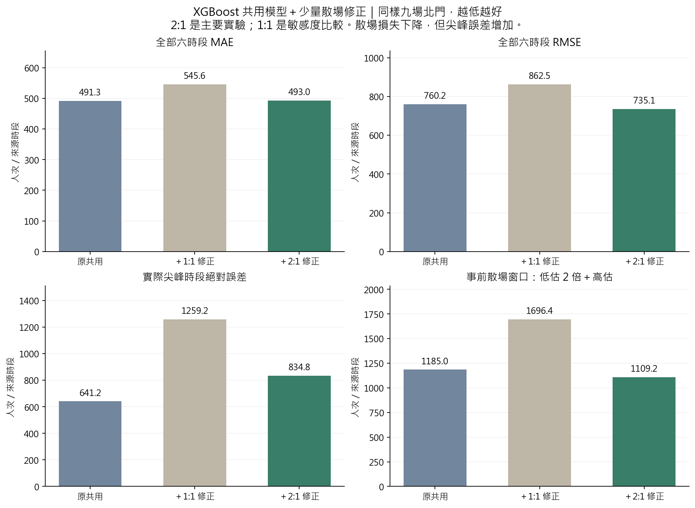
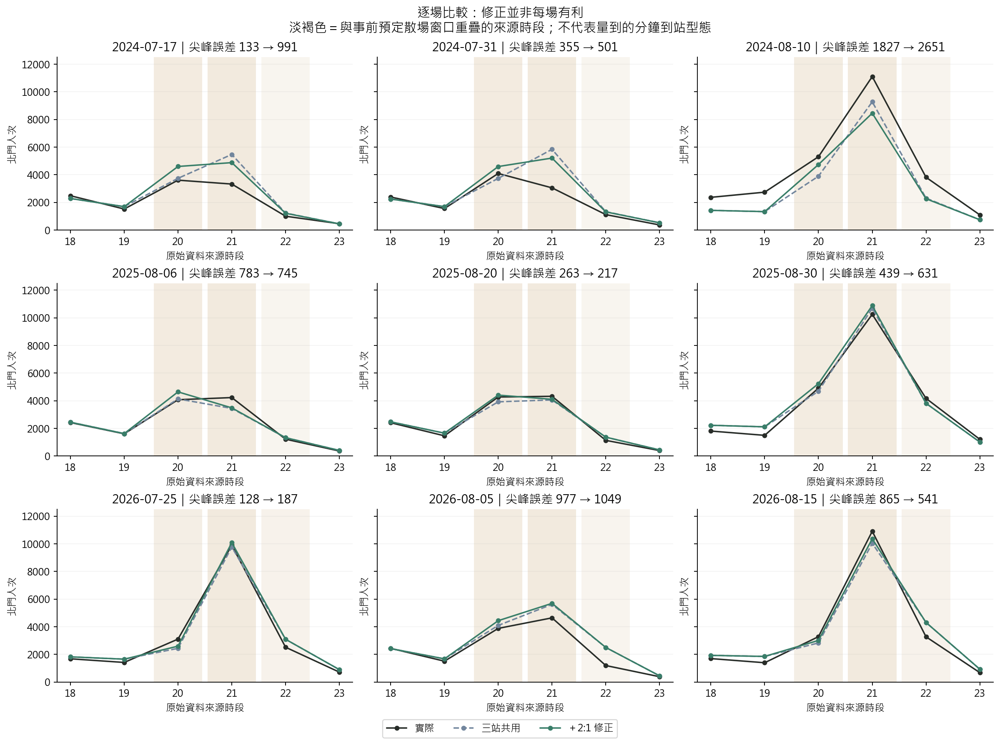
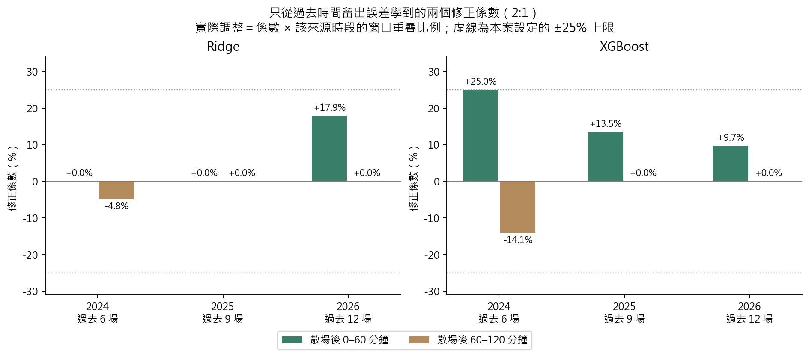

# 第十八版：三站共用模型＋少量散場修正

**已實作，但目前是取捨，不是全面改善。**三站 XGBoost 加 2:1 修正後，北門 MAE 491.32 → 492.99，RMSE 760.23 → 735.10；預定散場 2:1 誤差降低 6.4%，但實際尖峰絕對誤差增加 30.2%。保留原模型作主要比較基準，新版作候選情境，不依九場反覆結果宣稱已找到最佳模型。

## 1. 做了什麼

1. 北門、大橋頭、雙連繼續共用同一個 Ridge 或 XGBoost；保留車站、時段、車站×時段、週末、季節／年索引、預定結束訊號及原一般日基準，沒有新增當日 lag。
2. 每個年度先用更早年份選參數、擬合共用模型。產生 2021–2026 年逐年向前的預測；不用模型已經看過的訓練誤差。
3. 預測 2024／2025／2026 時，修正層分別只用過去 6／9／12 場「已知預定結束時間」活動的留出誤差。未知公告者不參與修正擬合。
4. 修正層只有兩個係數，分別對應北門預定結束後 0–60、60–120 分鐘；係數可正可負，總預測最多調整 ±25%。窗口外、其他站、結束時間未知者保留共用模型預測。
5. 用 L1 懲罰讓修正趨近零，低估罰 2 倍為主要實驗；另完整列出低估／高估等價的 1:1 比較。沒有再用當年結果挑參數。

這是**共用預測加受限制的殘差修正**，不是把真實最高小時切出來訓練另一棵樹，也不是前面三模型融合的權重重算。

## 2. 全部比較

同樣 2024–2026 九場北門、每場六個來源時段，54 列。每場等權，單位人次／來源時段，越低越好。

| 模型 | 版本 | MAE | RMSE | 尖峰絕對誤差 | 尖峰正向低估 | 散場 2:1 誤差 |
| --- | --- | --- | --- | --- | --- | --- |
| Ridge | 三站共用模型 | 854.66 | 1,518.92 | 2,637.12 | 2,312.49 | 3,354.17 |
| Ridge | 共用＋1:1 修正 | 871.38 | 1,722.76 | 3,002.36 | 3,002.36 | 3,767.84 |
| Ridge | 共用＋2:1 修正 | 854.17 | 1,478.68 | 2,612.64 | 2,273.71 | 3,304.90 |
| XGBoost | 三站共用模型 | 491.32 | 760.23 | 641.23 | 469.07 | 1,184.98 |
| XGBoost | 共用＋1:1 修正 | 545.62 | 862.46 | 1,259.22 | 1,161.50 | 1,696.44 |
| XGBoost | 共用＋2:1 修正 | 492.99 | 735.10 | 834.83 | 461.52 | 1,109.15 |

- **MAE 幾乎沒變：**2:1 修正後增加 0.34%；不是全時段精準度改善。
- **RMSE 下降 3.3%：**全部六時段的大誤差略減，但不代表每場最高小時更準。
- **窗口低估減少、高估增加：**XGBoost 預定散場平均正向低估 384.61 → 301.12（−21.7%），高估 415.75 → 506.91（＋21.9%）。加權後的 2:1 損失才下降 6.4%。這是代理損失，不是實際列車調度成本。
- **真正最高小時沒有解決：**尖峰正向低估僅 469.07 → 461.52（−1.6%），尖峰絕對誤差反而 641.23 → 834.83（＋30.2%）。窗口低估和實際峰值低估必須分開看。
- **1:1 也沒有更好：**XGBoost MAE 545.62、尖峰誤差 1259.22；歷史誤差讓第二個窗口的修正偏向下調。
- Ridge 的 2:1 MAE 854.66 → 854.17，改善不足一人次；仍遠遜於 XGBoost。

## 3. 為什麼一些場次變差

| 驗證年 | 版本 | MAE | RMSE | 尖峰絕對誤差 | 散場 2:1 誤差 |
| --- | --- | --- | --- | --- | --- |
| 2024 | 三站共用模型 | 784.95 | 1,138.45 | 771.96 | 2,039.90 |
| 2025 | 三站共用模型 | 246.20 | 323.52 | 495.01 | 622.22 |
| 2026 | 三站共用模型 | 442.82 | 577.18 | 656.73 | 892.80 |
| 2024 | 共用＋2:1 修正 | 772.25 | 1,086.42 | 1,380.91 | 1,967.01 |
| 2025 | 共用＋2:1 修正 | 274.37 | 355.95 | 530.93 | 600.91 |
| 2026 | 共用＋2:1 修正 | 432.34 | 560.45 | 592.64 | 759.53 |

- **2024/8/10：**最高小時實際 11,101 人次，共用模型 9,273.80，修正後 8,450.39；低估 1,827.20 → 2,650.61。只看過去六場學到的第二段負修正，在這場大型活動沒有延續。
- **2026/8/15：**最高小時實際 10,904，共用模型 10,038.63，修正後 10,362.57；低估 865.37 → 541.43，有改善。
- **2026/8/5：**實際 4,642，共用模型已高估為 5,618.85，修正後 5,691.38，反而更高。
- 同一年度只用兩個係數，無法充分分辨一般場與大型場的散場速度、規模。這是與結果相容的解釋，未證明原因完全由該因素造成。

## 4. 學到了多少修正

| 模型 | 預測年 | 過去有效場數 | 第一段係數 % | 第二段係數 % |
| --- | --- | --- | --- | --- |
| Ridge | 2024 | 6 | -0.00 | -4.83 |
| XGBoost | 2024 | 6 | 25.00 | -14.09 |
| Ridge | 2025 | 9 | -0.00 | -0.00 |
| XGBoost | 2025 | 9 | 13.47 | -0.00 |
| Ridge | 2026 | 12 | 17.88 | -0.00 |
| XGBoost | 2026 | 12 | 9.68 | -0.00 |

例如係數 +10%、窗口重疊只有 1/3 小時，該來源時段的預測只加約 3.33%，不是整小時都加 10%。2024 XGBoost 第一段碰到 +25% 上限，但**不能因此直接放寬上限**；當年尖峰已變差。上限、懲罰與至少六場皆為本案預設，不是論文保證的最佳值。

## 5. 時間隔離與資料性質

- 歷史 OOF 的選參也向前：預測 2023 的共用模型只能用 2019–2022 的封存候選驗證結果選參數，不能拿 2024 已選設定回頭產生「假 OOF」。
- 選參政策繼承 V11 四站核心候選庫；正式擬合則為目前三站＋原一般日基準。這輪沒有重新搜尋三站模型超參數。2024–2026 六個基準模型完整重現 V16。
- 兩個修正係數從過去年份的北門時間留出殘差學習；預測年度真值只用來評估。未知預定結束時間者不假設等於實際散場。
- **原始 D−1 可得性限制保留：**舊 OD 歷史發布時間尚未全部核實，事前公告也沒有完整歷史快照；沒有新增當日或事後天氣，但不能把這個原資料實驗稱為已驗證可部署的 D−1 成果。
- 來源時段的精確鐘點定義仍待核實。窗口重疊只用作特徵／評分權重，沒有把小時人次按比例當成實測分鐘到站人流。
- 九場已反覆用於開發，不能把本次差異當成新未見資料的改善證據；沒有推論顯著性、信賴區間或自動部署。

## 6. 接下來採用什麼

- **主基準保留原三站 XGBoost。**2:1 修正可作降低散場低估的比較方案，但不宣稱尖峰更準。
- 要用於調度，還要檢查每場低估／高估的後果、分鐘到站形狀、行走延遲、方向比例、列車剩餘容量與班距限制；本次沒有以這個小時模型直接產生可執行班表。
- 若下一輪要調修正幅度或區分大型場，應先固定少量候選、使用過去時間驗證；另留新活動驗證。不能看到某場變差就單獨改其係數。

## 7. 文獻依據與本案延伸

- [Montero-Manso & Hyndman（2021）, Principles and Algorithms for Forecasting Groups of Time Series: Locality and Globality](https://arxiv.org/abs/2008.00444)：支持多序列共用模型的研究方向；不保證本案三站一定勝過單站或四站。
- [Breiman（1996）, Stacked Regressions](https://statistics.berkeley.edu/sites/default/files/tech-reports/367.pdf)：借用「使用留出預測訓練第二層」的原則。原文以非負最小平方組合預測器；本案為時間向前、受限非對稱殘差修正，不是照原公式重現 stacking。
- [Gneiting（2011）, Making and Evaluating Point Forecasts](https://arxiv.org/abs/0912.0902)：評分損失要與決策目標一致。低估 2、高估 1 的絕對損失對應分位數目標 2/3；受限模型與小樣本不保證達到精確分位數校準。
- ±25%、L1=0.1、六場門檻、兩個窗口均為本案設計，沒有宣稱為上述文獻的定理或最佳設定。

## 8. 檔案與重現

~~~powershell
.\.venv\Scripts\python.exe -X utf8 src/run_analysis_v18.py
.\.venv\Scripts\python.exe -X utf8 src/verify_analysis_v18.py
.\.venv\Scripts\python.exe -X utf8 src/report_analysis_v18.py
.\.venv\Scripts\python.exe -X utf8 -m unittest discover -s tests -p 'test_analysis_v*.py'
~~~

[設定](../../configs/analysis_v18.json)／[實作公式](../../process.md#29-第十八版共用模型少量散場修正)／[全部指標](tables/summary.csv)／[各年度](tables/annual.csv)／[逐場](tables/events.csv)／[係數](corrections.json)／[獨立驗證](independent_validation.json)。

- 12 次共用模型擬合、12 次修正擬合；另用不同 LP 表示方式獨立檢查 12 個最適目標值。
- 核對 80 個來源雜湊、7 個結果雜湊、12 個過去選參程序、78 列公開指標；最大預測差 1.82e-12、LP 目標差 2.22e-16。
- 新增 20 項測試，全系列 347 項通過。逐列資料在 .local/analysis_v18/；公開結果在 result/analysis_v18/，沒有另存 12 份大型模型二進位檔。
