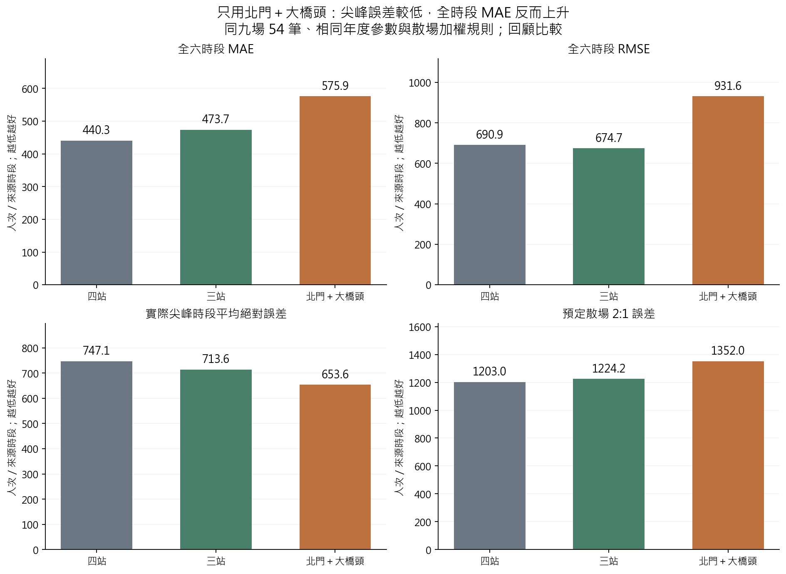
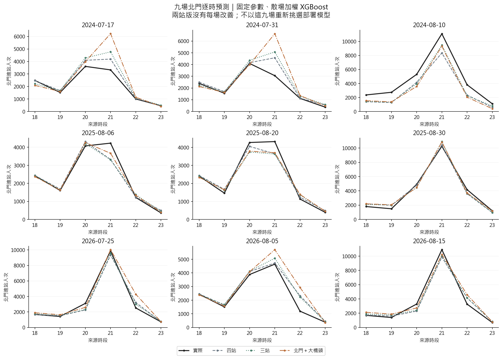
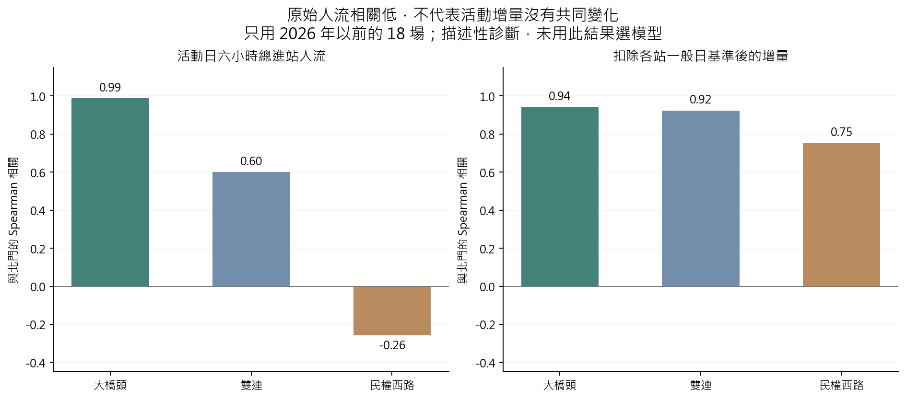

# 第十九版：只用北門與大橋頭，預測是否更準？

**本輪未支持直接改成兩站。**現行加權 XGBoost 的北門 MAE 從 440.28 增至 575.95，增加 30.8%；實際尖峰平均絕對誤差則從 747.14 降至 653.65，改善 12.5%。有取捨，整體誤差與散場 2:1 誤差仍變大；網站保留原模型。

## 1. 如何公平比較

- 四站：北門、大橋頭、雙連、民權西路；三站：北門、大橋頭、雙連；兩站：北門、大橋頭。來源名稱「大橋頭站」保持不變。
- 同一 21 場資料、18–23 六個來源時段；2024／2025／2026 分別用更早的 12／15／18 場訓練。同九場北門 54 筆為主要評估；次要比較共同兩站 108 筆。
- 依車站篩選訓練列，再做缺值處理、標準化、類別編碼、車站×時段交互作用；不先用四站估轉換再刪站。
- **主比較直接承接網站的 V14 frozen_w4。**另比較未加權 XGBoost 與 Ridge，讓本輪也能對照 V16 的原四／三站結果，避免拿不同模型設定混比。
- 每年度超參數固定為原封存設定，沒有新調參、融合或用這九場挑參數。加權版沿用北門預定散場權重，選定車站內每場平均權重為 1；Ridge 使用 alpha=n×λ，維持平均損失的懲罰強度。
- 輸入僅原先的一般日基準、日曆、事前預定結束訊號等；沒有當日前段人流、實測天氣、事後聲量或未來標籤。原歷史 OD／日曆發布時點仍未完全核實，這輪仍是回顧敏感度比較，不能新增宣稱為嚴格 D−1 可部署模型。
- 27 個模型擬合、15 組舊版預測控制均重現。四／三／兩站全資料分別 504／378／252 列，**獨立活動數都是 21，不會因逐站逐時列數變多就有更多活動**。

## 2. 現行加權 XGBoost：兩站沒有全面改善

| 訓練車站 | MAE | RMSE | 尖峰絕對誤差 | 散場 2:1 誤差 |
| --- | --- | --- | --- | --- |
| 四站 | 440.28 | 690.91 | 747.14 | 1,202.98 |
| 三站 | 473.68 | 674.70 | 713.61 | 1,224.23 |
| 北門＋大橋頭 | 575.95 | 931.59 | 653.65 | 1,352.01 |

尖峰誤差是「每場實際最高人流時段」的絕對誤差再平均，只作事後評估，不以真實尖峰當輸入。散場 2:1 依事前預定結束後兩小時的重疊權重計算 2×低估＋高估，各場等權；不是實際候車分鐘或金錢。



兩站版散場正向低估由 483.61 降至 390.52，但高估由 235.75 升至 570.98，使散場 2:1 誤差仍惡化。不能只看低估減少就認定調度一定更好。

## 3. 各年度及個別活動

| 年度 | 訓練車站 | MAE | RMSE | 尖峰絕對誤差 | 散場 2:1 誤差 |
| --- | --- | --- | --- | --- | --- |
| 2024 | 四站 | 661.25 | 993.70 | 1,098.36 | 1,793.31 |
| 2024 | 三站 | 714.48 | 967.21 | 850.67 | 1,722.59 |
| 2024 | 北門＋大橋頭 | 914.81 | 1,374.11 | 751.33 | 2,342.46 |
| 2025 | 四站 | 259.89 | 355.10 | 583.42 | 721.04 |
| 2025 | 三站 | 313.24 | 409.73 | 754.50 | 986.73 |
| 2025 | 北門＋大橋頭 | 283.16 | 355.89 | 587.94 | 816.39 |
| 2026 | 四站 | 399.71 | 564.39 | 559.65 | 1,094.60 |
| 2026 | 三站 | 393.33 | 512.13 | 535.66 | 963.37 |
| 2026 | 北門＋大橋頭 | 529.86 | 767.29 | 621.68 | 897.18 |

兩站加權版在三個年度的整體 MAE 都高於四站版。2024/8/10 實際尖峰 11,101 人，四站預測 8,359，兩站 9,324，這一場的尖峰更接近；但 2026/8/5 實際尖峰 4,642，四站 4,725，兩站 5,702，反而高估更多。



| 活動日期 | 實際尖峰時段 | 實際 | 四站 | 三站 | 兩站 |
| --- | --- | --- | --- | --- | --- |
| 2024-07-17 | 20 | 3,608.00 | 4,095.28 | 4,287.34 | 3,983.83 |
| 2024-07-31 | 20 | 4,093.00 | 4,158.88 | 4,359.02 | 3,991.95 |
| 2024-08-10 | 21 | 11,101.00 | 8,359.09 | 9,494.34 | 9,323.90 |
| 2025-08-06 | 21 | 4,229.00 | 3,320.64 | 3,306.92 | 3,665.40 |
| 2025-08-20 | 21 | 4,321.00 | 3,645.17 | 3,626.91 | 3,703.03 |
| 2025-08-30 | 21 | 10,251.00 | 10,417.06 | 10,898.34 | 10,833.25 |
| 2026-07-25 | 21 | 9,893.00 | 9,339.66 | 9,549.53 | 10,034.86 |
| 2026-08-05 | 21 | 4,642.00 | 4,724.95 | 5,074.09 | 5,702.18 |
| 2026-08-15 | 21 | 10,904.00 | 9,861.35 | 10,072.58 | 10,241.01 |

## 4. 原未加權模型也比較

| 模型 | 訓練車站 | MAE | RMSE | 尖峰絕對誤差 | 散場 2:1 誤差 |
| --- | --- | --- | --- | --- | --- |
| XGBoost 未加權 | 四站 | 473.91 | 766.90 | 749.02 | 1,231.28 |
| Ridge | 四站 | 845.44 | 1,547.49 | 2,681.26 | 3,376.59 |
| XGBoost 未加權 | 三站 | 491.32 | 760.23 | 641.23 | 1,184.98 |
| Ridge | 三站 | 854.66 | 1,518.92 | 2,637.12 | 3,354.17 |
| XGBoost 未加權 | 北門＋大橋頭 | 594.08 | 912.63 | 715.56 | 1,407.06 |
| Ridge | 北門＋大橋頭 | 868.10 | 1,469.05 | 2,553.14 | 3,263.04 |

未加權 XGBoost 的北門 MAE 473.91 → 594.08，Ridge 845.44 → 868.10，也沒有因只用兩站而改善。這次固定參數是為隔離車站範圍，**不是證明兩站已調到最佳**。

次要比較大橋頭：加權 XGBoost MAE 四站 268.82、三站 225.46、兩站 247.65。兩站對大橋頭比四站好，但對北門較差；評估範圍不能隨模型改變，不能拿兩站平均直接對比四站平均。

## 5. 「另外兩站相關性不大」需要分兩件事

以預測 2026 年前可用的 18 場訓練活動為例，每場將六小時加總，再算與北門的 Spearman 相關：

| 車站 | 原人流總量相關 | 扣除一般日基準後增量相關 |
| --- | --- | --- |
| 大橋頭站 | 0.99 | 0.94 |
| 雙連 | 0.60 | 0.92 |
| 民權西路 | -0.26 | 0.75 |



- 原始總量下，民權西路和北門的關係較弱且為負；扣掉各站一般日基準後，雙連與民權西路仍呈現共同活動增量。人流底量不同，不能只看總量就判定沒有資訊。
- 以上是同場的描述性關係，不是因果，也沒有把同場其他站的未來真實人流放入北門預測。全年共同趨勢與活動規模都可能使相關提高。
- **共用模型是在多站過去資料上學習，不是把另外三站當場實際人數當成三個預測變數。**移除車站會同時減少樣本、改變設計矩陣與樹分裂。相關係數不能取代配對向前驗證。
- 其他訓練截止年的診斷同樣保存在 [past_event_correlations.csv](tables/past_event_correlations.csv)；未以相關係數重新選車站。

## 6. 為什麼動畫進站時不滿載？

這是目前的載量及動畫假設，不是排隊理論規定列車必須留空：

1. 每班最大上限 K=2,220；預設本站下客後可再載 R=1,110，因此背景載量先假設 K−R=1,110（50%）。上游各站實際車上人數尚未建模。
2. 列車接近時仍顯示上述上車前假設；離站瞬間才上車 B=min(同方向候車 Q,R)，離站載量為 K−R+B。
3. 例如 2026/8/15、寬峰、往松山 21:02，模擬候車約 153 人，上車後約 1,263 人／2,220≈56.9%，不應為了讓畫面看起來擁擠而強制滿載。
4. 若同方向 Q>R，列車離站必滿載，剩餘旅客留到下一班。全部公開回放共 10,575 筆班次情境中，247 筆有離站後滯留；沒有「仍有同方向隊伍但未用完容量」的紀錄。
5. 紅色站點是雙向隊伍合計，單一列車只服務一個方向；列車離站後新到達的人也可能立即重新排隊。因此站紅與某列車未滿不一定矛盾。

目前是依班表批次上車的流體情境，不是把列車當 M/M/c 的平行櫃檯。未模擬車門吞吐、實際停站、拒絕上車、車廂分布或臨時加班車。前端已加上「上車前假設／離站後」字樣，不改容量來迎合期待。

要提高現實性，接下來優先校準：按班次／方向的既有車上載量與下車人數、分鐘進站量與方向比例、活動實際班表及有效可用容量。詳見[營運資料與官方來源](../../docs/metro_operations.md)；在這些資料尚缺時，保留均勻／寬峰／集中峰和剩餘容量敏感度，不能稱為實際即時人流復原。

## 7. 採用建議與重現

保留網站四站加權 XGBoost，兩站版留作候選／敏感度結果。若之後把訓練車站範圍也納入調參，需在更早年份的內層驗證選擇，再以未見活動評估，不能反覆在這九場挑最漂亮的結果。這次尚未完成新的兩站專屬調參，也不從探索結果推出「更多站永遠更好」。

```powershell
.\.venv\Scripts\python.exe -X utf8 src/run_analysis_v19.py
.\.venv\Scripts\python.exe -X utf8 src/verify_analysis_v19.py
.\.venv\Scripts\python.exe -X utf8 src/report_analysis_v19.py
.\.venv\Scripts\python.exe -X utf8 -m unittest discover -s tests -p test_analysis_v19.py -v
```

需要既有 V14／V16 本機快照；來源雜湊不一致會停止。模型及逐列預測留 `.local/analysis_v19`，公開表圖放 `result/analysis_v19`。[設定](../../configs/analysis_v19.json)／[擬合紀錄](fits.json)／[獨立計算檢核](independent_validation.json)／[列車滿載規則檢核](queue_display_audit.json)。檢核為另一程式重算，不宣稱由另一代理審查。
