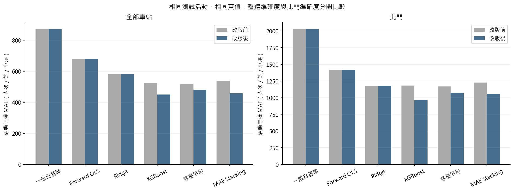
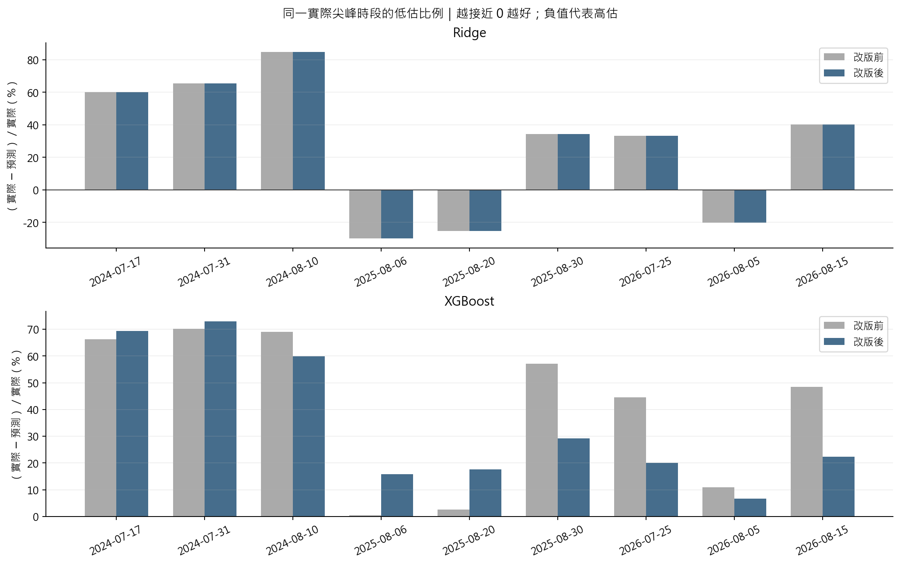
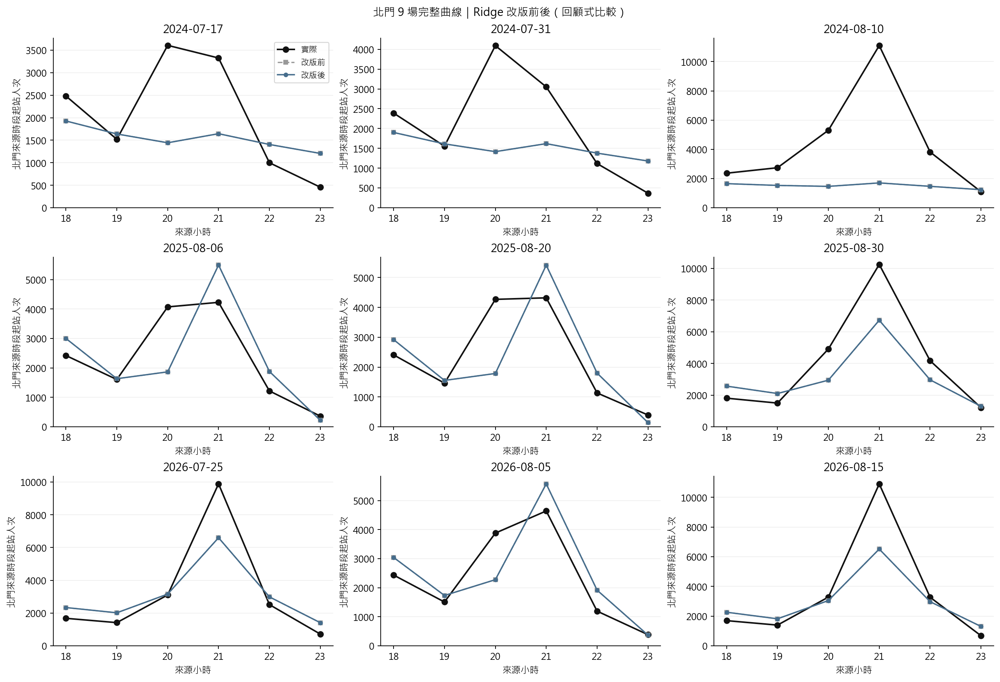
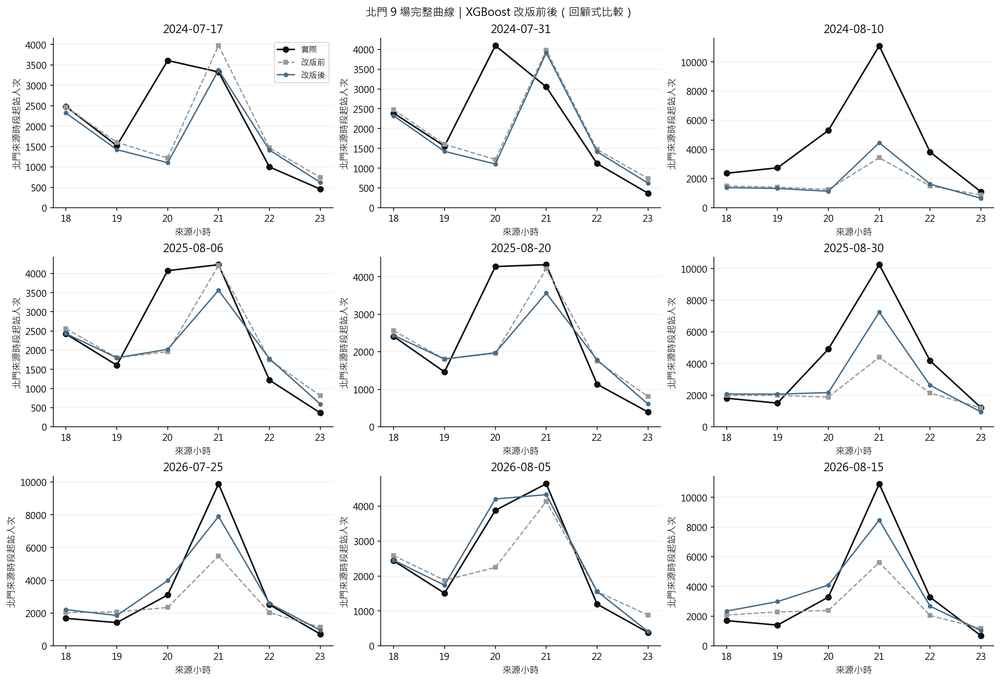

# 第二版與第三版調參對照：相同變數，擴大搜尋

## 比較範圍

- 使用完全相同的 2024、2025、2026 年、9 場、216 列外層預測；逐一核對活動日、車站、小時及真值。圖表與指標由保存的預測產生。
- **這是看過既有結果後的回顧式模型修訂比較，並非全新、未接觸的確認性測試。**不能再把這些年度當成未見過的最終考試；未來活動或另保留資料才適合確認泛化能力。
- 模型仍須以較早年度做內層調參與融合，這份比較表本身不選參數。不因北門改善就宣稱全站均改善，也不以逐時列數當獨立活動數做顯著性檢定。
- MAE 與 RMSE 按活動等權計算。尖峰先取每場北門真值最高的小時，再比較兩版在**同一小時**的預測；同值取最早小時。正向低估是 `max(實際 − 預測, 0)`，高估不抵銷低估；另保留有符號誤差與絕對誤差，以免高估被誤說成改善。

## 指標與結果

| 模型 | 全站 MAE 前 | 全站 MAE 後 | 北門 MAE 前 | 北門 MAE 後 | 北門尖峰低估 前 | 北門尖峰低估 後 |
|---|---|---|---|---|---|---|
| Forward OLS | 680.60 | 680.60 | 1419.48 | 1419.48 | 3569.49 | 3569.49 |
| Ridge | 582.87 | 582.87 | 1177.78 | 1177.78 | 2826.99 | 2826.99 |
| XGBoost | 523.05 | 450.12 | 1181.36 | 964.38 | 3236.04 | 2367.30 |
| 等權平均 | 517.85 | 481.41 | 1166.83 | 1072.08 | 3105.56 | 2799.27 |
| MAE Stacking | 538.60 | 456.95 | 1226.07 | 1055.05 | 3226.52 | 2698.38 |
| 一般日基準 | 871.48 | 871.48 | 2027.50 | 2027.50 | 6277.41 | 6277.41 |

- **Ridge**：北門 MAE 1177.78 → 1177.78（不變）；實際尖峰時正向低估 2826.99 → 2826.99 人次（不變）。0/9 場正向低估減少，0/9 場尖峰絕對誤差減少；改版後仍有 6 場低估。
- **XGBoost**：北門 MAE 1181.36 → 964.38（下降）；實際尖峰時正向低估 3236.04 → 2367.30 人次（下降）。5/9 場正向低估減少，5/9 場尖峰絕對誤差減少；改版後仍有 9 場低估。

完整 RMSE、偏誤、峰值時刻誤差與改變量見 [metrics_change.csv](tables/metrics_change.csv)；正向低估下降比例以原值為分母，原值為零時不定義。

## 每場北門實際尖峰

| 活動日 | 實際尖峰小時 | 實際人次 | Ridge 前 | Ridge 後 | XGB 前 | XGB 後 |
|---|---|---|---|---|---|---|
| 2024-07-17 | 20 | 3608.00 | 1443.57 | 1443.57 | 1217.31 | 1104.07 |
| 2024-07-31 | 20 | 4093.00 | 1416.84 | 1416.84 | 1217.31 | 1104.07 |
| 2024-08-10 | 21 | 11101.00 | 1700.42 | 1700.42 | 3431.54 | 4458.75 |
| 2025-08-06 | 21 | 4229.00 | 5496.01 | 5496.01 | 4209.71 | 3561.70 |
| 2025-08-20 | 21 | 4321.00 | 5415.79 | 5415.79 | 4209.71 | 3561.70 |
| 2025-08-30 | 21 | 10251.00 | 6727.88 | 6727.88 | 4396.43 | 7249.77 |
| 2026-07-25 | 21 | 9893.00 | 6601.88 | 6601.88 | 5484.63 | 7901.28 |
| 2026-08-05 | 21 | 4642.00 | 5573.84 | 5573.84 | 4134.60 | 4329.94 |
| 2026-08-15 | 21 | 10904.00 | 6516.53 | 6516.53 | 5616.40 | 8464.99 |

完整六種方法及預測尖峰時間見 [beimen_event_peaks.csv](tables/beimen_event_peaks.csv)。圖中負值代表高估，並非負的風險。逐時曲線如下，避免只比較單一峰值而漏掉時間錯位或其他時段偏誤。

## 銜接排隊的界線

這些數字仍是來源時段起站人次。較低的平均誤差或尖峰低估，不代表已識別月台的分鐘到達、方向別人數及列車剩餘容量，也不代表已有可行調度。須核實原始時段意義、補分鐘內到達形狀與步行延遲，再以批次登車、滯留守恆及營運限制做情境比較；本報告不把改善的回顧式預測稱為調度保證。
