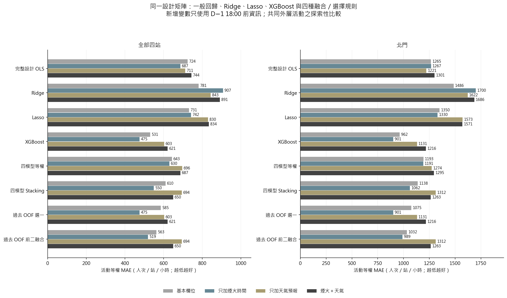
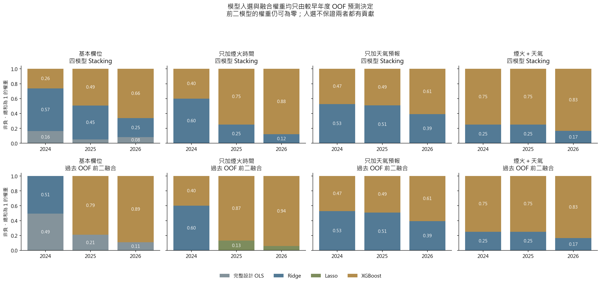
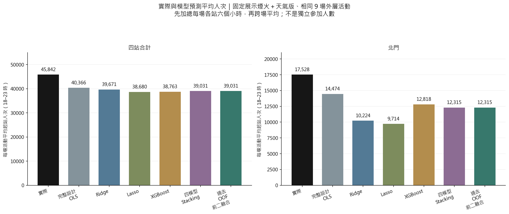
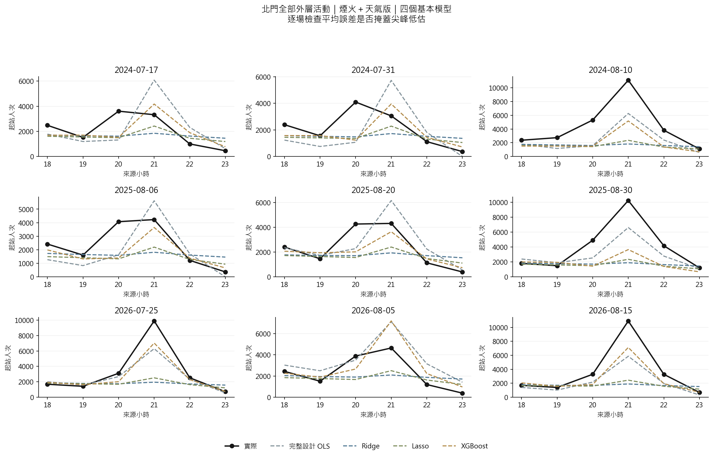
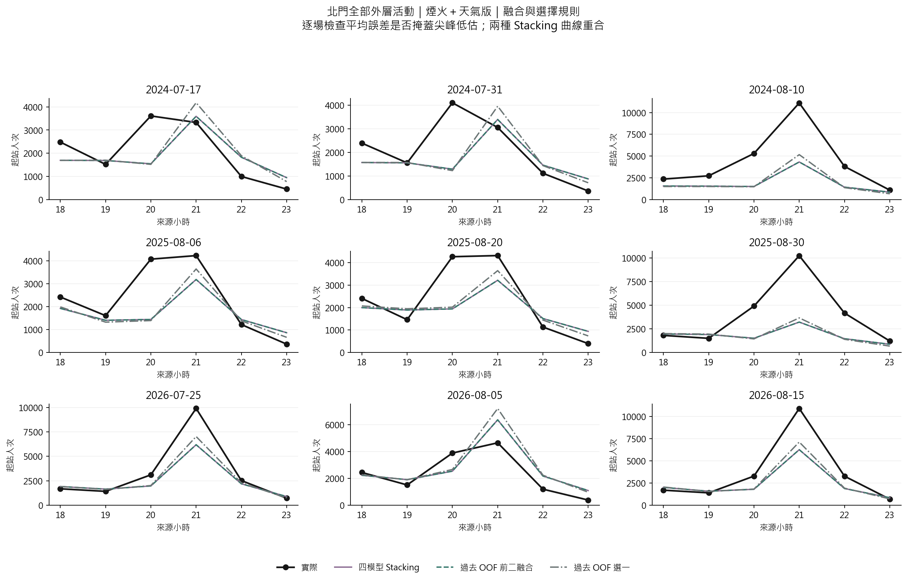

# 第五版：共同設計矩陣、Lasso 與先選模型再融合

本報告為已完成的共同外層回顧比較。所有新增特徵只接受活動前一天 18:00 前的公告／天氣預報；未核實當時發布時間的一般日基準已排除。早年訓練標籤的發布時點及已舉行樣本的回顧選取仍有限制，不能宣稱完整即時部署驗證。

四個模型在每個訓練折使用相同候選欄位、車站 × 時段交互作用、訓練內缺值處理與完全相依欄位移除。一般回歸為完整 OLS，這版沒有 Forward Selection；係數方法比較因此不再混入不同設計矩陣。

## 實際結果

### 全部四站 MAE（人次／站／小時；越低越好）

| 模型 | 基本欄位 | 只加煙火時間 | 只加天氣預報 | 煙火＋天氣 |
|---|---|---|---|---|
| 完整設計 OLS | 724.22 | 686.52 | 711.34 | 743.59 |
| Ridge | 781.14 | 907.18 | 843.22 | 890.61 |
| Lasso | 731.32 | 741.97 | 829.59 | 834.05 |
| XGBoost | 530.95 | 475.45 | 603.24 | 620.97 |
| 四模型等權 | 643.02 | 629.81 | 695.95 | 686.73 |
| 四模型 Stacking | 610.22 | 549.54 | 694.33 | 649.95 |
| 過去 OOF 選一 | 585.25 | 475.45 | 603.24 | 620.97 |
| 過去 OOF 前二融合 | 562.70 | 519.43 | 694.33 | 649.95 |

### 北門 MAE（人次／站／小時；越低越好）

| 模型 | 基本欄位 | 只加煙火時間 | 只加天氣預報 | 煙火＋天氣 |
|---|---|---|---|---|
| 完整設計 OLS | 1265.01 | 1266.52 | 1220.58 | 1301.11 |
| Ridge | 1486.04 | 1700.03 | 1622.12 | 1686.22 |
| Lasso | 1349.65 | 1329.60 | 1572.73 | 1570.68 |
| XGBoost | 962.42 | 901.07 | 1130.83 | 1216.43 |
| 四模型等權 | 1192.78 | 1190.95 | 1273.85 | 1295.27 |
| 四模型 Stacking | 1138.18 | 1062.28 | 1312.11 | 1263.43 |
| 過去 OOF 選一 | 1074.90 | 901.07 | 1130.83 | 1216.43 |
| 過去 OOF 前二融合 | 1032.45 | 989.44 | 1312.11 | 1263.43 |

固定煙火＋天氣版：北門四模型 Stacking MAE 為 1,263.43，先選前二再融合為 1,263.43，兩者 MAE 相同。 本版兩種規則在每個年度得到相同權重：全四模型融合已將未入選模型設成零，先排除它們沒有改變預測。這是共同外層結果，不能預先假定選模型再融合必然改善。

## 選模型與融合的規則

1. 每一外層年度只用較早活動；更內層向前驗證調 Ridge、Lasso、XGBoost。
2. 中層產生過去活動的 OOF 預測，用活動等權 MAE 排名四個模型，固定保留前二。
3. 在相同過去 OOF 上估計非負、總和為 1 的 MAE 融合權重；同時保留全四模型融合、等權及只選一個的對照。
4. 到外層年度才計分。排名與權重擬合共用 OOF，因此 OOF 誤差只是訓練診斷；成效只能看外層。
5. 本批外層資料已被多次檢查，結果屬探索性回顧比較；下一個尚未觀察的新場次才適合獨立確認。

## 平均人次

圖固定展示煙火＋天氣版，不依外層最小誤差挑版本。每一活動先加總 18–23 時的站點起站人次，再對相同外層活動取平均。這是捷運起站人次，不是獨立參加人數；不同逐時曲線也可能有相同平均，所以須同時檢查逐時與尖峰誤差。

## 北門逐場曲線

完整數值：`tables/metrics_by_variant.csv`、`tables/yearly.csv`、`tables/mean_event_counts.csv`、`tables/selected_models_weights.csv`。各版本另保留選參、係數與資料可得性稽核。
