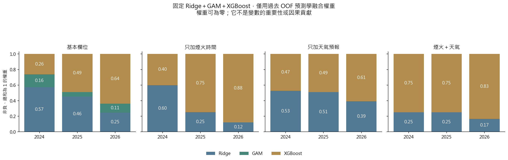
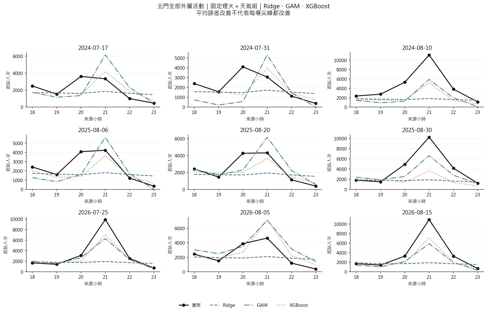
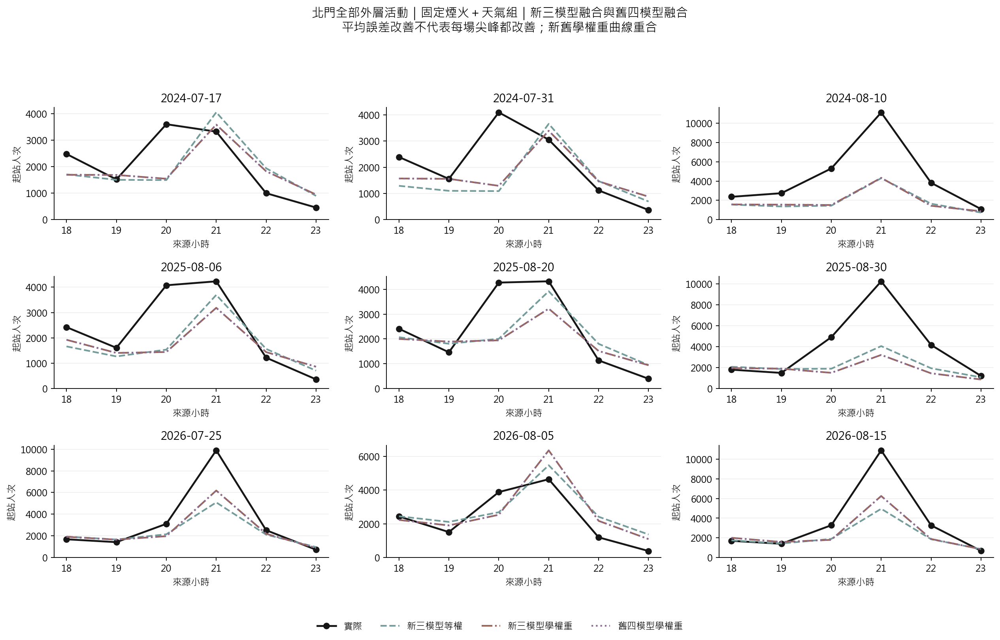

# 第六版：GAM 與 Ridge／GAM／XGBoost 融合

固定比較四組特徵；所有新增節目與天氣變數，只接受活動前一天 18:00 前已發布的資訊。原第五版八種方法的設定與來源保持一致，並逐值驗證預測重現。GAM 與兩種新融合均使用相同外層活動評分。

## 選模型的理由

- **Ridge**：提供收縮後的線性與既定車站 × 時段交互預測，保留相關訊號。
- **GAM**：用受懲罰的低複雜度平滑函數描述連續變數的彎曲關係，仍能逐項畫圖；類別與車站 × 時段結構另行保留。
- **XGBoost**：透過條件切分描述門檻與多變數交互規律。
- 三者的函數結構不同，是事前選擇融合成員的理由；是否互補仍須由外層誤差檢查，不能因模型名稱不同便假定有效。

## 實際結果

### 全部四站 MAE（人次／站／小時；越低越好）

| 模型 | 基本欄位 | 只加煙火時間 | 只加天氣預報 | 煙火＋天氣 |
|---|---|---|---|---|
| 完整 OLS | 724.22 | 686.52 | 711.34 | 743.59 |
| Ridge | 781.14 | 907.18 | 843.22 | 890.61 |
| Lasso | 731.32 | 741.97 | 829.59 | 834.05 |
| GAM | 668.05 | 616.17 | 726.32 | 803.89 |
| XGBoost | 530.95 | 475.45 | 603.24 | 620.97 |
| 舊四模型等權 | 643.02 | 629.81 | 695.95 | 686.73 |
| 舊四模型學權重 | 610.22 | 549.54 | 694.33 | 649.95 |
| 舊 OOF 選一 | 585.25 | 475.45 | 603.24 | 620.97 |
| 舊 OOF 前二融合 | 562.70 | 519.43 | 694.33 | 649.95 |
| 新三模型等權 | 615.25 | 604.40 | 673.61 | 675.36 |
| 新三模型學權重 | 608.46 | 549.54 | 694.33 | 649.95 |

### 北門 MAE（人次／站／小時；越低越好）

| 模型 | 基本欄位 | 只加煙火時間 | 只加天氣預報 | 煙火＋天氣 |
|---|---|---|---|---|
| 完整 OLS | 1265.01 | 1266.52 | 1220.58 | 1301.11 |
| Ridge | 1486.04 | 1700.03 | 1622.12 | 1686.22 |
| Lasso | 1349.65 | 1329.60 | 1572.73 | 1570.68 |
| GAM | 1227.20 | 1206.25 | 1254.88 | 1355.52 |
| XGBoost | 962.42 | 901.07 | 1130.83 | 1216.43 |
| 舊四模型等權 | 1192.78 | 1190.95 | 1273.85 | 1295.27 |
| 舊四模型學權重 | 1138.18 | 1062.28 | 1312.11 | 1263.43 |
| 舊 OOF 選一 | 1074.90 | 901.07 | 1130.83 | 1216.43 |
| 舊 OOF 前二融合 | 1032.45 | 989.44 | 1312.11 | 1263.43 |
| 新三模型等權 | 1139.10 | 1135.43 | 1213.10 | 1270.94 |
| 新三模型學權重 | 1134.10 | 1062.28 | 1312.11 | 1263.43 |

固定煙火＋天氣組：北門舊四模型學權重 MAE 1,263.43；新三模型等權 1,270.94、學權重 1,263.43。新學權重與舊融合的 MAE 相同。此組三個外層年度的 GAM 權重均為零，因此新融合只剩 Ridge 與 XGBoost；舊融合也只有這兩者有非零權重，兩組融合曲線重合。融合可能優於某些單一模型，也可能輸給另一個單一模型。

## 訓練與融合流程

1. 先固定 Ridge、GAM、XGBoost；本版不依外層成績決定成員。
2. 每個外層年度只用較早活動；各內層以向前切分選 Ridge 懲罰、GAM 平滑強度與 XGBoost 設定。
3. 對過去活動產生 OOF 預測。新等權融合各占 1/3；新學權重融合以過去 OOF 的活動等權 MAE，估計非負且總和為 1 的三個權重。
4. 到外層年度才計分。OOF 用來訓練權重，OOF 誤差不是最終測試成績；權重也不是因果貢獻。
5. 舊 OLS、Ridge、Lasso、XGBoost、四模型等權、四模型學權重、OOF 選一及前二融合都保留作同樣本對照。

## 平均人次及北門尖峰

固定展示煙火＋天氣組，沒有依外層最小誤差挑圖。先加總每場 18–23 時的起站人次，再跨活動平均；它不是獨立參加人數。平均總量接近也不代表尖峰時段正確。

## GAM 的可解釋性

下圖固定使用 2026 外層訓練模型（訓練資料止於 2025 年），只畫訓練觀測範圍。每個函數以訓練平均項效果中心化，表示未做非負截斷前的加法分量；不是完整人流預測、不是因果效果，也沒有推論用信賴區間。

## 限制與文獻

- 只有 21 場活動，外層共同評分 9 場；504 個站時列不能當成 504 個獨立活動。小樣本下平滑曲線與融合權重都可能不穩定。
- 新欄位有 D−1 來源閘門，但早年訓練標籤／日曆版本時間及回顧挑選已舉行活動的限制仍在；不能宣稱完整 D−1 即時部署驗證。
- 這批外層年度已反覆檢查，屬探索性回顧比較。更換模型後的改善仍需未見活動確認。
- [Hastie 與 Tibshirani（1986）：Generalized Additive Models](https://doi.org/10.1214/ss/1177013604)：GAM 的加法平滑結構。
- [Eilers 與 Marx（1996）：Flexible Smoothing with B-splines and Penalties](https://doi.org/10.1214/ss/1038425655)：基底與差分懲罰的平滑原理。
- [Hoerl 與 Kennard（1970）：Ridge Regression](https://doi.org/10.1080/00401706.1970.10488634)：係數收縮。
- [Chen 與 Guestrin（2016）：XGBoost](https://arxiv.org/abs/1603.02754)：梯度提升樹。
- [Breiman（1996）：Stacked Regressions](https://statistics.berkeley.edu/sites/default/files/tech-reports/367.pdf)：以留出預測學融合；本研究的 MAE、總和為 1 與時間切分是指定實作，不是原文最佳性保證。

完整數值：`tables/metrics_by_variant.csv`、`tables/yearly.csv`、`tables/mean_event_counts.csv`、`tables/fusion_weights.csv`。`comparison_audit.json` 留下來源雜湊、共同切分與第五版重現檢查。
