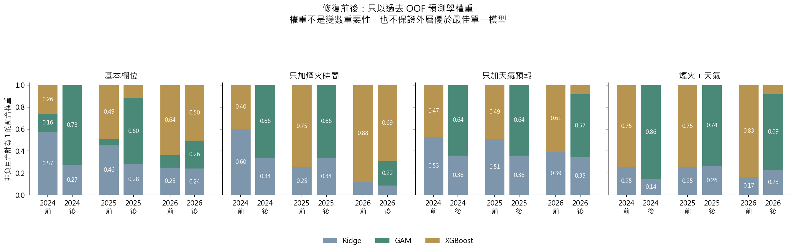
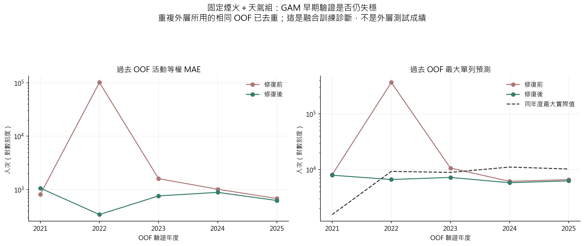
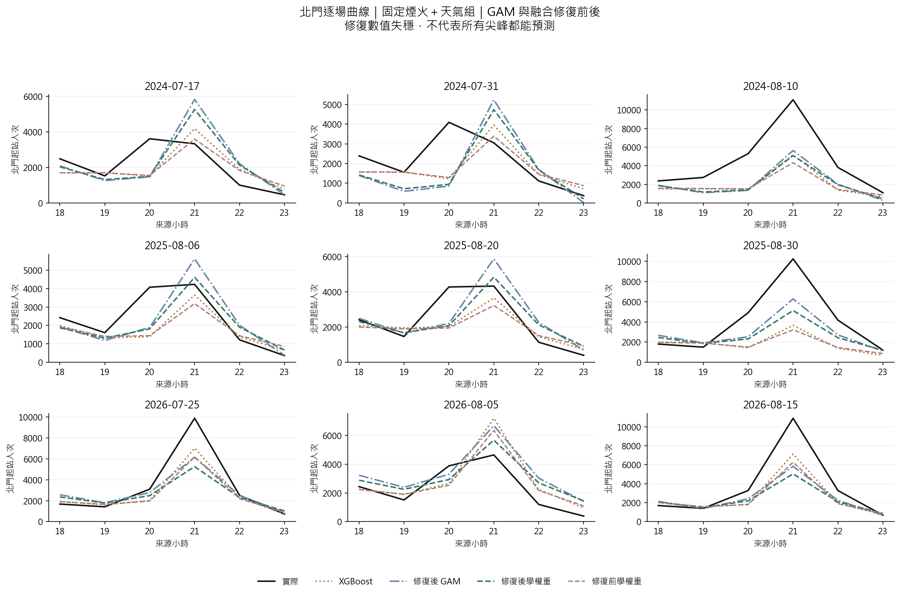

# 第七版：GAM 修復後重跑融合

本版固定原資料、D−1 18:00 來源閘門、候選變數與時間切分，只修復 GAM 的支援範圍／數值穩定性設計。四組特徵、九場共同外層活動與原八種方法都保留。所有比較先驗證來源雜湊、套件版本、切分，以及舊方法逐值重現。

## 固定煙火＋天氣組：北門結果

| 模型 | 修前 MAE | 修後 MAE | MAE 差（後−前） | 修前尖峰低估 | 修後尖峰低估 |
|---|---|---|---|---|---|
| Ridge | 1686.22 | 1686.22 | 0.00 | 5171.47 | 5171.47 |
| GAM | 1355.52 | 1275.14 | -80.38 | 2584.80 | 2623.76 |
| XGBoost | 1216.43 | 1216.43 | 0.00 | 2820.41 | 2820.41 |
| 三模型等權 | 1270.94 | 1266.76 | -4.18 | 3311.16 | 3335.84 |
| 三模型學權重 | 1263.43 | 1271.13 | 7.70 | 3241.51 | 2988.39 |
| 舊四模型學權重 | 1263.43 | 1263.43 | 0.00 | 3241.51 | 3241.51 |

此表 MAE 是北門六個時段先每場平均、再跨場平均的逐時絕對誤差。尖峰低估在每場北門實際最高時段計算正向低估量，高估記為零；不能用模型自己選的最高值代替。

## 融合權重與早期 OOF 診斷

等權融合固定 Ridge、GAM、XGBoost 各 1/3；學權重仍僅依過去向前 OOF 預測，以活動等權 MAE 估計非負且合計為 1 的權重。本版不因外層表現更換成員、刪除年份或事後選誤差最小的一組特徵。

固定煙火＋天氣組，學權重融合的全站 MAE 649.95 → 702.32；北門 1263.43 → 1271.13（增加 7.70）。同組 XGBoost 全站／北門 MAE 為 620.97／1216.43。修復讓過去 OOF 預測更穩定，但融合仍未勝過 XGBoost；GAM 得到非零權重不等於外層勝出。也不能依此事後調權重或刪掉年份。

| 版本 | OOF 年度 | 活動數 | MAE | 最大單列預測 | 最大實際值 |
|---|---|---|---|---|---|
| 修復前 | 2021 | 1 | 815.45 | 8118.66 | 1566.00 |
| 修復前 | 2022 | 1 | 101324.82 | 363991.94 | 9291.00 |
| 修復前 | 2023 | 6 | 1607.33 | 10655.65 | 8910.00 |
| 修復前 | 2024 | 3 | 1017.36 | 6152.25 | 11101.00 |
| 修復前 | 2025 | 3 | 682.53 | 6623.14 | 10251.00 |
| 修復後 | 2021 | 1 | 1066.06 | 7931.27 | 1566.00 |
| 修復後 | 2022 | 1 | 341.94 | 6644.98 | 9291.00 |
| 修復後 | 2023 | 6 | 763.15 | 7238.21 | 8910.00 |
| 修復後 | 2024 | 3 | 889.00 | 5818.21 | 11101.00 |
| 修復後 | 2025 | 3 | 626.53 | 6283.41 | 10251.00 |

OOF 健康表將不同外層年度重複使用的同一筆過去預測去重，並先檢查重複值一致。它描述訓練權重時可見的預測穩定性，不是未見年度的泛化成績。

## 北門尖峰與限制

- 修復數值失穩與改善尖峰預測是兩件事。若三個模型同時低估，非負且總和為 1 的融合無法超過當筆最高的基模型預測。
- 站時列的應變數是起站人次，不是獨立參加人數，也不是已驗證的分鐘月台到達率。
- 新增節目與天氣欄位維持 D−1 來源閘門；早年歷史標籤發布時間／預定活動日期版本未全核實，仍不可宣稱完整即時部署驗證。
- 九場外層活動已反覆查看，本次屬探索性修復比較；改善需要未見活動再驗證。
- 精確修復規格、懲罰公式與實作細節見根目錄 [process.md](../../process.md)。

完整資料：`tables/metrics_before_after.csv`、`tables/paired_changes.csv`、`tables/yearly_before_after.csv`、`tables/beimen_actual_peaks.csv`、`tables/oof_health.csv`、`tables/fusion_weights_before_after.csv`。來源與重現檢查見 `comparison_audit.json`。
