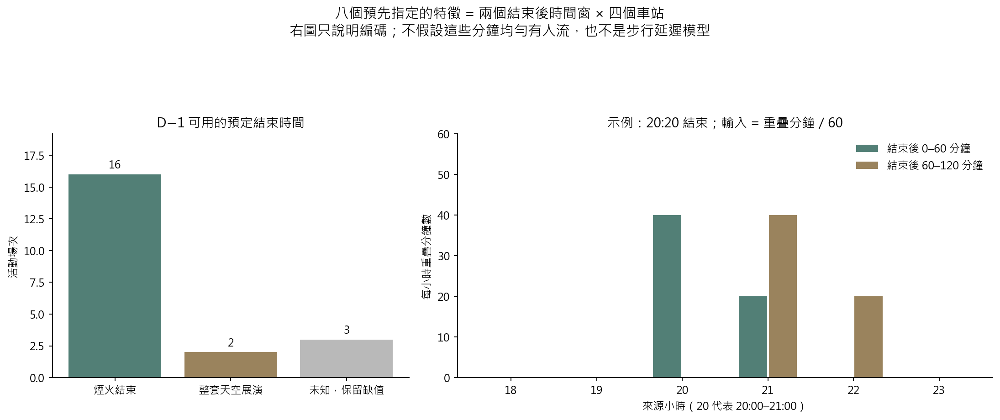
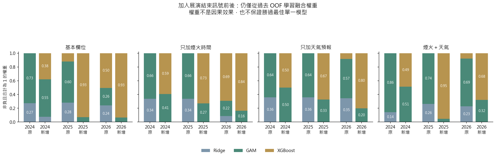

# 第八版：加入事前公告的展演結束訊號

本版新增『預定展演結束後兩個一小時時間窗 × 四個車站』共八個候選變數，重跑十一種方法。基準為修復後第七版；既有輸入、GAM 修復、調參網格、D−1 18:00 閘門與向前時間切分維持不變。主要比較事先固定為煙火＋天氣組，其他三組用於拆解特徵效果。

## 資料與特徵

- 共 21 場活動、504 筆站時資料；18 場可用預定結束時間，3 場維持未知。
- 16 場是煙火結束、2 場是整套天空展演結束；它們不等於舞台結束或民眾實際散場。
- 對來源小時與結束後 0–60／60–120 分鐘求重疊分鐘數，除以 60 後乘上各車站指標（0–1 小時）。未知活動的八欄全部留缺值，沒有刪除該活動或填入事後實際結束時間。
- 相同九場外層活動、216 筆站時資料全部保留。所有模型重新估計，因此既有模型預測可以改變。
- 共用 Encoder 僅擴充這八欄的允許名單與 0–1 範圍檢查；第七版模型演算法本體不變，差異另經程式審查與測試。

## 固定煙火＋天氣組：北門結果

| 模型 | 原 MAE | 新增後 MAE | MAE 差（新−原） | 原尖峰絕對誤差 | 新增後尖峰絕對誤差 |
|---|---|---|---|---|---|
| 完整 OLS | 1301.11 | 1107.64 | -193.48 | 3127.36 | 2669.78 |
| Ridge | 1686.22 | 1117.39 | -568.83 | 5171.47 | 3147.70 |
| Lasso | 1570.68 | 1153.35 | -417.33 | 4824.88 | 2977.66 |
| GAM | 1275.14 | 1108.64 | -166.50 | 3175.04 | 2652.86 |
| XGBoost | 1216.43 | 642.59 | -573.84 | 3103.92 | 1037.16 |
| 三模型等權 | 1266.76 | 875.62 | -391.14 | 3411.40 | 2103.30 |
| 三模型學權重 | 1271.13 | 787.27 | -483.86 | 3201.66 | 1485.88 |

MAE 先在每場的六個小時計算，再跨場平均；差值小於零表示改善。尖峰絕對誤差在每場實際最大人次的小時計算，沒有用模型自己選出的最高值取代。

- XGBoost：全站 MAE 620.97 → 460.96；北門 MAE 1216.43 → 642.59（降低 573.84）。
- 三模型等權：全站 MAE 675.63 → 557.84；北門 MAE 1266.76 → 875.62（降低 391.14）。
- 三模型學權重：全站 MAE 702.32 → 529.28；北門 MAE 1271.13 → 787.27（降低 483.86）。

**在同九場北門比較中，學權重融合的 MAE 787.27 仍高於 XGBoost 的 642.59。**特徵改善不代表融合一定優於單一模型。
XGBoost 的尖峰人次絕對誤差由 3103.92 → 1037.16，但尖峰出現小時的平均絕對誤差為 0.2222 → 0.3333 小時（增加）。因此不能把人次誤差降低解讀成尖峰時點也全面改善。

### 四組特徵的配對結果

以下完整展示四組結果；主要結論維持事先固定的煙火＋天氣組，不依外層最低分改選組合。

| 原有特徵組 | 模型 | 原北門 MAE | 新增後北門 MAE | MAE 差（新−原） |
|---|---|---|---|---|
| 煙火＋天氣 | 三模型學權重 | 1271.13 | 787.27 | -483.86 |
| 煙火＋天氣 | XGBoost | 1216.43 | 642.59 | -573.84 |
| 基本欄位 | 三模型學權重 | 1162.48 | 609.26 | -553.23 |
| 基本欄位 | XGBoost | 962.42 | 504.20 | -458.22 |
| 只加煙火時間 | 三模型學權重 | 1127.75 | 611.70 | -516.06 |
| 只加煙火時間 | XGBoost | 901.07 | 553.75 | -347.32 |
| 只加天氣預報 | 三模型學權重 | 1228.61 | 761.22 | -467.39 |
| 只加天氣預報 | XGBoost | 1130.83 | 690.79 | -440.04 |

## 北門尖峰與融合權重

等權融合固定 Ridge、GAM、XGBoost 各 1/3；學權重仍僅利用過去向前 OOF 預測，最小化活動等權 MAE，權重非負且合計為 1。新增時間特徵可能改變單一模型、過去 OOF 誤差與融合權重；外層結果沒有用來調權重、刪活動或更換模型。

## 解讀與後續

- 這次測試的是『事前公告的時間是否有助辨認逐時人流』。它不直接觀測離場者、步行時間、進閘或月台到達，亦不預設必定改善。
- 起站人次不是獨立參加人數；若要接排隊模型，仍需分鐘內到達形狀、方向分流、步行延遲、列車剩餘容量及班距。
- 21 場活動不是 504 場獨立樣本。結束時間變化有限，與原站時設計可能高度相關；秩檢查及正則化在各訓練折內進行。
- 三模型若同時低估，非負且和為 1 的融合無法超過該筆最高基模型預測；不要因融合形式較複雜就宣稱較準。
- 同九場外層活動已被多次查看，本版屬探索性比較，不能宣稱新的獨立驗證；須以未見活動確認。
- 新增來源通過現有 D−1 閘門，原歷史標籤發布時間與早期活動日期版本仍未全部核實，尚未具備完整事前部署認證。
- 實作、公式與原始公告整理見 [process.md](../../process.md) 與 [來源紀錄](../../docs/d1_show_end_sources.json)。

完整表格：`tables/metrics_before_after.csv`、`tables/paired_changes.csv`、`tables/yearly_before_after.csv`、`tables/beimen_actual_peaks.csv`、`tables/fusion_weights_before_after.csv`、`tables/end_time_coverage.csv`。來源、同筆比較與 GAM 全層診斷見 `comparison_audit.json`。
