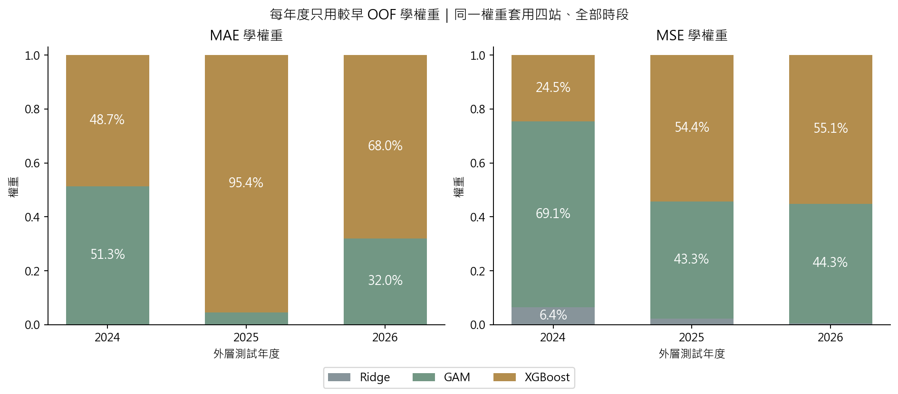
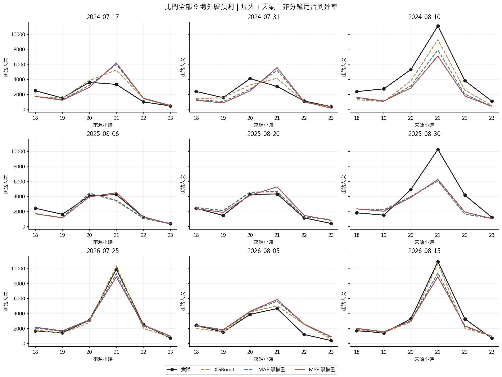

# 第九版：MAE 與 MSE 融合權重的公平比較

**本次北門 MAE、RMSE 均以 MAE 學權重較低；MSE 並沒有改善整體尖峰低估。** 這是相同九場的探索性結果，不表示 MAE 在所有情境都比 MSE 好。

固定第八版 Ridge、GAM、XGBoost 的訓練、調參與預測，只更換融合權重的損失函數。主要組仍為煙火＋天氣，其他三組完整列出。這不是重新以 MSE 調整所有基模型。

- 外層：2024–2026 年各 3 場，共 9 場、四站 × 18–23 時 = 216 列；北門 54 列。
- 每個年度只用更早的時間 OOF 同時擬合 MAE、MSE 權重；相同非負、總和為 1 限制。
- 每場活動等權，活動內站時等權。MSE 的單位為人次平方；展示 RMSE，與 MAE 都是人次／站／小時。
- RMSE = sqrt(各活動 MSE 的平均)，不是各活動 RMSE 的平均。在同一樣本及加權定義下，最小化 MSE 與 RMSE 的權重相同。

## 四站結果：煙火＋天氣

| 方法 | MAE | RMSE | 尖峰正向低估 | 尖峰絕對誤差 | 尖峰時刻差（小時） |
|---|---|---|---|---|---|
| Ridge | 693.21 | 1,204.33 | 1,703.40 | 1,736.88 | 0.56 |
| GAM | 708.96 | 1,010.76 | 1,079.09 | 1,478.99 | 0.56 |
| XGBoost | 460.96 | 707.19 | 830.11 | 962.87 | 0.50 |
| 等權融合 | 557.84 | 881.61 | 1,161.22 | 1,306.96 | 0.58 |
| MAE 學權重 | 529.28 | 792.60 | 917.27 | 1,080.59 | 0.50 |
| MSE 學權重 | 553.04 | 838.29 | 964.52 | 1,188.84 | 0.47 |

## 北門結果：煙火＋天氣

| 方法 | MAE | RMSE | 尖峰正向低估 | 尖峰絕對誤差 | 尖峰時刻差（小時） |
|---|---|---|---|---|---|
| Ridge | 1,117.39 | 1,966.79 | 3,147.70 | 3,147.70 | 0.22 |
| GAM | 1,108.64 | 1,557.02 | 2,006.01 | 2,652.86 | 0.22 |
| XGBoost | 642.59 | 982.09 | 889.81 | 1,037.16 | 0.33 |
| 等權融合 | 875.62 | 1,363.62 | 1,926.54 | 2,103.30 | 0.22 |
| MAE 學權重 | 787.27 | 1,168.11 | 1,338.54 | 1,485.88 | 0.33 |
| MSE 學權重 | 842.53 | 1,261.08 | 1,484.04 | 1,752.94 | 0.22 |

尖峰正向低估：每站每場以實際最高人次的那個小時，計算 max(實際−同小時預測, 0)，高估記 0；另列絕對誤差，避免只報低估而掩蓋高估。尖峰時刻差比較各自最高小時，並列最高時取較早小時。

## 每年度的融合權重

| 外層年度 | 目標 | Ridge | GAM | XGBoost | OOF 場數 | OOF MAE | OOF RMSE |
|---|---|---|---|---|---|---|---|
| 2024 | mae | 0.00% | 51.29% | 48.71% | 8 | 717.06 | 1,105.93 |
| 2024 | mse | 6.39% | 69.06% | 24.55% | 8 | 744.06 | 1,093.11 |
| 2025 | mae | 0.00% | 4.60% | 95.40% | 11 | 691.44 | 1,111.36 |
| 2025 | mse | 2.31% | 43.31% | 54.37% | 11 | 706.48 | 1,071.60 |
| 2026 | mae | 0.00% | 31.99% | 68.01% | 14 | 647.86 | 1,019.08 |
| 2026 | mse | 0.56% | 44.30% | 55.14% | 14 | 653.96 | 1,015.20 |

OOF 成績是用來學權重的訓練損失，不能當外層泛化成績。不同目標只能保證在自己目標的訓練 OOF 上不更差，不能保證未來或北門較準。

## 四組配對差異

下表是 MSE 融合 − MAE 融合；負數表示 MSE 融合誤差較低。主要組不因本表結果改選。

| 輸入 | 範圍 | ΔMAE | ΔRMSE | Δ尖峰正向低估 |
|---|---|---|---|---|
| 基本欄位 | 四站 | 72.91 | 118.93 | 227.83 |
| 基本欄位 | 北門 | 131.02 | 204.39 | 495.96 |
| 只加煙火時間 | 四站 | 87.10 | 88.45 | 123.06 |
| 只加煙火時間 | 北門 | 157.62 | 183.20 | 412.91 |
| 只加天氣預報 | 四站 | 45.55 | 63.55 | 84.57 |
| 只加天氣預報 | 北門 | 78.67 | 111.76 | 236.22 |
| 煙火＋天氣 | 四站 | 23.75 | 45.69 | 47.25 |
| 煙火＋天氣 | 北門 | 55.26 | 92.97 | 145.50 |

## 北門逐場結果

| 活動 | MAE 融合 MAE | MSE 融合 MAE | MAE 融合 RMSE | MSE 融合 RMSE |
|---|---|---|---|---|
| 2024-07-17 | 754.43 | 856.25 | 1,161.30 | 1,260.01 |
| 2024-07-31 | 917.17 | 1,050.98 | 1,165.42 | 1,345.55 |
| 2024-08-10 | 1,734.56 | 1,930.93 | 1,924.15 | 2,232.07 |
| 2025-08-06 | 397.15 | 280.60 | 482.42 | 378.55 |
| 2025-08-20 | 334.55 | 378.14 | 387.03 | 475.84 |
| 2025-08-30 | 1,500.57 | 1,420.61 | 2,059.88 | 1,948.67 |
| 2026-07-25 | 270.40 | 357.38 | 321.75 | 491.63 |
| 2026-08-05 | 588.25 | 644.79 | 738.93 | 808.83 |
| 2026-08-15 | 588.35 | 663.10 | 771.94 | 932.59 |

### 北門分年度：保留相反結果

| 年度 | 方法 | MAE | RMSE | 尖峰正向低估 |
|---|---|---|---|---|
| 2024 | MAE 學權重 | 1,135.39 | 1,461.64 | 1,673.63 |
| 2024 | MSE 學權重 | 1,279.39 | 1,671.35 | 2,099.33 |
| 2025 | MAE 學權重 | 744.09 | 1,241.72 | 1,639.85 |
| 2025 | MSE 學權重 | 693.11 | 1,178.56 | 1,333.94 |
| 2026 | MAE 學權重 | 482.33 | 644.32 | 702.14 |
| 2026 | MSE 學權重 | 555.09 | 767.17 | 1,018.84 |

年度成績不可用來事後替同年度挑模型；每年度權重在看到當年度真值前已由過去 OOF 固定。

## 方法、文獻與限制

- [Breiman（1996）, Stacked Regressions](https://statistics.berkeley.edu/sites/default/files/tech-reports/367.pdf)：支持以交叉驗證預測做非負最小平方融合；本案另固定總和為 1 與時間向前切分，不宣稱全部細節照搬原文。
- [Ersoy 等, Stacking Regression for Time-Series（2023 作者稿，2024 章節）](https://doi.org/10.1007/978-3-031-35763-3_7)：第 3 節比較 L1/L2 stacking，式 (2) 的 L1 使用非負、總和為 1 的絕對誤差目標。[作者稿](https://pure.hw.ac.uk/ws/portalfiles/portal/91472074/Schaffer_Stacking_paper_ECONVN2023.pdf)。
- [Gneiting（2011）, Making and Evaluating Point Forecasts](https://arxiv.org/abs/0912.0902)：平方損失與條件平均數、絕對損失與條件中位數相應；有限樣本、受限制的融合不保證恰好等於兩者。
- MAE 或 RMSE 較低都是這九場的描述結果，尚無新未見測試集支持最終選模；同一活動的 24 列不是獨立活動，未做逐列顯著性檢定。
- 沿用 D−1 18:00 事前節目／預報輸入；歷史 OD 標籤發布時間及日曆版本仍未完全核實，狀態維持 retrospective_non_deployable。沒有新加入當日觀測或實際散場特徵。
- 融合權重是全站、全時段共同估計；MSE 同時重罰高估與低估，不保證降低每場尖峰低估。凸組合不能超過該列三個基模型的最高預測。
- 接排隊前還需方向比例、分鐘到達形狀、步行／入站延遲、班距及剩餘容量。這次未產生候車時間或調度效果。

重現：`python -X utf8 src/compare_fusion_losses.py`。需本機 `.local/analysis_v8/` 已驗證快照；公開的彙整圖表不包含逐筆私有預測。完整實作見根目錄 process.md 第 20 節。
