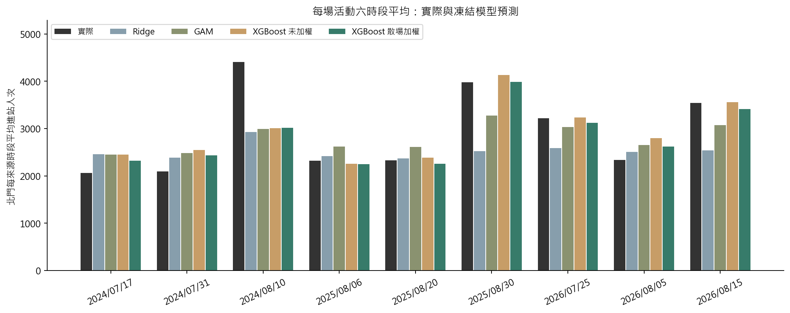
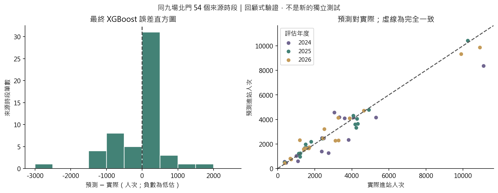
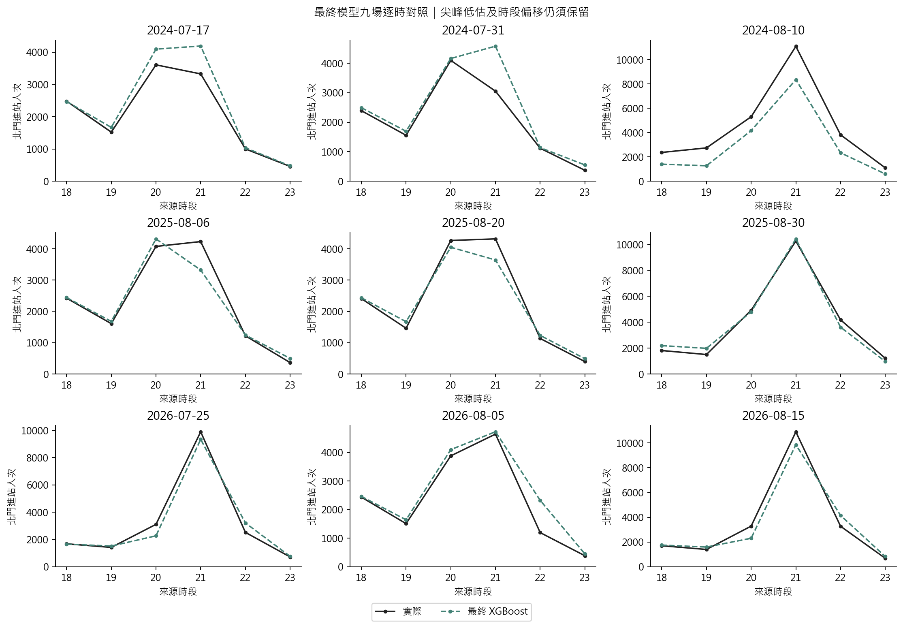
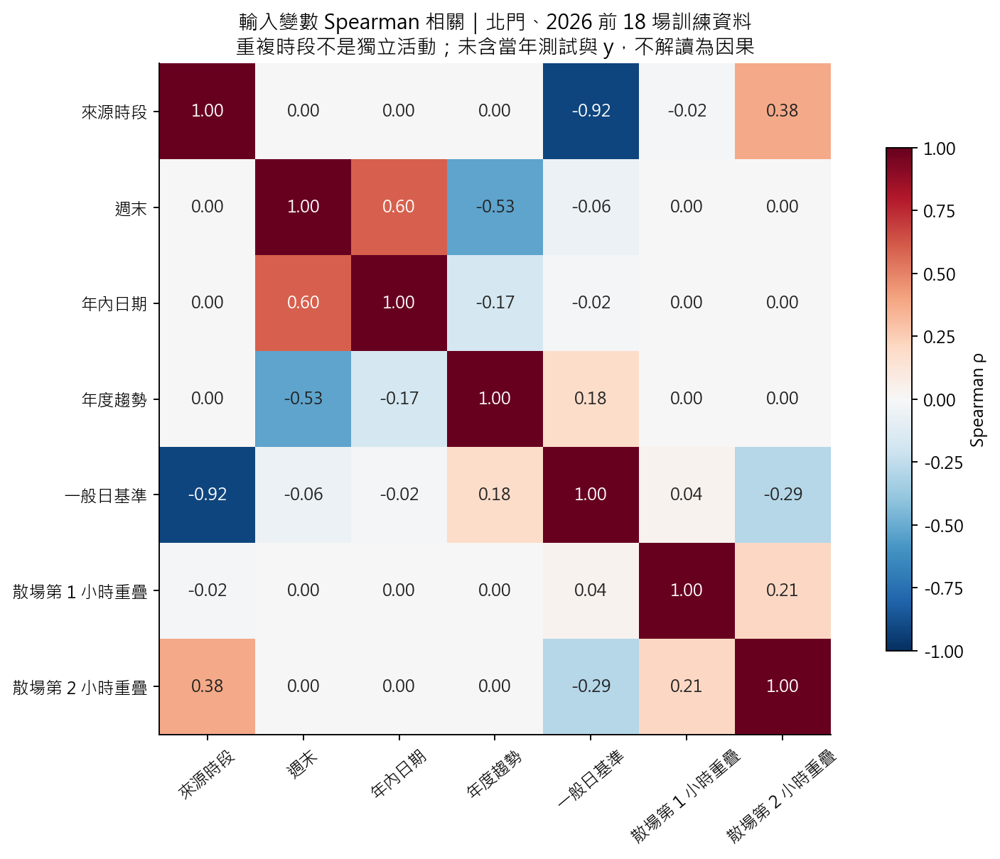

# 最終人流模型結果

保留四站散場加權 XGBoost，Ridge、GAM 為比較模型；未加權 XGBoost 為訓練加權的對照。這是整理原結果，沒有新調參或把當年答案放回訓練。

| 模型 | 北門 MAE | RMSE | 尖峰平均絕對誤差 |
|---|---:|---:|---:|
| Ridge | 845.44 | 1547.49 | 2681.26 |
| GAM | 830.71 | 1315.75 | 2305.11 |
| XGBoost 未加權 | 473.91 | 766.90 | 749.02 |
| XGBoost 散場加權 | 440.28 | 690.91 | 747.14 |

- 資料為 21 場活動、四站、18–23 六個來源時段；504 列不是 504 個獨立活動。
- 預測 2024／2025／2026 時，分別僅用過去 12／15／18 場擬合；主要評分為同九場北門 54 列。
- 現有歷史 OD 與日曆的原始發布時間未完全核實，因此是回顧敏感度研究，不能稱已驗證嚴格 D−1 部署。
- 九場已反覆用於開發。保留乘數 4 的決定受這些外層比較影響，尚需新活動驗證，不能把 440.28 稱為無偏泛化保證。
- 基礎參數原先在較早年度的留出預測上選取；一般日基準加入後保留原參數。細節及完整格點保存在 [調參紀錄](tuning_record.json)。
- 四站減至兩站的比較留在 [車站範圍摘要](tables/station_scope_comparison.csv)，不再保留逐版入口。

## 圖表怎麼讀

每一組是同一場活動六時段平均。這是分組長條圖；平均接近不代表每小時或最高峰也接近。

直方圖負值表示低估，正值表示高估；每格 500 人次。散點越靠近虛線越準，遠離虛線表示該時段誤差大。54 列同屬九場，不能當獨立樣本做一般推論。

最嚴重尖峰低估仍在 2024/8/10：實際 11,101、預測約 8,359，少估約 2,742（24.7%）。候車需保留需求與剩餘容量敏感度。

熱力圖為 2026 前的北門訓練資料，採兩兩非缺值 Spearman；相應筆數另存表格。它是七項代表性輸入的描述，不是超參數相關、因果效果或刪變數規則。車站類別、其他站散場交互項與缺值旗標未列入此七欄圖。

## 公式、係數與模型細節

- Ridge 的完整數值公式、訓練均數／尺度、補值、參考車站與時段：[JSON](ridge_equation_2026.json)；[係數表](tables/ridge_coefficients_2026.csv)。使用 2026 評估折，即僅訓練至 2025，不是用 2026 再擬合的因果模型。
- GAM 的逐項平滑／線性設定與解算檢核：[擬合紀錄](fits.json)；[中心化曲線](tables/gam_components_2026.csv)。本案一般日基準是線性項，不能宣稱所有連續變數都畫成曲線。
- XGBoost：[分裂增益重要度](tables/tree_importance_2026.csv)。只描述 2026 折訓練模型如何使用特徵，不是因果影響或新樣本上的重要度保證。
- [年度指標](tables/annual_metrics.csv)／[各場真實尖峰](tables/actual_peaks.csv)／[逐欄重現檢核](validation.json)／[歷史來源](provenance.json)。
- 等權／學權重融合曾試驗但未採用；不把不同輸入或不同調參目標的歷史融合數字混進這張相同資料的結果表。

[README](../../README.md)／[完整實作流程與公式](../../process.md)
