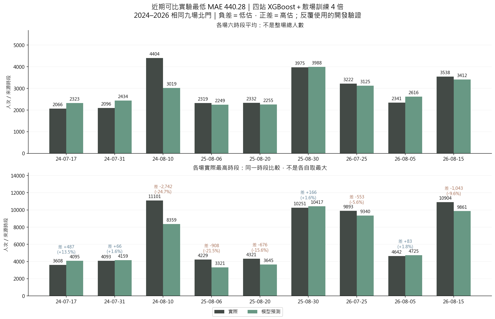
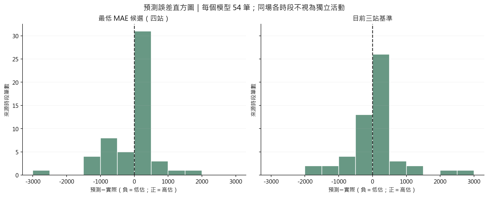

# 北門預測差距、極值模型可行性與待補變數

核對日期：2026-10-14。這次重新計算既有預測、製圖、檢查極值樣本數及查核公開資料來源；沒有重新訓練模型，也沒有擬合 GEV／GPD 或替換網站模型。

## 1. 現在到底差多少？

「最佳」先限定評分目標：最近可比實驗 V14、V15、V16、V18 中，整體 MAE 最低的是 **四站 XGBoost＋北門預定散場訓練權重 4 倍**；目前三站方案保留的是 **三站 XGBoost 原版**。4 倍指訓練損失中的樣本權重，不是把預測人數乘 4。

所有下列比較使用相同 **2024–2026 年九場北門、每場 18–23 六個來源時段，共 54 筆**。四站包含北門、大橋頭、雙連、民權西路；三站移除民權西路。

| 指標（越小越好） | 近期最低 MAE 候選：四站 | 目前三站基準 |
| --- | ---: | ---: |
| MAE：平均每個來源時段差多少 | 440.28 | 491.32 |
| RMSE：更重視大誤差 | 690.91 | 760.23 |
| 每場實際最高時段的平均絕對誤差 | 747.14 | 641.23 |
| 預定散場窗口 2:1 損失 | 1202.98 | 1184.98 |
| 誤差不超過 500 人次 | 36/54 筆 | 39/54 筆 |
| 誤差不超過 1000 人次 | 47/54 筆 | 46/54 筆 |

**四站整體 MAE 較低，但三站的平均實際尖峰誤差較低；沒有一個版本所有指標都贏。**2:1 指低估的研究懲罰是高估兩倍，不是已估得的調度貨幣成本。

這九場已反覆用來開發、挑版本，不能把事後最低分當成「未來已證實最佳」。原始人流及一般日基準的歷史發布時間、OD 來源時段定義限制仍存在，因此這是回顧比較，不能宣稱全部輸入都已證實符合 D−1 可得條件。

### 1.1 每場長條圖

上圖比較每場六時段平均；下圖取實際最高的那個時段，比較模型在**同一時段**的預測，避免各自取最大造成尖峰時間錯位被掩蓋。



| 活動日期 | 實際最高來源時段 | 實際人次 | 該時段預測 | 預測－實際 | 相對誤差 |
| --- | ---: | ---: | ---: | ---: | ---: |
| 2024-07-17 | 20 | 3608 | 4095 | +487 | +13.5% |
| 2024-07-31 | 20 | 4093 | 4159 | +66 | +1.6% |
| 2024-08-10 | 21 | 11101 | 8359 | −2742 | −24.7% |
| 2025-08-06 | 21 | 4229 | 3321 | −908 | −21.5% |
| 2025-08-20 | 21 | 4321 | 3645 | −676 | −15.6% |
| 2025-08-30 | 21 | 10251 | 10417 | +166 | +1.6% |
| 2026-07-25 | 21 | 9893 | 9340 | −553 | −5.6% |
| 2026-08-05 | 21 | 4642 | 4725 | +83 | +1.8% |
| 2026-08-15 | 21 | 10904 | 9861 | −1043 | −9.6% |

最大落差是 2024-08-10：11101 人次預測成 8359，少約 2742。不能只看整體平均：54 筆實際平均 2921.28、四站預測平均 2824.47，平均偏差雖只有 −96.81，但高低估互相抵銷後不代表每次只差 97。

目前三站的最大絕對誤差反而是 **2024-07-31 的 21 時段高估**：實際 3052、預測 5839，差 +2787。這說明問題同時包括人流規模與尖峰時間，不是全面加高預測就能解決。

[目前三站長條圖](figures/current_three_actual.png)／[九場逐時長條圖](figures/best_four_hourly.png)／[逐場原始數字](tables/best_four_events.csv)。資料是北門捷運人次，不能稱為整場活動不重複參加人數。

### 1.2 誤差直方圖

真正的直方圖如下：橫軸是「預測－實際」，負數低估、正數高估；每格寬 500 人次，兩圖使用相同刻度。同一場的六筆並非六場獨立活動。



## 2. 能不能加入極值模型？

**可以作風險預測研究，但目前不建議直接用 GEV 取代逐時 XGBoost。**它們回答的問題不同：

| 方法 | 回答什麼 | 本案限制 |
| --- | --- | --- |
| GEV：每場取 18–23 時段最大值 | 一場尖峰可能多高、超過容量的機率 | 每場只貢獻一個最大值；不能直接預測哪個時段達峰。每個區塊只有六個時段，GEV 近似、活動間可比性與相依性都要檢查 |
| GPD：超過高門檻的資料或低估殘差 | 尾端超過門檻後還可能多大 | 門檻、同場聚集、尾端參數穩定性都要檢查；不能把相鄰小時當獨立極端事件 |
| 分位數 XGBoost | 給定特徵，人流中位數及較高分位數 | 可以先比較，但分位數仍須校準，也不會自動解決資訊不足 |

我已按每個預測年度只計算過去資料的支持量：

| 要預測的年度 | 過去北門活動最大值個數 | 可用過去留出殘差的活動數 | 殘差高於第 90 百分位的筆數 | 這些筆數來自幾場 |
| --- | ---: | ---: | ---: | ---: |
| 2024 | 12 | 8 | 5 | 3 |
| 2025 | 15 | 11 | 7 | 4 |
| 2026 | 18 | 14 | 9 | 4 |

GEV 計數使用現有活動輸入；殘差計數使用 V18 **三站 XGBoost 的過去年份留出預測**，不是拿上方四站九場驗證誤差來擬合。第 90 百分位只是樣本量診斷示例，尚未選定 GPD 門檻。最多 18 個區塊最大值、超標資料僅來自 3–4 場，難以支持很多協變數共同控制位置、尺度與形狀的複雜模型。

文獻並非不允許：Gnecco、Terefe、Engelke 的 [Extremal Random Forests（2022 初稿，2024 修訂）](https://arxiv.org/abs/2201.12865) 將隨機森林與條件 GPD 結合，估計極高條件分位數；它支持「機器學習＋極值」的研究方向，並未證明本案這麼少的活動就能可靠估計。高門檻樣本少會增加估計變異、低門檻又可能增加近似偏差，可參考 [NIST 門檻穩定性說明](https://www.itl.nist.gov/div898/software/dataplot/refman1/auxillar/pot_plot.htm)。

本案建議先保留逐時點預測，另比較分位數預測。若沿用 $2(y-\hat y)_+ +(\hat y-y)_+$，其條件最優解是 $2/3$ 分位數；90% 分位數則代表另一個較保守目標，不應混稱為「低估罰兩倍」。XGBoost 已有 [`reg:quantileerror`](https://xgboost.readthedocs.io/en/release_3.3.0/parameter.html)；評估應包含分位數損失、超過預測的比例及區間寬度，並按活動／年度檢查，而非只比較 MAE。這是下一步提案，這輪尚未實作。

若日後補到更多可比較活動，再做「過去留出殘差 → 門檻診斷 → 同場聚集處理 → 簡單 GPD／GEV → 未來年度驗證」。分鐘到達量和列車剩餘容量仍需額外資料，極值模型不會把逐時 OD 自動變成分鐘排隊人數。

## 3. 是不是參數或變數太少？

**目前不能斷定。模型超參數和資料變數是兩回事。**前者如樹深、學習率與正則化，V14 已擴充並比較早停與散場加權；後者是當天節目、預報與活動吸引力。已有結果顯示，增加參數搜尋或增加變數都有可能變差。

- 已有或試過：車站×時段、星期／年度、一般日基準、煙火／展演預定結束、壓軸／特別場、無人機與展演時間、預報溫度／風速／雲量；不是全部都保留在目前最佳版本。
- 當日前 1／3／5 時段人流也試過，但那是另一個「當日更新」問題，不能納入 D−1 預測。
- 既有 Google 原始序列實際是月資料；年彙整更粗。前一個月的數值很難區分同一個月不同場的吸引力，而且歷史可得時間仍須補證據。
- 目前明確未完整補齊的是「分場地舞台節目時間」、「事前雨量預報」、「逐場前期熱度」及「事前公告的交通／入口限制」。是否能提高精度仍要做消融比較，不能先承諾。

### 3.1 最值得補的四組，以及怎麼抓

| 優先 | 要補什麼 | 最小輸入設計 | 公開來源與取得方式 |
| --- | --- | --- | --- |
| 1 | 分場地舞台／演唱節目結束時間 | 煙火後是否還有表演、距預定舞台結束的時間；只加少量車站交互項 | 市府／觀傳局事前新聞稿、節目表圖片或 PDF；逐場記錄場地、開始及結束，人工核對，不能將開園時間當節目結束 |
| 2 | D−1 預報雨量 | 入場期與散場期的預報累積毫米；先 1–2 欄 | 沿用現有 `scripts/collect_d1_gfs.py` 的 NOAA／NCAR 同一預報批次，擴充 APCP 雨量；保留起報與檔案可得時間 |
| 3 | 每場之前 7 日搜尋關注 | 前期熱度平均、相對前期的變化，先 1–2 欄 | Google Trends 指定地區、關鍵字及期間，下載 CSV；用日／週資料，保存查詢設定與截取時間 |
| 4 | 預定入口／交通限制 | 北門步行路線受限、鄰近替代運具暫停；依預定時段重疊建立少量指標 | 交通局／警察局事前交管公告，保存公告日期及生效區間；不使用活動當天才臨時實施的未知措施 |

**已查到的具體例子：**市府在 2025-08-25 發布的 [8/30 活動交通公告](https://www.gov.taipei/News_Content.aspx?n=F0DDAF49B89E9413&s=E7259AA387636909) 同時列出迪化街永樂廣場、延平河濱公園舞台活動的總時間範圍 14:00–21:30，以及台北地下街 Y27 出口 18:00–22:00 只出不進、北門站 3 號出口旁 YouBike 等站 17:00–23:00 暫停租借。公告日期在 D−1 截止前，顯示這些資料確實有公開來源。

但該新聞稿的 21:30 是多場地總範圍，**不能直接認定碼頭舞台一定演到 21:30**；Y27 是地下街出口，也不是北門驗票閘門。需再核對分場地節目表和步行路線，才能加入數值。現頁顯示發布／更新日期不是完整的歷史版本快照，對有事後修改的頁面仍須保留不確定狀態。

**2024 最大誤差那場也有候選公告：**[官方 8/10 演出介紹](https://travel.taipei/zh-tw/news/details/61571) 提到 13 組演出卡司及煙火規模；但目前頁面標示 2024-08-07 發布、2024-10-15 更新，晚於活動。因此先列為待追原版本的線索，不直接認定目前全文都在 D−1 可得，也不把 13 位／組各做一欄。不能只針對這一場加標籤救誤差。

**雨量可以取得，但處理方式不同：**[NCAR GFS 歷史資料](https://gdex.ucar.edu/datasets/d084001/) 有預報降水量／降水率。既有程式只取溫度、風速、雲量的瞬時值；雨量須讀 GRIB 的累積開始／結束時段，遇到累積重新起算時不能直接將所有相鄰檔案相減，也不能用瞬時溫度的插值方式處理。[NOAA 累積區間處理說明](https://cpc.ncep.noaa.gov/products/wesley/wgrib2/ncep_norm.html)。優先用原 D−1 00 UTC 批次，取得活動時段的累積量；如果只提供三小時間隔，就保留三小時特徵，不假造逐時降雨。

**熱度的免費取得方式：**Google Trends 圖表可[下載 CSV](https://support.google.com/trends/answer/4365538?hl=en)。不同查詢窗口各自縮放成 0–100，不能直接把不同窗口的值接起來比較；要固定查詢條件、使用重疊錨點或一致比例校準，且驗證校準本身沒有用未來資料。[Google 正規化說明](https://support.google.com/trends/answer/4365533?hl=en)。官方 [Trends API](https://developers.google.com/search/apis/trends) 仍是需申請的 Alpha、提供滾動五年資料，不能假定現在人人可用，或能補齊 2017–2020。歷史日資料若無法取得可比較尺度與當時版本，就暫不進正式 D−1 模型。

### 3.2 實際收集與比較順序

1. **先定資料表與截止：**每場、每個場地記錄 `event_date, venue, feature, value, unit, announced_at, source_updated_at, cutoff_at, source_url, retrieved_at, snapshot_sha256, status`；時間一律轉台北時間。預報另外存 `model_initialised_at, published_at, valid_start, valid_end`。
2. **逐場補舞台與雨量：**先補現有 21 場，不只補九場評分資料。公告抓取可用 `requests + BeautifulSoup`；節目圖片／PDF 需人工核對。保留來源，不用事後報導的實際觀眾數填入同場預測。
3. **把未知和零分開：**沒找到節目表不等於沒有演出；沒找到預報不等於沒有下雨。先報每欄各年度覆蓋率；只有確認沒演出／預報零毫米才填 0。
4. **每次一組消融：**凍結同一基準，分別比較「＋舞台時間」、「＋預報雨量」、「＋兩者」；再研究熱度或交管，不一次加入所有新欄位。新舊模型必須使用共同可得的活動資料另列對照，避免因刪掉難預測場次而假改善。
5. **只用過去年份選擇：**選變數、補值、縮放、調參與尾端門檻都只用當年度之前的資料。D−1 18:00 尚未結束的 D−1 全日熱度不能當完整已知值，至少改用 D−2 已完成日並確認發布延遲。
6. **同時看整體與散場：**報 MAE、RMSE、實際尖峰高低估、預定窗口 2:1 損失及每年／每場結果。新的真正未見活動才用來確認是否改善，反覆用的九場只作開發比較。

**建議下一輪先做「分場地節目結束＋D−1 雨量」的小型消融；尾端模型先做分位數，再決定是否有足夠資料做 GPD。**這個優先順序是依目前資料缺口提出的研究判斷，不是文獻已替本案證明的結果。

## 4. 重現與檔案

```powershell
.\.venv\Scripts\python.exe -X utf8 src/plot_best_model_actual.py
```

- 程式讀取既有 V14／V16 預測檔並核對 manifest SHA-256；逐列匹配九場北門的日期、站名、時段及真值。
- `tables/summary.csv`：指標；`tables/best_four_events.csv`、`tables/current_three_events.csv`：逐場數字。
- `tables/recent_candidate_ranking.csv`：本輪可比範圍的完整模型排名；沒有逐場挑最佳預測拼成模型。
- `tables/evt_support_audit.csv`：極值樣本量診斷，不是已擬合的 GEV／GPD 結果。
- `chart_audit.json`：使用檔案雜湊、比對結果與指標。重新製圖需要本機既有 `.local` 預測快照；已輸出的 PNG 不需資料庫或快照即可查看。
