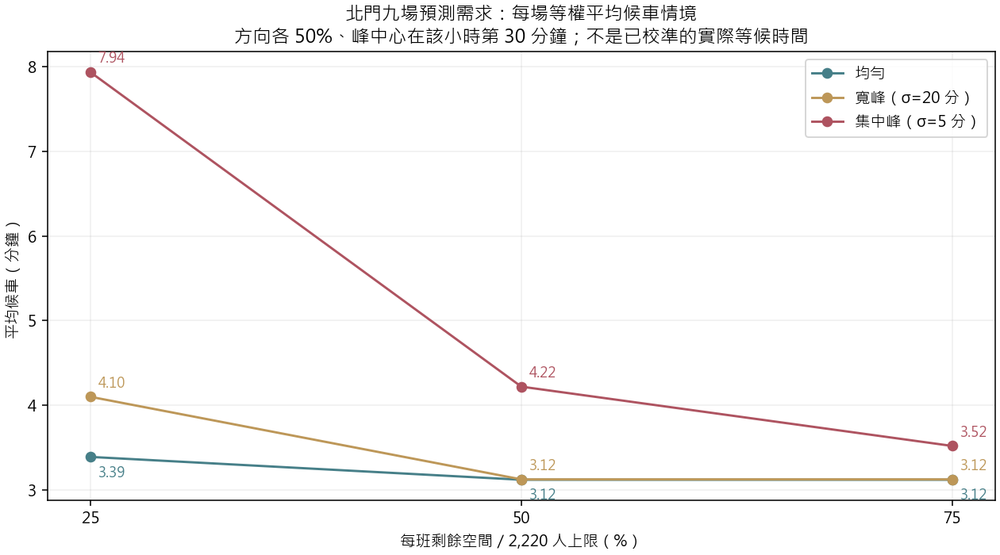
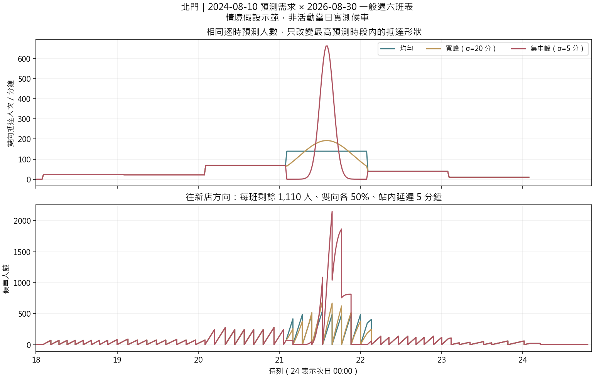

# 北門候車情境與四站營運資料（第一版）

**已執行：固定 V14 四站 XGBoost 的北門預測，沒有重新訓練。這是現行一般班表的壓力情境，不是歷史活動候車重建。**

## 1. 本次實際整理的資料

- 四站共 10 份官方方向 PDF、3 種日型、7,118 個離站時刻；民權西路分紅線／橘線，保留區間車與蘆洲／迴龍終點。
- 187 筆官方相鄰站資料，推算 20 條候選發車站→研究車站路徑；重複候選依營運路線保留。
- 八份班表自 2026/8/30 生效；橘線往南勢角的兩份表自 2026/10/1 生效。九場需求來自 2024–2026/8 的封存預測，故只是假設採用目前班表。
- 已寫入 MySQL 七張新表；重跑不重複新增。原分析表 74,880 列不變，逐欄讀回核對通過。

## 2. 三種到達形狀及容量比較

只調整模型**預測最高的小時**：均勻分布、截斷常態寬峰（σ=20 分鐘）、集中峰（σ=5 分鐘）。每小時總量完全相同，其他小時均勻。不是從真值挑尖峰，也不是已估出的分鐘分布。

每班剩餘空間假設為整列上限 2,220 人的 25%／50%／75%（555／1,110／1,665 人）；這些比例不是量測值。方向拆分另測 40:60、50:50、60:40，峰中心另測第 15／30／45 分鐘。站內步行延遲固定 5 分鐘，仍待校準。

| 到達情境 | 剩餘空間 25% 平均候車 | 50% | 75% |
|---|---:|---:|---:|
| 均勻 | 3.39 分 | 3.12 分 | 3.12 分 |
| 寬峰（σ=20 分） | 4.10 分 | 3.12 分 | 3.12 分 |
| 集中峰（σ=5 分） | 7.94 分 | 4.22 分 | 3.52 分 |

以上是九場各自雙向依人數加權後，再對九場等權平均。均已清空才報完整平均；沒有把未上車者刪掉。

例：2024-08-10，每班剩餘 1,110 人：

| 情境 | 雙向平均候車 | 最擁擠方向的最大候車人數 |
|---|---:|---:|
| 寬峰（σ=20 分） | 3.62 分 | 764 |
| 集中峰（σ=5 分） | 5.36 分 | 2,373 |
| 均勻 | 3.61 分 | 557 |

## 3. 候選發車站到四站的時間

**下表為候選站已發車後的區間行駛＋中間站停靠時間。不是接到調度命令到抵達的完整時間，也不表示候選站當時有備車或可插車。**
CSV 只列一個方向；反向採相同區間行駛時間的假設。停站欄依起站為 0 的序列解讀為 stationA 停靠，仍需營運方確認。沒有把乘客跨線轉乘當成列車調車路徑。

| 抵達站／路線 | 候選發車站 | 估計行車含中途停靠 | 反向對稱假設 |
|---|---|---:|---|
| 北門／G | 松山 | 13.25 分 | 否 |
| 北門／G | 新店 | 23.17 分 | 是 |
| 北門／G | 台電大樓 | 9.15 分 | 是 |
| 雙連／R | 淡水 | 34.72 分 | 否 |
| 民權西路／R | 淡水 | 33.22 分 | 否 |
| 雙連／R | 廣慈/奉天宮 | 21.63 分 | 是 |
| 民權西路／R | 廣慈/奉天宮 | 23.13 分 | 是 |
| 雙連／R | 北投 | 18.70 分 | 否 |
| 民權西路／R | 北投 | 17.20 分 | 否 |
| 雙連／R | 大安 | 13.25 分 | 是 |
| 民權西路／R | 大安 | 14.75 分 | 是 |
| 大橋頭站／O | 蘆洲 | 10.72 分 | 否 |
| 民權西路／O | 蘆洲 | 12.35 分 | 否 |
| 大橋頭站／O | 南勢角 | 25.90 分 | 是 |
| 民權西路／O | 南勢角 | 24.15 分 | 是 |
| 大橋頭站／O | 迴龍 | 21.17 分 | 否 |
| 民權西路／O | 迴龍 | 22.80 分 | 否 |

完整調度提前量：**整備／司機就緒＋出庫接軌＋等待插車＋上述行車時間**，必要時另加折返。未知部分在 DB 留 NULL，沒有當作 0。

## 4. 目前可說與不可說的結論

- 共執行 1,134 組單方向情境；全部清空：True；最大人數守恆誤差 1.09e-11。
- 相同逐時人數仍可能有不同候車：尖峰落在兩班列車之間且超過剩餘容量時，會發生跨班滯留。集中峰不保證在所有班表相位都最差，故另外保留峰位置敏感度。
- 模擬只追蹤 18–23 時的預測進站群體及其步行尾端；初始候車為 0，沒有額外轉乘、00 時後新進站人流、離隊或改道。終班後剩餘會保留，不偷偷增加清空列車。
- 用離站時刻近似瞬間完成上車，不含車門吞吐、實際停站延長與月台管制。北門晚間這批班表無台電大樓區間車；若未來出現會停止執行，要求先做目的地相容配車。
- 本版不是 M/M/c，也沒有宣稱最佳加班車數或實際能調度；車隊、司機、折返、號誌最小班距、道岔衝突與月台容量尚未核實。
- 小時 OD 時間語義及歷史發布時點仍有原研究限制；分鐘分配是情境假設。既有預測的歷史 D−1 稽核界線不因本版而消失。

車上人數估法、官方來源與仍缺資料：[營運資料與實作界線](../../docs/metro_operations.md)。
逐組結果：[scenarios.csv](scenarios.csv)；逐場：[event_summary.csv](event_summary.csv)；來源及 DB 核對：[import_audit.json](import_audit.json)。
