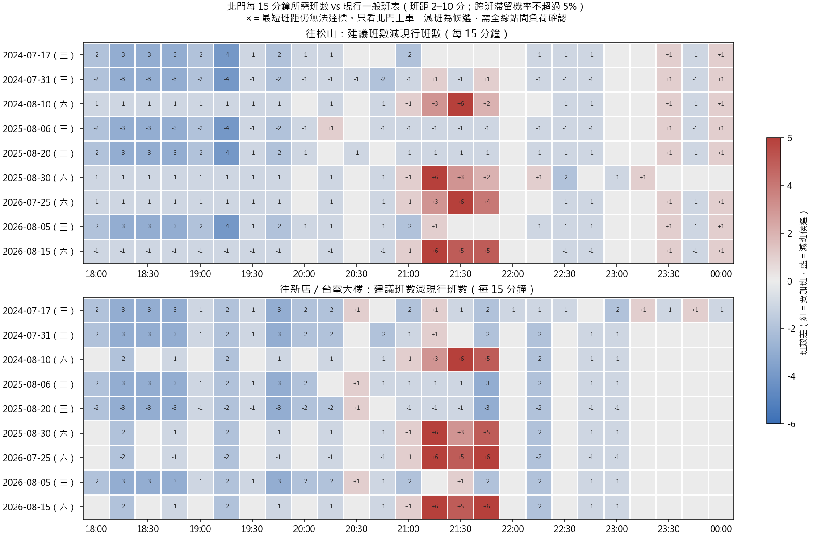

# 北門每 15 分鐘所需班數（第一版）

**只看北門上車需求，從現行一般班表出發判斷加班或減班。加班數是下限；減班是「候選」，要用全線站間負荷確認後才能採用。**

## 1. 方法

| 項目 | 設定 |
|---|---|
| 範圍 | 北門雙向，18:00–00:15，每 15 分鐘一段 |
| 決策 | 每段一個班距，候選 2–10 分鐘（上限為營運政策假設，下限為最小間隔假設） |
| 規則 | 依時間順序，每段選最長班距，使該段發車的班次「有人被留下」的情境 ≤ 5% |
| 為何能控制候車 | 沒有人被留下時，每人最多等一個班距；班距 ≤ 10 分即保證 P95 ≤ 10 分 |
| 需求 | 與候車不確定性模擬相同的情境（他場誤差、分鐘形狀、Poisson、方向、剩餘空間）；200 個情境決定班距 |
| 評估 | 另外 300 個獨立情境，比較現行班表與建議班表 |

因為以 95% 情境為準，等同用需求的高分位數規劃；這對減班特別重要（模型對尖峰平均少估約 24.7%）。

## 2. 結果

| 活動 | 方向 | 18:00–00:15 建議班數 | 現行班數 | 要加班的時段數 | 減班候選時段數 | 最短班距仍不足 |
|---|---|---:|---:|---:|---:|---:|
| 2024-07-17 | 往新店／台電大樓 | 42 | 72 | 4 | 19 | 0 |
| 2024-07-17 | 往松山 | 43 | 69 | 2 | 15 | 0 |
| 2024-07-31 | 往新店／台電大樓 | 42 | 72 | 1 | 16 | 0 |
| 2024-07-31 | 往松山 | 42 | 69 | 4 | 18 | 0 |
| 2024-08-10 | 往新店／台電大樓 | 55 | 52 | 4 | 9 | 0 |
| 2024-08-10 | 往松山 | 53 | 52 | 6 | 13 | 0 |
| 2025-08-06 | 往新店／台電大樓 | 42 | 72 | 1 | 17 | 0 |
| 2025-08-06 | 往松山 | 42 | 69 | 3 | 18 | 0 |
| 2025-08-20 | 往新店／台電大樓 | 41 | 72 | 1 | 17 | 0 |
| 2025-08-20 | 往松山 | 41 | 69 | 2 | 18 | 0 |
| 2025-08-30 | 往新店／台電大樓 | 55 | 52 | 4 | 9 | 0 |
| 2025-08-30 | 往松山 | 53 | 52 | 6 | 12 | 0 |
| 2026-07-25 | 往新店／台電大樓 | 58 | 52 | 4 | 9 | 0 |
| 2026-07-25 | 往松山 | 55 | 52 | 6 | 13 | 0 |
| 2026-08-05 | 往新店／台電大樓 | 43 | 72 | 2 | 16 | 0 |
| 2026-08-05 | 往松山 | 43 | 69 | 3 | 16 | 0 |
| 2026-08-15 | 往新店／台電大樓 | 58 | 52 | 4 | 9 | 0 |
| 2026-08-15 | 往松山 | 58 | 52 | 6 | 13 | 0 |

獨立情境評估（P95 候車超過 10 分鐘的機率）：

| 活動 | 現行：班數 | 現行：P95 中位數（95%） | 現行：超標機率 | 建議：班數 | 建議：P95 中位數（95%） | 建議：超標機率 |
|---|---:|---:|---:|---:|---:|---:|
| 2024-07-17 | 141 | 5.78（6.90） | 0.3% | 85 | 9.09（9.81） | 4.3% |
| 2024-07-31 | 141 | 5.82（8.64） | 2.7% | 84 | 9.27（14.57） | 10.0% |
| 2024-08-10 | 104 | 6.93（26.23） | 33.0% | 108 | 9.07（9.22） | 0.3% |
| 2025-08-06 | 141 | 5.80（7.26） | 2.7% | 84 | 9.26（9.38） | 2.3% |
| 2025-08-20 | 141 | 5.80（6.34） | 0.7% | 82 | 9.38（10.12） | 5.3% |
| 2025-08-30 | 104 | 7.04（34.85） | 37.3% | 108 | 9.08（9.24） | 1.7% |
| 2026-07-25 | 104 | 6.96（29.05） | 35.3% | 113 | 9.07（9.22） | 1.0% |
| 2026-08-05 | 141 | 5.87（8.12） | 2.0% | 86 | 9.18（10.19） | 6.0% |
| 2026-08-15 | 104 | 7.40（40.89） | 39.3% | 116 | 9.09（9.23） | 1.0% |

## 3. 界線

- **只看北門**：一班車服務整條線，北門車廂空不代表其他區段空。減班候選需用全線起訖資料算最大站間負荷後再決定。
- 最長班距 10 分、最短 2 分、5% 門檻、剩餘空間、分鐘形狀與方向比例都是假設；建議班表是條件解。
- 建議班表是均勻班距，沒有考慮車隊、司機、折返、出庫與號誌限制，也沒有和其他時段的班表銜接。
- 依時間順序逐段決定是啟發式；預測誤差只來自九場，且九場在開發時反覆使用。

逐段結果：[requirement.csv](requirement.csv)；摘要：[summary.csv](summary.csv)；評估：[evaluation.csv](evaluation.csv)。
